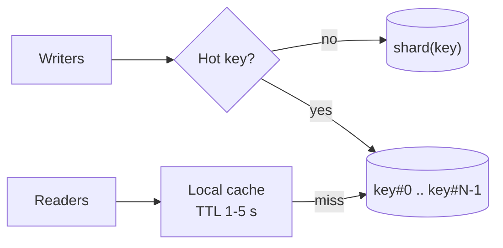
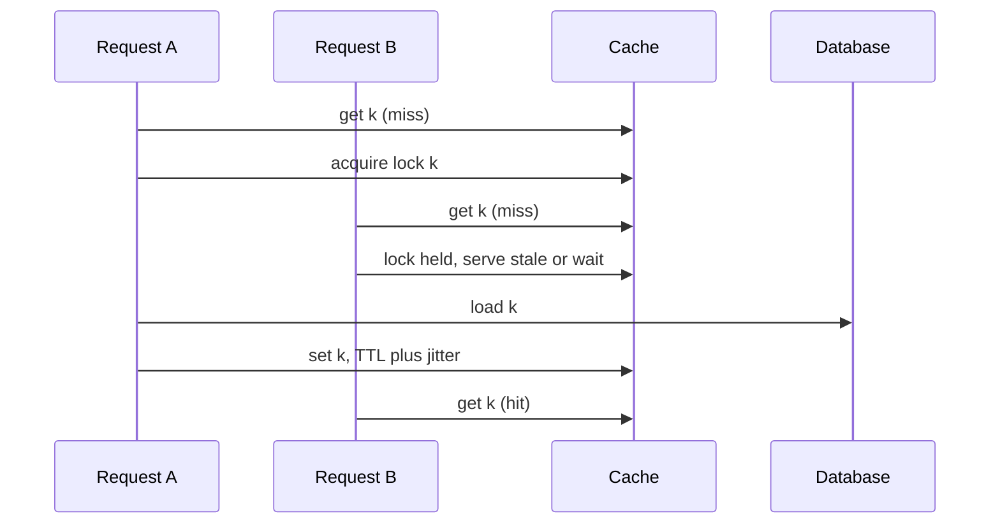
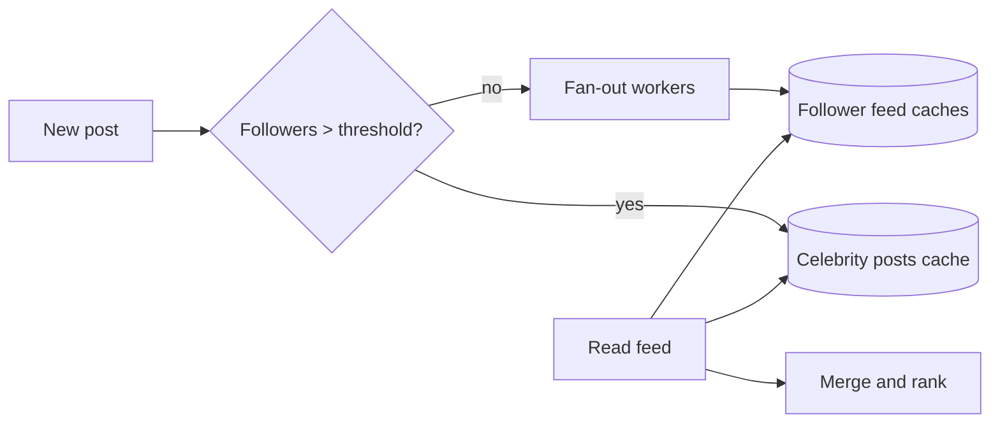
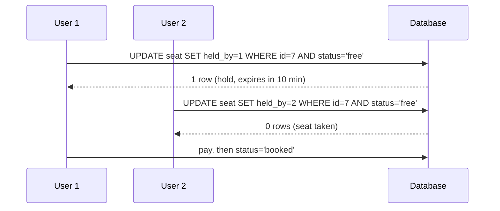
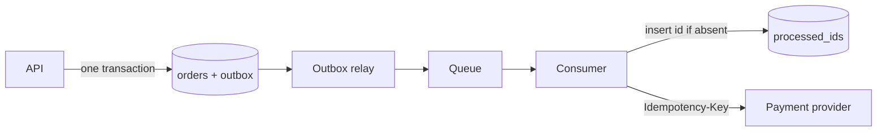
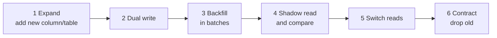
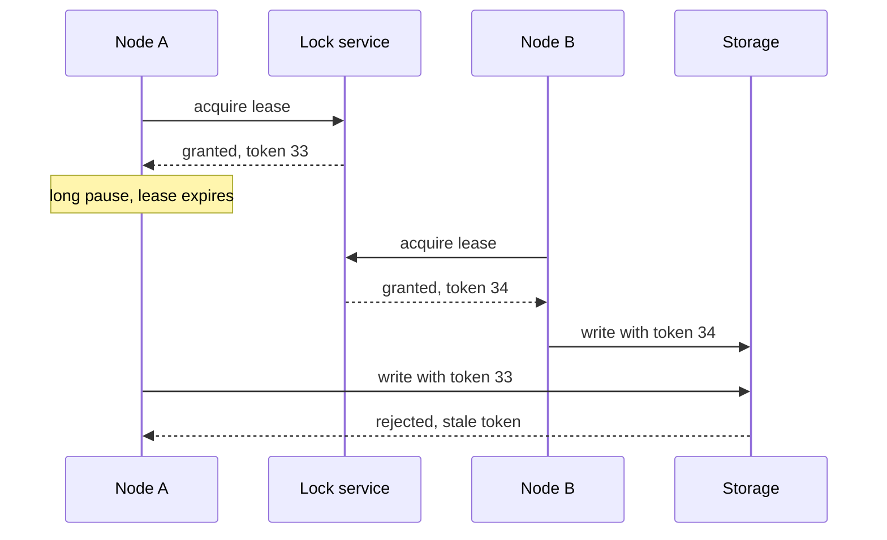

# Common deep dives

The same sixteen problems come up across most system design interviews. Each entry gives the problem, two or three options, the usual best answer and the problems in this repository where it appears. Learn the pattern once; adapt the numbers per problem.

| # | Deep dive | Usual answer in one line |
|---|---|---|
| 1 | Hot keys and partitions | Split the hot key, cache it close to readers |
| 2 | Thundering herd and stampedes | Coalesce misses, jitter TTLs and retries |
| 3 | Celebrity fan-out | Push for most users, pull for celebrities |
| 4 | Double booking and overselling | Conditional write or short hold with expiry |
| 5 | Exactly-once effects | At-least-once delivery plus idempotent handlers |
| 6 | Ordering | Order per key via partitioning, not globally |
| 7 | Pagination at scale | Cursor (keyset) pagination |
| 8 | Backpressure | Bounded queues, shed or slow producers |
| 9 | Cache invalidation | Delete on write via CDC, TTL as backstop |
| 10 | Zero-downtime migrations | Expand, migrate, contract |
| 11 | Multi-region writes | Home region per entity; conflict-free types only where needed |
| 12 | Large uploads | Presigned multipart uploads straight to object storage |
| 13 | Real-time updates to many clients | WebSocket gateways plus pub/sub routing |
| 14 | Leader election and split brain | Lease from a consensus store plus fencing tokens |
| 15 | Counting at scale | Sharded counters, pre-aggregation, sketches |
| 16 | Search index freshness | CDC into the index, accept seconds of lag |

## 1. Hot keys and partitions

**Problem.** One key (a viral post, a popular product, a celebrity's profile) receives far more traffic than its partition can serve. Consistent hashing spreads keys, not load.

**Options.**
- *Key splitting*: write to `key#0..key#N-1`, read all N and merge. Spreads writes; reads cost N.
- *Replicated hot-key cache*: detect hot keys and cache them in every app instance or on several cache replicas. Fixes reads, not writes.
- *Request coalescing at the edge*: CDN or a single-flight layer collapses identical reads.

**Usual best answer.** Detect hot keys from metrics or a count-min sketch, serve reads from a local or replicated cache with a short TTL, and split writes into N sub-keys only for keys that need it.

**Appears in:** [news-feed](../problems/news-feed.md), [distributed-cache](../problems/distributed-cache.md), [distributed-counter](../problems/distributed-counter.md), [top-k-trending](../problems/top-k-trending.md). See [consistent-hashing](../fundamentals/consistent-hashing.md), [sharding-and-partitioning](../fundamentals/sharding-and-partitioning.md), [src/count-min-sketch/](../src/count-min-sketch/).

## 2. Thundering herd and stampedes

**Problem.** A popular cache entry expires, or a dependency recovers, and thousands of requests hit the database at once. Synchronised retries do the same to a recovering service.

**Options.**
- *Request coalescing (single flight)*: only one request per key recomputes; others wait for its result.
- *Early refresh*: refresh probabilistically before expiry, or serve stale while one worker revalidates.
- *Jitter*: random TTL offsets and exponential backoff with jitter on retries.

**Usual best answer.** All three together: jittered TTLs, stale-while-revalidate with a per-key lock, and jittered backoff on clients.

**Appears in:** [distributed-cache](../problems/distributed-cache.md), [ticket-booking](../problems/ticket-booking.md), [url-shortener](../problems/url-shortener.md). See [caching-strategies](../fundamentals/caching-strategies.md), [resilience-patterns](../fundamentals/resilience-patterns.md).

## 3. Celebrity fan-out

**Problem.** Fan-out on write copies each post into every follower's feed. A user with 50 million followers turns one post into 50 million writes.

**Options.**
- *Fan-out on write (push)*: fast reads, write cost proportional to followers.
- *Fan-out on read (pull)*: cheap writes, reads must merge many timelines.
- *Hybrid*: push for normal users, pull for accounts above a follower threshold, merged at read time.

**Usual best answer.** Hybrid. Precomputed feeds for the long tail; celebrity posts fetched and merged when the feed is read, with the celebrity's recent posts cached.

**Appears in:** [news-feed](../problems/news-feed.md), [instagram](../problems/instagram.md), [notification-system](../problems/notification-system.md).

## 4. Double booking and overselling

**Problem.** Two users try to buy the last seat or the last unit of stock at the same moment. Both read "available" and both succeed.

**Options.**
- *Pessimistic lock*: `SELECT ... FOR UPDATE` on the row. Correct; serialises contention on the row.
- *Optimistic conditional write*: `UPDATE seats SET status='held', holder=? WHERE id=? AND status='free'` and check rows affected; or a version column.
- *Hold with expiry*: reserve for N minutes (a row with `expires_at` or a Redis key with TTL), confirm on payment, release on timeout.

**Usual best answer.** Conditional write to take a time-limited hold, then confirm after payment in a transaction. For flash sales, put a queue or a Redis atomic decrement in front so the database sees only the winners.

**Appears in:** [ticket-booking](../problems/ticket-booking.md), [ecommerce-platform](../problems/ecommerce-platform.md), [food-delivery](../problems/food-delivery.md). See [transactions-and-isolation](../fundamentals/transactions-and-isolation.md).

## 5. Exactly-once effects

**Problem.** Networks and retries mean messages arrive more than once. A charge or an email must still happen once.

**Options.**
- *Idempotency keys*: the client sends a key; the server stores key and result and returns the stored result on repeat.
- *Dedup by message id*: the consumer records processed ids in the same transaction as its effect.
- *Transactional processing*: Kafka transactions or Flink checkpoints with transactional sinks, for pipelines that stay inside one system.

**Usual best answer.** "Exactly-once delivery is not available end to end; we get at-least-once delivery and make the effect idempotent." Write the event with a transactional outbox, dedup on the consumer by id, and pass an idempotency key to external providers.

**Appears in:** [payment-system](../problems/payment-system.md), [webhook-delivery-system](../problems/webhook-delivery-system.md), [notification-system](../problems/notification-system.md), [subscription-billing-platform](../problems/subscription-billing-platform.md). See [delivery-semantics-and-idempotency](../fundamentals/delivery-semantics-and-idempotency.md), [transactional-outbox-and-cdc](../fundamentals/transactional-outbox-and-cdc.md), [src/idempotency-store/](../src/idempotency-store/).

## 6. Ordering

**Problem.** Events for one entity must be applied in order (messages in a chat, edits to an order), but a single global order does not scale.

**Options.**
- *Partition by entity key*: all events for a key go to one partition and one consumer at a time.
- *Sequence numbers per entity*: consumers buffer or reject out-of-order events.
- *Single sequencer*: one process assigns a global order. Simple and a bottleneck; used where global order is the product (a matching engine).

**Usual best answer.** Order per key, not globally. Partition by conversation or account id, assign a per-key sequence number on write, and have consumers apply in sequence order.

**Appears in:** [chat-system](../problems/chat-system.md), [stock-exchange](../problems/stock-exchange.md), [collaborative-editor](../problems/collaborative-editor.md), [distributed-message-queue](../problems/distributed-message-queue.md). See [message-queues-and-streams](../fundamentals/message-queues-and-streams.md), [id-generation](../fundamentals/id-generation.md), [src/vector-clock/](../src/vector-clock/).

## 7. Pagination at scale

**Problem.** `OFFSET 100000 LIMIT 20` scans and discards 100,000 rows, and results shift as new rows are inserted.

**Options.**
- *Offset pagination*: simple, fine for small tables and admin pages.
- *Keyset (cursor) pagination*: `WHERE (created_at, id) < (?, ?) ORDER BY created_at DESC, id DESC LIMIT 20`; the cursor is an opaque encoding of the last row's sort key.
- *Precomputed pages*: for feeds, store the list of ids and page through it.

**Usual best answer.** Cursor pagination on an indexed, unique sort key, with the cursor returned opaque to the client. Each page costs one index seek.

**Appears in:** [news-feed](../problems/news-feed.md), [chat-system](../problems/chat-system.md), [instagram](../problems/instagram.md). See [api-design](../fundamentals/api-design.md).

## 8. Backpressure

**Problem.** Producers outpace consumers. Unbounded queues grow until memory or latency fails.

**Options.**
- *Bounded buffers that block or reject*: producers slow down or receive 429/503.
- *Load shedding*: drop low-priority work first.
- *Durable buffer plus autoscaling*: a log absorbs bursts while consumers scale on lag.

**Usual best answer.** A durable queue absorbs bursts, consumers autoscale on lag, and the edge rate-limits and sheds low-priority traffic when lag exceeds a bound. Every queue has a maximum size and an alert.

**Appears in:** [web-crawler](../problems/web-crawler.md), [metrics-monitoring](../problems/metrics-monitoring.md), [ad-click-aggregation](../problems/ad-click-aggregation.md), [notification-system](../problems/notification-system.md). See [rate-limiting](../fundamentals/rate-limiting.md), [resilience-patterns](../fundamentals/resilience-patterns.md).

## 9. Cache invalidation

**Problem.** After a write, readers keep seeing the old value from cache.

**Options.**
- *TTL only*: bounded staleness, no coordination.
- *Delete on write*: application deletes the key after committing. A race (read old, write, delete, set old) can reinstate stale data.
- *CDC-driven invalidation*: a consumer of the database change log deletes or updates keys, in commit order.

**Usual best answer.** Delete (not update) on write, driven by CDC so no write path forgets, with a TTL as a backstop. Use versioned values when the race matters.

**Appears in:** [distributed-cache](../problems/distributed-cache.md), [ecommerce-platform](../problems/ecommerce-platform.md), [url-shortener](../problems/url-shortener.md). See [caching-strategies](../fundamentals/caching-strategies.md), [transactional-outbox-and-cdc](../fundamentals/transactional-outbox-and-cdc.md).

## 10. Zero-downtime schema and data migrations

**Problem.** Rename a column, split a table or move to a new store without stopping writes.

**Options.**
- *Expand and contract*: add the new shape, write both, backfill, switch reads, stop writing the old, drop it.
- *CDC-based migration*: stream changes from old to new store, backfill a snapshot, compare, cut over.
- *Big-bang with maintenance window*: only when downtime is acceptable.

**Usual best answer.** Expand, migrate, contract. Each step is deployable and reversible on its own; verify with shadow reads that compare old and new before switching.

**Appears in:** [payment-system](../problems/payment-system.md), [subscription-billing-platform](../problems/subscription-billing-platform.md). See [transactional-outbox-and-cdc](../fundamentals/transactional-outbox-and-cdc.md).

## 11. Multi-region writes

**Problem.** Users in several regions want low-latency writes, and the system must survive a region loss.

**Options.**
- *Single primary region*: writes go to one region; others read replicas. Simple; remote writes pay cross-region latency.
- *Home region per entity*: each user or tenant is owned by one region; writes go there. No conflicts; failover moves ownership.
- *Multi-leader with conflict resolution*: last-writer-wins, CRDTs or application merges. Low latency everywhere; conflicts are the cost.

**Usual best answer.** Home region per entity, with asynchronous replication to others for reads and failover. Use multi-leader only for data with a safe merge (counters, sets, presence), or a globally consistent database when the requirement demands it.

**Appears in:** [chat-system](../problems/chat-system.md), [payment-system](../problems/payment-system.md), [key-value-store](../problems/key-value-store.md). See [multi-region-and-disaster-recovery](../fundamentals/multi-region-and-disaster-recovery.md), [replication](../fundamentals/replication.md), [cap-and-pacelc](../fundamentals/cap-and-pacelc.md).

## 12. Large uploads

**Problem.** Multi-gigabyte files over unreliable mobile networks; proxying bytes through app servers wastes capacity.

**Options.**
- *Upload through the service*: simple; servers carry the bytes.
- *Presigned URL to object storage*: the client uploads directly; the service only issues the URL and records metadata.
- *Chunked, resumable multipart upload*: fixed-size parts, each retried independently, content hashes for dedup.

**Usual best answer.** Presigned multipart upload straight to object storage, resumable by part, with a completion callback or event that triggers processing (thumbnails, transcoding).

**Appears in:** [file-storage-sync](../problems/file-storage-sync.md), [video-streaming](../problems/video-streaming.md), [instagram](../problems/instagram.md), [object-storage](../problems/object-storage.md). See [cdn-and-blob-storage](../fundamentals/cdn-and-blob-storage.md).

## 13. Real-time updates to many clients

**Problem.** Push messages, locations or prices to millions of connected clients with low latency.

**Options.**
- *Polling / long polling*: simple, wasteful at scale.
- *Server-sent events*: one-way server to client over HTTP.
- *WebSockets*: bidirectional; needs stateful gateways and a way to route a message to the gateway holding the user's connection.

**Usual best answer.** WebSocket (or SSE for one-way) gateways that hold connections, a connection registry mapping user to gateway, and pub/sub between backend and gateways. Clients reconnect with the last seen sequence number to catch up.

**Appears in:** [chat-system](../problems/chat-system.md), [ride-hailing](../problems/ride-hailing.md), [collaborative-editor](../problems/collaborative-editor.md), [food-delivery](../problems/food-delivery.md), [stock-exchange](../problems/stock-exchange.md). See [realtime-communication](../fundamentals/realtime-communication.md).

## 14. Leader election and split brain

**Problem.** Exactly one node should run the scheduler or own a shard. During a network partition or a long GC pause, two nodes believe they are leader.

**Options.**
- *Lease in a consensus store*: etcd, ZooKeeper or Consul grant a lease with a TTL; the holder renews it.
- *Consensus inside the system*: Raft among the replicas themselves.
- *Database row lock or advisory lock*: fine when the database is already the single source of truth.

**Usual best answer.** A lease from a consensus store plus a fencing token (a number that increases with each new lease) that downstream storage checks and rejects when stale.

**Appears in:** [distributed-job-scheduler](../problems/distributed-job-scheduler.md), [distributed-message-queue](../problems/distributed-message-queue.md), [key-value-store](../problems/key-value-store.md). See [consensus-and-coordination](../fundamentals/consensus-and-coordination.md), [src/lease-lock/](../src/lease-lock/).

## 15. Counting at scale

**Problem.** Likes, views and clicks at hundreds of thousands per second on a few keys; unique visitor counts over billions of ids.

**Options.**
- *Sharded counters*: N sub-counters per key, summed on read.
- *Pre-aggregation*: buffer increments in memory or a stream processor and flush per window.
- *Probabilistic sketches*: HyperLogLog for distinct counts, count-min sketch for heavy hitters, with bounded error.

**Usual best answer.** Stream processor aggregates per key per window and writes totals; sharded counters for the few hot keys; sketches when exact distinct counts are not required. Reconcile with a batch job when billing depends on the number.

**Appears in:** [distributed-counter](../problems/distributed-counter.md), [ad-click-aggregation](../problems/ad-click-aggregation.md), [top-k-trending](../problems/top-k-trending.md), [leaderboard](../problems/leaderboard.md). See [bloom-filters-and-probabilistic](../fundamentals/bloom-filters-and-probabilistic.md), [src/hyperloglog/](../src/hyperloglog/), [src/count-min-sketch/](../src/count-min-sketch/).

## 16. Search index freshness

**Problem.** A product is updated in the database but search still shows the old price or the deleted item.

**Options.**
- *Dual write from the application*: write the database, then the index. Fails silently when the second write fails.
- *CDC into the index*: a connector reads the database log and updates the index in commit order.
- *Periodic rebuild*: rebuild the index from a snapshot; simple, stale by the rebuild interval.

**Usual best answer.** CDC into the index for incremental updates (seconds of lag), plus a periodic full rebuild into a new index and alias swap to repair drift. Re-check critical fields (price, stock) against the database on the detail page.

**Appears in:** [ecommerce-platform](../problems/ecommerce-platform.md), [search-autocomplete](../problems/search-autocomplete.md), [proximity-service](../problems/proximity-service.md). See [search-and-indexing](../fundamentals/search-and-indexing.md), [transactional-outbox-and-cdc](../fundamentals/transactional-outbox-and-cdc.md), [src/inverted-index/](../src/inverted-index/).

## How to run any deep dive

1. Name the problem in one sentence and the requirement it threatens.
2. Give two or three options with one trade-off each.
3. Pick one and say why, tied to a requirement or a number from your estimate.
4. Name how it fails and what you would monitor.
