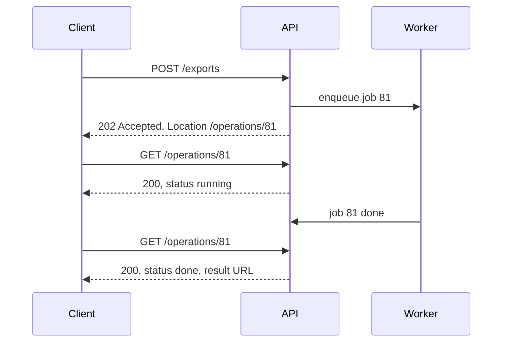

# API design

**In one line:** model resources and the operations on them so that clients can retry safely, page through large collections, detect conflicting edits and keep working as the API evolves.

## Why it matters in interviews

Most interviews include a step where you sketch the API. It shows whether you think about clients: what is safe to retry, how they page through a million rows, how errors look, how they learn that a long job finished. A few well-chosen endpoints with correct methods, cursor pagination and an idempotency key on the money-moving POST say more than a long list of routes.

## How it works

### Resource modelling

Name collections with plural nouns and identify items by ID: `/users/42/orders/7`. Use sub-resources for ownership, but keep nesting shallow; `/orders/7` is fine once the ID is globally unique. Actions that do not map to CRUD can be modelled as a resource that records the action (`POST /orders/7/cancellations`) or as a sub-path verb (`POST /orders/7:cancel`, the Google API style). Pick one convention and keep it.

### Methods, safety and idempotency

| Method | Use | Safe | Idempotent |
|---|---|---|---|
| GET | Read | Yes | Yes |
| HEAD | Read headers only | Yes | Yes |
| PUT | Replace (or create at a known URI) | No | Yes |
| DELETE | Remove | No | Yes |
| POST | Create in a collection, or run an action | No | No |
| PATCH | Partial update | No | Not guaranteed |

Safe means no intended side effects. Idempotent means repeating the request leaves the same state as doing it once (the response may differ: a second DELETE can return 404). Clients, proxies and SDKs may retry idempotent requests automatically; POST needs an **idempotency key** (`Idempotency-Key` header) to be safe to retry. See [delivery semantics and idempotency](./delivery-semantics-and-idempotency.md).

### Status codes worth knowing

| Code | Meaning |
|---|---|
| 200, 201, 204 | OK; created (with `Location`); no content |
| 202 | Accepted for asynchronous processing |
| 304 | Not modified (conditional GET) |
| 400, 422 | Malformed request; well-formed but semantically invalid |
| 401, 403 | Not authenticated; authenticated but not allowed |
| 404, 409 | Not found; conflicts with current state |
| 412 | Precondition failed (`If-Match` did not match) |
| 429 | Rate limited, with `Retry-After` |
| 500, 502, 503, 504 | Server error; bad gateway; unavailable; gateway timeout |

Errors should be machine-readable. **RFC 9457 Problem Details** (which obsoletes RFC 7807) defines `application/problem+json` with `type` (a URI identifying the error kind), `title`, `status`, `detail` and `instance`, plus any extension fields such as a list of invalid parameters.

### Pagination

**Offset**: `GET /orders?limit=50&offset=10000`. Easy, supports jumping to page N. At scale it breaks in two ways: the database still reads and discards the first 10,000 rows, so deep pages get slower; and inserts or deletes between requests shift rows, so clients skip or repeat items.

**Cursor (keyset)**: return an opaque `next_cursor` that encodes the last row's sort key, for example `(created_at, id)`. The next query is `WHERE (created_at, id) < (:t, :id) ORDER BY created_at DESC, id DESC LIMIT 50`, which uses an index and costs the same on page 1 and page 10,000. Rows inserted meanwhile do not shift the window. You lose "jump to page N" and an exact total count, which most feeds and lists do not need. Include a unique tiebreaker (the ID) in the sort key, or rows with equal timestamps are skipped.

### Filtering, sorting and field selection

Use query parameters: `?status=shipped&created_after=2026-01-01&sort=-created_at&fields=id,total`. Allow-list the filterable and sortable fields so every combination is backed by an index; arbitrary sort on unindexed columns is a denial-of-service risk.

### Versioning

Prefer additive, backward-compatible changes: new optional fields, new endpoints. Clients must ignore unknown fields. For breaking changes, version in the path (`/v2/orders`), a header, or a date-based version pinned per account (Stripe's approach). Path versioning is easiest to route and cache. Publish a deprecation schedule and keep old versions running until traffic drops.

### Optimistic concurrency with ETags

`GET /docs/9` returns `ETag: "v17"`. The client sends `PUT /docs/9` with `If-Match: "v17"`. If someone else updated the document meanwhile, the ETag differs and the server returns **412 Precondition Failed**; the client re-reads and merges. This prevents lost updates without locks. `If-None-Match` on GET gives cheap 304 responses for caching.

### Long-running operations

Return **202 Accepted** with a status resource. The client polls it (honouring a `Retry-After` hint), or registers a webhook to be told when it finishes.

### Webhooks

- **Sign** each payload with HMAC-SHA256 over the timestamp and body using a per-endpoint secret; receivers verify the signature and reject old timestamps to stop replays.
- **Retry** failures with exponential backoff over hours to days, then disable the endpoint and alert its owner.
- Deliveries are at-least-once and may arrive out of order: include an event ID for dedup, and a version or timestamp so receivers ignore stale updates.
- Receivers should respond 2xx quickly and process asynchronously.

### REST, gRPC and GraphQL

| Option | Pros | Cons | Use when |
|---|---|---|---|
| REST + JSON | Universal, cacheable with HTTP semantics, easy to debug | Over- or under-fetching; no enforced schema unless you add OpenAPI | Public APIs, CRUD, browsers |
| gRPC + Protobuf | Compact, typed contracts, code generation, streaming over HTTP/2 | Browsers need gRPC-Web or a proxy; harder to inspect | Internal service-to-service calls |
| GraphQL | Client picks fields; one round trip for nested data | Caching is harder; expensive queries need depth and cost limits; N+1 resolvers | Many client types with different data needs |
| Offset pagination | Page numbers, totals | Slow deep pages; skips and repeats | Small admin tables |
| Cursor pagination | Constant cost, stable under writes | No random access | Feeds, large lists, public APIs |

## Where you see it

- Stripe: idempotency keys, cursor pagination (`starting_after`), dated API versions, signed webhooks.
- Google API design guide: resource-oriented design, custom methods with `:verb`, long-running operations resources.
- GitHub: REST and GraphQL APIs side by side, ETag-based conditional requests.

## Common mistakes

- Using GET for actions with side effects, which crawlers and prefetchers will trigger.
- Offset pagination on a table with millions of rows.
- Cursor sorted only by timestamp, without a unique tiebreaker.
- Returning 200 with `{"error": ...}` in the body.
- Breaking changes without a new version, such as renaming a field.
- Synchronous endpoints for work that takes minutes, so clients and load balancers time out.
- Unsigned webhooks, or receivers that are not idempotent.

## Interview questions

**Q: Why is offset pagination a problem for a feed?**
Deep offsets scan and discard rows, so they get slower, and new posts shift positions so users see duplicates or miss items. Cursor pagination on `(created_at, id)` fixes both.

**Q: How do you make "create payment" safe to retry?**
Require an `Idempotency-Key` header. The server stores the key with a request fingerprint and the response, and replays the stored response for repeats.

**Q: Two users edit the same record. How do you avoid lost updates?**
Return an ETag (or version) on read and require `If-Match` on write. A stale write gets 412 and the client re-reads.

**Q: Report generation takes five minutes. What does the API look like?**
`POST /reports` returns 202 with a link to `/operations/{id}`. The client polls it or receives a webhook when the result is ready.

**Q: REST or gRPC between internal services?**
gRPC for typed contracts, efficient encoding and streaming; REST if teams value simplicity and HTTP tooling, or if callers include browsers.

## Related

- Fundamentals: [delivery semantics and idempotency](./delivery-semantics-and-idempotency.md), [rate limiting](./rate-limiting.md), [realtime communication](./realtime-communication.md), [security basics](./security-basics.md), [caching strategies](./caching-strategies.md), [microservices and boundaries](./microservices-and-boundaries.md).
- Problems: [URL shortener](../problems/url-shortener.md), [payment system](../problems/payment-system.md), [webhook delivery system](../problems/webhook-delivery-system.md), [news feed](../problems/news-feed.md).
- Code: [`src/idempotency-store`](../src/idempotency-store/).
