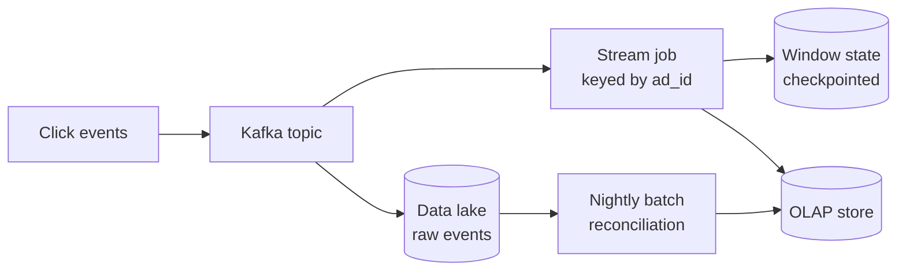

# Batch and stream processing

**In one line:** batch jobs compute over a bounded dataset after the fact, stream jobs compute continuously over unbounded events as they arrive; the hard parts of streaming are time, late data and keeping state correct across failures.

## Why it matters in interviews

Ad click counting, trending topics, metrics, fraud detection, billing and recommendations all aggregate large event volumes. Interviewers want to know whether you need answers in seconds or by tomorrow, how you count events that arrive late or twice, and where results are stored for queries. Naming Flink is not enough; you should be able to explain windows, watermarks and how a checkpoint plus an idempotent sink gives exactly-once results.

## How it works

### Batch

A batch job reads a bounded input (yesterday's logs in object storage), computes, and writes output. **MapReduce** splits work into a map phase that emits key-value pairs, a shuffle that groups by key across machines, and a reduce phase per key, writing intermediate results to disk. **Apache Spark** keeps intermediate data in memory where possible, expresses jobs as a graph of transformations, and recovers lost partitions by recomputing them from lineage. Batch is simple to reason about: rerun the job and you get the same answer. The cost is latency (hours) and reprocessing the whole window to fix one bug.

### Stream

A stream job runs forever over an unbounded input (a Kafka topic) and emits results continuously.

- **Apache Flink**: a streaming engine with event-time windows, large keyed state in RocksDB, and checkpoint-based exactly-once state.
- **Kafka Streams**: a library embedded in your service; reads and writes Kafka topics, with state in local stores backed by changelog topics.
- **Spark Structured Streaming**: the Spark DataFrame API over streams, processed as micro-batches by default.

### Lambda vs kappa

**Lambda architecture** runs a batch layer (complete, accurate, slow) and a speed layer (fast, approximate) side by side and merges their results at query time. You get fast answers corrected later, but maintain the same logic twice.

**Kappa architecture** uses only the stream path. To reprocess, replay the retained log through a new version of the job and switch readers over when it catches up. One codebase, but requires long log retention and a stream engine you trust for correctness.

Many real systems are a mix: a stream path for dashboards and a nightly batch job over raw data for billing-grade numbers.

### Windows

| Window | Shape | Example |
|---|---|---|
| Tumbling | Fixed size, no overlap | Clicks per ad per minute |
| Sliding (hopping) | Fixed size, advancing by a smaller step, so windows overlap | Clicks in the last 10 minutes, updated every minute |
| Session | Bursts of activity separated by a gap of inactivity; size varies per key | A user's browsing session ending after 30 minutes idle |

### Event time vs processing time

**Event time** is when the event happened (a timestamp set on the device). **Processing time** is when the job sees it. They differ because of network delays, offline phones, retries and backfills. Windowing by processing time is easy but wrong for anything that must match reality: a phone that reconnects after an hour lands its clicks in the wrong minute.

### Watermarks and late data

A **watermark** is the job's assertion that "no more events with event time before T are expected". It usually trails the highest seen event time by a fixed allowed delay. When the watermark passes the end of a window, the window fires and emits its result.

Events that arrive after the watermark are **late**. Options: drop them (and count how many), update the already-emitted result within an **allowed lateness** period (sinks must accept upserts), or send them to a side output for a batch correction. A longer delay means more complete results but higher latency and more state held in memory.

### Exactly-once state

Flink periodically takes a **checkpoint**: a consistent snapshot of all operator state together with the input offsets, using barriers that flow through the job graph (an adaptation of the Chandy-Lamport snapshot algorithm). On failure, every operator restores from the last checkpoint and the sources rewind to the stored offsets. Internal state is then exactly-once.

Output is a separate problem, because records emitted after the last checkpoint will be emitted again on recovery. Two fixes:

- **Idempotent sink**: upsert by a deterministic key (`ad_id, window_start`), so a replayed result overwrites itself.
- **Transactional sink**: write output in a transaction committed only when the checkpoint completes (Flink's two-phase-commit sink, used with Kafka transactions).

### Where results go: OLAP stores

| Store | Notes |
|---|---|
| ClickHouse | Columnar, very fast scans and aggregations, self-hosted or managed |
| Apache Druid | Real-time ingestion from Kafka, time-partitioned segments, low-latency slice and dice |
| Apache Pinot | Real-time ingestion, built at LinkedIn for user-facing analytics at high query rates |
| BigQuery | Serverless warehouse, pay per scanned data, good for ad hoc and batch analysis |

### Lake vs warehouse

A **data lake** stores raw files (Parquet, ORC, JSON) in object storage, cheap and schema-on-read. A **warehouse** (BigQuery, Snowflake, Redshift) stores curated tables with schema-on-write, fast SQL and governance. **Lakehouse** table formats (Apache Iceberg, Delta Lake, Apache Hudi) add transactions, schema evolution and time travel to files in a lake. A common shape: raw events land in the lake, batch jobs build curated warehouse tables, and stream jobs feed an OLAP store for fresh dashboards.

## Variants / options

| Option | Pros | Cons | Use when |
|---|---|---|---|
| Batch (Spark, SQL in a warehouse) | Simple, reproducible, cheap per event | Hours of latency | Reports, billing, training data, backfills |
| Stream (Flink) | Seconds of latency, event time, large state | Operational complexity | Real-time aggregation, fraud, alerting |
| Kafka Streams | Library, no separate cluster | Kafka in and out only | Service-local stream logic on Kafka |
| Spark Structured Streaming | Same API as batch | Micro-batch latency by default | Teams already on Spark |
| Lambda | Fast and eventually exact | Two codebases | Stream engine cannot be trusted for exact numbers |
| Kappa | One codebase, replay to reprocess | Long retention; replay time | Stream engine is the system of record for logic |

## Where you see it

- Hadoop MapReduce and Spark for large batch ETL.
- Flink used for real-time analytics and fraud detection at many large companies, often reading from Kafka.
- Druid and Pinot behind user-facing analytics dashboards.
- Iceberg and Delta Lake tables queried by Spark, Trino and warehouse engines.

## Common mistakes

- Windowing by processing time and producing wrong counts whenever there is lag or a replay.
- No plan for late events, so they are silently dropped.
- Claiming exactly-once while writing to a non-idempotent sink with plain inserts.
- Keying by a low-cardinality field, so one task holds all the state and becomes the bottleneck.
- Building a stream pipeline when a nightly batch would meet the requirement.
- Querying raw events for every dashboard request instead of pre-aggregating.

## Interview questions

**Q: Count clicks per ad per minute, with results within seconds. How?**
Kafka topic keyed by ad ID, Flink job with one-minute tumbling event-time windows and a watermark allowing some delay, upsert results by `(ad_id, minute)` into an OLAP store. Keep raw events in the lake for a nightly reconciliation.

**Q: What is a watermark?**
The job's estimate that all events up to time T have arrived. Windows ending before T can fire. It trades completeness for latency.

**Q: A phone sends clicks an hour late. What happens?**
They are behind the watermark. Either update the old window within an allowed lateness, route them to a side output for batch correction, or drop and count them. Billing-grade numbers come from the batch path.

**Q: How does Flink give exactly-once results?**
Checkpoints snapshot state and source offsets consistently; on failure everything rewinds to the checkpoint. Output is exactly-once only if the sink is idempotent or commits transactionally with the checkpoint.

**Q: Lambda or kappa?**
Kappa if the stream engine can produce correct results and you retain enough log to replay. Lambda, or a stream path plus batch reconciliation, when exact numbers matter more than maintaining one codebase.

## Related

- Fundamentals: [message queues and streams](./message-queues-and-streams.md), [delivery semantics and idempotency](./delivery-semantics-and-idempotency.md), [event-driven architecture](./event-driven-architecture.md), [choosing a database](./choosing-a-database.md), [storage engines](./storage-engines.md), [bloom filters and probabilistic structures](./bloom-filters-and-probabilistic.md).
- Problems: [ad click aggregation](../problems/ad-click-aggregation.md), [top-k trending](../problems/top-k-trending.md), [metrics monitoring](../problems/metrics-monitoring.md), [web crawler](../problems/web-crawler.md).
- Code: [`src/count-min-sketch`](../src/count-min-sketch/), [`src/hyperloglog`](../src/hyperloglog/).
