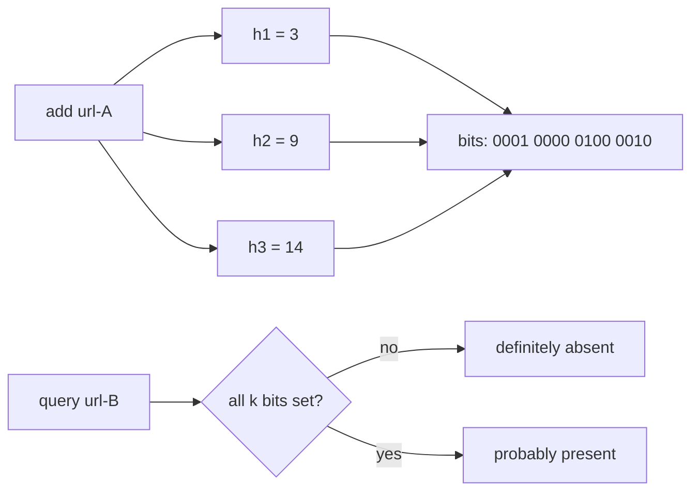

# Bloom filters and probabilistic data structures

**In one line:** trade a small, bounded error for huge memory savings: a Bloom filter answers "definitely not present" or "probably present", a Count-Min Sketch estimates frequencies, and HyperLogLog counts distinct items in a few kilobytes.

## Why it matters in interviews

These structures show up whenever exact answers would need too much memory: "has this crawler seen this URL?", "how many unique visitors today?", "which hashtags are trending?". Interviewers want you to know what error each structure makes (and which it never makes), how to size it, and where real systems use it. Getting the error direction right is the main test: a Bloom filter never has false negatives; a Count-Min Sketch never underestimates.

## How it works

### Bloom filter

A bit array of m bits, all zero, and k independent hash functions.

- **Add x:** set the k bits at positions `h1(x) .. hk(x)`.
- **Query x:** if any of the k bits is 0, x was never added. If all are 1, x was probably added, or other items happened to set those bits.



**Maths.** After inserting n items, the false-positive probability is approximately

`p ≈ (1 - e^(-k n / m))^k`

It is minimised at `k = (m / n) ln 2`, which gives `m = -n ln p / (ln 2)^2`, about 1.44 log2(1/p) bits per item.

| Target false-positive rate | Bits per item (m/n) | Hash functions (k) | Memory for 1 billion items |
|---|---|---|---|
| 1 % | about 9.6 | 7 | about 1.2 GB |
| 0.1 % | about 14.4 | 10 | about 1.8 GB |
| 0.01 % | about 19.2 | 13 | about 2.4 GB |

A set of 1 billion URLs at 100 bytes each is about 100 GB; the 1 % filter is 1.2 GB and fits in memory on one machine. In practice, two base hashes combined as `h1 + i * h2` give k usable hashes cheaply.

Limits: you cannot delete (clearing a bit may remove other items) and you cannot list members. If n grows past the design size, p rises quickly; scalable Bloom filters add new, larger filters as they fill.

See [`src/bloom-filter`](../src/bloom-filter/).

### Counting Bloom filter

Replace each bit with a small counter (commonly 4 bits). Add increments, delete decrements, query checks for non-zero. Supports deletion at about four times the memory.

### Cuckoo filter

Stores a short fingerprint of each item in a cuckoo hash table where each item has two candidate buckets. Supports deletion, and at low false-positive rates (below a few percent) uses less space than a Bloom filter. Inserts can fail when the table is nearly full.

### Count-Min Sketch

A grid of d rows by w counters, with one hash function per row.

- **Increment x by c:** in each row, add c to counter `row[i][hi(x)]`.
- **Estimate x:** take the minimum of its d counters.

Collisions only add to counters, so for non-negative increments the estimate **never underestimates**. With `w = ceil(e / ε)` and `d = ceil(ln(1 / δ))`, the estimate is at most the true count plus ε times the total of all counts, with probability at least 1 - δ.

Example: ε = 0.001, δ = 0.01 gives w = 2,719 and d = 5, about 13,600 counters (about 54 KB with 32-bit counters), regardless of how many distinct items there are. Errors are relative to the total, so the sketch is accurate for heavy hitters and noisy for rare items. "Conservative update" (only raise the counters that equal the current minimum) reduces overestimation. See [`src/count-min-sketch`](../src/count-min-sketch/).

### HyperLogLog

Counts distinct elements. Hash each item; use the first p bits to choose one of 2^p registers, and store in that register the maximum position of the first 1-bit seen in the remaining bits. Long runs of leading zeros are rare, so the maximum indicates how many distinct hashes went into that register. A bias-corrected harmonic mean across registers gives the estimate. Standard error is about `1.04 / sqrt(number of registers)`.

Redis uses 16,384 registers of 6 bits: **12 KB per key and about 0.81 % standard error**, for counts into the billions. Small sets use a sparse encoding that takes less memory.

```text
PFADD visitors:2026-11-07 user:1 user:2 user:3
PFCOUNT visitors:2026-11-07                 -> about 3
PFMERGE visitors:week visitors:2026-11-01 visitors:2026-11-02 ...
```

HyperLogLogs merge by taking the register-wise maximum, so daily counts union into weekly ones without double counting users. They cannot be subtracted or intersected accurately. See [`src/hyperloglog`](../src/hyperloglog/).

### Top-k heavy hitters

To find the k most frequent items in a stream:

- **Count-Min Sketch plus a min-heap of size k:** after each increment, estimate the item's count and update the heap if it beats the smallest.
- **Space-Saving or Misra-Gries:** keep a fixed number of counters; when a new item arrives and all counters are taken, replace the smallest. Counts have a bounded overestimate.

For trending topics, run this per time window (for example per minute) and merge windows. Exact counts can be computed later in a batch job if needed ([batch and stream processing](./batch-and-stream-processing.md)).

## Variants / options

| Option | Answers | Error | Memory | Pros | Cons | Use when |
|---|---|---|---|---|---|---|
| Hash set | Exact membership | None | Grows with items | Exact, deletable | Large | Small sets |
| Bloom filter | Membership | False positives only | About 10 bits per item at 1 % | Tiny, fast | No delete, no listing | Skip disk reads, dedup |
| Counting Bloom filter | Membership with delete | False positives | About 4 times a Bloom filter | Deletes | Memory | Sets with removals |
| Cuckoo filter | Membership with delete | False positives | Less than Bloom at low error rates | Deletes, compact | Inserts can fail near full | Low error rates with deletes |
| Count-Min Sketch | Frequency | Overestimates only | Fixed by ε and δ | Constant memory | Noisy for rare items | Heavy hitters, rate counts |
| HyperLogLog | Distinct count | About 0.81 % in Redis | 12 KB per key in Redis | Mergeable | No membership, no intersection | Unique visitors, cardinality |
| Space-Saving | Top-k | Bounded overestimate | k counters | Direct top-k | Approximate tail | Trending items |

## Where you see it

- **Cassandra and RocksDB**: a Bloom filter per SSTable skips files that cannot hold the key; Cassandra tunes it per table with `bloom_filter_fp_chance`, RocksDB with bits per key ([storage engines](./storage-engines.md)).
- **Web crawlers**: a Bloom filter of seen URLs before checking the exact store.
- **Unique visitor counts**: Redis `PFADD` and `PFCOUNT`; HyperLogLog-based approximate distinct functions in analytics databases.
- **Cache penetration**: a Bloom filter of valid ids in front of a cache ([caching strategies](./caching-strategies.md)).
- **RedisBloom module**: Bloom, cuckoo, Count-Min Sketch and top-k commands in Redis.

## Common mistakes

- Saying a Bloom filter has false negatives, or that a Count-Min Sketch underestimates.
- Sizing a Bloom filter without stating n and the target p.
- Trying to delete from a plain Bloom filter.
- Using a sketch where exact answers are required (billing, balances). Use it for analytics and for skipping work.
- Intersecting HyperLogLogs and trusting the result.

## Interview questions

**Q: How big a Bloom filter for 100 million URLs at a 1 % false-positive rate?**
About 9.6 bits per item: roughly 960 million bits, 120 MB, with 7 hash functions.

**Q: What does a false positive cost a crawler?**
It skips a URL it has never fetched. That is acceptable for a crawler; a false negative (refetching) would only waste work. If missing pages matters, recheck positives against the exact store.

**Q: Why does a Count-Min Sketch never underestimate?**
Every increment adds to each of the item's counters; collisions only add other items' counts. The minimum across rows is therefore at least the true count.

**Q: How do you count unique daily visitors across 50 servers?**
Each server keeps a HyperLogLog per day, or all write to Redis with `PFADD`. Merge with `PFMERGE` for totals and weekly unions. 12 KB per counter, about 0.81 % error.

**Q: How would you find the top 10 hashtags per minute?**
Count per minute window with a Count-Min Sketch plus a heap of size 10, or Space-Saving counters, partitioned by hashtag across workers, then merge each worker's candidates into a global top 10.

## Related

- Fundamentals: [storage engines](./storage-engines.md), [caching strategies](./caching-strategies.md), [batch and stream processing](./batch-and-stream-processing.md), [search and indexing](./search-and-indexing.md).
- Problems: [web crawler](../problems/web-crawler.md), [top-k trending](../problems/top-k-trending.md), [ad click aggregation](../problems/ad-click-aggregation.md), [distributed counter](../problems/distributed-counter.md), [key-value store](../problems/key-value-store.md).
- Code: [`src/bloom-filter`](../src/bloom-filter/), [`src/count-min-sketch`](../src/count-min-sketch/), [`src/hyperloglog`](../src/hyperloglog/).
