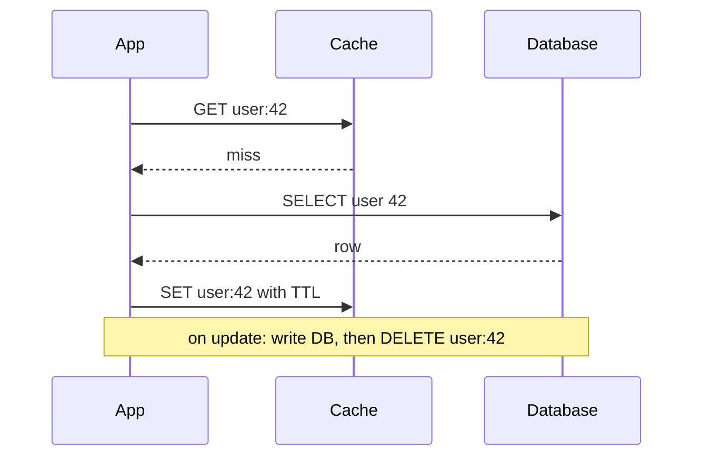

# Caching strategies

**In one line:** keep copies of hot data closer to the reader so most requests skip the slow path, and decide up front how the copy is filled, how it is kept fresh, and what happens when many requests miss at once.

## Why it matters in interviews

Almost every read-heavy design adds "a Redis cache". The interviewer then probes the hard parts: which pattern fills it, how stale data is avoided after a write, what happens when a popular key expires under load, how hot keys are handled, and how big the cache must be. Saying "cache-aside with TTL" is the start of the answer, not the end.

## How it works

### Where to cache

| Layer | Example | Good for | Invalidation |
|---|---|---|---|
| Client | Browser cache, mobile app storage | Static assets, user's own data | `Cache-Control`, ETags |
| CDN | CloudFront, Fastly, Akamai | Images, video, public pages, API responses that are the same for many users | TTL, purge API, versioned URLs |
| API gateway or reverse proxy | nginx, Varnish | Whole responses for anonymous traffic | TTL |
| Application in-process | Local LRU map | Config, very hot small objects | TTL; each instance holds its own copy |
| Distributed cache | Redis, Memcached | Shared objects, sessions, computed results | Explicit delete, TTL |
| Database buffer pool | Postgres shared buffers, InnoDB buffer pool | Hot pages | Managed by the database |

Each layer that hits saves every layer behind it. Each layer is also another place where data can be stale.

### Patterns

| Pattern | Read path | Write path | Pros | Cons |
|---|---|---|---|---|
| Cache-aside (lazy loading) | App reads cache; on miss reads DB and fills cache | App writes DB, then deletes the key | Simple; cache holds only requested data; cache failure is not fatal | First read is slow; race window (below) |
| Read-through | Cache library loads from DB on miss | As cache-aside | Loading logic in one place | Needs a cache layer that knows the DB |
| Write-through | As read-through | Write goes to cache and DB synchronously | Cache always fresh for written keys | Write latency; caches data that may never be read |
| Write-behind (write-back) | From cache | Write to cache; flush to DB asynchronously, often batched | Very fast writes; absorbs bursts | Data loss if cache dies before flush; ordering and complexity |
| Write-around | Cache-aside reads | Write to DB only; no cache fill | Avoids filling cache with write-once data | Next read after write misses |
| Refresh-ahead | From cache | Refresh popular keys in background before expiry | No miss latency for hot keys | Wasted refreshes for keys that go cold |

Cache-aside with delete-on-write is the default answer for most systems.

### Eviction

| Policy | Evicts | Good for | Weakness |
|---|---|---|---|
| LRU | Least recently used | Recency-driven workloads | A one-off scan flushes hot data |
| LFU | Least frequently used | Stable popularity | Slow to forget formerly hot keys (implementations add decay) |
| TTL | Anything past its expiry | Bounding staleness | Not a memory policy on its own |
| FIFO or random | Oldest or random | Simplicity | Ignores access pattern |

Redis approximates LRU and LFU by sampling a few keys rather than keeping an exact ordering; `maxmemory-policy` chooses among `allkeys-lru`, `allkeys-lfu`, `volatile-ttl`, `noeviction` and others.

### Invalidation and the update race

Why delete instead of update on write: two writers that each `SET` the cache can apply in the opposite order to the database writes and leave the wrong value. Deleting is idempotent.

Delete-after-write still has a race with a concurrent reader:

1. Reader misses and reads the old value from the DB.
2. Writer updates the DB and deletes the key.
3. Reader writes the old value into the cache. It stays stale until TTL.

Fixes, in order of how often they are used:

- **Short TTLs** on everything, so any stale entry ages out.
- **Delayed second delete**: delete again a short time after the write.
- **Versioned keys**: include a version in the key (`user:42:v17`) or store the version with the value and refuse to overwrite a newer one.
- **Leases**: the cache gives a missing reader a token, and a delete invalidates outstanding tokens, so the stale fill in step 3 is rejected. The "Scaling Memcache at Facebook" paper (NSDI 2013) describes this.
- **CDC-driven invalidation**: a consumer of the database change log deletes keys, so every write path is covered ([transactional outbox and CDC](./transactional-outbox-and-cdc.md)).

### Stampede protection

When a hot key expires, thousands of requests miss together and all hit the database.

- **Request coalescing (single flight):** one in-flight load per key per process; other callers wait for its result.
- **Distributed lock:** the first misser takes a short lock (`SET key:lock NX PX 5000`) and loads; others wait briefly or serve the stale value.
- **Probabilistic early expiration:** each reader recomputes early with a probability that rises as expiry approaches, so one request refreshes before the crowd misses.
- **Jittered TTLs:** add randomness so keys loaded together do not expire together.
- **Serve stale while revalidating:** keep the old value past its soft TTL while one request refreshes it.

### Hot keys

One key can exceed a single cache node's capacity (a celebrity profile, a flash-sale item). Options: an in-process cache in front of Redis with a short TTL, replicating the key under several names (`item:9#0..7`) and reading a random copy, or reading from Redis replicas. Consistent hashing balances keys, not traffic ([consistent hashing](./consistent-hashing.md)).

### Cache penetration

Requests for keys that do not exist miss the cache every time and always reach the database; attackers can exploit this. Fixes: **negative caching** (store "not found" with a short TTL) and a **Bloom filter** of existing ids checked before the cache ([Bloom filters](./bloom-filters-and-probabilistic.md)).

### Sizing

Size for the working set, not the whole dataset. Example: 10 million daily active users, 2 KB profile each, hot set about 20 % of users: 2 million times 2 KB = 4 GB, so one Redis node with a replica fits, and growth room is cheap. Track hit ratio: at a 95 % hit ratio the database sees 5 % of reads; dropping to 90 % doubles database load.

### Redis vs Memcached

| | Redis | Memcached |
|---|---|---|
| Data types | Strings, hashes, lists, sets, sorted sets, streams, HyperLogLog | Strings (bytes) only |
| Persistence | Optional snapshots (RDB) and append-only file (AOF) | None |
| Replication and failover | Replicas, Sentinel, Redis Cluster with 16,384 hash slots | None built in; clients shard |
| Threading | Commands execute on a single thread (I/O threads optional) | Multi-threaded |
| Use when | You need structures, atomic operations, persistence or pub/sub | A simple, large, multi-threaded string cache |

## Variants / options

| Option | Pros | Cons | Use when |
|---|---|---|---|
| Cache-aside plus TTL plus delete-on-write | Simple, resilient | Short staleness windows | Default for read-heavy data |
| Write-through | Fresh reads after writes | Slower writes | Read-after-write matters for cached keys |
| Write-behind | Very fast writes | Durability risk | Counters, metrics, tolerable loss |
| CDN plus versioned URLs | Offloads most traffic | Purges are slow; only for shared content | Static and public content |
| In-process plus distributed cache | Survives hot keys | Two layers to invalidate | Very hot, small, mostly static data |

## Where you see it

- Redis or Memcached in front of relational databases in most web stacks.
- CDNs for images, video segments and static assets.
- Database buffer pools; OS page cache under Kafka.

## Common mistakes

- No TTL. A missed invalidation then stays wrong forever.
- Updating the cache on write instead of deleting it.
- Forgetting stampede protection for hot keys.
- Caching data that must be strictly consistent (balances, stock at checkout) and reading it for decisions.
- Treating the cache as the source of truth without persistence or a rebuild plan.

## Interview questions

**Q: Cache-aside or write-through?**
Cache-aside by default: simple, caches only what is read, and the system works if the cache is down. Write-through when readers must see their writes immediately and write latency is acceptable.

**Q: Why delete the key on write rather than set the new value?**
Concurrent writers can set values in a different order from their database commits and leave the wrong value. A delete is idempotent; the next read loads the current value.

**Q: A popular key expires and the database falls over. What happened and how do you prevent it?**
A cache stampede. Coalesce requests per key, take a short lock for the reload, refresh early probabilistically, jitter TTLs, or serve stale while one request refreshes.

**Q: How do you stop requests for non-existent ids from hammering the database?**
Cache the "not found" result with a short TTL, and check a Bloom filter of valid ids before the cache.

**Q: How big should the cache be?**
Estimate the hot working set (active users times object size), add headroom, and measure the hit ratio. Size for the hit ratio you need to keep database load within its capacity.

## Related

- Fundamentals: [cdn and blob storage](./cdn-and-blob-storage.md), [consistent hashing](./consistent-hashing.md), [Bloom filters](./bloom-filters-and-probabilistic.md), [transactional outbox and CDC](./transactional-outbox-and-cdc.md), [consistency models](./consistency-models.md), [replication](./replication.md).
- Problems: [distributed cache](../problems/distributed-cache.md), [news feed](../problems/news-feed.md), [url shortener](../problems/url-shortener.md), [instagram](../problems/instagram.md).
- Code: [`src/bloom-filter`](../src/bloom-filter/), [`src/consistent-hash-ring`](../src/consistent-hash-ring/).
