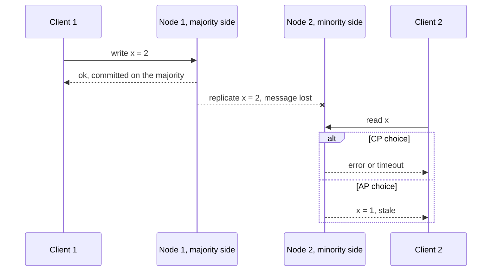

# CAP and PACELC

**In one line:** when the network splits a replicated system, each side must either keep answering (and risk stale or conflicting data) or refuse until it can answer correctly; PACELC adds that even on a healthy network, stronger consistency costs latency on every request.

## Why it matters in interviews

"Is this CP or AP?" comes up in almost every design with more than one database node. A weak answer puts one label on the whole system. A strong answer goes feature by feature: "booking a seat must refuse rather than double-sell during a partition, so that path is CP; the seat map can show slightly stale availability, so it is AP."

Interviewers also listen for whether you know what the letters mean. Most popular explanations of CAP are loose in ways that lead to bad designs ("we picked CA"). PACELC matters more day to day: partitions are rare, but the latency cost of synchronous replication is paid on every write.

## How it works

### The precise statement

Eric Brewer stated CAP as a conjecture in 2000; Gilbert and Lynch proved it in 2002 with narrow definitions.

| Letter | Precise meaning | Common misreading |
|---|---|---|
| **C**onsistency | Linearizability: every operation appears to take effect at one instant between its start and its end, so a read returns the latest completed write, as if there were a single copy | "The data is valid" (that is the C in ACID) |
| **A**vailability | Every request received by a non-failing node eventually gets a non-error response | "99.99 % uptime" |
| **P**artition tolerance | The system keeps working while the network drops any number of messages between nodes | "A feature you can opt out of" |

The theorem: if the network can drop messages, no system provides both C and A. Cut the link between two replicas, write to one side, read from the other. The reader's node can answer with what it has (available, not linearizable) or wait or fail until it hears from the other side (linearizable, not available).

### Why "CA" is not an option

You do not get to choose whether partitions happen. Switches fail, links congest, and a node stuck in a long garbage-collection pause looks exactly like a partition to its peers. A system that claims CA has only described its behaviour when nothing fails. When a partition does happen it must still either stop answering (it was really CP) or let replicas diverge (it was really AP). The only true CA system is a single node, and a single node loses availability the moment it fails.

The useful form of CAP: **during a partition, choose C or A.** With no partition, you can have both.

### Labels belong to operations, not systems

Many deployments are neither CP nor AP in the strict sense. A Postgres primary with async read replicas is not C (replica reads can be stale) and not A (clients cut off from the primary cannot write). Martin Kleppmann's essay "Please stop calling databases CP or AP" makes this point: describe each operation instead. Several stores let you choose per request:

- **Cassandra**: a consistency level per query. `QUORUM` fails on the minority side of a partition (CP-like for that query); `ONE` keeps working on both sides (AP). Lightweight transactions (`INSERT ... IF NOT EXISTS`) run Paxos for a linearizable compare-and-set.
- **DynamoDB**: eventually consistent reads by default, at half the read-capacity cost, or strongly consistent reads with `ConsistentRead=true`.
- **MongoDB**: write concern and read concern per operation, from `w: 1` up to `w: "majority"` with `readConcern: "linearizable"`.

### PACELC

Daniel Abadi's extension (2010, published 2012): **if** there is a **P**artition, choose **A** or **C**; **e**lse, choose **L**atency or **C**onsistency. The "else" half is paid continuously. To make a write visible to every later read, it must reach a quorum before you acknowledge it, so every write waits for the slowest replica in that quorum.

| System | Partition | Else | Why |
|---|---|---|---|
| Cassandra, Riak, Dynamo-style stores (defaults) | PA | EL | Any replica accepts writes; replicas converge later |
| etcd (default reads) | PC | EC | Raft majority commit; reads confirmed with the leader |
| Spanner, CockroachDB | PC | EC | Paxos or Raft per range; Spanner also waits out clock uncertainty at commit |
| Postgres primary + async replicas | PC for writes | EL for replica reads | Writes need the primary; replicas lag |

The cost in numbers, using the [cheat sheet](../docs/back-of-envelope.md): a majority write across regions in India, Singapore and the US west coast waits for India to Singapore, about 35 ms, on every write, even when nothing is broken. A write that must reach the US pays about 220 ms. Async replication acknowledges in local-datacenter time (about 0.5 ms) and accepts that losing a region loses whatever had not replicated yet.

### Using it per feature in an interview

| Feature | Choose | What the user sees during a partition | Why |
|---|---|---|---|
| Payment, ledger, wallet debit | CP | An error; the client retries with the same idempotency key | A double spend or overdraft costs money and trust |
| Inventory decrement, seat booking | CP for the claim, AP for display | Checkout fails; the "3 left" badge may be stale | Overselling means refunds and apologies |
| Username or email uniqueness | CP | Sign-up fails briefly | Two accounts with one name are hard to untangle |
| Likes, views, follower counts | AP | Counts lag, then converge | Nobody can tell 1,203 from 1,207 |
| News feed, timelines, search | AP | Slightly stale content | Staleness is invisible; an error page is not |
| Shopping cart | AP with merge | Cart always writable; a removed item can reappear | The Dynamo paper's example: never reject an add-to-cart |
| Leader election, locks, config | CP | Minority side loses its lease and stops | Two leaders corrupt data |

Say it like this: "Feeds and counters are AP: during a partition each region serves local data and reconciles later. The payment path is CP: if we cannot reach a majority of the ledger replicas we fail the request, and the idempotency key makes the retry safe."

## Variants / options

| Option | Pros | Cons | Use when |
|---|---|---|---|
| CP via consensus (Raft, Paxos, ZAB) | Linearizable; no conflicting writes; failover without losing acknowledged writes | Minority side unavailable; every write waits for a majority | Money, inventory claims, uniqueness, locks, cluster metadata |
| AP via leaderless or multi-leader replication | Every reachable node accepts reads and writes; low local latency | Stale reads; concurrent writes need merging (LWW drops data, CRDTs restrict data types) | Counters, feeds, carts, presence, telemetry |
| Tunable per request (Cassandra levels, DynamoDB reads, MongoDB concerns) | One store serves both kinds of feature | Easy to pick the wrong level per query | Mixed workloads on one database |
| Single leader with async replicas | Simple; fast writes; cheap read scaling | Stale replica reads; writes stop without the leader; failover can lose writes | Most CRUD apps, with read-your-writes routing |
| Synchronous cross-region quorum (PC/EC) | Survives losing a region with no lost writes | Inter-region round trip on every write | Global ledgers and metadata where loss is unacceptable |

## Where you see it

- **ZooKeeper, etcd, Consul**: coordination services on majority quorums (ZAB, Raft); a minority partition cannot commit writes. etcd reads are linearizable by default, with an opt-in serializable read that may be stale.
- **Google Spanner**: CP. Brewer's 2017 paper on Spanner and CAP argues it is technically CP but available enough in practice that users can treat it as CA.
- **CockroachDB**: CP; each range is a Raft group, and a range that loses its majority stops serving.
- **Cassandra, Riak, Voldemort**: Dynamo-style, AP by default, with per-query consistency levels.
- **DynamoDB**: per-request read consistency; global tables replicate asynchronously between regions and resolve conflicting writes with last writer wins.
- **Azure Cosmos DB**: five named levels (strong, bounded staleness, session, consistent prefix, eventual) set per account and relaxable per request.

## Common mistakes

- Claiming CA. It only describes what happens when nothing fails.
- Equating CAP availability with an uptime SLA. A CP system with a healthy majority serves almost all requests; an AP system is still down if every replica is.
- Putting one label on the whole system instead of each operation.
- Mixing up CAP's C (linearizability of single objects) with ACID's C (invariants hold) or with serializability (transactions).
- Assuming Cassandra `QUORUM` is linearizable. It is not (see [consistency models](./consistency-models.md)); use lightweight transactions for compare-and-set.
- Paying cross-region synchronous latency for data that tolerates staleness: the PACELC mistake.
- Forgetting that a timeout in a CP system is ambiguous. The write may have committed, so retries need an idempotency key.

## Interview questions

**Q: Is a Postgres primary with two async read replicas CP or AP?**
Neither, as a whole. Reads and writes on the primary are linearizable. Replica reads can be stale, so they are not C. An app server partitioned from the primary cannot write, so writes are not A. Describe each path: writes behave CP, replica reads behave AP.

**Q: Why can't you choose CA?**
Because partitions are not optional. "CA" only says what the system does when the network works. When it does not, the system must refuse requests (CP) or let replicas diverge (AP).

**Q: Your design stores bookings in Cassandra. How do you stop two users booking the same seat?**
`QUORUM` writes do not help: both writes succeed and last-write-wins silently keeps one. Use a lightweight transaction (`INSERT ... IF NOT EXISTS`) for the seat claim and accept its extra Paxos round trips, or keep bookings in a relational database with a unique constraint on `(event_id, seat_id)`.

**Q: What does PACELC add to CAP?**
The cost when nothing is broken. A linearizable write must reach a quorum before it is acknowledged, so every write pays the replica round trip; across regions that is tens to hundreds of milliseconds. PACELC makes you say whether a feature is worth that latency.

**Q: The link between your two regions fails. What does each feature do?**
Feeds, likes and search keep serving from the local region and reconcile when the link returns. Payments for an account are accepted only in the region that holds that account's leader; the other region returns a retryable error. Giving each user a home region keeps most writes on one side.

**Q: Is a ZooKeeper read always up to date?**
No. Writes go through the leader and a quorum, but a read is answered by the server the client is connected to, which may lag. ZooKeeper guarantees each client sees updates in order; call `sync` before the read when it must see the latest write.

## Related

- Fundamentals: [consistency models](./consistency-models.md), [replication](./replication.md), [consensus and coordination](./consensus-and-coordination.md), [multi-region and disaster recovery](./multi-region-and-disaster-recovery.md), [transactions and isolation](./transactions-and-isolation.md), [delivery semantics and idempotency](./delivery-semantics-and-idempotency.md).
- Problems: [payment system](../problems/payment-system.md), [ticket booking](../problems/ticket-booking.md), [news feed](../problems/news-feed.md), [ecommerce platform](../problems/ecommerce-platform.md), [key-value store](../problems/key-value-store.md).
- Code: [`src/quorum-kv`](../src/quorum-kv/), [`src/vector-clock`](../src/vector-clock/), [`src/lease-lock`](../src/lease-lock/).
