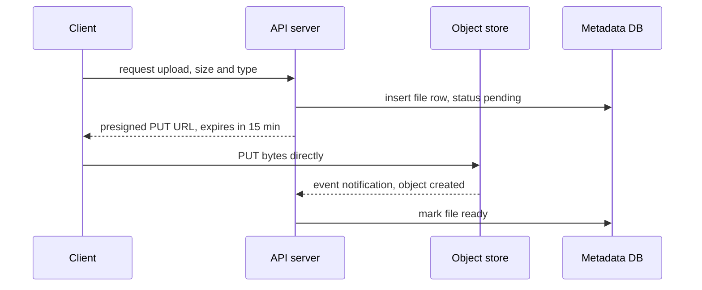
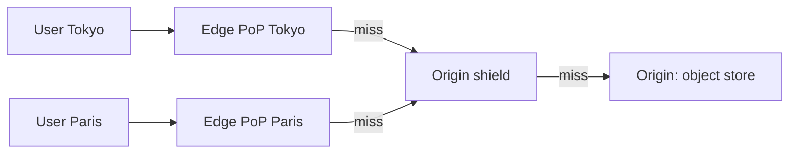

# CDN and blob storage

**In one line:** put large, immutable bytes (images, video, uploads, backups) in an object store addressed by bucket and key, and put a CDN in front so most reads are served from an edge cache near the user instead of from the origin.

## Why it matters in interviews

Almost every product design has a "where do the photos or videos live?" moment. The weak answer stores files in the database or on the application servers' disks. The strong answer separates metadata (a row in a database) from bytes (an object in blob storage), lets clients upload directly to the store with a presigned URL, and serves reads through a CDN with a deliberate cache-key and TTL policy.

Interviewers then probe the details: how a 4 GB upload survives a dropped connection, how you stop people hotlinking private files, how you change an image that is already cached at 300 edge locations, and how video is delivered as small segments.

## How it works

### The object storage model

| Concept | Meaning |
|---|---|
| Bucket | A namespace with its own policies, region and lifecycle rules |
| Key | A flat string such as `users/42/avatar/3f9a.jpg`; the slashes are a naming convention, not real directories |
| Object | The bytes plus metadata (content type, size, ETag, user metadata); written whole and replaced whole, never edited in place |
| Version | Optional; with versioning on, an overwrite or delete keeps the previous version |

Objects are immutable: to change one byte you upload a new object. That is what makes the store easy to replicate and easy to cache. Listing by prefix is supported but slow compared with a database query, so keep the index of "which files does user 42 own" in your own metadata database.

Amazon S3 has provided strong read-after-write consistency for PUT and DELETE, including overwrites and list operations, since December 2020. Before that, overwrites and listings were eventually consistent, and many older designs and blog posts still assume that.

### Upload path

- **Presigned URL:** the server signs a URL that grants one operation (PUT or GET) on one key for a limited time. The bytes never pass through your servers, so they do not need the bandwidth. With S3 SigV4, the maximum expiry is 7 days; use minutes.
- **Multipart upload:** split a large file into parts uploaded in parallel and retried independently, then call "complete" with the list of parts. S3 parts are at least 5 MiB (except the last) and there can be up to 10,000 of them. Abort incomplete uploads with a lifecycle rule or they keep costing storage.
- **Resumable upload:** the client can ask "how many bytes do you have?" and continue from there after a dropped connection. Google Cloud Storage resumable uploads and the open tus protocol work this way. This matters on mobile networks.

### Content-addressable storage and dedup

Name the object by the hash of its contents (`sha256/ab12...`). Identical content gets the same key, so it is stored once, and the key doubles as an integrity check. Git objects and container image layers work this way. File sync products split files into blocks and hash each block, so editing one part of a large file uploads only the changed blocks. The catch is deletion: a block shared by many files needs reference counting or a periodic mark-and-sweep before it can be removed.

### Lifecycle tiers

Storage classes trade storage price against retrieval price and latency. S3 has Standard, Standard-IA, and several Glacier classes; Google Cloud Storage has Standard, Nearline, Coldline and Archive. Lifecycle rules move objects between tiers by age or delete them. Infrequent-access tiers usually have a minimum storage duration and a per-GB retrieval fee, so moving hot data there costs more, not less.

### CDN

- **Pull CDN:** the edge fetches from the origin on the first miss and caches it. Zero setup per file; the first user in each region pays the miss.
- **Push CDN:** you upload content to the CDN ahead of time. Useful for a known large release; more operational work.
- **Cache key:** by default usually host plus path plus some or all query string. Strip query parameters that do not change the response (tracking tags), or each variant becomes a separate cache entry and the hit ratio collapses.
- **TTL:** set by `Cache-Control` from the origin (`max-age`, `s-maxage`) or overridden at the CDN. Long TTLs give high hit ratios but slow updates.
- **Invalidation:** purge by path or tag. It works but takes time to propagate and can be rate limited or billed. The more reliable approach is versioned URLs: `app.3f9a.js` or `avatar/42/v7.jpg` with a one-year TTL, and change the URL when the content changes.
- **Signed URLs and signed cookies:** the CDN checks a signature and expiry before serving, so private content can still be cached. Signed cookies cover many files at once (all segments of one video).
- **Origin shield:** a designated mid-tier cache in front of the origin, so a miss in 50 PoPs becomes one origin request, not 50.

### Serving video

Video is transcoded into several bitrates and cut into segments of a few seconds (HLS or DASH). A manifest lists the segments; the player picks a bitrate per segment based on measured bandwidth. Segments are immutable and get long TTLs; a live stream's manifest changes every few seconds and gets a TTL of about one segment. Popular titles are served almost entirely from edge caches.

## Variants / options

| Option | Pros | Cons | Use when |
|---|---|---|---|
| Files in the database (BLOB column) | Transactional with metadata | Bloats backups and replicas; expensive bandwidth | Small files, low volume, strict transactional need |
| Object store, reads through API servers | Simple auth checks | API servers carry every byte | Low traffic, internal tools |
| Object store + presigned URLs | Bytes bypass your servers | URL leaks grant access until expiry | Uploads and private downloads |
| Object store + pull CDN | High hit ratio, low latency, low origin cost | Invalidation is slow; cache-key mistakes | Public or semi-public static content |
| CDN with signed URLs or cookies | Caching plus access control | Key management; clock skew on expiry | Paid video, private media at scale |
| Content-addressed blocks | Dedup, integrity, delta sync | Reference counting for deletes | File sync, backups, container images |

## Where you see it

- Amazon S3, Google Cloud Storage, Azure Blob Storage; S3-compatible stores such as MinIO and Ceph RGW.
- CDNs: Amazon CloudFront (signed URLs and cookies, Origin Shield), Cloudflare, Fastly (shielding), Akamai.
- Git and OCI container registries (content-addressed objects and layers).
- HLS and DASH streaming for video on demand and live.

## Common mistakes

- Routing uploads through application servers when a presigned URL would do.
- Using the object store as the index ("list the bucket to show a user's files").
- Relying on CDN purges for every change instead of versioned URLs.
- Letting every query parameter into the cache key.
- Long-lived presigned URLs pasted into emails and logs.
- Moving data to an archive tier and then reading it often, paying retrieval fees and waiting minutes to hours.
- Forgetting that a CDN hit ratio is per object and per PoP: long-tail content (old posts) mostly misses.

## Interview questions

**Q: How does a client upload a 4 GB video reliably?**
The API creates a metadata row and returns presigned URLs for a multipart upload. The client uploads parts in parallel, retries failed parts, and calls complete. An object-created event marks the row ready and starts transcoding.

**Q: A user changes their avatar but people still see the old one. Why, and how do you fix it?**
The old image is cached at the edge and in browsers until its TTL expires. Put a version or content hash in the URL and update the URL stored in the profile; old URLs can keep their long TTL.

**Q: How do you serve private photos through a CDN?**
Issue short-lived signed URLs (or signed cookies for many files) from the API after an authorization check. The CDN verifies the signature, so the bytes are still cached.

**Q: What does an origin shield buy you?**
Misses from many PoPs collapse into one request to the origin, which protects the origin during a cold start or after a purge.

**Q: How would you deduplicate identical uploads?**
Hash the content and use the hash as the key; if the key already exists, skip the upload and add a reference. Deletes decrement the reference count, and a background job removes unreferenced objects.

## Related

- Fundamentals: [caching strategies](./caching-strategies.md), [replication](./replication.md), [multi-region and DR](./multi-region-and-disaster-recovery.md), [security basics](./security-basics.md), [consistency models](./consistency-models.md).
- Problems: [object storage](../problems/object-storage.md), [video streaming](../problems/video-streaming.md), [file storage and sync](../problems/file-storage-sync.md), [Instagram](../problems/instagram.md).
- Code: [`src/merkle-tree`](../src/merkle-tree/) (hashing blocks to find what changed).
