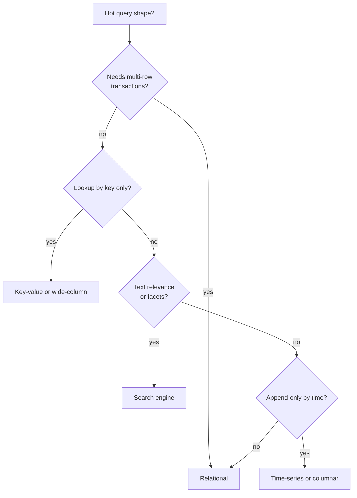

# Choosing a database

**In one line:** start from the access patterns (how you read, write, query and grow), pick the simplest store that serves them, and add a specialised store only when a concrete signal says the default no longer fits.

## Why it matters in interviews

"Which database would you use?" is asked in nearly every design round. Naming a product is not an answer; the interviewer wants the reasoning: the data shape, the dominant queries, the consistency needs and the scale. A good answer usually ends with more than one store: a system of record plus derived stores for search, caching or analytics, kept in sync by CDC or events.

## How it works

Work through four questions in order.

1. **What are the hot queries?** Point lookup by id, range scan by time, ad-hoc filters, full-text search, graph traversal, aggregations over billions of rows.
2. **What consistency does each write need?** Money and inventory need transactions and constraints; likes and view counts tolerate eventual consistency.
3. **How big and how fast?** Dataset size, write rate, read rate, growth per year. Use [back-of-envelope estimates](../docs/back-of-envelope.md).
4. **Who else reads the data?** Search, analytics and caches are usually derived copies, not the system of record.

### Families

| Family | Data model | Strong at | Weak at | Examples |
|---|---|---|---|---|
| Relational | Tables, joins, constraints | Transactions, ad-hoc queries, integrity | Horizontal write scaling (without extra tooling) | Postgres, MySQL |
| Key-value | Opaque value by key | Very fast point reads and writes | Queries by anything but the key | Redis, DynamoDB, Memcached |
| Wide-column | Partition key plus sorted rows | High write throughput, time-ordered reads per key | Joins, ad-hoc queries, secondary access paths | Cassandra, ScyllaDB, Bigtable, HBase |
| Document | JSON-like documents | Nested data read as a whole, flexible schema | Many-to-many relationships, cross-document joins | MongoDB, Couchbase, Firestore |
| Graph | Nodes and edges | Multi-hop traversals | Bulk analytics, sharding | Neo4j, Amazon Neptune |
| Time-series | Timestamped points per series | High ingest, downsampling, retention | Updates, arbitrary joins | Prometheus, InfluxDB, TimescaleDB |
| Search | Inverted index | Full-text relevance, facets, fuzzy match | Being the system of record; strong consistency | Elasticsearch, OpenSearch |
| Columnar OLAP | Columns compressed per segment | Aggregations over billions of rows | Point updates, high-rate single-row writes | ClickHouse, Druid, BigQuery |
| NewSQL / distributed SQL | Relational over consensus-replicated ranges | SQL and ACID across shards and regions | Write latency; cost and operational depth | Spanner, CockroachDB, YugabyteDB, TiDB |

### Decision table by access pattern

| Access pattern | First choice | Why |
|---|---|---|
| Orders, payments, bookings, inventory | Relational | Transactions, unique constraints, row locks |
| Session, profile or config by id | Key-value (or relational with a cache) | Single-key reads dominate |
| Messages or events per entity, newest first | Wide-column | Partition by entity, cluster by time |
| Product catalogue with varied attributes | Relational with JSONB, or document | Flexible attributes, still queryable |
| Search box with typo tolerance | Search engine fed by CDC | Inverted index and relevance scoring |
| Leaderboard, counters, rate limits | Redis | Sorted sets and atomic increments in memory |
| Metrics and monitoring | Time-series database | Compression, downsampling, retention |
| Click and ad analytics | Columnar OLAP fed by a stream | Fast group-by over huge data |
| Friends-of-friends, fraud rings | Graph (or relational with recursive CTEs at small scale) | Traversals |
| Photos, videos, files | Object storage plus a metadata table | Blobs do not belong in a database |

### Postgres is enough until...

Postgres covers relational data, JSONB documents, full-text search (`tsvector`), geospatial queries (PostGIS), time-series (partitioning or TimescaleDB) and queues (`SELECT ... FOR UPDATE SKIP LOCKED`). Start there unless a signal below already applies:

| Signal | What breaks | Typical next step |
|---|---|---|
| Write rate exceeds what one tuned primary sustains | Single-writer ceiling | Shard (Citus), or a natively partitioned store |
| Dataset or working set far exceeds one machine's disk or RAM | Index and cache misses, long vacuums | Partitioning, sharding, archiving cold data |
| Read load beyond what replicas plus cache absorb | Replica lag, connection limits | More replicas, caching, connection pooling (PgBouncer) |
| Search needs relevance tuning, facets, typo tolerance at scale | `tsvector` lacks these features | Elasticsearch or OpenSearch via CDC |
| Analytics over billions of rows | Row store scans are slow and hurt OLTP | Columnar warehouse fed by CDC |
| Active writes in several regions | One primary region | Distributed SQL, or multi-leader with a home-region rule |
| Ingest of millions of points per second with retention | Bloat, vacuum, index cost | Time-series database |

### JSONB

Postgres `jsonb` stores JSON in a parsed binary form. You can index it with GIN (`CREATE INDEX ON products USING gin (attrs)`) and query with containment (`attrs @> '{"color": "red"}'`) or extract fields into expression indexes. Use it for sparse or varied attributes alongside normal columns; keep fields you join on, constrain or update often as real columns.

### Read replicas

Replicas scale reads, not writes, and are eventually consistent. Route reads that must see the user's own writes to the primary. See [replication](./replication.md).

### This repository's problems

| Problem | System of record | Derived or supporting stores |
|---|---|---|
| [URL shortener](../problems/url-shortener.md) | Key-value (DynamoDB) or Postgres | Redis cache for hot codes |
| [Chat system](../problems/chat-system.md) | Wide-column, partitioned by conversation | Redis for presence |
| [News feed](../problems/news-feed.md) | Relational or wide-column for posts and follows | Redis lists for precomputed feeds |
| [Payment system](../problems/payment-system.md) | Relational, double-entry ledger | Event stream for downstream |
| [Ticket booking](../problems/ticket-booking.md) | Relational with row locks or conditional updates | Redis for temporary holds |
| [Leaderboard](../problems/leaderboard.md) | Relational or key-value for scores | Redis sorted sets |
| [Metrics monitoring](../problems/metrics-monitoring.md) | Time-series database | Object storage for old blocks |
| [Ad click aggregation](../problems/ad-click-aggregation.md) | Log or stream (Kafka) | Columnar OLAP for queries |
| [Search autocomplete](../problems/search-autocomplete.md) | Query logs in a warehouse | Trie or prefix index in memory |
| [Proximity service](../problems/proximity-service.md) | Relational for businesses | Geospatial index (PostGIS, geohash in Redis) |
| [File storage sync](../problems/file-storage-sync.md) | Relational metadata | Object storage for chunks |
| [E-commerce platform](../problems/ecommerce-platform.md) | Relational for orders and inventory | Search engine for catalogue, cache |

## Variants / options

| Option | Pros | Cons | Use when |
|---|---|---|---|
| One relational database | One source of truth, transactions, SQL | Single-writer ceiling | Default for most systems |
| Relational plus cache and search | Fast reads, rich search, still one source of truth | Sync pipeline to maintain | Most production systems |
| Polyglot from day one | Each store fits its job | Many systems to run; consistency across them | Clearly distinct workloads at scale |
| Distributed SQL | SQL and ACID at scale | Latency, cost | Strong consistency beyond one node or region |

## Where you see it

- Postgres or MySQL as the system of record in most web companies, with Redis and Elasticsearch alongside.
- DynamoDB and Cassandra where access patterns are known and scale is large.
- Columnar warehouses (BigQuery, Snowflake, ClickHouse) fed by CDC for analytics.

## Common mistakes

- Choosing NoSQL "because it scales" without naming the query it serves.
- Using a search engine or cache as the system of record.
- Picking a document store for highly relational data, then joining in the application.
- Not saying how derived stores stay in sync (CDC, outbox, events).
- Ignoring operational cost: every extra store needs backups, monitoring and on-call knowledge.

## Interview questions

**Q: Why Postgres over MongoDB for an e-commerce order system?**
Orders, payments and inventory need multi-row transactions and constraints. Postgres gives those directly; JSONB covers flexible product attributes.

**Q: When would you choose Cassandra?**
Very high write rates, data partitioned by a known key and read by that key in sorted order (messages per chat, events per device), and a need to stay writable across node or datacenter failures.

**Q: How do you add full-text search to a Postgres-backed product?**
Start with `tsvector` and a GIN index. When you need relevance tuning, facets or typo tolerance, stream changes through CDC into Elasticsearch and query it for search, while Postgres stays the source of truth.

**Q: What are the signals that you have outgrown one Postgres primary?**
Sustained write load near the primary's limit after tuning, a working set far beyond RAM, replicas lagging under read load, or a requirement for writes in several regions.

**Q: Where do photos go?**
Object storage (S3 or similar) behind a CDN, with a metadata row in the database pointing to the object key.

## Related

- Fundamentals: [storage engines](./storage-engines.md), [replication](./replication.md), [sharding and partitioning](./sharding-and-partitioning.md), [transactions and isolation](./transactions-and-isolation.md), [caching strategies](./caching-strategies.md), [search and indexing](./search-and-indexing.md), [cdn and blob storage](./cdn-and-blob-storage.md), [transactional outbox and CDC](./transactional-outbox-and-cdc.md).
- Docs: [technology picker](../docs/technology-picker.md), [back-of-envelope](../docs/back-of-envelope.md).
