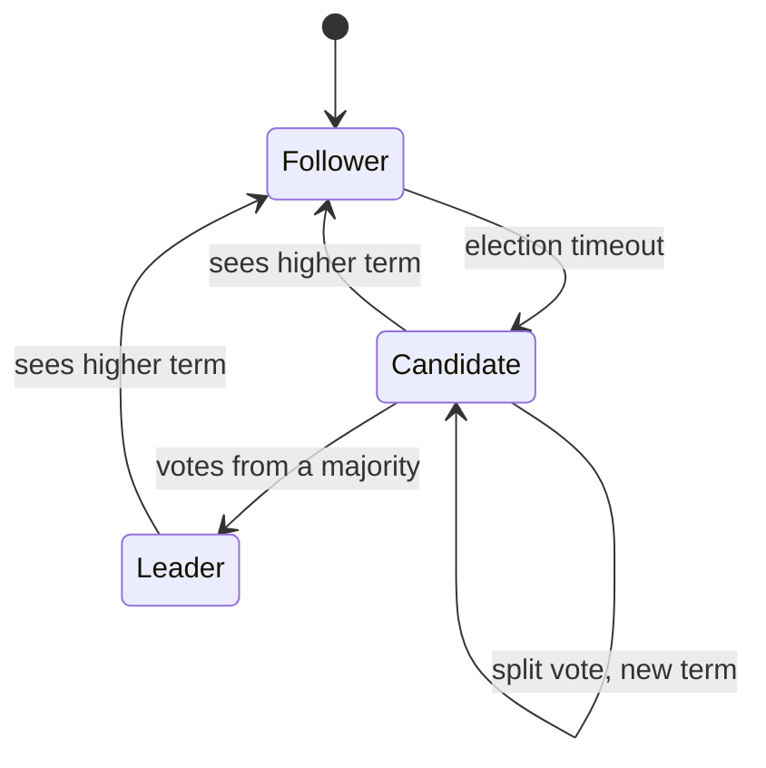
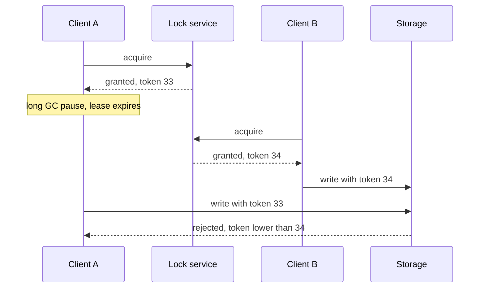

# Consensus and coordination

**In one line:** consensus lets a group of nodes agree on one value or one ordered log even when some of them crash, as long as a majority is up; coordination services package that agreement as leader election, locks, configuration and membership.

## Why it matters in interviews

Whenever a design has "one leader", "a single scheduler", "exactly one worker holds this job" or "the cluster's current shard map", the follow-up is "how do the nodes agree on that, and what happens when the network splits?". You are rarely asked to implement Raft. You are expected to know that you should not invent your own election protocol, to name etcd or ZooKeeper, to size the cluster correctly, and to explain why a lock with a timeout is not safe without fencing tokens.

## How it works

### What consensus is for

| Need | What is agreed on |
|---|---|
| Leader election | Which node is the leader for this term |
| Configuration and metadata | The current shard map, feature flags, cluster membership |
| Distributed locks and leases | Which client holds a resource, until when |
| Replicated state machine | An ordered log of commands; every replica applies them in the same order |

The core guarantee: once a value is decided (an entry committed), it is never undone, and all nodes that decide agree on the same value.

### Raft

Raft (Ongaro and Ousterhout, 2014) was designed to be easier to understand than Paxos. Each node is a follower, candidate or leader.

- **Terms:** time is divided into numbered terms; each term has at most one leader. A node that sees a higher term steps down.
- **Elections:** a follower that hears no heartbeat within a randomized timeout (the paper suggests 150-300 ms) becomes a candidate, increments the term and requests votes. Each node votes once per term, and only for a candidate whose log is at least as up to date as its own. Randomized timeouts make repeated split votes unlikely.
- **Log replication:** clients send commands to the leader. The leader appends them to its log and sends AppendEntries to followers (empty AppendEntries double as heartbeats).
- **Commit index:** an entry is committed once it is stored on a majority, and the leader only counts replicas this way for entries from its current term. The leader advances the commit index, followers learn it on the next AppendEntries, and every node applies committed entries in order.

Reads need care too. A leader that has been partitioned away may not know it was replaced. Linearizable reads either go through the log or have the leader confirm with a majority (ReadIndex) before answering.

### Paxos

Leslie Lamport's Paxos solves the same problem and came first. Multi-Paxos, which elects a stable leader and runs one round per log slot, is close to Raft in practice. Google Chubby and Spanner use Paxos; ZooKeeper uses its own protocol, Zab. In an interview, "Raft or Multi-Paxos, via etcd or ZooKeeper" is the right level.

### Coordination services

| Feature | ZooKeeper | etcd | Consul |
|---|---|---|---|
| Protocol | Zab | Raft | Raft |
| Data model | Tree of znodes | Flat key range with revisions | KV store plus service catalog |
| Liveness primitive | Ephemeral znodes, deleted when the session ends | Leases with a TTL; keys attached to a lease vanish when it expires | Sessions tied to health checks |
| Change notification | Watches | Watch on a key or prefix from a revision | Blocking queries and watches |
| Typical user | HBase, older Kafka, Hadoop | Kubernetes | Service discovery, HashiCorp stack |

Leader election recipe: every candidate creates an ephemeral sequential znode (or a key attached to its lease); the lowest sequence number is the leader; the others watch the node just ahead of them. If the leader dies, its session or lease expires, its node disappears and the next one takes over.

Keep these services small. They hold metadata measured in megabytes and serve thousands of writes per second, not your application data.

### Distributed locks done right

A lock with a timeout (a lease) can expire while its holder is still running: a long GC pause, a stalled VM or a slow network can outlast the TTL. The old holder wakes up, believes it still holds the lock and writes.

The fix is a **fencing token**: a number that increases with every grant (etcd's revision or ZooKeeper's zxid work). The storage rejects any write carrying a lower token than one it has already seen. That makes the resource itself enforce safety; the lock only provides efficiency.

The Redlock debate: Redis's Redlock algorithm acquires a lock on a majority of independent Redis nodes. Martin Kleppmann's 2016 critique argued it is unsafe for correctness because it depends on bounded pauses, network delay and clock drift, and it does not produce fencing tokens. Salvatore Sanfilippo (antirez) responded that the timing assumptions are reasonable in practice, that Redlock checks elapsed time after acquiring, and that a random lock value can serve a similar purpose when the resource supports compare-and-set. A neutral summary for an interview: if a lock exists only to avoid duplicate work, a Redis lock is fine; if two holders would corrupt data, use a consensus-backed lease plus fencing tokens checked by the resource.

### Split brain and quorum sizing

Split brain is two nodes both acting as leader. Majority quorums prevent it: two majorities of the same cluster always overlap, so only one side of a partition can elect a leader or commit.

| Nodes | Majority | Failures tolerated |
|---|---|---|
| 3 | 2 | 1 |
| 4 | 3 | 1 |
| 5 | 3 | 2 |
| 7 | 4 | 3 |

A cluster of 2f+1 nodes tolerates f failures. Even sizes add cost without adding tolerance. Bigger clusters also make every write slower, since the leader waits for more acknowledgements, so 3 or 5 voting members is the norm. Spread them across three failure domains: with two zones, losing the zone that holds the majority stops the cluster.

## Variants / options

| Option | Pros | Cons | Use when |
|---|---|---|---|
| etcd or ZooKeeper leases | Proven consensus, fencing via revision or zxid | Another cluster to run; small data only | Leader election, locks, shard maps |
| Database row lock or advisory lock | No new system | Tied to one database's availability | You already depend on that database |
| Single Redis lock (SET NX PX) | Fast, simple | Lost on failover; no fencing | Avoiding duplicate work only |
| Redlock | No single Redis node | Debated safety; timing assumptions | Efficiency locks across Redis nodes |
| Embedded Raft library | No external dependency | You own a hard protocol's operations | Building a database or queue (KRaft, CockroachDB) |

## Where you see it

- Kubernetes stores all cluster state in etcd.
- Kafka's KRaft mode replaced ZooKeeper for metadata; Kafka 4.0 removed ZooKeeper support.
- CockroachDB, TiKV and YugabyteDB run a Raft group per range of data.
- Google Chubby (lock service) and Spanner use Paxos.
- HBase and many Hadoop components use ZooKeeper.

## Common mistakes

- Rolling your own election with heartbeats and timeouts, which produces split brain under partition.
- Running two or four coordination nodes, or putting all of them in one zone.
- Treating a lease as mutual exclusion without fencing tokens.
- Storing large or high-churn application data in ZooKeeper or etcd.
- Reading from a follower and assuming the answer is current.
- Assuming consensus survives the loss of a majority. It does not: it stops accepting writes, by design.

## Interview questions

**Q: Why five nodes rather than four?**
Both tolerate failures only up to a majority: four tolerates one, five tolerates two. The extra node buys a second failure for one more member's latency and cost.

**Q: How does Raft avoid electing a leader that is missing committed entries?**
Committed entries live on a majority, and a voter refuses any candidate whose log is less up to date. A winner needs a majority of votes, which overlaps the majority holding each committed entry.

**Q: A worker holds a lock, pauses for 30 seconds and resumes. What goes wrong?**
The lease expired and another worker took the lock, so both write. Fencing tokens let the storage reject the stale writer.

**Q: When is a Redis lock good enough?**
When the worst case of two holders is wasted work, such as two nodes sending the same cache refresh. Not when it would double-charge a card or corrupt a file.

**Q: What happens to a Raft cluster during a partition?**
The side with a majority keeps or elects a leader and makes progress. The minority side cannot commit; its old leader steps down once it sees a higher term after the partition heals.

## Related

- Fundamentals: [CAP and PACELC](./cap-and-pacelc.md), [consistency models](./consistency-models.md), [replication](./replication.md), [distributed transactions](./distributed-transactions.md), [ID generation](./id-generation.md).
- Problems: [distributed job scheduler](../problems/distributed-job-scheduler.md), [key-value store](../problems/key-value-store.md), [distributed message queue](../problems/distributed-message-queue.md).
- Code: [`src/lease-lock`](../src/lease-lock/), [`src/quorum-kv`](../src/quorum-kv/).
