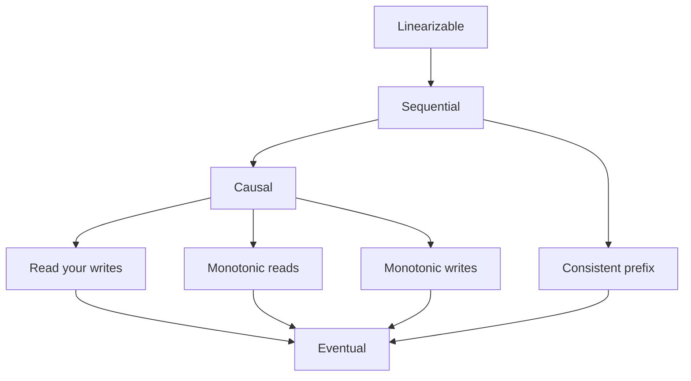
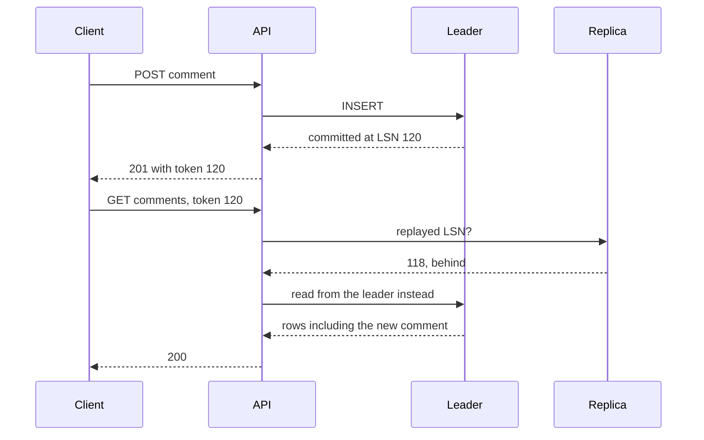

# Consistency models

**In one line:** a consistency model is the contract for what a read may return given the writes before it; stronger models are easier to reason about but cost latency and availability, and most user-visible bugs come from missing session guarantees rather than missing linearizability.

## Why it matters in interviews

"It's eventually consistent" is not an answer on its own. The interviewer wants to know which anomaly a user can see and what you do about it. "A user posts a comment, refreshes, and it is gone" is a read-your-writes violation caused by replica lag, fixed by routing that user's reads to the leader for a short window. Naming the exact guarantee and the cheapest mechanism that provides it is what a senior answer sounds like.

The models also explain trade-offs elsewhere: why quorum reads are not linearizable, why chat needs per-conversation ordering, and why a lock service must be linearizable.

## How it works

Arrows point from a stronger model to a weaker one. Causal and consistent prefix are not comparable: causal lets unrelated writes appear in different orders to different readers, and consistent prefix says nothing about seeing your own writes.

| Model | Guarantee | Anomaly it rules out | Usually provided by |
|---|---|---|---|
| Linearizable | Behaves like one copy: once a write completes, every later read by anyone sees it or something newer | Reading an old value after a newer one was acknowledged | A leader serving reads under a lease; consensus (Raft, Paxos) |
| Sequential | All clients see all operations in one total order that respects each client's own order, possibly behind real time | Two clients disagreeing on the order of writes | A totally ordered log applied by every replica (ZooKeeper) |
| Causal | If writer B had seen write A, everyone sees A before B; concurrent writes may appear in any order | A reply visible before the message it answers | Dependency tracking with version vectors or logical clocks |
| Read your writes | A client always sees its own completed writes | Profile edit "reverts" on refresh | Reading from the leader after writing; version tokens |
| Monotonic reads | A client never sees older data after newer data | A comment appears, then disappears on the next refresh | Pinning the client to one replica; minimum-version tokens |
| Monotonic writes | A client's writes apply everywhere in the order issued | "Add photo to album" applied before "create album" | One leader or log per key or user; sequence numbers |
| Consistent prefix | Readers see writes in an order that happened, with no gaps: never a later write without the earlier ones | The answer before the question in a sharded chat | One ordered log per partition; related writes in one partition |
| Eventual | If writes stop, all replicas converge | Nothing, while writes continue | Async replication, anti-entropy, a merge rule (LWW, CRDT) |

Read your writes, monotonic reads, monotonic writes and writes-follow-reads (a write made after reading X is ordered after X) are the four **session guarantees** from the Bayou work at Xerox PARC. Together they amount to causal consistency for one client.

### Quorums: what R + W > N buys

Each key lives on N replicas. A write waits for W acknowledgements; a read asks R replicas and keeps the newest version. If R + W > N, every read set overlaps every write set in at least one replica, so a read normally sees the latest acknowledged write. N = 3, W = 2, R = 2 tolerates one slow or dead replica on both paths; W = 3, R = 1 makes reads cheap but lets one dead replica block every write.

Quorums alone do **not** give linearizability:

- **Concurrent read and write.** While a write sits on 1 of 3 replicas, one reader can see the new value and a later reader the old one. The fix (the ABD algorithm) makes the reader write the newest value back to a quorum before returning, a second round trip.
- **Failed writes are not rolled back.** A write that reached one replica is reported as failed but may still show up in later reads.
- **Last write wins on wall clocks.** Two concurrent writers both "succeed"; the higher timestamp survives, even when it came from a skewed clock.
- **Sloppy quorums.** If hinted handoff counts toward W (as in the Dynamo paper), the W nodes may not be the key's home replicas, so the overlap argument fails until hints are delivered.
- **Rebuilt replicas.** A replica restored from an older copy can leave fewer than W replicas holding the new value.
- **No multi-key guarantees.** Quorums are per key; they are not transactions.

### Session guarantees and how to implement them

Most complaints are about a user's own session: their write vanished, or the page went back in time. These are cheap to fix without making the whole system strongly consistent.

| Technique | Gives | Caveat |
|---|---|---|
| Sticky routing: hash the user id to one replica | Monotonic reads | Breaks when that replica fails; heavy users skew load |
| Read from the leader after a write, for a window longer than p99 replica lag, or always for data the user owns | Read your writes | Extra leader load; needs the user's last-write time (cookie or session store) |
| Version token: the write returns its commit position (Postgres LSN, MySQL GTID set, a logical timestamp); later reads carry it; the router picks a replica that has replayed that far, else waits or uses the leader | Read your writes and monotonic reads | Clients carry the token; keep it server-side for cross-device guarantees |
| One partition and sequence numbers per entity | Monotonic writes, consistent prefix | A hot entity limits throughput |
| Client-side reordering: hold a message until the gap before it fills | Consistent prefix on screen | Needs sequence numbers; adds display delay |

The building blocks exist: Postgres standbys report `pg_last_wal_replay_lsn()`, MySQL has `WAIT_FOR_EXECUTED_GTID_SET()`, MongoDB causally consistent sessions send `afterClusterTime`, and Cosmos DB returns a session token with every write.

### Examples from the problems

| Problem | What users must not see | Model needed | Mechanism |
|---|---|---|---|
| [URL shortener](../problems/url-shortener.md) | A link that 404s right after creation | Read your writes | Write the new key to the cache at creation; on a replica miss, check the primary before answering 404 |
| [News feed](../problems/news-feed.md) | Own post missing from own feed | RYW for the author, eventual for followers | Insert into the author's timeline synchronously; fan out to followers asynchronously |
| [Chat system](../problems/chat-system.md) | A reply before the message it answers | Consistent prefix per conversation | Partition by conversation id; per-conversation sequence numbers; clients reorder |
| [Collaborative editor](../problems/collaborative-editor.md) | Two users ending with different documents | Strong eventual consistency: replicas that saw the same edits are identical | CRDT or operational transformation |
| [Ticket booking](../problems/ticket-booking.md), [payments](../problems/payment-system.md) | Two successful claims on one seat or one balance | Linearizable for the claim | Row lock or conditional update on a single leader; consensus-replicated store |
| [Leaderboard](../problems/leaderboard.md), like counts | Exact real-time numbers are not required | Eventual | Async counters and periodic aggregation |

## Variants / options

| Option | Pros | Cons | Use when |
|---|---|---|---|
| Linearizable | Simplest to reason about; safe for locks, uniqueness, claims | Leader or consensus round trip per operation; unavailable on the minority side of a partition | Locks, leader election, seat and balance claims, uniqueness |
| Sequential | One agreed order; reads served locally | Reads can be stale; needs a total-order log | Coordination metadata (ZooKeeper-style) |
| Causal | Preserves cause and effect; stays available during partitions | Dependency metadata grows with writers; few stores offer it directly | Comments, chat, social interactions |
| Session guarantees on an eventual store | Fixes most user-visible anomalies cheaply | Protects one session only; other users still see lag | Default for user-facing CRUD on replicated databases |
| Bounded staleness (at most K versions or T seconds behind) | Lag you can write into the requirements | Must block or fail when the bound would be exceeded | Dashboards, inventory displays, multi-region reads |
| Eventual | Lowest latency, highest availability | Any read can be stale; conflicts need a merge rule | Counters, feeds, analytics, caches |

## Where you see it

- **etcd**: linearizable reads by default; serializable reads (local, possibly stale) on request.
- **ZooKeeper**: linearizable writes, in-order updates per client, possibly stale reads; `sync` catches a server up before a read.
- **Spanner**: external consistency, which is strict serializability: transactions are serializable and respect real-time order.
- **Azure Cosmos DB**: strong, bounded staleness, session (the default), consistent prefix, eventual.
- **DynamoDB**: eventually consistent reads by default, strongly consistent reads on request; global secondary indexes are eventually consistent only.
- **Cassandra**: per-query levels (`ONE`, `QUORUM`, `LOCAL_QUORUM`, `ALL`); lightweight transactions for linearizable compare-and-set.
- **MongoDB**: causally consistent client sessions; `readConcern: "linearizable"` for single-document reads from the primary.
- **Amazon S3**: strong read-after-write consistency for all objects since December 2020.

## Common mistakes

- Saying "eventually consistent" without saying how stale and what the user sees.
- Treating R + W > N as strong consistency.
- Round-robin load balancing across replicas, which produces non-monotonic reads (comments flicker).
- Ignoring the author's own view: read-your-writes violations are the most visible anomaly and the cheapest to fix.
- Ordering events from different machines by wall-clock timestamps. Clocks skew; use per-partition sequence numbers or logical clocks.
- Confusing consistency models (single objects, recency) with isolation levels (multi-object transactions).
- Making everything linearizable "to be safe" and paying consensus latency on reads that could be stale.

## Interview questions

**Q: A user renames themselves, refreshes, and sees the old name. What is happening and how do you fix it?**
The write went to the leader; the refresh read a lagging replica. That is a read-your-writes violation. Read the user's own profile from the leader, or route all their reads to the leader for a window after a write, or return the commit LSN and serve the read only from a replica that has replayed past it.

**Q: N = 3, W = 2, R = 2. Is that linearizable?**
No. A read concurrent with a write can see the new value while a later read sees the old one; failed partial writes are not rolled back; last-write-wins can drop an acknowledged write. You need read write-back (ABD) or consensus.

**Q: What is the difference between linearizability and serializability?**
Linearizability is about single objects and real time: once a write completes, everyone sees it. Serializability is about transactions over many objects: the outcome equals some serial order, not necessarily the real-time one. Strict serializability is both; Spanner provides it.

**Q: In a chat app, how do you avoid showing a reply before the message it replies to?**
Keep a conversation's messages in one partition with a sequence number assigned by that partition's leader. Clients render in sequence order and hold a message until the earlier numbers arrive. That gives consistent prefix within a conversation, which is all the product needs.

**Q: How do you give read-your-writes across a user's phone and laptop?**
A token on one device does not help the other. Keep the user's latest write position server-side, keyed by user id, and have the read path compare it with replica positions, falling back to the leader.

**Q: When is eventual consistency the right choice?**
When stale data is harmless and availability or latency matter more: like counts, feeds, recommendations, search indexes, analytics. State the expected bound ("followers see a post within a few seconds") and the rule for conflicts.

## Related

- Fundamentals: [CAP and PACELC](./cap-and-pacelc.md), [replication](./replication.md), [transactions and isolation](./transactions-and-isolation.md), [consensus and coordination](./consensus-and-coordination.md), [caching strategies](./caching-strategies.md), [multi-region and disaster recovery](./multi-region-and-disaster-recovery.md).
- Problems: [news feed](../problems/news-feed.md), [chat system](../problems/chat-system.md), [collaborative editor](../problems/collaborative-editor.md), [ticket booking](../problems/ticket-booking.md), [URL shortener](../problems/url-shortener.md), [key-value store](../problems/key-value-store.md).
- Code: [`src/quorum-kv`](../src/quorum-kv/), [`src/vector-clock`](../src/vector-clock/).
