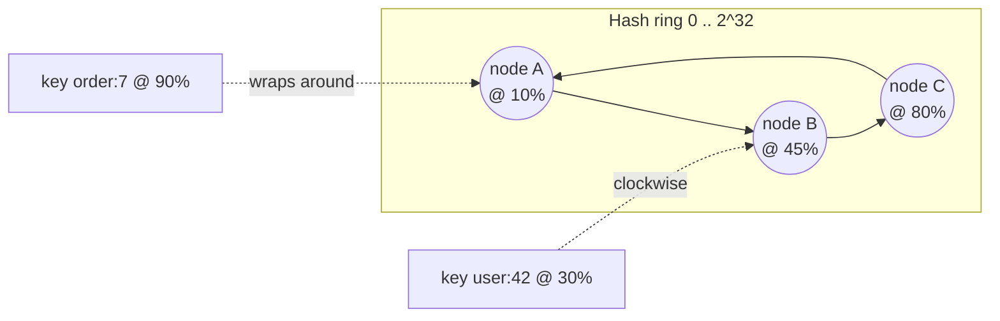

# Consistent hashing

**In one line:** map both nodes and keys onto a ring so that adding or removing a node moves only about 1/N of the keys, instead of nearly all of them.

## Why it matters in interviews

Any time you say "shard by key" or "distributed cache", the follow-up is "what happens when you add a node?". With `hash(key) mod N`, changing N remaps almost every key: every cache entry misses at once, every partition rebalances. Consistent hashing is the standard answer, and it is the mechanism behind DynamoDB, Cassandra, Riak, Memcached clients, Envoy and nginx load balancing, and Kafka-style partition placement in several systems.

## How it works

1. Hash each node (its name or address) to a point on a ring of 2^32 positions.
2. Hash each key to a point on the same ring.
3. A key belongs to the first node found walking clockwise from the key's position.

Adding node D at 60 % takes over only the keys between 45 % and 60 % (previously on C). Removing B hands its arc to C. Nothing else moves.

### Virtual nodes

Three nodes at random positions give wildly uneven arcs. The fix is to place each physical node at many positions (100-200 "virtual nodes" or "vnodes"): the arcs average out, load is within a few percent of uniform, and heterogeneous machines can get more vnodes than smaller ones. Removing a node spreads its keys across *all* remaining nodes instead of dumping them on one neighbour.

### Replication

Store each key on the next R distinct physical nodes clockwise ("preference list"). This is how Dynamo-style stores get N replicas with no central coordinator.

### Implementation

A sorted array of `(hash, node)` plus binary search gives O(log V) lookup, where V is the number of vnodes. See [`src/consistent-hash-ring`](../src/consistent-hash-ring/) for a tested implementation with vnodes and `getNodes(key, n)` for replication.

## Variants / options

| Option | Pros | Cons | Use when |
|---|---|---|---|
| `hash mod N` | Trivial | Resharding moves ~everything | N never changes (fixed partition count) |
| Ring with vnodes (Dynamo, Cassandra) | Minimal movement, decentralised | Memory for vnodes; range lookups awkward | Caches, KV stores, request routing |
| Jump consistent hash (Google) | No memory, very fast | Only supports adding/removing the *last* bucket | Fixed-order node lists |
| Rendezvous / highest-random-weight | Simple, no ring | O(N) per lookup | Small N, e.g. picking a cache server |
| Fixed partitions + partition→node map (Kafka, Elasticsearch, Vitess) | Rebalance by moving whole partitions; metadata is explicit | Needs a coordinator | Databases and logs with ordered ranges |

## Where you see it

- Amazon DynamoDB and the Dynamo paper, Apache Cassandra, Riak, Voldemort.
- Memcached/Redis client-side sharding (ketama).
- Load balancers: nginx `hash $key consistent`, Envoy ring hash / Maglev, HAProxy.
- Discord and Akamai for routing sessions and content.

## Common mistakes

- Forgetting vnodes, then "proving" the load is uneven.
- Using a weak hash (e.g. Java `hashCode`) that clusters; use MurmurHash, xxHash, MD5 or SHA-1 truncated to 32/64 bits.
- Treating the ring as a database of keys. It only answers "which node"; the node still stores the data.
- Ignoring the hot-key problem: consistent hashing balances *keys*, not *traffic*. A single celebrity key still lands on one node; fix with replication of hot keys or request coalescing.

## Interview questions

**Q: Why not `hash(key) mod N`?**
Changing N remaps ~(N-1)/N of the keys. For a cache that is a stampede on the database; for a datastore it is a full rebalance.

**Q: How much data moves when you add one node to N?**
About 1/(N+1) of the keys, taken proportionally from every node when vnodes are used.

**Q: How do you handle a node that is twice as powerful?**
Give it twice as many virtual nodes.

**Q: How does this give replication?**
Walk clockwise and take the next R distinct physical nodes; that list is the replica set for the key.

## Related

- Fundamentals: [sharding](./sharding-and-partitioning.md), [replication](./replication.md), [caching](./caching-strategies.md), [hot keys](./caching-strategies.md).
- Problems: [distributed cache](../problems/distributed-cache.md), [key-value store](../problems/key-value-store.md).
- Code: [`src/consistent-hash-ring`](../src/consistent-hash-ring/).
