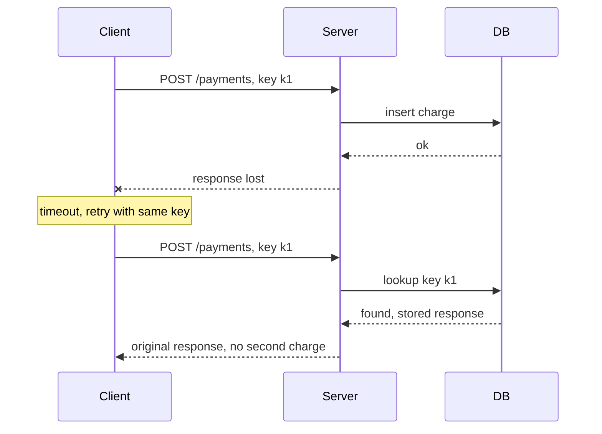

# Delivery semantics and idempotency

**In one line:** networks lose acknowledgements, so a sender must either risk losing a message or risk sending it twice; you get "exactly-once" behaviour by accepting duplicates and making their processing harmless.

## Why it matters in interviews

Every retry, queue consumer, webhook and payment call raises the same question: what if this runs twice? Saying "Kafka gives exactly-once" without qualification is a red flag. The expected answer is: delivery is at-least-once, and the consumer is idempotent through a natural key, a dedup table, or by committing its output and its progress in one transaction. For anything involving money, interviewers expect idempotency keys on the API.

## How it works

### The three guarantees

| Guarantee | How you get it | Failure mode |
|---|---|---|
| At-most-once | Ack or commit before processing; never retry | A crash after the ack loses the message |
| At-least-once | Process, then ack; retry until acked | A crash after processing but before the ack causes a duplicate |
| Exactly-once | Not possible as a delivery guarantee across independent systems | Achieved as an *effect*: at-least-once delivery plus idempotent processing |

The root cause is the ambiguous timeout. A client sends a request and hears nothing back. The request may never have arrived, may have been processed with the response lost, or may still be running. The client cannot tell these apart, so it can either give up (at-most-once) or retry (at-least-once). No protocol between two parties over an unreliable network removes this; the Two Generals problem is the classic statement of it.

### Effectively-once processing

Three common ways to make duplicate deliveries harmless:

1. **Naturally idempotent operations.** `SET balance = 100`, `PUT /users/42`, `DELETE /items/7`, "mark order 9 shipped". Applying them twice leaves the same state. `balance = balance + 10` and "append a row" are not idempotent.
2. **Dedup table.** Record each processed message ID (or business key) in a table with a unique constraint, in the same transaction as the side effect. A duplicate hits the constraint and is skipped.
3. **Output and offset in one transaction.** Store the consumer's position (Kafka offset, last event ID) in the same database transaction as the result. On restart, read the position from the database, not from the broker. A crash either loses both or keeps both.

### What Kafka's exactly-once covers

- The **idempotent producer** (`enable.idempotence=true`, on by default in recent clients) gives each producer an ID and sequence numbers per partition, so broker-side retries do not create duplicates in the log.
- **Transactions** let a producer write to several partitions and commit consumer offsets atomically. A read-process-write loop where both input and output are Kafka topics, and consumers use `isolation.level=read_committed`, gets exactly-once results. Kafka Streams uses this.
- None of this covers side effects outside Kafka. If your consumer calls an email API or writes to Postgres, you are back to at-least-once and need idempotency on that side.

### Idempotency keys (the Stripe pattern)

The client generates a unique key (usually a UUID) per logical operation and sends it in a header, for example `Idempotency-Key: 6f1c...`. The server:

1. Looks up the key. If absent, inserts it with status "in progress" and a **fingerprint** of the request (hash of method, path and body).
2. Runs the operation, then stores the response status and body against the key.
3. On a repeat with the same key and fingerprint, returns the stored response without re-running anything.
4. On a repeat with the same key but a different fingerprint, returns an error (Stripe does this); the client has reused a key for a different request.
5. On a repeat while the first is still "in progress", returns 409 so the client retries later instead of running it concurrently.

Keys are scoped to the account or API key and expire after a window (Stripe documents 24 hours). The key record and the business write should commit in the same transaction where possible; otherwise a crash between them leaves an ambiguous state that needs a recovery step.

### Dedup windows and their cost

You cannot store every message ID forever. A dedup window (minutes for SQS FIFO, hours or days for API keys) bounds storage, but a duplicate that arrives after the window is processed again. Size the window from the longest realistic retry horizon: client retry policy, queue retention, and how long a replay might reach back. Storage is roughly messages per second times window length times bytes per entry: 10,000 msg/s for 24 hours at 50 bytes is about 43 GB, which is a reason to prefer natural idempotency or offset-in-transaction where they fit.

### Idempotency across a chain

Each hop needs its own protection. A client retries to your API, your API retries to the payment provider, and your consumer retries its database write. Pass the original key downstream (or derive one from it, such as `k1:charge`) so the provider deduplicates too. A key that stops at your API protects only the first hop.

## Variants / options

| Option | Pros | Cons | Use when |
|---|---|---|---|
| At-most-once | Simplest, lowest latency | Loses data on crashes | Metrics samples, presence pings, anything where loss is fine |
| At-least-once + naturally idempotent writes | No extra storage | Not every operation can be phrased as a set or upsert | Upserts keyed by entity ID, state replacement |
| At-least-once + dedup table | Works for any operation | Extra write per message; table grows | Consumers with side effects in your own DB |
| Offset stored with output | Exactly-once effect, no dedup table | Output store must be transactional and you own offset management | Stream sinks into a relational DB |
| Kafka transactions | Exactly-once within Kafka | Only Kafka-to-Kafka; throughput cost | Kafka Streams and similar topologies |
| API idempotency keys | Safe client retries for non-idempotent calls | Server must store keys and responses | Payments, order creation, any POST that costs money |

## Where you see it

- Stripe, Adyen and PayPal APIs accept idempotency keys on POST requests.
- SQS FIFO deduplication IDs with a five-minute window.
- Kafka idempotent producer and transactions, used by Kafka Streams.
- Flink checkpoints combined with two-phase-commit sinks.

## Common mistakes

- Saying "exactly-once delivery" without saying where the guarantee stops.
- Deduplicating in Redis and writing the side effect to Postgres: the two can disagree after a crash.
- Generating the idempotency key on the server, which defeats the point; the client must reuse the same key on retry.
- Not storing the response, so a retry gets a different answer (or an error) instead of the original result.
- Retrying non-idempotent requests automatically in a client library or proxy.
- Dedup on message ID when the producer itself may re-send the same business event with a new ID; dedup on a business key instead.

## Interview questions

**Q: Can you guarantee exactly-once delivery?**
Not across independent systems. You can guarantee at-least-once delivery and make processing idempotent, which gives an exactly-once effect.

**Q: A payment request times out. Should the client retry?**
Only with the same idempotency key. The server then returns the stored result if the first attempt succeeded, and processes it if it never arrived.

**Q: How would you make a Kafka consumer that writes to Postgres effectively-once?**
Write the result and the consumed offset in one Postgres transaction, and on startup seek to the stored offset. Or keep a processed-IDs table with a unique constraint inside the same transaction.

**Q: Why include a request fingerprint with the idempotency key?**
To detect a client bug that reuses a key for a different request. Without it, the server would silently return a response for the wrong operation.

**Q: How long should you keep idempotency keys?**
Longer than the longest retry horizon. Past that, cost grows linearly with retention, so expire them and rely on natural keys for long-term uniqueness.

## Related

- Fundamentals: [message queues and streams](./message-queues-and-streams.md), [transactional outbox and CDC](./transactional-outbox-and-cdc.md), [distributed transactions](./distributed-transactions.md), [API design](./api-design.md), [resilience patterns](./resilience-patterns.md).
- Problems: [payment system](../problems/payment-system.md), [webhook delivery system](../problems/webhook-delivery-system.md), [notification system](../problems/notification-system.md).
- Code: [`src/idempotency-store`](../src/idempotency-store/).
- Pattern: [retry with backoff](https://github.com/hardyalsinghdeora/design-patterns/tree/main/src/modern/retry-with-backoff).
