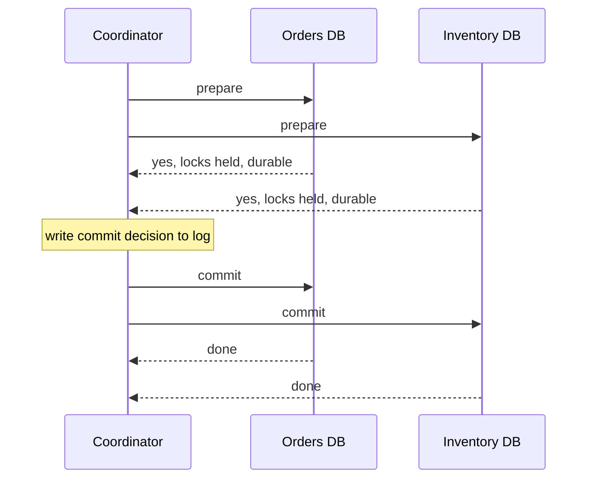

# Distributed transactions

**In one line:** making one business operation atomic across several databases or services is expensive and fragile, so prefer one database per invariant, then sagas with compensations, and use two-phase commit only inside a single trusted system.

## Why it matters in interviews

"Place the order, reserve stock, charge the card" spans three services in most microservice designs. The interviewer wants to know what happens when the charge fails after stock is reserved. Weak answers reach for a distributed transaction without knowing its costs, or wave at "eventual consistency" with no plan for partial failure. Strong answers explain why 2PC blocks, design a saga with explicit compensations, address the missing isolation, and ask whether the boundary should move so one database owns the rule.

## How it works

### Why it is hard

A local transaction relies on one log and one lock manager. Across nodes there is no shared log: each participant can crash, time out or be partitioned independently, and a participant that has promised to commit cannot change its mind. Any atomic commit protocol must make every participant agree on commit or abort, which is a consensus problem with the same impossibility limits.

### Two-phase commit (2PC)

1. **Prepare.** The coordinator asks each participant to prepare. A participant that votes yes has made its changes durable and holds its locks; it can no longer abort on its own.
2. **Commit.** If every vote is yes, the coordinator logs the decision and tells everyone to commit. Any no (or timeout) means abort.

The weakness is the window between voting yes and hearing the decision. If the coordinator crashes there, prepared participants are **in doubt**: they cannot commit (others may have aborted) or abort (others may have committed), so they hold locks until the coordinator recovers. 2PC is a **blocking** protocol. It also adds at least two round trips and a forced log write per participant to every transaction, and throughput is limited by the slowest participant.

**XA** is the standard interface for 2PC across heterogeneous resources (a database and a message broker, for example), supported by many relational databases and Java transaction managers. It works, but operational tooling for in-doubt transactions is poor and many cloud services and modern brokers do not support it.

Inside a single distributed database, 2PC is common and fine: Spanner, CockroachDB and YugabyteDB run 2PC across shards, but each participant is itself a consensus-replicated group, so a "participant crash" is masked by failover and the coordinator state is replicated too.

### Three-phase commit (3PC)

3PC adds a pre-commit phase so that participants can make progress if the coordinator fails. It assumes bounded network delay and fail-stop nodes; under real network partitions it can produce inconsistent outcomes, so it is rarely used. Consensus-based commit (Paxos Commit, or 2PC over Raft groups) is the practical answer to coordinator failure.

### Sagas

A saga is a sequence of local transactions, each in one service. If step k fails, run **compensating transactions** for steps k-1 back to 1. Each step commits immediately, so there are no long-held locks, but there is also no isolation: other requests can see intermediate states.

- **Orchestration**: a saga orchestrator (a workflow engine or a state machine in one service) calls each step and decides what to do next. The flow lives in one place, which makes it easier to reason about, test and monitor.
- **Choreography**: each service listens for events and reacts ("OrderCreated" leads Inventory to reserve, "StockReserved" leads Payment to charge). No central component, but the flow is spread across services and harder to trace and change.

Compensations are semantic, not rollbacks. "Refund the charge" undoes "charge the card", but an email cannot be unsent. Order steps so that irreversible actions come last (a **pivot** step), and make every step and compensation idempotent and retryable, since they are triggered by messages that may be redelivered.

### Countermeasures for missing isolation

Sagas were introduced by Garcia-Molina and Salem (1987). Chris Richardson's catalogue of countermeasures, drawn from Frank and Zahle (1998), is the usual reference:

| Countermeasure | Idea |
|---|---|
| Semantic lock | Mark the record as pending (`status = PENDING_PAYMENT`) so other requests know it is in flux |
| Commutative updates | Design updates so order does not matter (increment and decrement counters) |
| Pessimistic view | Order steps to reduce the damage of dirty reads (reserve stock before showing it as sold) |
| Reread value | Check the record has not changed before overwriting (optimistic check) |
| Version file | Record operations so out-of-order ones can be reordered |
| By value | Pick the mechanism by risk: sagas for low-value requests, stronger coordination for high-value ones |

### Try-Confirm/Cancel (TCC)

Each participant exposes three operations: **Try** reserves resources (hold $50, hold one seat) without making the effect final, **Confirm** finalises the reservation, **Cancel** releases it. A coordinator calls Try on everyone, then Confirm or Cancel. It is a business-level 2PC: reservations act as locks, but they are visible, time-limited and owned by the application. Reservations need a timeout so a lost coordinator does not hold them forever.

### Redraw the boundary first

If two pieces of data must change together, consider putting them in one service and one database. "Order and payment status must agree" may mean the order service owns the payment record, and the external payment provider is called via an outbox. A single-database transaction is simpler and faster than any distributed protocol. The [transactional outbox](./transactional-outbox-and-cdc.md) then publishes the change reliably to everyone else.

## Variants / options

| Option | Pros | Cons | Use when |
|---|---|---|---|
| One database owns the invariant | Real ACID, simple | May require merging services or data | The rule is truly atomic (balance never negative) |
| 2PC / XA | Atomic, isolated | Blocking on coordinator failure; latency; poor support in brokers and SaaS | Few participants you control, low volume, same data centre |
| 2PC over consensus groups (Spanner, CockroachDB) | Atomic and fault tolerant | Cross-region latency per commit | You already use a distributed SQL database |
| Orchestrated saga | Clear flow, observable, no long locks | No isolation; compensations to design | Multi-service business workflows (orders, bookings) |
| Choreographed saga | Loose coupling, no central component | Flow hard to trace; cyclic event chains | Few steps, stable flow |
| TCC | Explicit reservations, bounded holds | Every participant needs three APIs | Inventory, seats, funds holds |

## Where you see it

- XA in Java EE application servers and many relational databases.
- Spanner, CockroachDB and YugabyteDB use 2PC across consensus-replicated shards.
- Workflow engines such as Temporal, AWS Step Functions and Camunda are used to orchestrate sagas.
- Travel and ticket booking: hold a seat with a timeout, then confirm on payment (TCC shape).

## Common mistakes

- Using 2PC across microservices owned by different teams, then discovering in-doubt locks during an outage.
- Treating compensations as rollbacks and forgetting non-reversible steps.
- Ignoring isolation: two sagas both see stock available and both reserve it.
- Non-idempotent saga steps that double-charge on message redelivery.
- Choreography with ten services and no single place showing where an order is stuck.
- Not considering whether the services should be one service.

## Interview questions

**Q: Why not use 2PC between the order and payment services?**
It blocks when the coordinator fails after prepare, holds locks across network round trips, needs every participant to support it (payment providers do not), and couples the availability of both services. A saga or a reservation is a better fit.

**Q: Orchestration or choreography?**
Orchestration for flows with more than three or four steps or frequent changes, because the logic lives in one place and you can see each saga's state. Choreography for short, stable flows where loose coupling matters more.

**Q: The card charge succeeds but the inventory service is down. What happens?**
The orchestrator retries the reservation with backoff (it is idempotent). If it fails permanently, it runs the compensation: refund the charge and cancel the order. Better still, reserve stock before charging so the irreversible step comes last.

**Q: How do you stop two sagas from overselling the last item?**
Make the reservation itself atomic in the inventory database (a conditional decrement), and use a semantic lock (the order is `PENDING`) so other flows treat the stock as taken.

**Q: Where is 2PC acceptable?**
Inside one distributed database whose participants are replicated groups, or between a few resources in one data centre with good tooling for in-doubt transactions.

## Related

- Fundamentals: [transactions and isolation](./transactions-and-isolation.md), [consensus and coordination](./consensus-and-coordination.md), [transactional outbox and CDC](./transactional-outbox-and-cdc.md), [delivery semantics and idempotency](./delivery-semantics-and-idempotency.md), [microservices and boundaries](./microservices-and-boundaries.md), [event-driven architecture](./event-driven-architecture.md).
- Problems: [ecommerce platform](../problems/ecommerce-platform.md), [payment system](../problems/payment-system.md), [ticket booking](../problems/ticket-booking.md), [food delivery](../problems/food-delivery.md).
- Patterns: [saga](https://github.com/hardyalsinghdeora/design-patterns/tree/main/src/modern/saga), [transactional outbox](https://github.com/hardyalsinghdeora/design-patterns/tree/main/src/modern/transactional-outbox).
