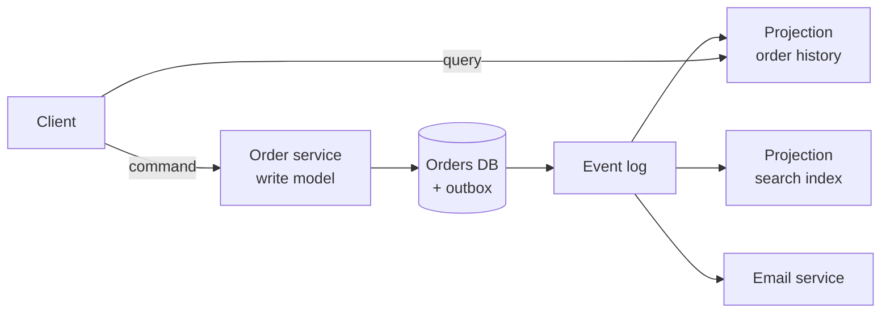

# Event-driven architecture

**In one line:** services announce facts that have happened and others react to them, which decouples who produces a change from who cares about it, at the cost of eventual consistency and flows that are harder to see.

## Why it matters in interviews

Most large designs end up with events: an order is placed and five downstream systems react. Interviewers want to see that you can tell an event from a command, choose how much data an event carries, plan for schema changes without breaking consumers, and design the user experience around data that is not yet up to date everywhere. "We will use events" with no answer to "what happens when consumer three changes its mind about the format?" is a weak answer.

## How it works

### Events, commands and queries

| Message | Meaning | Tense | Receivers | Example |
|---|---|---|---|---|
| Command | "Please do this"; can be rejected | Imperative | Exactly one handler | `ReserveStock` |
| Event | "This happened"; cannot be rejected | Past | Zero or more subscribers | `StockReserved` |
| Query | "Tell me this"; no side effects | Question | One handler, expects a reply | `GetStockLevel` |

The producer of an event does not know or care who listens. The sender of a command depends on the receiver existing and doing the work. Mixing them up ("`SendEmail` event") hides coupling: if something must happen, it is a command and someone owns it.

Name events after business facts (`OrderPlaced`, `PaymentFailed`), not table operations (`OrderRowUpdated`). Business events survive internal refactoring; row-change events leak the schema.

### Fowler's taxonomy

Martin Fowler's essay "What do you mean by Event-Driven?" separates patterns that share the label:

- **Event notification.** The event carries little more than an ID and type (`OrderPlaced {orderId: 42}`). Consumers call back to the producer for details. Small events and low coupling on data shape, but callbacks add load and the producer must be up.
- **Event-carried state transfer.** The event carries the data consumers need (`OrderPlaced {orderId, items, total, address}`). Consumers keep a local copy and never call back. More resilient and faster to read, but data is duplicated and the event schema becomes a wider contract.
- **Event sourcing.** The events *are* the system of record. Current state is rebuilt by replaying the event log for an aggregate; snapshots shorten replay. You get a full audit history and can build new views from the past, but querying current state needs projections, and changing old event formats is hard.
- **CQRS** (Command Query Responsibility Segregation). Separate the write model from one or more read models, often kept in sync by events. Each read model is shaped for its queries (a search index, a denormalised table, a cache). Often paired with event sourcing but does not require it.

### Schema evolution

Events outlive the code that wrote them, especially in a retained log. Use a schema format with explicit rules and a registry:

- **Avro**, **Protobuf** or **JSON Schema**, stored in a **schema registry** (Confluent Schema Registry, AWS Glue Schema Registry, Apicurio). Producers register schemas; the registry rejects incompatible changes.
- **Backward compatible**: consumers on the new schema can read data written with the old one. Adding a field with a default is backward compatible. Upgrade consumers first.
- **Forward compatible**: consumers on the old schema can read data written with the new one. Adding a field old readers ignore, or removing a field that has a default, is forward compatible. Upgrade producers first.
- **Full**: both. Safest for topics with many independent consumers.
- In Protobuf, never reuse a field number; mark removed fields `reserved`. In Avro, new fields need defaults.
- For a breaking change, publish a new event type or a new topic version (`orders.v2`) and run both until consumers migrate.

### Choreography pitfalls

When services react to each other's events with no coordinator, the business flow exists only in the combined behaviour.

- No single place shows where an order is stuck; you need distributed tracing and correlation IDs on every event.
- Cyclic chains: A reacts to B, B to C, C to A.
- A change to the flow touches several teams.
- Error handling is spread out; each service needs to know what compensation to emit.

Use orchestration (a workflow engine or one owning service) when the flow has many steps or changes often. Choreography suits independent reactions ("when an order ships, also send a survey"), not tightly ordered workflows.

### Designing UX for eventual consistency

A read model updated by events lags the write by milliseconds to seconds, sometimes longer.

- Return the result of the command directly to the user who made it, rather than reading it back from a lagging projection.
- Read-your-writes: route the author's reads to the write model for a short time, or pass the write's version and wait until the projection reaches it.
- Show pending states honestly ("Payment processing"), with a status the client can poll or receive by push.
- Avoid flows where a user must immediately read data written by another service in the same click.

## Variants / options

| Option | Pros | Cons | Use when |
|---|---|---|---|
| Synchronous calls only | Simple, immediately consistent | Temporal coupling; cascading failures | Few services, the caller needs the answer now |
| Event notification | Small events, flexible consumers | Callbacks to producer; producer must be up | Consumers need different subsets of data |
| Event-carried state transfer | Consumers independent and fast | Data duplication, wider contract | Many readers of the same entity |
| Event sourcing | Full history, rebuildable views | Complexity, projections, hard to change old events | Audit-heavy domains (ledgers), temporal queries |
| CQRS with projections | Read models shaped per query | Eventual consistency, more moving parts | Read and write patterns differ sharply |

## Where you see it

- Kafka as the event backbone, with Debezium CDC feeding it from databases.
- Ledgers and accounting systems that append entries and derive balances, close to event sourcing.
- Search indexes and caches built as projections from change events.
- Cloud event buses such as Amazon EventBridge and Google Cloud Pub/Sub.

## Common mistakes

- Commands disguised as events, so ownership and failure handling are unclear.
- Publishing events with a dual write instead of an outbox.
- No schema registry; a producer renames a field and breaks every consumer.
- Event sourcing everything, including CRUD data with no need for history.
- Assuming events arrive in order across partitions, or exactly once.
- Leaving users staring at stale data right after they acted.

## Interview questions

**Q: What is the difference between an event and a command?**
A command asks one handler to do something and can be rejected. An event states something that already happened; any number of subscribers may react, and none can reject it.

**Q: Should the event carry the full order or just its ID?**
Carry enough for the main consumers to act without calling back (event-carried state transfer), so they keep working when the producer is down. Use ID-only notifications when consumers need very different data or the payload is large or sensitive.

**Q: How do you add a field to an event without breaking consumers?**
Add it as optional with a default, register the schema with backward compatibility enforced, and let consumers adopt it when ready. Breaking changes go to a new event version.

**Q: When would you use event sourcing?**
When the history itself is valuable: ledgers, audit trails, or when you need to rebuild new read models from past behaviour. Not for ordinary CRUD.

**Q: A user updates their profile and the page still shows the old name. How do you fix it?**
Return the updated profile from the write, or read from the write model for that user for a short window, or have the client wait until the projection reaches the write's version.

## Related

- Fundamentals: [message queues and streams](./message-queues-and-streams.md), [transactional outbox and CDC](./transactional-outbox-and-cdc.md), [distributed transactions](./distributed-transactions.md), [delivery semantics and idempotency](./delivery-semantics-and-idempotency.md), [consistency models](./consistency-models.md), [microservices and boundaries](./microservices-and-boundaries.md), [observability](./observability.md).
- Problems: [ecommerce platform](../problems/ecommerce-platform.md), [food delivery](../problems/food-delivery.md), [notification system](../problems/notification-system.md).
- Patterns: [CQRS](https://github.com/hardyalsinghdeora/design-patterns/tree/main/src/modern/cqrs), [event sourcing](https://github.com/hardyalsinghdeora/design-patterns/tree/main/src/modern/event-sourcing), [saga](https://github.com/hardyalsinghdeora/design-patterns/tree/main/src/modern/saga).
