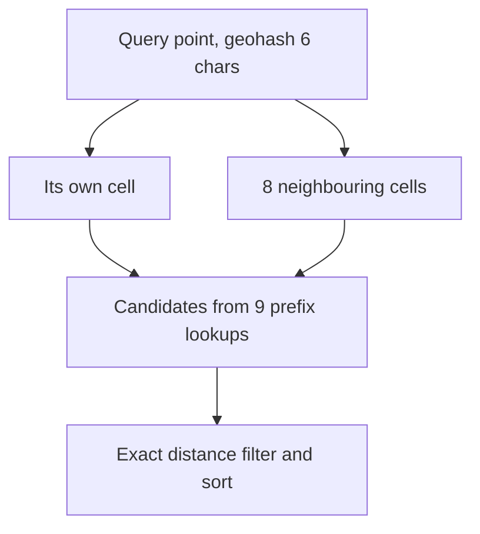

# Geospatial indexing

**In one line:** map two-dimensional locations onto one-dimensional cell ids (geohash, S2, H3) or a spatial tree (quadtree, R-tree), so "what is near this point?" becomes a lookup of a few cells instead of a scan of every row.

## Why it matters in interviews

Proximity search, ride hailing, food delivery and maps all ask "find things within 2 km of me". Interviewers want to see you explain why an ordinary index on latitude and longitude does not solve it, pick a cell scheme, handle cell edges, and treat static places (restaurants) differently from moving points (drivers updating every few seconds).

## How it works

### Why naive range queries are slow

`WHERE lat BETWEEN a AND b AND lon BETWEEN c AND d` can use a B-tree index on one column efficiently. With an index on `(lat, lon)`, the database narrows to a latitude band, but that band runs around the whole planet, and every row in it must be checked for longitude. Two separate indexes give two huge candidate sets to intersect. Then a distance calculation must still filter the box down to a circle. The fix is an index whose ordering keeps nearby points close together.

### Geohash

Geohash alternately bisects longitude and latitude, interleaves the resulting bits, and encodes them in base32. Each extra character subdivides the cell into 32 smaller ones. A shared prefix means a shared containing cell, so a prefix query on a B-tree or a sorted set finds everything in a cell.

| Length | Approx. cell size at the equator |
|---|---|
| 4 | 39 km x 20 km |
| 5 | 4.9 km x 4.9 km |
| 6 | 1.2 km x 0.6 km |
| 7 | 153 m x 153 m |
| 8 | 38 m x 19 m |

Cells shrink in the east-west direction away from the equator, because lines of longitude converge.

**Edge problem:** two points a few metres apart on either side of a cell boundary can have very different geohashes (at the equator or the prime meridian they share no prefix at all). So never query only the point's own cell: query it plus its eight neighbours, choosing a precision whose cell is at least as large as the search radius, then filter by exact distance.

### Quadtrees

Start with one square covering the area; split any square holding more than N points into four children, recursively. Dense cities get small cells and empty oceans stay as one big cell, so each leaf holds a similar number of points. Usually held in memory and rebuilt or updated in place. Good for "k nearest" queries with uneven density; harder to shard than fixed cell ids.

### Google S2

S2 projects the sphere onto the six faces of a cube and orders the cells on each face along a Hilbert curve, which keeps nearby cells close in id order better than geohash's Z-order. Cell ids are 64-bit integers across 31 levels (0 to 30), from a whole cube face down to roughly a square centimetre. A region coverer approximates any circle or polygon with a small set of cells, possibly at mixed levels, and each becomes an id range scan.

### Uber H3

H3 tiles the globe with hexagons at 16 resolutions (0 to 15). Hexagons have six neighbours all at the same centre-to-centre distance, which makes "rings" around a cell, smoothing and movement analysis simple. The trade-offs: a parent hexagon does not exactly contain its seven children (containment is approximate), and each resolution includes 12 pentagons. Uber open-sourced it in 2018 for marketplace analysis such as supply, demand and pricing by area.

### R-trees and PostGIS

An R-tree groups nearby shapes into nested bounding rectangles; a query descends only into rectangles that overlap the search area. It indexes polygons and lines as well as points. PostGIS uses GiST indexes, which provide R-tree-style indexing, with functions such as `ST_DWithin` on the `geography` type for metre-based radius search. This is the right choice when you also need polygons (delivery zones, city boundaries) and SQL joins.

### Redis geo commands

`GEOADD` stores members in a sorted set whose score is a 52-bit geohash-style integer. `GEOSEARCH` (Redis 6.2 and later, replacing `GEORADIUS`) finds members within a radius or box, internally by scanning the relevant score ranges for the centre and neighbouring cells, then filtering by distance. Fast and simple for millions of points that fit in memory.

### Static points vs moving points

| | Static (restaurants, stores) | Moving (drivers, couriers) |
|---|---|---|
| Write rate | Rare updates | Every few seconds per object |
| Storage | Database with a spatial index, cached | In memory, often sharded by cell or city |
| Staleness | Hours are fine | Seconds matter; expire positions with a TTL |
| Update cost | Index rebuild acceptable | Update only when the object changes cell |

For moving points, keep `cell -> set of driver ids` and `driver -> (cell, position, timestamp)` in memory. On each location update, move the driver between sets only if the cell changed. Old positions expire so a driver whose app died disappears from results.

## Variants / options

| Option | Pros | Cons | Use when |
|---|---|---|---|
| Geohash on a B-tree or sorted set | Works in any KV store or database, easy to shard by prefix | Edge effects, Z-order jumps, cells distort with latitude | Simple proximity search |
| Quadtree | Adapts to density | In-memory structure, harder to distribute | Uneven density, k-nearest queries |
| S2 cells | Good locality, precise region covering | More complex library | Region coverage, global services |
| H3 hexagons | Uniform neighbours, good for aggregation | Approximate parent-child containment | Analytics, pricing, demand heatmaps |
| PostGIS (R-tree via GiST) | Polygons, SQL, exact geometry | One database's write limits | Zones, boundaries, moderate scale |
| Redis GEO | In memory, fast updates | Memory bound, radius and box queries only | Moving points, live maps |

## Where you see it

- Redis `GEOADD` and `GEOSEARCH`; Elasticsearch `geo_point` and `geo_shape` fields.
- PostGIS on PostgreSQL.
- Google's S2 library; Uber's H3 library.
- Ride-hailing dispatch, food delivery, store locators and map tile services.

## Common mistakes

- A B-tree on latitude and longitude presented as a spatial index.
- Querying only the point's own geohash cell, missing neighbours across the boundary.
- Using degrees as distance; one degree of longitude shrinks towards the poles.
- Writing every driver update to a disk-based spatial index.
- No expiry on positions, so offline drivers keep showing up.
- One global in-memory index with no sharding plan for hot cities.
- Skipping the exact distance filter, so results include the corners of the cell box outside the circle.
- Ignoring the antimeridian and the poles, where longitude wraps and cells become very narrow.

## Interview questions

**Q: Why not just index latitude and longitude?**
A composite B-tree narrows to a latitude band that spans the whole planet and scans every longitude in it. Cell ids keep nearby points adjacent in the index.

**Q: Two restaurants 10 m apart have completely different geohashes. How do you still find both?**
They sit on a cell boundary. Query the point's cell plus its eight neighbours, then filter by exact distance.

**Q: How do you choose geohash precision for a 1 km radius?**
Pick the precision whose cell is at least about 1 km across (length 6 is about 1.2 km x 0.6 km, so length 5 is safer), search the cell and its neighbours, then filter.

**Q: How would you store live driver locations for a city?**
In memory, keyed by cell, sharded by city or region. Update the driver's entry on each ping, move it between cells only when the cell changes, and expire entries after a few missed pings.

**Q: When would you choose H3 over geohash?**
For aggregation and analysis by area, such as demand heatmaps and pricing zones, because hexagons have uniform neighbours. For simple prefix-based lookups in an existing store, geohash is simpler.

## Related

- Fundamentals: [sharding and partitioning](./sharding-and-partitioning.md), [caching strategies](./caching-strategies.md), [realtime communication](./realtime-communication.md), [storage engines](./storage-engines.md).
- Problems: [proximity service](../problems/proximity-service.md), [ride hailing](../problems/ride-hailing.md), [food delivery](../problems/food-delivery.md), [maps and navigation](../problems/maps-and-navigation.md).
- Code: [`src/geohash`](../src/geohash/).
