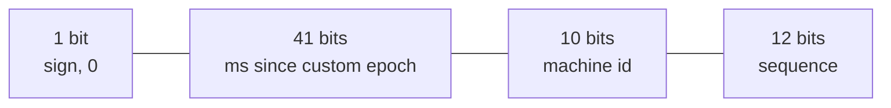

# ID generation

**In one line:** pick an id scheme by what you need from it (globally unique, roughly time-sortable, compact, generated without coordination), knowing that random ids scatter B-tree inserts and time-based ids depend on clocks.

## Why it matters in interviews

Every design creates entities: posts, orders, messages, short URLs. Once there are many writers or many shards, "use auto-increment" stops working and the interviewer asks how ids are made. Good answers state requirements first and then pick: Snowflake-style ids for sortable 64-bit keys, UUIDv7 when 128 bits is fine, base62 codes for user-visible short strings. Expect follow-ups on clock skew, machine id assignment, and why UUIDv4 primary keys hurt databases.

## How it works

### Requirements to ask about

| Requirement | Question | Affects |
|---|---|---|
| Unique | Across shards, regions, retries? | Everything |
| Sortable | Do ids need to sort by creation time? | Feed pagination, index locality |
| Compact | 64-bit integer, 128-bit, or a short string? | Index size, URLs |
| Coordination-free | Can every node mint ids without a network call? | Latency, availability |
| Unguessable | Must ids hide volume or prevent enumeration? | Security, public URLs |

### Auto-increment and ticket servers

A single database sequence is simple, compact and strictly increasing, but every insert depends on one node, and ids leak volume (order 1,000,042 tells competitors your order count).

A **ticket server** is a dedicated database that hands out ids. Flickr described running two MySQL servers, one issuing odd and one even ids (`auto_increment_increment = 2` and different offsets), so either can fail. Clients can fetch ranges (blocks of 1,000) to avoid a round trip per id. Simple, but it is still a central service, and ids from the two servers are not globally ordered.

### UUIDv4

122 random bits. No coordination and practically no collisions. The cost is in the database: random keys insert into random leaf pages of a B-tree index, causing page splits, poor cache locality and larger, fragmented indexes. In InnoDB the primary key is the clustered index, so the whole table suffers ([storage engines](./storage-engines.md)). They also do not sort by time.

### UUIDv7 (RFC 9562)

RFC 9562 (May 2024) replaced RFC 4122 and defined UUIDv7: a 48-bit Unix timestamp in milliseconds, then version and variant bits, then 74 bits that are random or partly a counter for ordering within a millisecond. Ids generated later sort later, so inserts append to the right edge of the index like a sequence, while still needing no coordination. Postgres 18 added a built-in `uuidv7()` function; libraries exist for most languages. It reveals creation time, which is usually acceptable.

### ULID

128 bits: 48-bit millisecond timestamp plus 80 random bits, written as 26 Crockford base32 characters that sort lexicographically in time order. A monotonic mode increments the random part for ids within the same millisecond. Predates UUIDv7 and fills the same role; UUIDv7 is now the standard choice where a UUID type is expected.

### Snowflake

Twitter's Snowflake packs an id into a signed 64-bit integer:

- 41 bits of milliseconds last about 69 years from the chosen epoch.
- 10 bits allow 1,024 generators (Twitter split them into 5 bits datacenter and 5 bits worker).
- 12 bits allow 4,096 ids per millisecond per generator, about 4 million per second. If the sequence overflows, wait for the next millisecond.

Ids are roughly time-ordered across machines (exactly ordered per machine), fit in a `BIGINT`, and are generated locally. Machine ids must be unique: assign them from configuration, from ZooKeeper or etcd leases, or from a database table at startup. Instagram described a variant generated inside Postgres: 41 bits of time, 13 bits of logical shard id and 10 bits of sequence. See [`src/snowflake-id`](../src/snowflake-id/).

### KSUID

Segment's KSUID is 20 bytes: a 32-bit timestamp in seconds since a custom epoch plus 128 random bits, encoded as 27 base62 characters. Sortable at second granularity, with more randomness than ULID.

### Base62 short codes

For user-visible codes (URL shorteners, invite codes), encode a number in `[0-9a-zA-Z]`. 62^6 is about 57 billion and 62^7 about 3.5 trillion, so 7 characters cover a very large service. Sources for the number:

- **A counter or Snowflake id, then base62.** Unique without collision checks, but sequential counters are guessable; shuffle with a reversible permutation if that matters.
- **Random code plus uniqueness check.** Unguessable; insert with a unique constraint and retry on collision.
- **Hash of the long URL, truncated.** Deduplicates identical URLs but must handle collisions.

### Clock skew

Time-based ids assume clocks move forward. NTP can step a clock backwards, and VM pauses or leap-second handling can cause jumps. If a generator's clock moves backwards, it could reissue ids. Snowflake implementations refuse to generate (or wait) until the clock passes the last timestamp used. Across machines, skew only makes ordering approximate, which is why Snowflake ids are "roughly sortable". Do not use them to decide causality ([consistency models](./consistency-models.md)).

## Variants / options

| Option | Size | Sortable | Coordination | Pros | Cons | Use when |
|---|---|---|---|---|---|---|
| Auto-increment | 64-bit | Yes | Single DB | Simplest, compact | Single writer; leaks volume | One database |
| Ticket server with ranges | 64-bit | Per server | Central service | Compact, simple | Central dependency | Few writers, ids must be integers |
| UUIDv4 | 128-bit | No | None | No coordination, unguessable | Index fragmentation | Non-key identifiers, tokens |
| UUIDv7 | 128-bit | Yes (ms) | None | Standard, index-friendly | Reveals time; 16 bytes | Default primary key for new systems |
| ULID | 128-bit | Yes (ms) | None | Readable, sortable strings | Not a UUID version | String ids in logs, URLs |
| Snowflake | 64-bit | Roughly | Machine id assignment | Compact, fast, sortable | Clock dependence; machine id management | High-volume sortable ids (tweets, messages) |
| KSUID | 160-bit | Yes (s) | None | Lots of randomness | Larger | Event ids |
| Base62 code | 6-8 chars | Depends on source | Depends on source | Short and URL-safe | Collisions or guessability | User-visible codes |

## Where you see it

- Twitter Snowflake and derivatives (Discord's message ids are Snowflakes with their own epoch).
- UUIDv7 in new Postgres and MySQL schemas; ULID in many event and log pipelines.
- Base62 codes in URL shorteners and invite links.

## Common mistakes

- UUIDv4 as the clustered primary key of a large, write-heavy InnoDB table.
- Snowflake without a plan for assigning unique machine ids, or for clocks moving backwards.
- Treating Snowflake order as exact global order across machines.
- Exposing sequential ids in public URLs when enumeration matters.
- Hashing long URLs to short codes without collision handling.
- Using ids as timestamps for business logic. Use a real `created_at` column; id time is approximate and may come from a skewed clock.

## Interview questions

**Q: Why not UUIDv4 for primary keys?**
Random values insert all over the B-tree, causing page splits, cache misses and fragmentation. UUIDv7 or Snowflake ids insert near the end of the index.

**Q: Explain the Snowflake layout and its limits.**
1 sign bit, 41 bits of milliseconds (about 69 years), 10 bits of machine id (1,024 generators), 12 bits of sequence (4,096 per millisecond per generator). Limits: clock dependence and machine id assignment.

**Q: What if the clock goes backwards?**
Track the last timestamp used; if the current time is earlier, wait until it catches up or fail the request and alert. Never reuse a timestamp with a reset sequence.

**Q: How would you generate 7-character short URLs?**
Take a unique number from a Snowflake generator or a range-allocated counter and base62-encode it, optionally permuted so codes are not sequential. Or generate random 7-character codes and insert with a unique constraint, retrying on collision.

**Q: UUIDv7 or Snowflake?**
UUIDv7 if 128 bits is acceptable: standard, no machine ids to manage. Snowflake if you need 64-bit integers for storage size or compatibility.

**Q: Can a shard be derived from the id?**
Yes, if the id embeds it. Instagram's scheme puts a logical shard id in 13 bits, so any service can route a lookup by id without a directory. With Snowflake or UUIDv7 you hash the id instead.

## Related

- Fundamentals: [storage engines](./storage-engines.md), [sharding and partitioning](./sharding-and-partitioning.md), [consistency models](./consistency-models.md), [consensus and coordination](./consensus-and-coordination.md).
- Problems: [url shortener](../problems/url-shortener.md), [chat system](../problems/chat-system.md), [news feed](../problems/news-feed.md), [payment system](../problems/payment-system.md).
- Code: [`src/snowflake-id`](../src/snowflake-id/).
