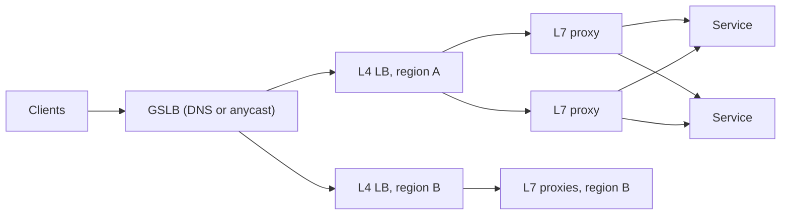

# Load balancing

**In one line:** spread requests across a pool of interchangeable servers, stop sending traffic to the unhealthy ones, and make sure the balancer itself is never the single point of failure.

## Why it matters in interviews

Almost every design starts with "client → load balancer → stateless service", so the box gets questioned: L4 or L7? Which algorithm? How is a dead backend detected? What happens when the load balancer itself dies? How do users in Europe reach the nearest region? Each answer is short, but skipping them reads as hand-waving. The load balancer is also where TLS usually terminates, where deploys drain traffic, and where global traffic steering starts.

## How it works

1. The client resolves a hostname. DNS (or an anycast address) leads it to a load balancer, usually in the nearest region.
2. The load balancer picks a backend from the pool of healthy instances using a balancing algorithm.
3. It forwards the connection (L4) or each individual request (L7) and relays the response.
4. Health checks and observed errors keep adding and removing backends from the pool.

A common layout is tiered: a cheap, fast L4 layer spreads connections over a fleet of L7 proxies, which do the request-level routing.

### L4 vs L7

| | L4 (transport) | L7 (application) |
|---|---|---|
| Sees | IP addresses, ports, TCP/UDP | HTTP method, path, headers, cookies, gRPC service |
| Balances | Connections (flows) | Individual requests |
| Can do | Forward packets, TLS passthrough, direct server return | Path and header routing, retries, rewrites, auth, caching, compression |
| Cost | Very low per packet | Parses every request, so more CPU |
| Examples | AWS NLB, Google Maglev, Linux IPVS, HAProxy in TCP mode | nginx, Envoy, HAProxy in HTTP mode, AWS ALB |

The difference matters for HTTP/2 and gRPC: one long-lived connection carries thousands of requests, so an L4 balancer pins all of them to one backend. Use an L7 proxy or client-side balancing for gRPC.

### Choosing a backend

Round robin is fine when servers are identical and requests cost about the same. When request durations vary, prefer a load-aware choice such as least connections. With many independent balancers, each one only sees its own connections, so they can all pick the same "least loaded" server at once, typically a server that has just been added. **Power of two random choices** avoids this: pick two backends at random and send the request to the less loaded one. In the classic balls-into-bins analysis, placing n requests on n servers at random leaves the busiest server with about log n / log log n of them; picking the less loaded of two cuts that to about log log n. Envoy's least-request balancer and nginx `random two least_conn` work this way. Pair any load-aware algorithm with **slow start** so a new server with cold caches is ramped up instead of flooded.

### Health checks

- **Active**: the balancer probes each backend (for example `GET /healthz` every 5 s), marks it down after N consecutive failures and up after M successes. The thresholds stop flapping.
- **Passive** (outlier detection): the balancer watches real traffic and ejects a backend that returns consecutive 5xx responses or connection errors, then tries it again after a cool-down. This catches failures between probes and failures the probe does not exercise.
- Use both. Keep the health endpoint about *this instance* being able to serve. If it checks a shared database, one database blip marks every instance unhealthy at the same moment.
- Balancers have a safety valve for that case: Envoy ignores health status once too many hosts look unhealthy (its "panic threshold"), and AWS ALB and NLB route to all targets when every target fails its checks (they fail open).
- On deploys, **drain**: stop sending new requests to an instance and let in-flight ones finish before it shuts down.

### Sticky sessions

Session affinity pins a client to one backend, by cookie or by hashing the client IP. It lets a server keep session state in memory, which is exactly why to avoid it: load becomes uneven (a heavy user stays on one box), a crash loses that server's sessions, and scaling in or deploying breaks affinity anyway. Keep servers stateless and put session state in Redis, the database or a signed token. Affinity is acceptable as an optimisation (a warm per-user cache that can be lost) but not as a correctness requirement. WebSockets are sticky by nature for the life of the connection.

### TLS termination

- **Terminate at the balancer**: it holds the certificates, decrypts, and can route on HTTP content. Backends skip the handshake work and certificates are managed in one place.
- **Re-encrypt**: terminate, then open a new TLS (often mTLS) connection to the backend. Needed when the internal network is not trusted or compliance requires encryption on every hop.
- **Passthrough**: an L4 balancer forwards encrypted bytes and the backend terminates. Encryption is end to end, but the balancer can only route on IP, port and the SNI hostname.

### Global load balancing

- **DNS-based GSLB**: the authoritative DNS answers with the address of the nearest or healthiest region (geo, latency or failover policies). Cheap and universal, but resolvers and clients cache answers, sometimes longer than the TTL, so failover takes minutes for some users. The DNS server also sees the resolver's location rather than the user's; EDNS Client Subnet helps.
- **Anycast**: the same IP prefix is announced over BGP from many sites, and the network delivers each packet to the nearest one. Failover is a route withdrawal, which takes effect in seconds. CDNs and public DNS resolvers rely on it, and anycast front ends usually terminate the connection at the edge and forward to a backend region over the provider's own network.

### Keeping the load balancer available

- **Active-passive pair**: two nodes share a virtual IP using VRRP (keepalived). When the active node stops sending heartbeats, the standby claims the IP.
- **Active-active fleet**: routers spread flows over many balancer nodes with ECMP. Each node uses consistent hashing (Maglev hashing in Google's design) so a flow still reaches the same backend after a balancer node is added or removed.
- **Managed cloud balancers** already run as a distributed fleet across availability zones; the remaining risks are misconfiguration and regional outages.
- Spread balancers over several zones and list several addresses in DNS, so no single box or zone fronts all traffic.

### Gateway, load balancer, reverse proxy, service mesh

| Component | Sits | Main job | Examples |
|---|---|---|---|
| Reverse proxy | In front of servers | Accept client connections and forward them; TLS, caching, compression | nginx, HAProxy |
| Load balancer | In front of a pool of identical instances | Spread traffic, remove unhealthy instances | AWS ALB/NLB, Maglev, Envoy |
| API gateway | At the edge, in front of many services | Auth, API keys, rate limits, routing by API, request shaping | Kong, AWS API Gateway, Apigee |
| Service mesh | Beside every service (east-west traffic) | mTLS, retries, timeouts, balancing, telemetry without app code | Istio (Envoy), Linkerd |

They overlap: an L7 load balancer is a reverse proxy with a pool, and an API gateway is a reverse proxy with API-management features. In an interview, name the job you need done and pick the component that does it.

## Variants / options

| Option | Pros | Cons | Use when |
|---|---|---|---|
| Round robin | Trivial, stateless | Assumes equal servers and equal request cost | Identical servers, short uniform requests |
| Weighted round robin | Handles mixed instance sizes; canary by weight | Static weights drift from real capacity | Heterogeneous fleets, gradual rollouts |
| Least connections / least outstanding requests | Adapts to slow requests and long-lived connections | Needs per-backend counts; independent balancers can herd onto one server | Variable request durations, WebSockets |
| Least response time | Steers traffic away from slow backends | Needs latency tracking; feedback can oscillate | Backends with uneven performance |
| IP hash | Affinity without cookies | NAT puts many users behind one IP; resizing the pool remaps clients | Legacy apps that need affinity |
| Consistent hash on a key | Same key reaches the same backend; little remapping on resize | Hot keys overload one backend | Cache locality by URL or user id |
| Power of two random choices | Close to least-loaded with O(1) work; no herding | Still needs load counts for the two picks | Large fleets, many independent balancers |

## Where you see it

- Cloud: AWS ALB (L7) and NLB (L4), Google Cloud Load Balancing (global anycast front ends), Azure Load Balancer and Front Door.
- Software: nginx, HAProxy, Envoy, Traefik; Linux IPVS; keepalived for VRRP.
- Large-scale L4: Google Maglev (NSDI 2016 paper) and Facebook's Katran (eBPF/XDP).
- Kubernetes: Services via kube-proxy for L4; Ingress and Gateway API controllers for L7.

## Common mistakes

- Drawing one load balancer box and never saying how it fails over.
- Using sticky sessions to paper over state kept on the server.
- Deep health checks that test shared dependencies, so a database blip removes every instance from rotation.
- Balancing gRPC or HTTP/2 at L4 and then wondering why one backend sits at 100 % CPU.
- Assuming DNS failover is instant; plan for clients that cache answers for minutes.
- Adding a server to a least-connections pool without slow start, so it is flooded while its caches are cold.
- Skipping connection draining, which turns every deploy into a burst of errors.

## Interview questions

**Q: L4 or L7 load balancer for this API?**
L7 for HTTP APIs: per-request balancing, path routing, retries and TLS termination. L4 for raw TCP/UDP, TLS passthrough or the lowest overhead. At scale you often run both, an L4 tier in front of a fleet of L7 proxies.

**Q: What happens when the load balancer itself fails?**
It must not be a single box. Use an active-passive pair with a floating IP (VRRP), or an active-active fleet behind ECMP that uses consistent hashing so flows survive membership changes. Managed balancers already span zones; several regions behind GSLB cover a regional failure.

**Q: Why not always use least connections?**
Each balancer only sees its own connections, so many balancers can pile onto the same server, especially a newly added one. Power of two random choices gives nearly the same balance without the herding. For short, uniform requests, round robin is enough.

**Q: How do you route users to the nearest region and fail over?**
Latency- or geo-based DNS with health checks, or anycast addresses that reach the nearest edge. DNS failover is limited by caching, so keep TTLs short and expect stragglers; anycast shifts traffic within seconds when a site withdraws its route.

**Q: Users lose their cart when they hit a different server. Fix it with sticky sessions?**
No. Move the cart to a shared store (Redis or the database) or a signed cookie so any server can handle any request. Stickiness hides the bug until a server dies or the pool scales in.

**Q: Do you need an API gateway if you already have a load balancer?**
Only if you need gateway features at the edge: authentication, API keys, per-client rate limits, routing across many services. The gateway is itself load-balanced, so the two are complementary rather than alternatives.

## Related

- Fundamentals: [consistent hashing](./consistent-hashing.md), [rate limiting](./rate-limiting.md), [resilience patterns](./resilience-patterns.md), [microservices and boundaries](./microservices-and-boundaries.md), [multi-region and DR](./multi-region-and-disaster-recovery.md), [security basics](./security-basics.md), [realtime communication](./realtime-communication.md), [CDN and blob storage](./cdn-and-blob-storage.md).
- Problems: [URL shortener](../problems/url-shortener.md), [rate limiter](../problems/rate-limiter.md), [chat system](../problems/chat-system.md).
- Code: [`src/consistent-hash-ring`](../src/consistent-hash-ring/).
