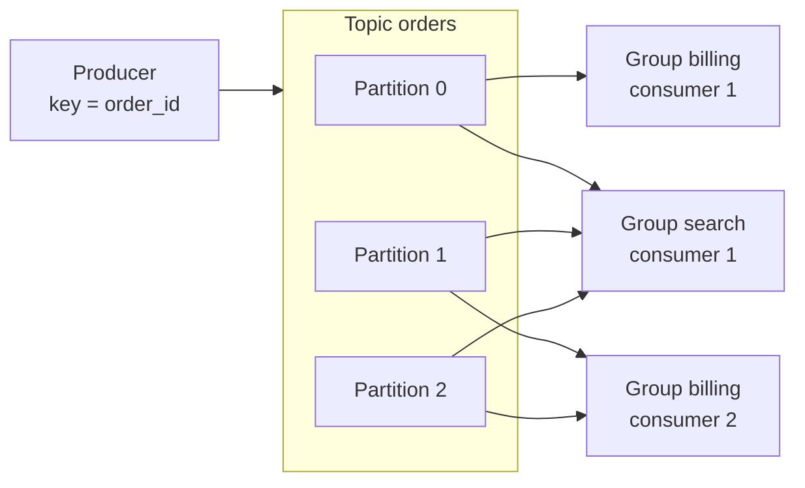

# Message queues and streams

**In one line:** a queue hands each message to one consumer and forgets it once acknowledged; a log (stream) keeps an ordered, replayable record that many consumer groups read independently at their own offsets.

## Why it matters in interviews

Almost every design past the first box diagram has an asynchronous step: send the email, update the search index, recompute the feed, charge the card later. The moment you draw a queue, the interviewer asks what happens when the consumer is slow, when a message cannot be processed, whether order matters, and how many partitions you need. A strong answer picks queue or log on purpose, names the ordering guarantee you actually get, and explains how a bad message is kept from blocking everything behind it.

## How it works

### Queue vs log

| | Queue (RabbitMQ, SQS) | Log (Kafka, Kinesis, Pulsar, Redpanda) |
|---|---|---|
| After consumption | Message deleted once acked | Message kept until retention expires |
| Multiple readers | Each message goes to one consumer; fan-out needs one queue per subscriber | Any number of consumer groups, each with its own offset |
| Replay | Not possible once acked | Rewind the offset and reprocess |
| Ordering | Best effort, or per group in FIFO variants | Strict within a partition |
| Scaling consumers | Add consumers freely | At most one active consumer per partition per group |

**Point-to-point** means one message, one handler (a work queue). **Publish/subscribe** means one message, every interested subscriber gets a copy. Queues do pub/sub by copying into a queue per subscriber; logs do it by letting each group read the same data.

### Kafka

- A **topic** is split into **partitions**. Each partition is an append-only log replicated across brokers; each record has an **offset**.
- The producer picks a partition by hashing the record **key** (or round-robin with no key). Records with the same key land in the same partition, so they stay in order.
- **Ordering is only guaranteed within a partition.** There is no global order across a topic with more than one partition.
- A **consumer group** shares the partitions among its members; each partition is read by exactly one member of the group. Adding a fifth consumer to a four-partition topic leaves one idle.
- Consumers commit offsets. On restart or rebalance a consumer resumes from the last committed offset, which is why processing is at-least-once by default.
- **Retention** is by time or size (for example seven days), or **compaction**, which keeps the latest record per key and suits changelogs.

### RabbitMQ

Producers publish to an **exchange**, not a queue. **Bindings** route messages from exchanges to queues: `direct` matches the routing key exactly, `topic` matches wildcard patterns, `fanout` copies to every bound queue, `headers` matches header values. Consumers **ack** each message; an unacked message is redelivered when the consumer's channel closes. A **prefetch** limit caps how many unacked messages one consumer holds, which is the main backpressure knob. Rejected or expired messages can be routed to a dead-letter exchange.

### Amazon SQS

- **Standard queues**: very high throughput, at-least-once delivery, best-effort ordering.
- **Visibility timeout**: a received message is hidden from other consumers for a period. If the consumer deletes it in time, it is done; otherwise it reappears and someone else gets it. Set the timeout above your worst-case processing time, or extend it while working.
- **FIFO queues**: strict order within a **message group ID**, plus deduplication on a deduplication ID within a five-minute window. Lower throughput than standard queues. Different groups are processed in parallel, much like Kafka partitions.
- **Dead-letter queue**: after `maxReceiveCount` failed receives, a message moves to a DLQ. **Redrive** moves messages from the DLQ back to the source queue once the bug is fixed.

### Backpressure and consumer lag

A queue absorbs bursts, but only if consumers eventually catch up. **Consumer lag** is the gap between the newest offset and the group's committed offset (or queue depth for SQS and RabbitMQ). Alert on lag growth and on the age of the oldest message, not just depth. When lag grows: add consumers (up to the partition count), make handlers faster or batched, or slow producers. A bounded buffer that rejects or blocks producers is better than an unbounded one that runs out of memory or disk.

### Poison messages and DLQs

A message that always fails (bad schema, a bug, a deleted foreign key) is retried forever and, in an ordered partition, blocks every message behind it. Retry a fixed number of times with backoff, then park it in a DLQ (or a retry topic chain in Kafka, which has no built-in DLQ) with the error attached. Alert on DLQ depth, and have a tool to inspect and redrive.

### Partition counts

Partitions cap consumer parallelism and are the unit of ordering. Size from throughput: if one consumer handles 5 MB/s and you need 100 MB/s, you need at least 20 partitions, plus headroom. Adding partitions later changes `hash(key) mod partitions`, so existing keys move and per-key order breaks across the change; pick a count you will not need to raise soon. Too many partitions cost broker memory, file handles and longer leader elections.

### Choosing

Ask four questions. Does more than one service need every message? Do you need to replay history? Does order matter, and per what key? Do individual messages need delays, priorities or per-message retry? Yes to the first two points to a log. Yes to the last points to a queue. Many systems use both: a log for domain events and a queue for the jobs those events trigger.

## Variants / options

| Option | Pros | Cons | Use when |
|---|---|---|---|
| Kafka (or Kinesis, Redpanda, Pulsar) | Replay, many independent consumers, high throughput, per-key order | Partition count limits parallelism; per-message retry and delay are awkward | Event streams, CDC, analytics, fan-out to several services |
| RabbitMQ | Flexible routing, per-message acks, priorities | No replay once acked; throughput lower than a log | Task queues with complex routing, RPC-style work |
| SQS standard | Fully managed, scales without capacity planning | No order, duplicates possible, no replay | Background jobs on AWS where order does not matter |
| SQS FIFO | Order per message group, built-in dedup window | Lower throughput | Per-entity ordered jobs (per account, per order) |
| Redis Streams | Already in the stack, consumer groups, low latency | Memory-bound, weaker durability than a replicated log | Small to medium streams, lightweight job queues |
| Database table as queue | Transactional with your data, no new system | Polling load, contention at scale | Low volume, or as an outbox |

## Where you see it

- Kafka at LinkedIn, where it was created, and as the backbone for CDC pipelines (Debezium) and stream processing (Kafka Streams, Flink).
- SQS with Lambda triggers for background work on AWS.
- RabbitMQ behind Celery workers in many Python stacks.

## Common mistakes

- Claiming global ordering on a multi-partition topic.
- Choosing a low-cardinality key (country, status) so a few partitions get all the traffic.
- Adding consumers beyond the partition count and expecting more throughput.
- Setting the SQS visibility timeout shorter than processing time, so every slow message is processed twice.
- No DLQ, so one poison message stalls a partition indefinitely.
- Forgetting that every consumer must be idempotent, because redelivery is normal, not exceptional.

## Interview questions

**Q: Kafka or SQS for an order-events pipeline consumed by billing, search and analytics?**
Kafka. Three independent consumers each need every event, analytics may need replay, and per-order ordering comes from keying by order ID. With SQS you would need SNS plus a queue per consumer and would lose replay.

**Q: How do you keep all events for one user in order while still scaling?**
Use the user ID as the partition key (or SQS FIFO message group ID). Order holds per user, and different users are processed in parallel across partitions.

**Q: Consumer lag keeps growing. What do you do?**
Check whether it is one partition (hot key or a poison message) or all of them (consumers too slow). Then batch writes, add consumers up to the partition count, increase partitions if needed, or shed and defer low-priority work.

**Q: What happens to a message that crashes the consumer every time?**
Without limits it loops forever and blocks its partition. Cap retries, move it to a DLQ with the error, alert, fix, then redrive.

**Q: Why can't you just add partitions when traffic grows?**
You can, but keys rehash to different partitions, so per-key ordering is broken for in-flight data and any state partitioned by key must move. Over-provision partitions at the start.

## Related

- Fundamentals: [delivery semantics and idempotency](./delivery-semantics-and-idempotency.md), [transactional outbox and CDC](./transactional-outbox-and-cdc.md), [event-driven architecture](./event-driven-architecture.md), [batch and stream processing](./batch-and-stream-processing.md), [sharding and partitioning](./sharding-and-partitioning.md), [resilience patterns](./resilience-patterns.md).
- Problems: [distributed message queue](../problems/distributed-message-queue.md), [notification system](../problems/notification-system.md), [ad click aggregation](../problems/ad-click-aggregation.md), [webhook delivery system](../problems/webhook-delivery-system.md).
- Code: [`src/idempotency-store`](../src/idempotency-store/).
