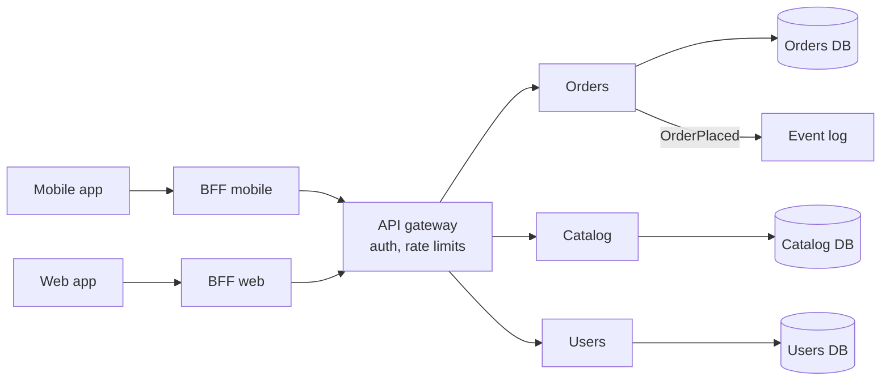

# Microservices and boundaries

**In one line:** split a system into separately deployable services only along business boundaries that change independently, give each service its own data, and accept that every cross-service call and transaction is now a distributed-systems problem.

## Why it matters in interviews

Designs often start with "an order service, a payment service, a user service" without saying why those are separate or how they share data. Interviewers probe the boundaries: what happens when checkout needs data from three services, how a schema change rolls out, and how consistency works without a shared transaction. Senior candidates are also expected to say when *not* to split, because a premature split produces a distributed monolith: all the cost of microservices and none of the independence.

## How it works

### Monolith, modular monolith, microservices

| Shape | Deploys | Data | Main benefit | Main cost |
|---|---|---|---|---|
| Monolith | One unit | One database | Simple to build, test, debug and run | Teams step on each other as it grows |
| Modular monolith | One unit | One database, schemas or tables owned per module | Enforced internal boundaries without network calls | Needs discipline; one deploy cadence |
| Microservices | Many units | Database per service | Independent deploys, scaling and failure isolation | Network failures, eventual consistency, operational overhead |

Reasons to split a module into a service:

- A team needs to deploy it on its own schedule without coordinating with others.
- It has very different scaling or resource needs (video transcoding vs profile pages).
- It needs failure isolation, or a different technology or compliance boundary (card data in a smaller audited scope).

Not good reasons: "it is cleaner", or a team count lower than the planned service count.

### Bounded contexts

From Eric Evans's domain-driven design: a bounded context is the part of the domain where a term has one meaning. "Order" in checkout (items, price, payment) is not the same as "order" in fulfilment (parcels, warehouse, carrier). Service boundaries that follow bounded contexts mostly exchange events about facts ("OrderPlaced"), not fine-grained calls.

### Database per service

Each service owns its tables; others access the data only through its API or events. That is what makes independent schema changes possible. Consequences:

- No cross-service joins. Use API composition, or keep a local read model built from events.
- No cross-service ACID transactions. Use sagas and the outbox pattern; see [distributed transactions](./distributed-transactions.md) and [transactional outbox and CDC](./transactional-outbox-and-cdc.md).

### Sync vs async communication

| Style | Pros | Cons | Use when |
|---|---|---|---|
| Sync request/response (REST, gRPC) | Simple, immediate answer | Availability multiplies: five services at 99.9% each give at most about 99.5% for the chain | The caller needs the answer to continue |
| Async events or commands (queue, log) | Decouples availability and speed | Eventual consistency, harder debugging | Notifying others that something happened |

Long synchronous chains are fragile; prefer a shallow call graph with events for side effects. See [resilience patterns](./resilience-patterns.md) for the timeouts and breakers that sync calls need.

### Edge: API gateway and backend-for-frontend

An **API gateway** handles cross-cutting concerns at the edge: TLS, authentication, rate limiting, routing and request logging. A **backend-for-frontend** is a thin service per client type that aggregates calls and shapes responses for that screen, so the mobile app does not make ten round trips. Keep business logic out of both.

### Service discovery

- **Server-side:** callers hit a stable name (a load balancer, a Kubernetes Service, DNS) that routes to healthy instances.
- **Client-side:** callers fetch the instance list from a registry (Consul, Eureka) and load-balance themselves.

### Service mesh

A sidecar proxy (Envoy in Istio, Linkerd's own proxy) next to each instance handles mTLS, retries, timeouts, traffic splitting and telemetry, configured centrally. It moves networking concerns out of application code at the cost of more moving parts and some added latency per hop.

### The distributed monolith

Symptoms: services must be deployed together; several services share one database; a single user request makes a long chain of synchronous calls; a change to one service's API breaks others. It is usually caused by splitting along technical layers or entities instead of business capabilities.

### Strangler fig migration

Martin Fowler's name for replacing a legacy system piece by piece. Put a routing layer in front of the monolith, build one capability as a new service, route its traffic there, and repeat. The old system shrinks until it can be removed. Change data capture can keep data in sync during the transition.

### Conway's law

Melvin Conway observed that organizations design systems that mirror their communication structure. Boundaries that cut across team lines produce constant coordination. Teams often use this deliberately: shape teams around the architecture you want.

## Variants / options

| Option | Pros | Cons | Use when |
|---|---|---|---|
| Monolith | Fastest to build, one transaction | Scaling teams and deploys gets hard | Early product, small team |
| Modular monolith | Clear boundaries, no network | One deploy pipeline | Medium teams; a likely future split |
| Microservices, sync | Familiar request model | Coupled availability and latency | Few, shallow dependencies |
| Microservices, event-driven | Loose coupling, independent scaling | Eventual consistency, tooling needed | Many teams, many consumers of the same facts |
| Gateway plus BFFs | Tailored client APIs | Extra hops, more services | Several client types |
| Service mesh | Uniform security and traffic policy | Operational complexity | Many services, a platform team to run it |

## Where you see it

- Amazon's move to service-oriented teams and Netflix's microservices on AWS are the commonly cited early examples.
- Shopify has written about running a large modular monolith.
- Amazon Prime Video's monitoring team described in 2023 moving one distributed serverless pipeline into a single process to cut cost.
- Istio, Linkerd and Consul for mesh and discovery; Kubernetes Services and DNS for server-side discovery.

## Common mistakes

- One service per database table or entity ("User service", "Address service").
- Sharing a database between services "temporarily".
- Long synchronous call chains on the hot path.
- Splitting before the domain is understood; boundaries are expensive to move once they are network calls.
- Assuming a distributed transaction will just work; use sagas with compensations.
- Putting business logic in the API gateway.
- No contract testing or API versioning, so deploys still need coordination.

## Interview questions

**Q: When would you start with a monolith?**
Most new products: a small team, an unsettled domain and no independent scaling needs. Use a modular structure so modules can be extracted later.

**Q: Checkout needs the price, the stock level and the user's address from three services. How?**
Call the services that must be current (price, stock reservation) synchronously with timeouts; cache or replicate slow-changing data (address) locally from events. Commit the order with a saga rather than a cross-service transaction.

**Q: How do you avoid a distributed monolith?**
Split along business capabilities, give each service its own data, prefer events for side effects, version APIs, and check that each service can be deployed on its own.

**Q: How would you migrate a legacy monolith?**
Strangler fig: route at the edge, extract one capability at a time, keep data in sync with CDC during the move, and remove the old path when traffic reaches zero.

**Q: What does a service mesh give you, and what does it cost?**
mTLS, retries, timeouts, traffic shifting and telemetry without code changes. It costs an extra proxy hop per call, more infrastructure, and a team that understands it.

## Related

- Fundamentals: [distributed transactions](./distributed-transactions.md), [transactional outbox and CDC](./transactional-outbox-and-cdc.md), [event-driven architecture](./event-driven-architecture.md), [API design](./api-design.md), [resilience patterns](./resilience-patterns.md), [load balancing](./load-balancing.md), [security basics](./security-basics.md).
- Patterns: [saga](https://github.com/hardyalsinghdeora/design-patterns/tree/main/src/modern/saga), [transactional outbox](https://github.com/hardyalsinghdeora/design-patterns/tree/main/src/modern/transactional-outbox), [CQRS](https://github.com/hardyalsinghdeora/design-patterns/tree/main/src/modern/cqrs).
- Problems: [e-commerce platform](../problems/ecommerce-platform.md), [food delivery](../problems/food-delivery.md), [payment system](../problems/payment-system.md).
