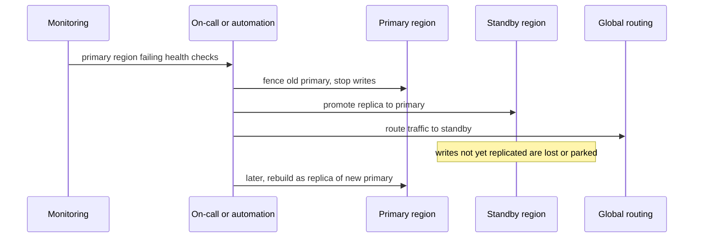

# Multi-region and disaster recovery

**In one line:** run in more than one region for latency, availability or data-residency reasons, decide how much data you can lose (RPO) and how long you can be down (RTO), and practise failing over, because an untested plan usually does not work.

## Why it matters in interviews

"What happens if the whole region goes down?" is a common late-interview question. The weak answer is "we replicate to another region". The strong answer states the RPO and RTO the business needs, picks active-passive or active-active to match, explains what happens to writes in flight with asynchronous replication, says how conflicts are avoided or resolved in active-active, and notes that replication is not a backup.

## How it works

### Why go multi-region

- **Latency:** users far from a single region pay a round trip of a hundred milliseconds or more on every request.
- **Availability:** survive the loss of a whole region, not just one zone. Multi-zone already covers most failures; multi-region is for rarer, larger ones.
- **Data residency:** laws or contracts can require some users' data to stay in a jurisdiction, which forces a regional data layout regardless of availability goals.

### RPO and RTO

| Term | Question | Driven by |
|---|---|---|
| RPO (recovery point objective) | How much recent data may be lost? | Replication mode and backup frequency |
| RTO (recovery time objective) | How long may the service be down? | Detection, decision, automation and warm capacity |

Synchronous cross-region replication gives RPO zero but adds the inter-region round trip to every write. Asynchronous replication keeps writes fast, and the RPO equals the replication lag at the moment of failure.

### Strategies

| Strategy | Standby region | Typical RPO / RTO | Cost |
|---|---|---|---|
| Backup and restore | Nothing running; backups copied there | Hours / hours to a day | Lowest |
| Pilot light | Data replicated, compute off or minimal | Minutes / tens of minutes | Low |
| Warm standby | Scaled-down full stack running | Seconds to minutes / minutes | Medium |
| Active-passive hot | Full-size stack, receives no user writes | Seconds / minutes | High |
| Active-active | All regions serve reads and writes | Near zero / seconds for affected users | Highest, plus conflict design |

### Backups vs replication

Replication copies mistakes as faithfully as data: a bad migration, a `DELETE` without `WHERE`, a buggy deploy or ransomware encryption reaches every replica within seconds. Backups protect against that. Keep point-in-time recovery (base snapshots plus the write-ahead log), keep copies in another account and region, make some immutable (object lock), and run restore tests, because a backup that has never been restored is a hope, not a plan.

### Failover and failback

1. **Detect:** health checks from outside the failing region. Distinguish a regional outage from a monitoring failure.
2. **Decide:** automatic failover is fast but can flap or split brain on a partial failure; many teams automate the mechanics and keep a human decision for whole-region failover.
3. **Fence:** make sure the old primary cannot accept writes (revoke credentials, stop the database, or rely on a consensus-backed leader record), or both regions write.
4. **Promote and redirect:** promote a replica, then shift traffic with DNS (bounded by TTL and clients that cache it), anycast or a global load balancer.
5. **Failback:** do not just switch back. The old primary may hold writes the new one never saw. Rebuild it as a replica, reconcile parked writes, then do a planned switchover at a quiet time.

### Conflict handling in active-active

If two regions accept writes to the same record, they can conflict.

- **Home-region writes:** each user, tenant or record has one home region that takes its writes; other regions serve reads and forward writes. No conflicts, at the cost of cross-region latency for travellers and a re-homing process on failover.
- **CRDTs:** data types whose concurrent updates merge deterministically (counters, sets, some text structures). Good for likes, carts and presence; not for "balance must not go negative".
- **Last-writer-wins:** keep the update with the highest timestamp. Simple, and used by DynamoDB global tables and Cassandra, but clock skew and concurrent updates silently drop writes. Acceptable for profile fields; dangerous for money or inventory.
- **Globally consistent databases:** Spanner and CockroachDB use consensus across regions, so writes are linearizable but pay cross-region latency.

### Cell-based architecture

Split the system into independent cells, each a full copy of the stack serving a subset of customers, with a thin routing layer that maps a customer to a cell. A bad deploy, a poison request or overload affects one cell, not everyone. Regions can host several cells, and cells are also the unit for gradual rollout. The router must stay simple and highly available, because it is shared.

### Game days and chaos testing

Run planned failure exercises: fail over a region, kill a database primary, cut a dependency. Measure actual RTO and RPO against the targets, check that runbooks and permissions work, and fix what breaks. Netflix's Chaos Monkey (terminating instances) and its larger region-evacuation exercises are the best-known examples. Start in staging and with small blast radius, then move to production at scheduled times.

## Variants / options

| Option | Pros | Cons | Use when |
|---|---|---|---|
| Single region, multi-zone | Simple, strong consistency easy | Region outage takes you down | Most systems; zone failures are the common case |
| Backup and restore to another region | Cheap | Long RTO, RPO of last backup | Internal tools, cost-sensitive systems |
| Active-passive with async replication | Simple data model, fast writes | Lag-sized data loss on failover | Most transactional systems |
| Active-active, home-region writes | Low latency, no conflicts | Re-homing logic, cross-region writes for travellers | User-partitioned data |
| Active-active, multi-writer with LWW or CRDT | Writes anywhere | Lost updates (LWW) or limited data types (CRDT) | Carts, counters, presence, profiles |
| Globally consistent database | No conflicts, RPO zero | Cross-region latency on writes | Money, inventory, global uniqueness |
| Cells | Small blast radius | Routing layer, more stacks to run | Large multi-tenant systems |

## Where you see it

- Cloud DR guidance: AWS describes backup and restore, pilot light, warm standby and multi-site active-active strategies.
- DynamoDB global tables and Cassandra multi-datacentre replication (last-writer-wins).
- Google Spanner and CockroachDB (consensus across regions).
- Route 53, Cloud DNS and global load balancers for traffic steering.
- Netflix chaos engineering and region evacuation exercises.

## Common mistakes

- Treating replicas as backups.
- Claiming active-active without saying how conflicting writes are handled.
- No fencing, so the old primary keeps accepting writes after failover.
- Forgetting the dependencies: the standby region lacks a secret, a quota, a container image or a third-party allowlist entry.
- Standby capacity too small to absorb the full load.
- Failing back immediately and losing the writes that only the old primary had.
- Never testing failover or restores.

## Interview questions

**Q: The business wants zero data loss and two-minute recovery from a region failure. What does that imply?**
Synchronous replication to a second region (or a consensus database spanning three regions), which adds inter-region latency to every write, plus warm capacity and automated, fenced failover. Check whether every flow really needs RPO zero.

**Q: You replicate asynchronously and the primary region dies. What happens to recent writes?**
Writes within the replication lag are lost or stranded. Keep them visible as "unconfirmed", reconcile when the old region returns, and make the important flows idempotent so clients can retry.

**Q: How do you avoid conflicts in active-active?**
Give each record a home region that takes its writes; use CRDTs for data that merges naturally; reserve last-writer-wins for fields where losing a concurrent update is acceptable.

**Q: Why are backups still needed with three replicas?**
Replicas copy deletes and corruption immediately. Backups with point-in-time recovery let you return to the state before the mistake.

**Q: What is a cell, and why use cells as well as regions?**
A self-contained stack serving a subset of customers. Cells limit the blast radius of bad deploys and overloads, which are more common than regional outages.

## Related

- Fundamentals: [replication](./replication.md), [CAP and PACELC](./cap-and-pacelc.md), [consistency models](./consistency-models.md), [consensus and coordination](./consensus-and-coordination.md), [load balancing](./load-balancing.md), [resilience patterns](./resilience-patterns.md), [observability](./observability.md).
- Problems: [payment system](../problems/payment-system.md), [key-value store](../problems/key-value-store.md), [object storage](../problems/object-storage.md), [chat system](../problems/chat-system.md).
- Code: [`src/vector-clock`](../src/vector-clock/) (detecting concurrent writes), [`src/quorum-kv`](../src/quorum-kv/).
