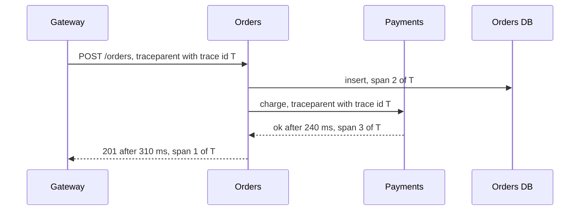

# Observability

**In one line:** emit metrics, logs and traces with shared identifiers so you can tell from the outside whether users are being served well, get paged only when they are not, and find which component is at fault.

## Why it matters in interviews

"How would you know it is broken?" is a standard closing question, and for problems such as metrics monitoring it is the whole question. A weak answer is "add logging and dashboards". A strong answer names the signals per service (rate, errors, latency, saturation), defines an SLO, alerts on error-budget burn rather than on CPU, and explains how a trace id lets you follow one slow request across ten services.

## How it works

### The three signal types

| Signal | What it is | Good for | Cost driver |
|---|---|---|---|
| Metrics | Numeric time series with labels, pre-aggregated | Alerting, trends, dashboards | Number of distinct label combinations (series) |
| Logs | Timestamped event records | Debugging a specific event, audits | Volume of bytes ingested and retained |
| Traces | A tree of timed spans for one request across services | Finding where latency or errors come from | Number of spans kept; usually sampled |

They answer different questions: metrics say *that* something is wrong, traces say *where*, logs say *why*.

### What to measure

- **RED** (for request-driven services): Rate, Errors, Duration.
- **USE** (for resources such as CPU, disks, pools, queues): Utilization, Saturation, Errors.
- **Four golden signals** (Google SRE book): latency, traffic, errors, saturation. Measure latency of successful and failed requests separately; a fast error is not good latency.

Record latency as a histogram and look at percentiles (p50, p99). Averages hide the tail, and percentiles cannot be averaged across hosts; aggregate the histograms instead.

### SLI, SLO, SLA

| Term | Meaning | Example |
|---|---|---|
| SLI | A measured ratio of good events to valid events | Share of checkout requests that return 2xx within 300 ms |
| SLO | Internal target for the SLI over a window | 99.9% over 30 days |
| SLA | Contract with customers, with penalties | 99.5% monthly, or service credits |

Set the SLA looser than the SLO so you can react before you owe money.

### Error budgets and burn-rate alerts

A 99.9% SLO over 30 days leaves a 0.1% error budget: about 43 minutes of full outage, or a longer period of partial errors. While budget remains, ship features; when it is spent, prioritize reliability.

Alert on how fast the budget is burning, not on every error. Burn rate 1 means you would use exactly the budget over the window. The Google SRE workbook recommends multiwindow, multi-burn-rate alerts:

| Severity | Burn rate | Long window | Short window | Budget consumed |
|---|---|---|---|---|
| Page | 14.4 | 1 hour | 5 minutes | 2% |
| Page | 6 | 6 hours | 30 minutes | 5% |
| Ticket | 1 | 3 days | 6 hours | 10% |

Both windows must exceed the rate. The long window gives significance; the short one makes the alert stop soon after the problem is fixed.

### Cardinality

Each unique combination of metric name and label values is a separate time series. Labels such as `user_id`, `order_id`, full URL paths or raw error messages can create millions of series and overwhelm a Prometheus-style system. Keep metric labels bounded (method, route template, status class, region) and put high-cardinality detail in logs and traces.

### Structured logs and correlation ids

Log JSON with fixed fields (timestamp, level, service, route, status, duration, `trace_id`, `request_id`) instead of free text, so you can filter and aggregate. Generate a request id at the edge, return it to the client, and include it in every log line. Do not log secrets, tokens or unnecessary personal data. Sample or rate-limit noisy debug logs.

### Distributed tracing

Each service creates spans with a start, duration, attributes and parent span id, and passes the trace context on outgoing calls. The W3C Trace Context standard defines the `traceparent` header. Across a queue, put the context in message headers. OpenTelemetry provides vendor-neutral APIs, SDKs and a collector for traces, metrics and logs, exporting to backends such as Jaeger, Tempo or commercial tools.

Sampling keeps cost down. **Head sampling** decides at the start (keep 1%); it is cheap but may drop the interesting failures. **Tail sampling** decides after the trace completes, keeping errors and slow traces, at the cost of buffering spans in a collector.

### Dashboards vs alerts

Alerts should fire on symptoms users feel (SLO burn, error rate, latency), be actionable, and link to a runbook. Causes (high CPU, a full disk on a replica) belong on dashboards or in low-urgency tickets unless they will soon cause user impact (a disk filling within hours). A good service dashboard shows RED at the top, then its dependencies and resources.

### Synthetic monitoring

Probes that run scripted user journeys (log in, search, check out) from several regions every minute. They catch outages when real traffic is low, and they test paths users take outside your own network, including DNS, TLS and the CDN.

## Variants / options

| Option | Pros | Cons | Use when |
|---|---|---|---|
| Pull metrics (Prometheus scraping) | Simple targets; scraper knows what is down | Needs service discovery; short-lived jobs need a push gateway | Long-running services |
| Push metrics (StatsD, OTLP push) | Works for batch jobs and serverless | Harder to tell "down" from "quiet" | Ephemeral workloads |
| Full logs centrally indexed | Search anything | Expensive at volume | Moderate volume, audit needs |
| Head-sampled traces | Cheap, simple | Misses rare errors | High-volume services |
| Tail-sampled traces | Keeps errors and slow requests | Collector memory and complexity | When rare failures matter |
| Threshold alerts on causes | Easy to write | Noisy, not tied to users | Resources that will cause an outage soon |
| SLO burn-rate alerts | Few, user-focused pages | Needs SLIs and good data | Paging for user-facing services |

## Where you see it

- Prometheus and Grafana; OpenTelemetry; Jaeger and Zipkin (Zipkin descends from Google's Dapper paper).
- ELK or OpenSearch for logs; Loki for label-indexed logs.
- Commercial platforms such as Datadog, Honeycomb and New Relic.
- The Google SRE book and workbook for SLOs, error budgets and burn-rate alerting.

## Common mistakes

- Alerting on every cause (CPU 80%) and training on-call to ignore pages.
- Reporting average latency.
- Putting user ids or request ids in metric labels.
- Free-text logs with no request or trace id.
- Tracing that stops at a message queue because context is not propagated in headers.
- Monitoring that runs in the same failure domain as the thing it watches, so both go down together.
- SLOs set at 100% or never reviewed.

## Interview questions

**Q: What would you alert on for this service?**
SLO burn rate on availability and latency SLIs, using multi-window rules so pages are rare and meaningful. Resource alerts only when they predict user impact soon.

**Q: Why is p99 more useful than the average?**
The average hides a slow tail. With fan-out, a request touching 100 backends hits the slowest one most of the time, so the tail becomes the common case for users.

**Q: A request is slow, but every service's dashboard looks fine. How do you find out why?**
Find its trace by request or trace id. The span tree shows which hop took the time, including queueing or retries that per-service averages hide.

**Q: Your metrics bill tripled after a deploy. What is the likely cause?**
A new high-cardinality label, such as a raw URL path or user id. Replace it with a bounded value and move the detail to logs or traces.

**Q: What is an error budget for?**
It turns the SLO into a decision rule: while budget remains, the team can take release risk; when it runs out, work shifts to reliability.

## Related

- Fundamentals: [resilience patterns](./resilience-patterns.md), [batch and stream processing](./batch-and-stream-processing.md), [microservices and boundaries](./microservices-and-boundaries.md), [multi-region and DR](./multi-region-and-disaster-recovery.md).
- Problems: [metrics monitoring](../problems/metrics-monitoring.md), [ad click aggregation](../problems/ad-click-aggregation.md), [top-k trending](../problems/top-k-trending.md).
- Code: [`src/count-min-sketch`](../src/count-min-sketch/), [`src/hyperloglog`](../src/hyperloglog/) (approximate counting at high cardinality).
