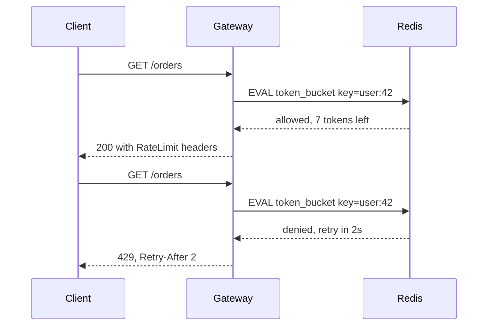

# Rate limiting

**In one line:** cap how many requests a client may make in a time period, so one caller cannot exhaust capacity, run up costs or abuse the system, and tell rejected callers when to try again.

## Why it matters in interviews

Rate limiting is both a standalone problem ("design a rate limiter") and a component in nearly every public API design. Interviewers look for four things: choosing the right key (user, API key, IP, tenant), choosing an algorithm and knowing its burst behaviour, making the limit work across many servers without a race, and returning a useful 429 so well-behaved clients back off.

## How it works

### Why limit

- **Abuse**: credential stuffing, scraping, denial of service.
- **Fairness**: one noisy tenant should not degrade everyone else.
- **Cost**: each request may call a paid downstream (SMS, LLM, maps).
- **Protection**: keep load below what the backend can serve; this overlaps with load shedding.

### Where to limit

| Layer | Key | Good for |
|---|---|---|
| Edge / CDN / WAF | IP, ASN, country | Volumetric abuse, bots, before traffic reaches you |
| API gateway | API key, user ID, tenant, route | Product quotas and plan tiers |
| Service | Tenant, operation, downstream | Protecting a specific expensive dependency |
| Client | Its own outgoing calls | Staying under a third party's limits |

IP is a weak key: many users share one address behind carrier NAT or a corporate proxy, and an attacker can rotate addresses. Prefer authenticated identity where you have it, and use IP limits for unauthenticated endpoints such as login.

### Algorithms

**Token bucket.** A bucket holds up to `capacity` tokens and refills at `rate` tokens per second. Each request takes one token; an empty bucket means reject. Store only `tokens` and `last_refill`; refill lazily on each request as `tokens = min(capacity, tokens + elapsed * rate)`. Allows bursts up to capacity while enforcing the long-run rate.

**Leaky bucket.** Requests enter a queue that drains at a fixed rate; a full queue rejects. Output is perfectly smooth, which protects a fragile backend, but bursts wait in the queue and add latency. (As a meter without a queue it behaves like a token bucket.)

**Fixed window counter.** Count requests in the current window (`key:minute`) and reject above the limit. One counter per key. At a window boundary a client can send the full limit at 12:00:59 and again at 12:01:00, so up to twice the limit in a short span.

**Sliding window log.** Store a timestamp per request (a Redis sorted set), drop entries older than the window, count what remains. Exact, but memory grows with the limit: a 10,000 per hour limit stores up to 10,000 timestamps per key.

**Sliding window counter.** Keep the counts for the current and previous fixed windows, and estimate `previous * (1 - elapsed_fraction) + current`. Two counters per key; smooths the boundary spike with a small error that assumes the previous window's requests were evenly spread.

| Algorithm | Bursts | Memory per key | Accuracy |
|---|---|---|---|
| Token bucket | Up to capacity, then the refill rate | 2 values | Exact for its model |
| Leaky bucket (queue) | Queued, output smooth | Queue up to its size | Exact; adds latency |
| Fixed window | Up to 2x the limit at a boundary | 1 counter | Loose at boundaries |
| Sliding window log | None beyond the limit | One entry per request in the window | Exact |
| Sliding window counter | Small overshoot possible | 2 counters | Approximate, usually close |

### Distributed limits

With many gateway instances, the count must be shared. A Redis node (or cluster, sharded by key) is the usual store.

The naive version is a read-modify-write race: two instances both read `count = 99`, both see it is under 100, both write 100, and 101 requests get through. Fixes:

- Fixed window: `INCR key` is atomic; if it returns 1, set `EXPIRE key 60`. Do both in a `MULTI` or a Lua script so a crash cannot leave a key without a TTL.
- Token bucket or sliding window: run the whole read, refill, decide and write as one **Lua script** (`EVAL`), which Redis executes atomically.

A central store adds a network hop per request and becomes a dependency. **Local plus global hybrids** reduce that: each instance keeps a local bucket with a share of the limit and syncs with Redis every few hundred milliseconds or in batches of tokens. You trade a small overshoot for lower latency. Decide what happens when Redis is unreachable: fail open (allow, protect availability) for most product limits, fail closed for security limits such as login attempts.

### Responding to limited clients

- Status **429 Too Many Requests**, with `Retry-After` in seconds (or an HTTP date).
- Quota headers so clients can pace themselves. Many APIs use `X-RateLimit-Limit`, `X-RateLimit-Remaining` and `X-RateLimit-Reset`; an IETF draft standardises `RateLimit` and `RateLimit-Policy` headers.
- Clients retry with exponential backoff and jitter, honour `Retry-After`, and do not retry other 4xx errors.

## Variants / options

| Option | Pros | Cons | Use when |
|---|---|---|---|
| Token bucket | Allows bursts, cheap, easy to explain | Bursts may still overload a fragile backend | Most API limits |
| Leaky bucket queue | Smooth output | Added latency; queue memory | Shaping traffic to a fixed-rate dependency |
| Fixed window | Simplest, one counter | Boundary doubling | Coarse quotas (per day) |
| Sliding window log | Exact | Memory grows with limit | Low limits where exactness matters (login attempts) |
| Sliding window counter | Close to exact, two counters | Approximate | High-volume per-user limits |
| Local-only limiter | No network hop | Effective limit scales with instance count | Coarse protection per instance |
| Central Redis + Lua | Exact across instances | Extra hop; Redis is a dependency | Shared quotas per user or tenant |

## Where you see it

- Envoy and NGINX ship local rate limiting; Envoy also supports an external global rate limit service.
- Stripe and GitHub APIs return 429 or 403 with rate-limit headers and document their limits per key.
- AWS API Gateway throttling uses a token bucket model (rate and burst).
- Cloudflare and other CDNs offer IP and path based limits at the edge.

## Common mistakes

- Limiting by IP only, blocking whole offices and missing rotating attackers.
- Check-then-set in application code instead of an atomic operation.
- Keys without TTLs that accumulate in Redis.
- Returning 429 without `Retry-After`, so clients retry immediately in a tight loop.
- Using one global limit when different endpoints have very different costs; weight requests or limit per route.
- Not deciding fail-open vs fail-closed before the limiter's store goes down.

## Interview questions

**Q: Token bucket or sliding window?**
Token bucket when bursts are acceptable and you want a smooth long-run rate, which covers most APIs. Sliding window when you need a hard cap over any rolling period, such as login attempts.

**Q: How do you enforce 100 requests per minute per user across 50 gateway servers?**
Store the counter or bucket in Redis keyed by user and update it atomically with a Lua script. Shard Redis by key for throughput. For lower latency, give each gateway a local allowance that it syncs periodically.

**Q: What is wrong with a fixed window?**
A client can send the full limit at the end of one window and again at the start of the next, so twice the limit in a few seconds.

**Q: Redis is down. Do you allow or reject?**
Depends on the limit's purpose. Product quotas usually fail open with a local fallback limit; security limits fail closed.

**Q: How should a client react to 429?**
Wait for `Retry-After` if present, otherwise back off exponentially with jitter, and reduce its request rate using the remaining-quota headers.

## Related

- Fundamentals: [API design](./api-design.md), [resilience patterns](./resilience-patterns.md), [load balancing](./load-balancing.md), [security basics](./security-basics.md), [caching strategies](./caching-strategies.md).
- Problems: [rate limiter](../problems/rate-limiter.md), [URL shortener](../problems/url-shortener.md), [notification system](../problems/notification-system.md).
- Code: [`src/rate-limiter-algorithms`](../src/rate-limiter-algorithms/).
- Pattern: [retry with backoff](https://github.com/hardyalsinghdeora/design-patterns/tree/main/src/modern/retry-with-backoff).
