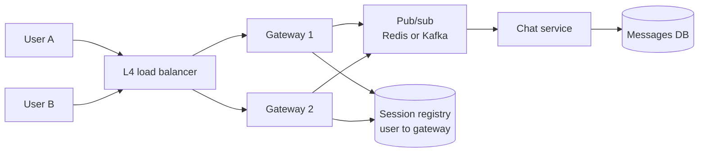

# Realtime communication

**In one line:** pick how the server tells a client something changed (polling, long polling, server-sent events, WebSockets or push) by how often updates happen, which direction they flow and how many connections you must hold open.

## Why it matters in interviews

Chat, live comments, ride tracking, collaborative editing, dashboards and notifications all need the server to reach the client. Interviewers check that you pick a transport for a reason, and then that you can scale it: a WebSocket server holds state per connection, so load balancing, routing a message to the right server, presence, reconnection and ordering all become design problems.

## How it works

### Transports

| Transport | Direction | How it works | Cost |
|---|---|---|---|
| Short polling | Client pulls | Request every N seconds | Wasted requests; latency up to N |
| Long polling | Client pulls, server holds | Server keeps the request open until data arrives or a timeout, then the client re-requests | One open request per client; reconnect churn |
| Server-sent events (SSE) | Server to client | One long HTTP response streaming `text/event-stream`; browser `EventSource` reconnects and sends `Last-Event-ID` | One connection per client; text only; one-way |
| WebSocket | Both ways | HTTP upgrade to a persistent full-duplex TCP connection | Stateful servers; proxies and load balancers must support it |
| WebRTC | Peer to peer | Direct UDP media and data channels after signalling; STUN and TURN for NAT traversal | Complex; TURN relays cost bandwidth |
| Webhooks | Server to server | HTTP POST to a registered URL when an event happens | Receiver must be public and idempotent |
| Mobile push (APNs, FCM) | Provider to device | The OS keeps one connection to Apple or Google; your server sends to their API | Best effort; payload limits; delivery not guaranteed |

Under HTTP/1.1, browsers limit connections per origin (six is typical), which constrains SSE across many tabs; HTTP/2 multiplexes streams over one connection and removes most of that limit.

### Choosing

- Updates every few minutes, or simple status checks: short polling.
- Server-to-client updates only (feeds, notifications, progress, LLM token streaming): SSE. It is plain HTTP, so it works with existing auth, proxies and HTTP/2.
- Frequent messages in both directions (chat, games, collaborative editing): WebSockets.
- Audio, video, or low-latency peer data: WebRTC, with a separate signalling channel.
- App in the background or closed: mobile push, which wakes the app so it can fetch over the normal API.

### Scaling WebSockets

- **Gateway servers** only hold connections and forward frames; business logic lives in stateless services behind them. A gateway can hold tens to hundreds of thousands of mostly idle connections, limited by memory per connection and file descriptors, so tune OS limits.
- **Load balancing**: connections are long-lived, so new connections must be spread well; a plain round-robin balancer leaves long-lived imbalance after a deploy or scale-out. Use least-connections, and drain gateways gradually on deploy.
- **Routing**: to send to user B, find which gateway holds B's connection. Either look up a session registry (user ID to gateway, in Redis) and send directly, or have every gateway subscribe to channels for its connected users (Redis pub/sub per user or per room, or Kafka partitions consumed by gateways) and publish to the channel.
- **Fan-out**: a message to a 10,000-member room becomes 10,000 deliveries. Publish once per room channel and let each gateway deliver to its local members, rather than looking up every member.
- **Presence**: each gateway writes "user online, last seen T" with a short TTL and refreshes it on heartbeat. Offline is inferred when the TTL expires; broadcast presence changes only to interested contacts, and batch them, since presence traffic can exceed message traffic.

### Heartbeats and reconnection

TCP does not notice a dead peer quickly, and NATs and proxies drop idle connections. Send ping/pong frames every 20-60 seconds and close connections that miss several. Clients reconnect with exponential backoff and jitter so a gateway restart does not cause a synchronized reconnect storm.

On reconnect, the client sends a **resume token**: the last sequence number or message ID it received per conversation. The server replays missed messages from storage. Without this, anything sent while the client was disconnected is lost from its view.

### Ordering and delivery guarantees in chat

- Persist the message first, then deliver. The database (or log) is the source of truth; the socket is a delivery hint.
- Assign a per-conversation **sequence number** at write time (by the conversation's owning shard or partition). Clients order by it and detect gaps.
- The sender includes a client-generated message ID, so a retried send is deduplicated.
- Delivery is at-least-once: clients ack received sequence numbers, and the server resends unacked ones on reconnect. Clients drop duplicates by ID.
- Global ordering across conversations is not needed and is expensive; ordering per conversation is.

### Multiple devices per user

One user may have a phone, a laptop and three browser tabs connected. The session registry maps a user to a set of connections, not one. Each device keeps its own last-received sequence numbers, and read receipts sync across devices as ordinary events. Mobile devices that are offline get a push notification, and fetch the messages over the normal API when opened.

## Variants / options

| Option | Pros | Cons | Use when |
|---|---|---|---|
| Short polling | Trivial, stateless | Wasteful; latency equals the interval | Infrequent updates, small scale |
| Long polling | Works through any HTTP infrastructure | Reconnect overhead per message | Fallback where WebSockets are blocked |
| SSE | Simple, HTTP-native, auto-reconnect with last event ID | One-way; text only | Notifications, live feeds, streaming responses |
| WebSocket | Full duplex, low overhead per message | Stateful servers, custom protocol on top | Chat, multiplayer, collaborative editing |
| WebRTC | Peer-to-peer, low latency media | Signalling, NAT traversal, TURN costs | Voice and video calls |
| Mobile push | Reaches apps that are not running | Not guaranteed, rate limited, small payloads | Wake-up and alerts on mobile |

## Where you see it

- Slack and Discord use WebSockets for their realtime clients, with gateway services in front of message services.
- Many LLM APIs stream responses with server-sent events.
- WhatsApp has described using long-lived connections to Erlang servers for message delivery.
- Video calling products build on WebRTC.

## Common mistakes

- WebSockets for one-way updates where SSE or polling would do.
- Business logic inside connection servers, so every deploy drops every connection.
- Delivering only over the socket without persisting, so offline users lose messages.
- No heartbeats, leaving thousands of half-open connections.
- All clients reconnecting at once after a deploy, with no jitter.
- Treating mobile push as reliable delivery instead of a wake-up signal.

## Interview questions

**Q: SSE or WebSockets for a live sports score page?**
SSE. Updates flow only from server to client, it is plain HTTP with built-in reconnection and resume through `Last-Event-ID`, and it scales behind normal HTTP infrastructure.

**Q: User A on gateway 3 sends to user B on gateway 17. How does it get there?**
The chat service persists the message, then either looks up B's gateway in the session registry and sends it there, or publishes to B's channel, which gateway 17 subscribes to because B is connected to it.

**Q: A phone loses signal for 30 seconds. How do you avoid losing messages?**
Messages are persisted with per-conversation sequence numbers. On reconnect the client sends its last received sequence per conversation, and the server replays everything after it.

**Q: How do you implement online presence for 50 million users?**
Heartbeat-refreshed keys with a short TTL in a sharded store, updated by gateways. Publish changes only to the user's contacts who are online, and batch or rate-limit presence updates.

**Q: How do you deploy a new gateway version without disconnecting everyone at once?**
Drain gradually: stop sending new connections to old instances, ask clients to reconnect in batches with jitter, and resume from their last sequence numbers.

## Related

- Fundamentals: [message queues and streams](./message-queues-and-streams.md), [load balancing](./load-balancing.md), [API design](./api-design.md), [delivery semantics and idempotency](./delivery-semantics-and-idempotency.md), [consistent hashing](./consistent-hashing.md).
- Problems: [chat system](../problems/chat-system.md), [notification system](../problems/notification-system.md), [collaborative editor](../problems/collaborative-editor.md), [ride hailing](../problems/ride-hailing.md), [webhook delivery system](../problems/webhook-delivery-system.md).
