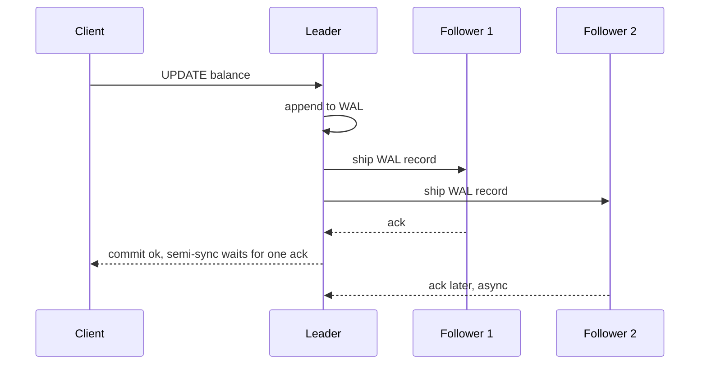
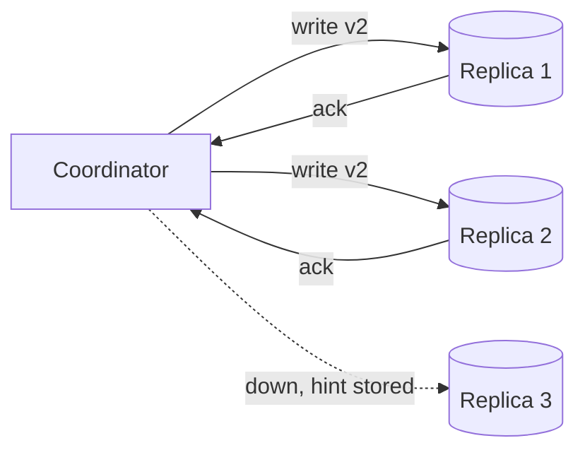

# Replication

**In one line:** keep copies of the same data on several machines so the system survives node loss and serves more reads, and then decide how the copies agree when writes arrive at different times or different places.

## Why it matters in interviews

Every design with a database eventually gets "what happens when the database node dies?" and "how do you scale reads?". Both answers are replication. The follow-ups separate strong candidates: is replication synchronous or asynchronous, how much data can a failover lose, what does a user see when they read from a lagging replica, and who wins when two regions accept conflicting writes.

There are three topologies, and you should be able to name which one a given store uses:

| Topology | Who accepts writes | Typical stores |
|---|---|---|
| Single-leader | One leader per dataset (or per partition) | Postgres, MySQL, MongoDB replica sets, Redis, Kafka partitions |
| Multi-leader | Several leaders, usually one per region | MySQL or Postgres with bidirectional replication tools, CouchDB, DynamoDB global tables |
| Leaderless | Any replica; the client or a coordinator writes to several | Cassandra, ScyllaDB, Riak, the original Dynamo design |

## How it works

### Single-leader

All writes go to the leader. The leader appends each change to a log (Postgres WAL, MySQL binlog) and followers replay that log in the same order. Reads can go to the leader or to followers.

| Mode | Leader commits when | Data lost if leader dies | Write latency |
|---|---|---|---|
| Synchronous | All (or a named set of) followers confirm | None for confirmed followers | Bounded by the slowest required follower; a dead follower blocks writes |
| Asynchronous | The leader's own log is durable | Everything not yet shipped | Lowest |
| Semi-synchronous | At least one follower confirms receipt | None if that follower is promoted | One extra round trip to the nearest follower |

**Postgres streaming replication** ships WAL from the primary to standbys over a replication connection. It is asynchronous by default. Setting `synchronous_standby_names` (for example `ANY 1 (s1, s2)`) plus `synchronous_commit` makes commits wait for standbys; `remote_apply` additionally waits until the standby has applied the change, so reads there see it. Standbys can serve read-only queries (hot standby). Postgres does not fail over by itself; tools such as Patroni handle leader election and promotion. Logical replication (publications and subscriptions) replicates row changes per table and is used for upgrades and CDC.

**MySQL** replicates through the binary log, asynchronously by default. The semi-synchronous plugin makes the source wait until at least one replica has written the event to its relay log before the commit returns. GTIDs give every transaction a global id, which makes repointing replicas after failover reliable. Group Replication (used by InnoDB Cluster) uses a Paxos-based group protocol so a transaction commits only after a majority agrees.

### Failover and split brain

Failover means: detect the leader is gone (usually a heartbeat timeout), pick the most up-to-date follower, promote it, and repoint clients and other followers.

What goes wrong:

- **Lost writes.** With async replication, writes acknowledged by the old leader but not shipped are gone. If the old leader comes back, its extra writes conflict with the new history and are usually discarded.
- **Split brain.** A leader that was only slow or partitioned keeps accepting writes while a new leader is elected. Two leaders diverge.
- **Bad timeouts.** Too short and a GC pause or load spike triggers needless failovers; too long and you are down for longer.

Fixes: elect leaders with a majority (Raft, Paxos, or an external coordinator such as etcd or ZooKeeper) so a minority side cannot elect one; give each leader an epoch or term number and have storage reject writes carrying an older one (fencing tokens); in the worst case, forcibly power off the old node (STONITH). See [consensus and coordination](./consensus-and-coordination.md).

### Replication-lag anomalies

Async followers are behind by milliseconds normally and by minutes under load. Three anomalies follow, with standard fixes:

| Anomaly | What the user sees | Fix |
|---|---|---|
| Read-your-writes violation | Posts a comment, refreshes, comment is missing | Read the user's own data from the leader for a short window after they write; or record the write's log position (LSN) and only read from a replica that has reached it |
| Non-monotonic reads | A comment appears, then disappears on the next refresh | Pin each user to one replica (hash of user id) |
| Consistent-prefix violation | Sees an answer before the question | Keep causally related writes in the same partition; or carry causal metadata |

These are session guarantees; [consistency models](./consistency-models.md) covers them formally.

### Multi-leader

Each region has its own leader that accepts local writes and replicates asynchronously to the others. Writes are fast and a region can keep working when cut off, but two leaders can accept conflicting writes to the same row.

Conflict handling options:

- **Avoid conflicts.** Route all writes for a given record to one "home" region. This is the most common real answer.
- **Last-writer-wins (LWW).** Attach a timestamp and keep the highest. Simple, but it silently drops the losing write, and clock skew decides who wins.
- **Merge in the application.** Store both versions (siblings) and let the application or user merge, as Riak and CouchDB allow.
- **CRDTs.** Data types whose merge is commutative, associative and idempotent, so replicas converge regardless of order: G-counters and PN-counters, OR-sets, sequence CRDTs for text. Riak data types and Redis Enterprise active-active use them.

**DynamoDB global tables** replicate a table across regions with every replica accepting writes. In the default mode, replication is asynchronous and concurrent writes to the same item are resolved by last-writer-wins. AWS has since added a multi-region strong consistency mode, which trades write latency for no conflicts. Within one region, each DynamoDB partition is itself replicated across three availability zones with a leader per partition.

### Leaderless

The client (or a coordinator node acting for it) sends each write to all N replicas and waits for W acknowledgements; reads query R replicas and take the newest version. If **W + R > N**, the read set and write set overlap in at least one replica, so a read sees the latest acknowledged write in the normal case.

With N=3, W=2, R=2 one replica can be down for reads and writes. Quorums are not linearizable on their own: concurrent writes, partial failures and sloppy quorums can still produce stale reads.

How replicas catch up:

- **Read repair.** A read that sees replicas disagree writes the newest version back to the stale ones.
- **Hinted handoff.** If a target replica is down, another node stores the write with a hint and forwards it when the target returns. With a sloppy quorum those hinted writes count toward W, which raises availability but breaks the W + R > N guarantee.
- **Anti-entropy with Merkle trees.** Each replica builds a hash tree over its key ranges. Two replicas compare roots, then descend only into subtrees whose hashes differ, so they find divergent keys while exchanging little data. Cassandra's `nodetool repair` works this way. See [`src/merkle-tree`](../src/merkle-tree/).

**Cassandra** places replicas with a token ring ([consistent hashing](./consistent-hashing.md)) and sets the consistency level per query: `ONE`, `QUORUM`, `LOCAL_QUORUM` (quorum within the local datacenter), `ALL`. Conflicts between versions are resolved per cell by write timestamp (LWW). Lightweight transactions (`IF NOT EXISTS`) use Paxos when you need compare-and-set. See [`src/quorum-kv`](../src/quorum-kv/) for a runnable quorum store.

## Variants / options

| Option | Pros | Cons | Use when |
|---|---|---|---|
| Single-leader, async | Simple; fast writes; easy read scaling | Failover can lose recent writes; replica reads are stale | Most OLTP apps; reads dominate |
| Single-leader, sync or semi-sync | No acknowledged write lost on failover | Higher write latency; a slow follower slows commits | Money, orders, anything that must not vanish |
| Consensus-replicated (Raft or Paxos per range) | Automatic, safe failover; linearizable | Majority round trip per write | Spanner, CockroachDB, etcd; metadata and strong consistency |
| Multi-leader | Local writes in each region; survives region cut-off | Conflicts; LWW drops data | Multi-region writes with a home-region rule or CRDT data |
| Leaderless quorum | No failover step; tunable per query | Conflicts, repair machinery, weaker guarantees than they look | High write volume, always-writable stores |

## Where you see it

- Postgres streaming and logical replication; MySQL binlog, semi-sync and Group Replication.
- MongoDB replica sets: one primary, automatic election, write concern `majority`.
- Cassandra and ScyllaDB: leaderless, tunable consistency, hinted handoff, Merkle-tree repair.
- DynamoDB: three-AZ replication per partition; global tables across regions.
- Kafka: each partition has a leader and in-sync replicas; `acks=all` waits for the ISR.
- Redis: async primary-replica replication, with Sentinel or Cluster for failover.

## Common mistakes

- Saying "we add read replicas" without addressing read-your-writes for the user who just wrote.
- Treating async failover as lossless. State the window: up to the replication lag at the moment of failure.
- Electing a leader with a timeout alone, without fencing. A paused old leader wakes up and writes.
- Choosing LWW and not mentioning that it discards concurrent writes.
- Believing W + R > N gives linearizability. It does not under concurrency or sloppy quorums.
- Forgetting that replication is not a backup. A bad `DELETE` replicates to every copy within milliseconds.

## Interview questions

**Q: Sync or async replication for a payments database?**
Semi-sync or sync to at least one follower, ideally in another availability zone, so a confirmed payment survives the loss of the primary. Accept the extra round trip on writes. Keep further replicas async for reads and analytics.

**Q: A user updates their profile and the page still shows the old name. Why, and how do you fix it?**
The read went to a lagging replica. Route that user's reads to the leader for a few seconds after a write, or store the commit LSN in their session and read only from replicas that have replayed past it.

**Q: How do you prevent split brain during failover?**
Elect the leader through a majority quorum so only one side of a partition can win, give each leadership term an increasing number, and make storage or downstream services reject writes from an older term.

**Q: With N=3, what W and R would you pick?**
W=2, R=2 tolerates one replica down and keeps read and write sets overlapping. For write-heavy logging data, W=1, R=1 trades consistency for latency. W=3 makes any single failure block writes.

**Q: How do leaderless replicas find which keys differ without comparing everything?**
Merkle trees over key ranges. Compare root hashes; if they differ, compare children, and recurse only into mismatched branches. The data exchanged is proportional to the differences, not the dataset.

**Q: Two regions edit the same document offline. What are your options?**
Avoid the conflict by giving the document a home region, accept LWW and lose one edit, keep both versions for the user to merge, or model the document as a CRDT so edits merge automatically. For collaborative text, CRDTs or operational transformation.

## Related

- Fundamentals: [consistency models](./consistency-models.md), [CAP and PACELC](./cap-and-pacelc.md), [consensus and coordination](./consensus-and-coordination.md), [sharding and partitioning](./sharding-and-partitioning.md), [multi-region and disaster recovery](./multi-region-and-disaster-recovery.md), [consistent hashing](./consistent-hashing.md).
- Problems: [key-value store](../problems/key-value-store.md), [distributed cache](../problems/distributed-cache.md), [collaborative editor](../problems/collaborative-editor.md), [payment system](../problems/payment-system.md).
- Code: [`src/quorum-kv`](../src/quorum-kv/), [`src/merkle-tree`](../src/merkle-tree/), [`src/vector-clock`](../src/vector-clock/), [`src/lease-lock`](../src/lease-lock/).
