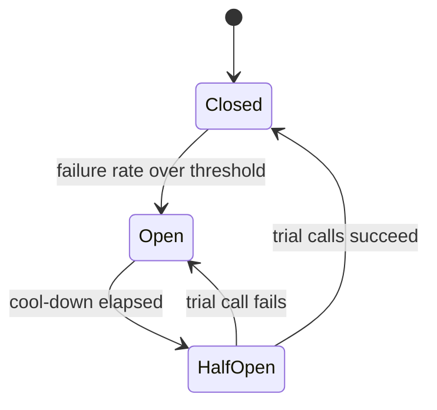
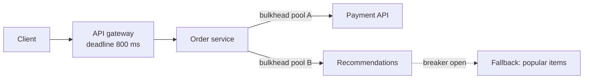

# Resilience patterns

**In one line:** assume every dependency will be slow or down at some point, and bound the damage with timeouts, careful retries, circuit breakers, bulkheads, load shedding and fallbacks, so one failing part does not take down the whole system.

## Why it matters in interviews

Large outages are often cascading failures: one database slows down, callers pile up waiting on it, their thread pools fill, their callers time out and retry, and the extra load keeps the database down. Interviewers ask "what happens when the payment provider is slow?" to see whether you can stop that chain. Saying "add retries" without backoff, budgets and idempotency is a red flag, because naive retries are one of the main ways cascades start.

## How it works

### Timeouts and deadline propagation

Every network call needs a timeout. Without one, a hung dependency holds a thread or connection forever. Pick it from the dependency's latency distribution (a little above its p99), not a round number.

Better than per-hop timeouts is a **deadline** set once at the edge and passed down: "this request must finish by 12:00:00.800". Each service subtracts its own time and forwards the remainder. If the remaining time is too small to be useful, the service fails fast instead of starting work nobody will wait for. gRPC propagates deadlines this way.

### Retries with backoff and jitter

Retry only transient failures (timeouts, connection resets, 503, 429), and only operations that are safe to repeat. Wait longer between attempts (exponential backoff: 100 ms, 200 ms, 400 ms, with a cap) and randomize the wait (jitter), or every client that failed at the same moment retries at the same moment. "Full jitter" picks a random delay between zero and the backoff value.

**Idempotency is the prerequisite.** A timed-out POST may have succeeded. Retrying it without an idempotency key can charge a card twice. See [delivery semantics and idempotency](./delivery-semantics-and-idempotency.md).

### Retry storms and budgets

If each of five layers retries three times, one user request can become 3^5 = 243 calls at the bottom. Rules that prevent this:

- Retry at one layer only, usually the one closest to the user or the client library of the failing dependency.
- Use a **retry budget**: allow retries only while they are a small fraction of total traffic (the Google SRE book describes a per-client budget of about 10%). When the dependency is down, retries stop instead of multiplying load.
- Honour `Retry-After` and do not retry on overload signals from deeper layers.

### Circuit breakers

A breaker wraps calls to one dependency. While closed, calls pass and failures are counted over a sliding window. Past a threshold it opens: calls fail immediately (or go to a fallback) without touching the dependency, which gets room to recover. After a cool-down it lets a few trial calls through (half-open) and closes if they succeed.

### Bulkheads

Isolate resources per dependency or per tenant, like watertight compartments in a ship. Separate connection pools or concurrency limits mean that a slow recommendations service can exhaust only its own 20 slots, while checkout calls still have theirs.

### Load shedding and admission control

When a service is past capacity, serving everyone slowly means serving no one before their timeout. Reject excess work early and cheaply:

- Cap concurrent requests or queue length; return 503 or 429 beyond it.
- Drop requests whose deadline has already passed instead of processing them.
- Prioritize: shed analytics and prefetch traffic before checkout.
- Adaptive concurrency limits adjust the cap from observed latency.

### Backpressure

In pipelines, a slow consumer should slow the producer rather than let an unbounded queue grow until memory runs out. Bounded queues, TCP flow control, reactive streams and consumer-paced pulls (Kafka consumers fetch at their own speed) are all forms of backpressure.

### Graceful degradation and fallbacks

Decide in advance what each feature does when its dependency fails: serve cached or stale data, show a default (popular items instead of personalized ones), hide the widget, or queue the write for later. A fallback that calls another fragile service is not a fallback.

### Hedged requests

For tail latency on idempotent reads, send the request to a second replica if the first has not answered within roughly its p95 latency, and use whichever answers first. Dean and Barroso's "The Tail at Scale" (2013) describes this. It adds only a few percent more load, because only the slowest requests are hedged.

### Liveness vs readiness

| Probe | Question | On failure |
|---|---|---|
| Liveness | Is the process stuck beyond repair? | Restart it |
| Readiness | Can it take traffic right now? | Remove from the load balancer, do not restart |

A liveness check that calls the database is a common cause of outages: the database blips, every pod fails liveness, and the orchestrator restarts the entire fleet at once.

## Variants / options

| Option | Pros | Cons | Use when |
|---|---|---|---|
| Timeout plus deadline propagation | Bounds waiting everywhere | Needs plumbing through every call | Always |
| Retry with backoff and jitter | Absorbs transient faults | Amplifies load; needs idempotency | Idempotent calls, transient errors |
| Retry budget | Stops retry storms | Some failures not retried | Any service with many clients |
| Circuit breaker | Fails fast, lets dependency recover | Tuning thresholds; can trip on a few bad hosts | Remote dependencies that can fail as a whole |
| Bulkhead | Contains one dependency's slowness | Idle reserved capacity | Several dependencies of different importance |
| Load shedding | Keeps goodput under overload | Some users get errors | Any service that can be overloaded |
| Hedged requests | Cuts tail latency | Extra load; reads only | Fan-out reads across replicas |
| Fallback or degraded mode | Users keep the core journey | Must be built and tested | Non-critical features |

## Where you see it

- Runnable implementations: [circuit breaker](https://github.com/hardyalsinghdeora/design-patterns/tree/main/src/modern/circuit-breaker), [retry with backoff](https://github.com/hardyalsinghdeora/design-patterns/tree/main/src/modern/retry-with-backoff), [bulkhead](https://github.com/hardyalsinghdeora/design-patterns/tree/main/src/modern/bulkhead).
- Libraries: Resilience4j (Java), Polly (.NET); Netflix Hystrix popularized breakers and bulkheads and is now in maintenance mode.
- Service meshes and proxies: Envoy outlier detection, retries with budgets, and circuit-breaking limits.
- gRPC deadlines and retry policies; AWS SDKs retry with exponential backoff and jitter.
- Kubernetes liveness, readiness and startup probes.

## Common mistakes

- No timeout, or a default timeout of 30-60 seconds on an internal call.
- Retrying non-idempotent writes, or retrying at every layer.
- Retrying immediately with no jitter, producing synchronized waves.
- One shared thread pool for all outbound calls.
- Unbounded queues that hide overload until memory runs out.
- Liveness checks that depend on downstream services.
- Fallbacks that are never exercised and fail when first needed.

## Interview questions

**Q: The payment provider starts taking 20 seconds per call. What happens to your service, and what do you change?**
Without limits, request threads block, the pool fills and unrelated endpoints fail. Add a timeout near the provider's normal p99, a bulkhead around payment calls, a circuit breaker, and an async path that records the order as pending and confirms later.

**Q: Why add jitter to backoff?**
Clients that failed together retry together. Random delays spread the retries out so the recovering service is not hit by synchronized spikes.

**Q: How do you prevent retry amplification across a deep call chain?**
Retry at one layer, enforce a retry budget, propagate deadlines so lower layers stop when the caller has given up, and do not retry on overload responses.

**Q: Circuit breaker or retry: which goes outside?**
Usually the breaker wraps the retrying call, so when the dependency is clearly down the breaker stops attempts entirely; retries handle the occasional transient failure while it is closed.

**Q: What should a readiness check test?**
Whether this instance can serve: it has finished warming up, its own critical resources are available and it is not overloaded. It should not restart the process, and liveness should not depend on other services.

## Related

- Fundamentals: [delivery semantics and idempotency](./delivery-semantics-and-idempotency.md), [rate limiting](./rate-limiting.md), [load balancing](./load-balancing.md), [observability](./observability.md), [message queues and streams](./message-queues-and-streams.md), [microservices and boundaries](./microservices-and-boundaries.md).
- Problems: [payment system](../problems/payment-system.md), [webhook delivery system](../problems/webhook-delivery-system.md), [notification system](../problems/notification-system.md), [rate limiter](../problems/rate-limiter.md).
- Code: [`src/idempotency-store`](../src/idempotency-store/), [`src/rate-limiter-algorithms`](../src/rate-limiter-algorithms/).
