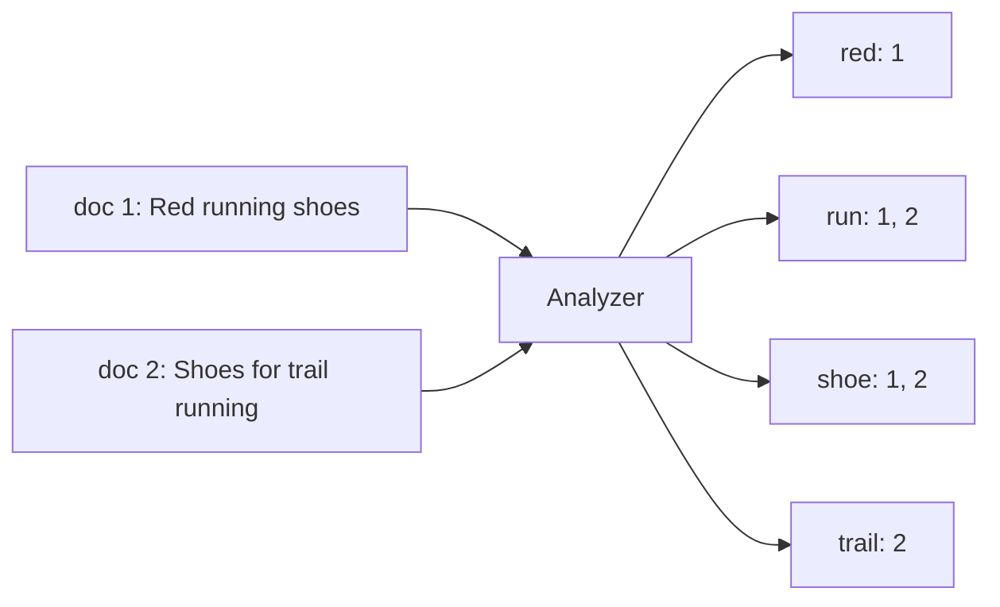

# Search and indexing

**In one line:** full-text search inverts documents into a map from each term to the documents that contain it, ranks matches by how well they fit the query (BM25), and runs as a separate, eventually consistent index fed from the source database.

## Why it matters in interviews

"Users can search products, posts or messages" appears in many designs, and `LIKE '%term%'` on the main database is the wrong answer: it cannot use a B-tree index, it does not rank, and it ignores plurals, case and typos. Interviewers expect you to put a search engine beside the system of record, explain how data gets there without dual writes, and handle typeahead separately. Knowing what an analyzer does and why refresh makes search near-real-time shows real understanding.

## How it works

### Inverted index

For each term, the index stores a postings list: the ids of documents containing it, usually with term frequency and positions (needed for phrase queries). A query for `running shoes` analyzes the query the same way, fetches the postings for `run` and `shoe`, intersects or unions them, and scores the matches. Postings are sorted and compressed, so intersecting them is fast.

### Analyzers and tokenization

An analyzer turns text into terms:

1. **Character filters:** strip HTML, normalize characters.
2. **Tokenizer:** split into tokens on whitespace and punctuation, or use language-aware rules (CJK text needs dictionary or n-gram tokenizers).
3. **Token filters:** lowercase, remove stop words, stem (`running` to `run`), add synonyms, fold accents.

The same analysis must apply at index time and at query time, or the terms do not match. Exact-match fields (ids, tags, status) should not be analyzed at all; in Elasticsearch they are `keyword` fields.

### Ranking: TF-IDF and BM25

- **TF-IDF:** a term counts more if it appears often in this document (term frequency) and rarely across all documents (inverse document frequency). "the" scores almost nothing; a rare product name scores a lot.
- **BM25:** the default in Lucene, Elasticsearch and OpenSearch. It refines TF-IDF in two ways: term frequency saturates (the tenth mention adds little), controlled by `k1` (default 1.2), and long documents are normalized against the average length, controlled by `b` (default 0.75).

Real ranking adds signals on top of text relevance: popularity, recency, personalization, business rules, and often a learned re-ranking stage over the top few hundred results.

### Elasticsearch and OpenSearch

| Concept | Meaning |
|---|---|
| Index | A collection of documents with a mapping (schema) |
| Primary shard | A Lucene index holding part of the documents; a document's shard is chosen by hashing its routing value (the id by default) |
| Replica shard | A copy of a primary for failover and read throughput |
| Segment | An immutable piece of a Lucene index; new documents create new segments, which merge in the background |
| Refresh | Makes recently indexed documents searchable by opening a new segment, every 1 second by default |
| Translog | A write-ahead log so acknowledged writes survive a crash before segments are flushed |

A search is scatter-gather: the coordinating node sends the query to one copy of every shard, each returns its top results, and the coordinator merges them and fetches the documents. Because of refresh, search is **near-real-time**: a document is typically visible about a second after indexing, not immediately. The number of primary shards is fixed at index creation (changing it needs the split or shrink APIs, or a reindex), so size shards up front and use index aliases to swap in a reindexed copy without downtime.

Deep pagination (`from: 100000`) is expensive because every shard must produce that many results; use `search_after` with a sort key instead.

### Keeping search in sync: CDC, not dual writes

Writing to the database and then to the search index from the application (dual write) leaves them inconsistent when the second write fails or when two updates race. Instead, treat the database as the source of truth and stream its changes (via change data capture such as Debezium, or a transactional outbox) to an indexer. Use the row's version or log position as the document's external version so an older update arriving late cannot overwrite a newer one. Keep the ability to rebuild the index from scratch, because mapping changes require it.

### Typeahead

Typeahead must respond in tens of milliseconds per keystroke, so it is usually a separate structure from full-text search:

- **Trie with top-k per node:** each prefix node stores its best few completions, precomputed offline from query logs. Lookup is a walk down the prefix.
- **Edge n-grams:** index `shoes` as `s`, `sh`, `sho`, `shoe`, `shoes`, then run an ordinary term query on the prefix. Easy in a search engine; larger index.
- **Completion suggesters:** Elasticsearch's completion suggester keeps an in-memory finite state transducer for fast prefix lookups.

### Vector search, briefly

Embedding models map text or images to vectors where similar meaning means nearby vectors. Search becomes "find the k nearest vectors to the query vector". Exact search is linear in the corpus, so systems use approximate nearest neighbour indexes; HNSW (hierarchical navigable small world) builds a layered proximity graph and greedily walks it, trading a little recall for large speedups. Many systems run hybrid search: BM25 for exact terms and names, vectors for meaning, merged with a method such as reciprocal rank fusion.

## Variants / options

| Option | Pros | Cons | Use when |
|---|---|---|---|
| SQL `LIKE` / `ILIKE` | No new system | Full scans, no ranking | Tiny tables, admin tools |
| Database full-text (Postgres `tsvector` with GIN) | Transactional, one system | Limited ranking and scale | Moderate data, simple relevance |
| Elasticsearch / OpenSearch | Rich analysis, ranking, aggregations, scale-out | Separate cluster, eventual consistency | Product, log or content search at scale |
| Trie or precomputed prefix service | Very fast typeahead | Offline rebuilds for freshness | Query suggestions |
| Edge n-gram fields | Typeahead inside the search engine | Index size grows | Prefix search on names or titles |
| Vector index (HNSW) | Semantic matches | Approximate; embedding cost | Semantic search, recommendations, RAG |

## Where you see it

- Apache Lucene underlies Elasticsearch, OpenSearch and Apache Solr.
- Postgres full-text search with GIN indexes; `pgvector` for vectors in Postgres.
- Debezium and Kafka Connect for streaming database changes into search indexes.
- Vector indexes in OpenSearch k-NN, Elasticsearch dense vectors, and dedicated vector databases.

## Common mistakes

- Treating the search index as the source of truth.
- Dual writes from application code with no repair path.
- Different analyzers at index and query time.
- Analyzing fields that need exact matches, or not analyzing text fields.
- Too many small shards, or too few to grow, with no reindex plan.
- Expecting a document to be searchable the instant the write returns.
- Serving typeahead with full-text queries on every keystroke.

## Interview questions

**Q: Why not search with `LIKE '%shoe%'` in Postgres?**
A leading wildcard cannot use a B-tree index, so it scans the table. It also has no ranking, stemming or typo handling.

**Q: How does a product update reach the search index?**
The service writes to its database; CDC streams the change to an indexer that upserts the document using the row version as the external version. Lag is usually seconds, and the index can be rebuilt from the database.

**Q: A user creates a post and cannot find it in search right away. Why?**
The index is near-real-time: new documents become searchable after the next refresh, and the change may still be in the CDC pipeline. Show the user's own new content from the primary store.

**Q: How does BM25 differ from plain TF-IDF?**
Repeated terms have diminishing returns, and scores are normalized by document length so long documents do not win by being long.

**Q: How would you build typeahead for a search box?**
Precompute popular completions per prefix from query logs into a trie or key-value map, serve from memory with a CDN or cache in front, and refresh it periodically. Fall back to an edge n-gram query for less common prefixes.

## Related

- Fundamentals: [transactional outbox and CDC](./transactional-outbox-and-cdc.md), [storage engines](./storage-engines.md), [sharding and partitioning](./sharding-and-partitioning.md), [caching strategies](./caching-strategies.md), [batch and stream processing](./batch-and-stream-processing.md).
- Problems: [search autocomplete](../problems/search-autocomplete.md), [web crawler](../problems/web-crawler.md), [e-commerce platform](../problems/ecommerce-platform.md).
- Code: [`src/inverted-index`](../src/inverted-index/), [`src/trie-autocomplete`](../src/trie-autocomplete/).
