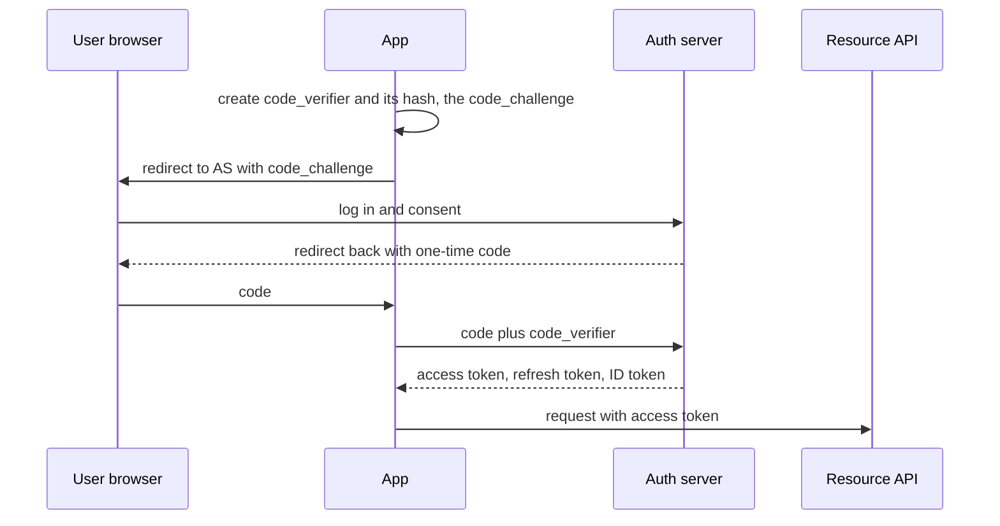
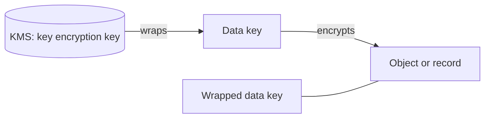

# Security basics

**In one line:** prove who is calling (authentication), check what they may do on every request and every object (authorization), protect data in transit and at rest with managed keys, and keep an audit trail.

## Why it matters in interviews

Security rarely gets its own interview, but it shows up as follow-ups: "how does the mobile app log in?", "how do services trust each other?", "how does the receiver know this webhook is really from you?", "how do you stop user A reading user B's invoice?". Interviewers want correct building blocks named precisely (OAuth with PKCE, mTLS, envelope encryption, HMAC with a timestamp) rather than "we will encrypt everything".

## How it works

### Authentication vs authorization

- **Authentication (authn):** who are you? Passwords plus MFA, passkeys, OAuth/OIDC login, client certificates, API keys.
- **Authorization (authz):** may this caller do this action on this resource? Checked on every request, server side, against the specific object.

### Sessions vs JWTs

| | Server-side session | JWT access token |
|---|---|---|
| What the client holds | Opaque random id in a cookie | Signed token containing claims |
| Validation | Look up the session store | Verify signature and expiry locally |
| Revocation | Delete the session; immediate | Hard until expiry; needs a denylist or short lifetimes |
| Scaling | Shared session store | Stateless validation by any service |

The usual compromise is short-lived access tokens (minutes) plus a refresh token that is stored server side, rotated on use and can be revoked. Always validate the signature, issuer, audience and expiry, and do not accept the `none` algorithm. Keep browser tokens in `HttpOnly`, `Secure`, `SameSite` cookies rather than in JavaScript-readable storage where possible.

### OAuth 2.0 and OpenID Connect

OAuth 2.0 delegates authorization: a user lets an app call an API on their behalf without sharing their password. OpenID Connect (OIDC) is a layer on top that adds an ID token (a JWT about the user) for login.

- **Authorization code with PKCE:** for web, mobile and single-page apps. PKCE stops a stolen authorization code from being exchanged by anyone without the original verifier. The implicit flow is deprecated by current OAuth security guidance.
- **Client credentials:** machine-to-machine; a service authenticates as itself and gets a token with its own scopes.
- **Scopes** limit what a token may do; **audience** limits which API should accept it.

### API keys

Simple long-lived secrets identifying a calling application. Store only a hash server side, show the key once, allow several active keys so customers can rotate, scope them, and rate-limit per key. They identify a client but are weaker than OAuth tokens because they rarely expire.

### Service-to-service: mTLS

With mutual TLS both sides present certificates, so each service knows the other's identity cryptographically. Service meshes issue short-lived certificates automatically (SPIFFE identities are a common format) and rotate them. mTLS answers "which service is calling"; you still need authorization rules on top ("orders may call payments, recommendations may not").

### RBAC vs ABAC

| Model | Rule shape | Good for | Weakness |
|---|---|---|---|
| RBAC | User has role, role has permissions | Admin consoles, staff tools | Role explosion for fine-grained cases |
| ABAC / policy | Rule over attributes of user, resource, context | "Managers can approve expenses under 5,000 in their own department" | Harder to audit and test |
| Relationship-based (Zanzibar style) | Access from a graph: owner, member of folder | Document sharing, nested groups | Needs a dedicated service |

### Encryption in transit and at rest

- In transit: TLS 1.2 or 1.3 everywhere, including internal traffic; HSTS for browsers.
- At rest: disk or storage-level encryption is standard and protects against lost disks, not against someone with application access. Field-level encryption protects specific columns (card numbers, national ids) even from database administrators.

### KMS and envelope encryption

The application asks the KMS for a data key, encrypts data locally with it, and stores the wrapped (encrypted) data key next to the data. To read, it asks the KMS to unwrap the data key. The master key never leaves the KMS, every unwrap is logged, and rotating the master key does not require re-encrypting all data. Deleting a key makes data encrypted under it unreadable, which can serve as crypto-shredding for deletion requests.

### Secrets management

Keep secrets out of code, images and plain environment files. Use a secrets manager (HashiCorp Vault, AWS Secrets Manager, GCP Secret Manager), grant access per workload identity, rotate automatically, and prefer short-lived dynamic credentials where supported.

### Common attack classes

| Attack | What happens | Defence |
|---|---|---|
| Injection (SQL, command) | Input is executed as code | Parameterized queries; never build commands from strings |
| SSRF | Server is tricked into fetching an internal URL, such as the cloud metadata endpoint | Allowlist destinations, block private ranges after DNS resolution, use IMDSv2 on AWS |
| IDOR / broken object-level authorization | `GET /invoices/1235` returns someone else's invoice | Check ownership of the specific object on every request; OWASP API Security Top 10 lists it first |
| XSS | Script injected into pages | Output encoding, Content Security Policy |
| CSRF | Browser sends an authenticated request the user did not intend | SameSite cookies, CSRF tokens |

### Signed webhooks

The sender computes an HMAC over `timestamp + "." + body` with a secret shared with the receiver, and sends the timestamp and signature in headers. The receiver recomputes the HMAC over the raw body, compares in constant time, and rejects timestamps older than a few minutes to block replay (Stripe's libraries default to a five-minute tolerance). Support two active secrets during rotation.

### PII handling and audit logs

Collect the minimum, classify fields, encrypt or tokenize sensitive ones, restrict access, set retention periods and support deletion (GDPR and similar laws). Mask PII in logs. Audit logs record who did what to which resource, when and from where, are append-only, are stored separately from the application data, and are retained according to policy.

## Variants / options

| Option | Pros | Cons | Use when |
|---|---|---|---|
| Server-side sessions | Instant revocation, small cookie | Session store lookup | First-party web apps |
| Short-lived JWT plus refresh token | Stateless checks across services | Revocation lag up to token lifetime | APIs and microservices |
| OAuth code + PKCE via OIDC provider | Standard, delegated, supports SSO | Integration complexity | User login, third-party access |
| Client credentials | Simple machine identity | Secret distribution | Service or partner backends |
| API keys | Easy for developers | Long-lived, often leaked | Public developer APIs, with scopes and rotation |
| mTLS via mesh | Strong service identity, automated rotation | Mesh operations | Internal service traffic |

## Where you see it

- OIDC providers: Auth0, Okta, Keycloak, Google and Microsoft identity platforms.
- AWS KMS, Google Cloud KMS, Azure Key Vault (envelope encryption); HashiCorp Vault.
- Istio and Linkerd for automatic mTLS; SPIFFE and SPIRE for workload identity.
- Google Zanzibar and open-source descendants such as OpenFGA and SpiceDB for relationship-based authorization.
- Stripe and GitHub webhook signatures.

## Common mistakes

- Checking that the user is logged in but not that they own the object.
- Long-lived JWTs with no revocation path.
- Authorization only in the UI or the gateway, not in the service that owns the data.
- Storing API keys or passwords in plain text; passwords need a slow hash such as bcrypt, scrypt or Argon2.
- Comparing signatures with `==` instead of a constant-time comparison.
- Logging tokens, passwords or full card numbers.
- Treating encryption at rest as protection against application-level breaches.

## Interview questions

**Q: How do you revoke a JWT?**
Keep access tokens short-lived and revoke the refresh token; for immediate revocation, check a denylist of token ids (or a per-user "valid after" timestamp) at validation time, accepting the lookup cost.

**Q: Why does a mobile app need PKCE?**
It cannot keep a client secret, and another app could intercept the redirect. PKCE binds the code to a verifier only the original app knows.

**Q: How do internal services authenticate each other?**
mTLS with short-lived certificates issued per workload, plus an authorization policy on which identities may call which endpoints. For calls on behalf of a user, also pass the user's token or a derived token.

**Q: How does a webhook receiver know a request is genuine and not replayed?**
Verify an HMAC over the timestamp and raw body with the shared secret, and reject old timestamps. Deduplicate by event id for retries.

**Q: Why envelope encryption instead of encrypting everything with the KMS directly?**
KMS calls are rate limited and have size limits. Encrypting locally with a data key is fast, and only the small data key goes to the KMS.

## Related

- Fundamentals: [API design](./api-design.md), [rate limiting](./rate-limiting.md), [microservices and boundaries](./microservices-and-boundaries.md), [CDN and blob storage](./cdn-and-blob-storage.md), [observability](./observability.md).
- Problems: [payment system](../problems/payment-system.md), [webhook delivery system](../problems/webhook-delivery-system.md), [file storage and sync](../problems/file-storage-sync.md), [subscription billing platform](../problems/subscription-billing-platform.md).
- Code: [`src/rate-limiter-algorithms`](../src/rate-limiter-algorithms/).
