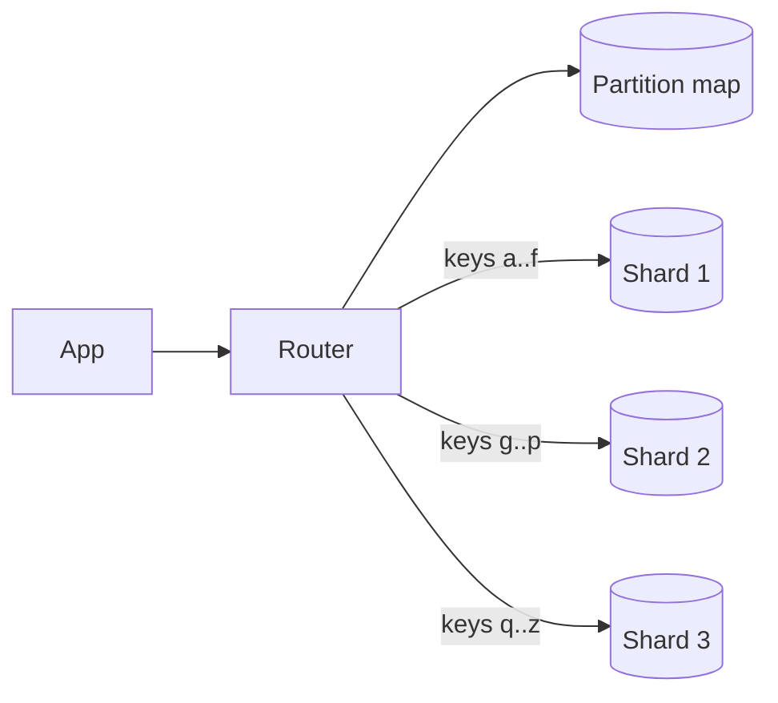

# Sharding and partitioning

**In one line:** split a dataset that is too big or too busy for one machine into pieces by a key, so each node owns a subset, and pick the key so that load spreads evenly and most queries touch one piece.

## Why it matters in interviews

Once the estimate says "20 TB" or "50,000 writes/s", one database node is no longer enough and the interviewer asks how you split the data. The quality of the answer lies in the shard key: it decides which queries stay on one shard, where hot spots appear and how painful resharding will be. Expect follow-ups on celebrity users, secondary indexes, cross-shard transactions and how you add capacity without downtime.

Terminology: "partition" is the logical piece of data; "shard" usually means a partition, or the node or database that holds it. Replication is separate: each partition is usually also replicated ([replication](./replication.md)).

## How it works

A router (client library, proxy, or the database itself) maps each key to a partition, and a partition map maps partitions to nodes.

### Partitioning schemes

| Scheme | How a key is placed | Pros | Cons | Use when |
|---|---|---|---|---|
| Range | Contiguous key ranges per partition | Range scans and ordered reads are cheap | Sequential keys (timestamps) hit one partition | Time-ordered or prefix queries; HBase, Bigtable, Spanner, CockroachDB |
| Hash | `hash(key)` decides the partition | Spreads load evenly | Range queries hit every partition | Point lookups by id; Cassandra, DynamoDB |
| Directory (lookup table) | A service stores key or tenant to shard | Any placement, move single tenants | Lookup service is on the hot path and must be highly available | Multi-tenant SaaS, very uneven tenants |
| Geographic | Region or country decides the shard | Data residency, low latency for local users | Uneven regions; cross-region users | Legal residency rules, location-bound data |

Compound keys combine them: Cassandra hashes the partition key and sorts rows inside a partition by clustering columns, so `(user_id) + (created_at)` gives even spread across users and ordered reads within one user.

### Choosing a shard key

Ask three questions:

1. **Cardinality.** Are there many more distinct values than shards? `country` is too coarse; `user_id` is fine.
2. **Even load.** Is traffic spread across values, or do a few values dominate? A celebrity account or a monotonically increasing timestamp concentrates writes.
3. **Query locality.** Do the hot queries include the key? If "load a user's orders" is the main query, sharding orders by `user_id` keeps it on one shard; sharding by `order_id` scatters it.

For an orders table: `user_id` gives single-shard "my orders" but cross-shard "orders for a merchant". Choose by the dominant query, and serve the other with a secondary index or a separate read model.

### Hot partitions

| Mitigation | How | Cost |
|---|---|---|
| Salting | Append a suffix 0..N-1 to a hot key (`post:42#7`) to spread writes over N partitions | Reads must query all N and combine |
| Split the partition | Range stores split a hot range in two and move one half | Does not help a single hot key |
| Cache in front | Absorb hot reads in Redis or a CDN | Only helps reads |
| Write buffering | Aggregate increments in memory and flush periodically | Reads lag by the flush interval |
| Isolate the tenant | Move a large tenant to a dedicated shard via the directory | Operational work per tenant |

DynamoDB adaptive capacity shifts throughput toward busy partitions and can split a partition by traffic, but a single item is still bounded by per-partition limits.

### Rebalancing

| Approach | How | Examples |
|---|---|---|
| Fixed number of partitions | Create many more partitions than nodes (for example 1,024); move whole partitions when nodes join | Elasticsearch shards, Couchbase vBuckets, Vitess, Redis Cluster's 16,384 hash slots |
| Dynamic splitting | Split a partition when it grows past a size, merge when small | HBase regions, MongoDB chunks, DynamoDB, CockroachDB ranges |
| Consistent hashing with vnodes | Nodes own many small token ranges; a new node takes ranges from all others | Cassandra, ScyllaDB, Riak |

Never use `hash(key) mod number_of_nodes`: adding a node remaps almost every key. See [consistent hashing](./consistent-hashing.md).

### Secondary indexes

| Type | Where the index lives | Write | Read by indexed field |
|---|---|---|---|
| Local (document-partitioned) | Each partition indexes only its own rows | One partition, synchronous | Scatter to all partitions, gather |
| Global (term-partitioned) | Index is partitioned by the indexed value | Touches the base partition and an index partition; usually async | One index partition |

DynamoDB has both: a local secondary index shares the table's partition key and must be defined at table creation; a global secondary index has its own partition key and is updated asynchronously, so its reads are eventually consistent. Cassandra and Elasticsearch use local indexes.

### Cross-shard queries and transactions

Queries without the shard key fan out to every shard; latency follows the slowest shard, and load grows with the shard count. Keep them rare, or maintain a second copy keyed differently (a denormalised table, a search index or an analytics store fed by CDC).

Cross-shard writes need two-phase commit or a saga ([distributed transactions](./distributed-transactions.md)). Better: choose the key so that one business transaction stays in one shard. Citus co-locates tables distributed on the same column so that joins and transactions on one tenant stay on one node.

### Resharding without downtime

1. Create the new shards and start **dual writes** (or, more safely, CDC from old to new) so new changes reach both layouts.
2. **Backfill** existing rows from old to new in batches, idempotently.
3. **Verify**: compare row counts and checksums, and shadow-read from the new layout comparing results.
4. **Cut over reads**, then writes, shard by shard, with a way back.
5. Stop writes to the old layout and delete it later.

Vitess automates this with VReplication: it copies and streams changes into the new shards, then switches traffic in a short cutover. MongoDB supports resharding a collection to a new shard key since version 5.0.

## Variants / options

| Option | Pros | Cons | Use when |
|---|---|---|---|
| No sharding, bigger box plus read replicas | No distributed queries; simple transactions | Write ceiling of one primary | Until you have concrete evidence you need more |
| Application-level sharding | Full control; works with any database | Routing, resharding and cross-shard logic are yours | Few, well-understood access paths |
| Sharding middleware (Vitess, Citus) | Keeps SQL; automated resharding | New component to operate; some SQL limits | Existing MySQL or Postgres apps outgrowing one node |
| Natively partitioned stores (DynamoDB, Cassandra, MongoDB) | Partitioning built in | Data model shaped around the partition key | Known access patterns at large scale |
| Distributed SQL (Spanner, CockroachDB, YugabyteDB) | Automatic range splitting; ACID across shards | Latency of consensus; cost | Global relational data with cross-shard transactions |

## Where you see it

- **Vitess**: shards MySQL into keyspaces; a VIndex maps a column to a shard; VTGate routes queries.
- **Citus**: Postgres extension; distributed tables by a distribution column, reference tables copied to every node.
- **DynamoDB**: partition key hashed to partitions; partitions split by size and throughput.
- **MongoDB**: ranged or hashed shard keys; a balancer moves chunks between shards.
- **Cassandra**: Murmur3 token ring with vnodes; partition key hashed, clustering columns sorted.

## Common mistakes

- Picking a shard key without naming the main queries it must serve.
- Sharding by timestamp or auto-increment id with range partitioning: every write lands on the newest partition.
- Ignoring the celebrity or big-tenant case.
- Hand-waving "we'll reshard later". Say how: fixed partitions, or dual write, backfill, verify, cut over.
- Proposing cross-shard joins on the hot path.
- Sharding too early. One well-tuned Postgres primary with replicas handles a lot.

## Interview questions

**Q: How would you shard a chat messages table?**
By `conversation_id` (hashed), clustered by message time or id within the partition. "Recent messages in this chat" is one partition and ordered. Very large group chats can be bucketed by time, `(conversation_id, month)`, to cap partition size.

**Q: One key gets 100 times the traffic of others. What do you do?**
For reads, cache it and replicate it. For writes, salt it across N sub-keys and sum on read, or buffer increments in memory and flush. If it is a tenant, move it to its own shard.

**Q: Hash or range partitioning for time-series metrics?**
Neither alone. Hash on `(metric, host)` for spread, then range by time inside each partition. Pure time ranges create a single hot partition.

**Q: How do you query by a field that is not the shard key?**
A global secondary index (one lookup, eventually consistent), a local index with scatter-gather (consistent, but hits every shard), or a separate store keyed by that field and fed by CDC.

**Q: Walk through adding shards to a live system.**
Prefer fixed partitions so you just move some to the new nodes. Otherwise: create new shards, stream changes via CDC or dual writes, backfill, verify with checksums and shadow reads, cut over reads then writes, and keep rollback until confident.

## Related

- Fundamentals: [consistent hashing](./consistent-hashing.md), [replication](./replication.md), [distributed transactions](./distributed-transactions.md), [choosing a database](./choosing-a-database.md), [transactional outbox and CDC](./transactional-outbox-and-cdc.md), [caching strategies](./caching-strategies.md).
- Problems: [chat system](../problems/chat-system.md), [key-value store](../problems/key-value-store.md), [news feed](../problems/news-feed.md), [distributed counter](../problems/distributed-counter.md), [url shortener](../problems/url-shortener.md).
- Code: [`src/consistent-hash-ring`](../src/consistent-hash-ring/).
