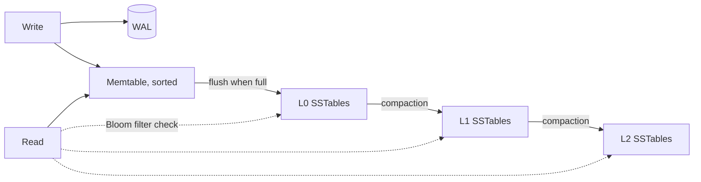

# Storage engines

**In one line:** a B-tree updates sorted pages in place and favours reads, an LSM-tree buffers writes in memory and merges sorted files in the background and favours writes, and both rely on a write-ahead log to survive crashes.

## Why it matters in interviews

When you pick Cassandra for a write-heavy feed or Postgres for an order system, a good interviewer asks why it handles that load. The answer lives in the storage engine: how a write reaches disk, how many disk reads a lookup needs, and how much extra I/O the engine does behind your back. Index design questions (which columns, in which order, does the query need the table at all) come from the same place.

## How it works

### Write-ahead log

Before changing data pages, the engine appends a description of the change to a sequential log and flushes it. After a crash, replaying the log restores every committed change. Sequential appends are cheap, so commits are fast even though the data pages are written later. Postgres calls it the WAL, InnoDB the redo log; LSM engines use a commit log or WAL for the in-memory memtable. The same log often drives replication ([replication](./replication.md)).

### B-tree

Data and indexes are stored in fixed-size pages (8 KB in Postgres, 16 KB by default in InnoDB) arranged as a balanced tree. Internal pages hold keys and child pointers; leaf pages hold the entries. With a fan-out of hundreds, three or four levels cover billions of keys, and the upper levels stay in memory, so a lookup costs about one or two disk reads.

A write finds the leaf page and modifies it in place (with the change first written to the WAL). A full page splits in two, and the parent gets a new pointer.

### LSM-tree

1. A write goes to the WAL and to an in-memory sorted structure (the memtable).
2. When the memtable is full it is flushed as an immutable sorted file, an SSTable.
3. Background compaction merges SSTables, keeping the newest version of each key and dropping deleted ones (deletes are written as tombstones).
4. A read checks the memtable, then SSTables from newest to oldest, until it finds the key.

Each SSTable carries a **Bloom filter** over its keys. A read asks the filter first and skips files that certainly lack the key, so most point lookups touch only one or two files. Filters do not help range scans. See [Bloom filters](./bloom-filters-and-probabilistic.md) and [`src/lsm-tree`](../src/lsm-tree/).

### Amplification

| Kind | Meaning | B-tree | LSM-tree |
|---|---|---|---|
| Write amplification | Bytes written to disk per byte of user data | A whole page (plus WAL) per small change | Data rewritten at each compaction level |
| Read amplification | Disk reads per lookup | About one path down the tree | Possibly several SSTables; reduced by Bloom filters |
| Space amplification | Disk used per byte of live data | Partly empty pages after splits and deletes | Obsolete versions and tombstones until compacted |

You cannot minimise all three; each engine and compaction strategy picks a point on that triangle.

### Compaction strategies

| Strategy | How | Pros | Cons | Default in |
|---|---|---|---|---|
| Size-tiered | Merge several SSTables of similar size into one bigger one | Low write amplification | High space amplification (a large merge temporarily needs free space comparable to its input); a key can sit in many files | Cassandra (STCS) |
| Leveled | Each level is a set of non-overlapping SSTables, each level about 10 times larger than the previous; files merge into the next level | Few files per read; low space amplification | Higher write amplification | LevelDB, RocksDB; Cassandra LCS option |
| Time-window | Group SSTables by time window; old windows are never merged again | Efficient TTL expiry for time-series | Only suits time-ordered, append-mostly data | Cassandra TWCS option |

### Which engines use which

| Engine | Structure | Notes |
|---|---|---|
| Postgres | B-tree indexes over an unordered heap | MVCC writes new row versions; `VACUUM` reclaims old ones |
| MySQL InnoDB | B-tree, clustered on the primary key | Rows live in the primary key leaf pages |
| SQLite | B-tree | Single file |
| LevelDB, RocksDB | LSM | RocksDB is embedded in MyRocks, TiKV, Kafka Streams state stores |
| Cassandra, ScyllaDB, HBase, Bigtable | LSM | Write-optimised wide-column stores |
| CockroachDB | LSM (Pebble, a Go engine modelled on RocksDB) | Earlier versions used RocksDB |

### Clustered vs secondary indexes

- **Clustered index**: the table's rows are stored in the index order. InnoDB always clusters on the primary key, so a primary-key range scan reads adjacent pages. InnoDB secondary indexes store the primary key, so a secondary lookup is two tree descents. This is why random primary keys (UUIDv4) hurt InnoDB ([id generation](./id-generation.md)).
- **Heap plus secondary indexes**: Postgres stores rows in a heap in no particular order; every index, including the primary key, points to a row location. `CLUSTER` reorders the heap once but is not maintained.

### Covering and composite indexes

A **covering index** contains every column the query needs, so the engine answers from the index without visiting the table. Postgres supports `INCLUDE (cols)` for non-key payload columns and index-only scans when pages are marked all-visible; in InnoDB every secondary index already includes the primary key.

A **composite index** on `(a, b, c)` is sorted by `a`, then `b`, then `c`. It serves:

| Query | Uses the index? |
|---|---|
| `WHERE a = ?` | Yes |
| `WHERE a = ? AND b = ?` | Yes |
| `WHERE a = ? AND b > ? ORDER BY b` | Yes, range on `b` |
| `WHERE b = ?` | Not efficiently: no leading `a` |
| `WHERE a > ? AND b = ?` | Only `a` narrows the range; `b` is filtered row by row |

Rule of thumb: equality columns first, then the range or sort column, then extra columns to make it covering. For "a user's latest orders", index `(user_id, created_at DESC)`.

## Variants / options

| Option | Pros | Cons | Use when |
|---|---|---|---|
| B-tree engine | Predictable reads, efficient range scans, mature transactions | Random writes; page splits | OLTP with mixed reads and writes |
| LSM with leveled compaction | High write throughput, good reads | Write amplification from compaction | Write-heavy with frequent point reads |
| LSM with size-tiered compaction | Highest write throughput | Space overhead; reads touch more files | Ingest-heavy, read-light |
| Columnar | Compression and fast scans of few columns | Slow single-row writes and updates | Analytics |
| In-memory (Redis) | Lowest latency | RAM cost; persistence is snapshot or append log | Caches, counters, leaderboards |

## Where you see it

- Postgres and MySQL for transactional systems: B-tree.
- Cassandra, ScyllaDB, HBase and RocksDB-based stores for high write rates: LSM.
- Kafka's log is append-only segments, a close relative of the LSM idea without compaction by key (except for compacted topics).

## Common mistakes

- Saying "LSM is faster" without naming the trade: faster writes, more background I/O, more variable reads.
- Forgetting tombstones: deleting many rows in an LSM store makes reads scan tombstones until compaction.
- Indexing every column. Each index slows writes and uses memory.
- Composite index in the wrong order, then wondering why the range query scans.
- Assuming a secondary index lookup is free in InnoDB; it is a second descent through the primary key.

## Interview questions

**Q: Why do LSM-trees write faster than B-trees?**
Writes are sequential appends to the WAL plus an in-memory insert; disk writes happen later in large sorted batches. A B-tree modifies random pages in place.

**Q: How does an LSM read avoid checking every SSTable?**
Per-SSTable Bloom filters rule out files that cannot contain the key, and leveled compaction keeps at most one candidate file per level.

**Q: What is write amplification and why care?**
The ratio of bytes written to disk to bytes written by the user. On SSDs it consumes device endurance and I/O bandwidth that foreground requests need.

**Q: Size-tiered or leveled compaction for a read-heavy workload?**
Leveled: fewer files per read and less space overhead, at the cost of more compaction writes.

**Q: You have `WHERE user_id = ? AND status = ? ORDER BY created_at DESC LIMIT 20`. Which index?**
`(user_id, status, created_at DESC)`: two equality columns first, then the sort column, so the engine reads the first 20 entries and stops.

## Related

- Fundamentals: [Bloom filters and probabilistic structures](./bloom-filters-and-probabilistic.md), [choosing a database](./choosing-a-database.md), [transactions and isolation](./transactions-and-isolation.md), [id generation](./id-generation.md), [replication](./replication.md), [search and indexing](./search-and-indexing.md).
- Problems: [key-value store](../problems/key-value-store.md), [metrics monitoring](../problems/metrics-monitoring.md).
- Code: [`src/lsm-tree`](../src/lsm-tree/), [`src/bloom-filter`](../src/bloom-filter/).
