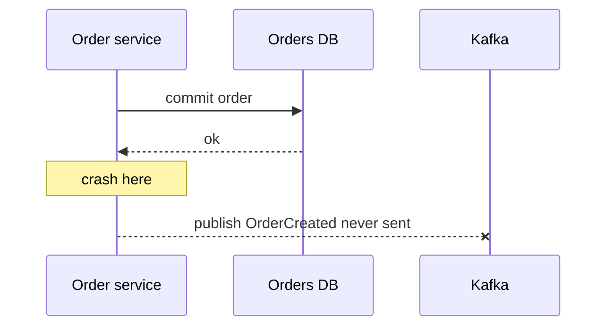
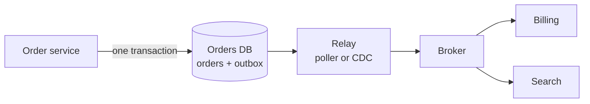

# Transactional outbox and CDC

**In one line:** write the event into the same database transaction as the state change, then publish it from the database to the broker afterwards, so the two can never disagree.

## Why it matters in interviews

"Save the order, then publish OrderCreated" looks harmless and is one of the most common bugs in event-driven designs. Interviewers ask "what if the process crashes between the two?" to see whether you recognise the dual-write problem. The expected answer is an outbox table or change data capture, plus the admission that the result is at-least-once and consumers must deduplicate.

## How it works

### The dual-write problem



Writing to two systems without a shared transaction has four outcomes, and two are wrong: the DB write commits and the publish fails (consumers never hear about the order), or the publish succeeds and the DB write fails or rolls back (consumers act on an order that does not exist). Publishing inside the DB transaction does not help: the broker cannot roll back if the commit fails, and the transaction now holds locks while waiting on the network.

### The outbox pattern

1. In the same transaction as the business change, insert a row into an `outbox` table: event ID, aggregate type and ID, event type, payload, created time.
2. A separate **relay** reads unpublished rows, publishes them to the broker, and marks them published (or deletes them).
3. Consumers receive each event at least once.



Atomicity comes from the local transaction: the event exists if and only if the state change committed.

### Polling relay vs CDC

**Polling relay.** A process runs `SELECT ... FROM outbox WHERE published_at IS NULL ORDER BY id LIMIT 100`, publishes, then updates `published_at`. Simple, works on any database, but adds query load and latency equal to the poll interval.

**Change data capture (CDC).** A connector tails the database's replication log: the Postgres write-ahead log through logical decoding, or the MySQL binlog in row format. **Debezium** is the common open-source choice; it runs as a Kafka Connect source and emits one event per row change. Point it at the outbox table (Debezium has an outbox event router that turns outbox rows into events on per-aggregate topics) or at the business tables directly. CDC gives lower latency and no polling load, but adds a Kafka Connect deployment, needs replication slots or binlog access, and a stalled Postgres replication slot makes the WAL grow until disk fills.

CDC directly on business tables exposes your internal schema as a public contract. Using CDC on an outbox table keeps the event shape explicit and versioned.

### Ordering

The relay must publish in commit order per aggregate. Use the aggregate ID as the partition key so all events for one order land in one partition. With a polling relay, ordering by an auto-increment ID is not quite commit order: a transaction that took ID 101 can commit after one that took 102, and a poller that has already moved past 102 will skip 101. Fixes include polling with a small lag, tracking gaps, or using CDC, which reads in commit order.

### Multiple relays

To scale or for high availability, run several pollers that claim different rows:

```sql
SELECT id, payload FROM outbox
WHERE published_at IS NULL
ORDER BY id
LIMIT 100
FOR UPDATE SKIP LOCKED;
```

`SKIP LOCKED` (Postgres 9.5+, MySQL 8.0+) makes each poller skip rows another poller has locked. This loses strict global order across pollers; if per-aggregate order matters, shard pollers by aggregate ID (poller i takes `hash(aggregate_id) mod n = i`) or use a single active relay with leader election.

### At-least-once and the inbox

The relay can publish and then crash before marking the row, so the event is published again. Consumers must deduplicate: keep an **inbox** (processed-event-IDs table) and insert into it in the same transaction as the consumer's own change, skipping events already present. Outbox on the producer plus inbox on the consumer gives effectively-once processing end to end.

### Cleanup

The outbox grows with every write. Delete published rows after a retention period (hours to days, enough for debugging and replay), in small batches to avoid long locks, or partition the table by day and drop old partitions. With CDC you can delete the row in the same transaction right after inserting it: the WAL still contains the insert, so Debezium still emits the event, and the table stays empty.

### Listen to yourself

An alternative: the service publishes only the event, and updates its own database by consuming that event like everyone else. The log becomes the source of truth. It removes the dual write, but the service cannot read its own write until it has consumed it, and validation against current state becomes harder. It fits event-sourced designs better than CRUD services.

## Variants / options

| Option | Pros | Cons | Use when |
|---|---|---|---|
| Dual write (DB then broker) | Trivial | Lost or phantom events on crash | Never for events that matter |
| Outbox + polling relay | Any database, easy to reason about | Poll latency and load; commit-order gaps | Moderate volume, no CDC infrastructure |
| Outbox + CDC (Debezium) | Low latency, commit order, no polling | Kafka Connect to operate; WAL or binlog retention risks | Already on Kafka; high volume |
| CDC on business tables | No code change in the service | Internal schema becomes the contract | Feeding search indexes, caches, warehouses |
| Listen to yourself | No dual write, single source of truth | Read-your-writes lag; harder validation | Event-sourced services |

## Where you see it

- Debezium connectors for Postgres, MySQL, MongoDB, SQL Server and others, often feeding Kafka.
- DynamoDB Streams and MongoDB change streams as built-in CDC.
- Search and cache invalidation pipelines that tail a primary database.
- Microservice frameworks that ship an outbox implementation (for example Eventuate Tram, MassTransit, NServiceBus).

## Common mistakes

- Publishing to the broker inside the database transaction and assuming that makes it atomic.
- Forgetting consumer-side dedup; the outbox is at-least-once.
- Running several pollers without `SKIP LOCKED` or sharding, so they publish the same rows.
- Never cleaning the outbox table, or a stuck Postgres replication slot filling the disk.
- Exposing raw table changes as public events, then being unable to change the schema.
- Assuming auto-increment order equals commit order.

## Interview questions

**Q: Why not publish the event right after committing?**
A crash between the commit and the publish loses the event forever. Writing it into the outbox in the same transaction guarantees it is recorded if and only if the change committed.

**Q: Outbox with polling or CDC?**
Polling when volume is moderate and you do not run Kafka Connect. CDC when you need low latency, commit ordering, or high volume and already operate the infrastructure.

**Q: The relay published an event twice. Is that a bug?**
No, it is expected. The relay can crash after publishing and before marking the row. Consumers deduplicate on event ID with an inbox table.

**Q: How do you keep events for one order in order?**
Partition by order ID on the broker, and publish from the relay in commit order per aggregate: a single relay, relays sharded by aggregate, or CDC.

**Q: How do you stop the outbox table from growing forever?**
Delete published rows in batches after a retention period, or partition by time and drop old partitions. With CDC you can delete in the same transaction.

## Related

- Fundamentals: [delivery semantics and idempotency](./delivery-semantics-and-idempotency.md), [distributed transactions](./distributed-transactions.md), [message queues and streams](./message-queues-and-streams.md), [event-driven architecture](./event-driven-architecture.md), [replication](./replication.md), [search and indexing](./search-and-indexing.md).
- Problems: [ecommerce platform](../problems/ecommerce-platform.md), [payment system](../problems/payment-system.md), [notification system](../problems/notification-system.md).
- Code: [`src/idempotency-store`](../src/idempotency-store/).
- Pattern: [transactional outbox](https://github.com/hardyalsinghdeora/design-patterns/tree/main/src/modern/transactional-outbox).
