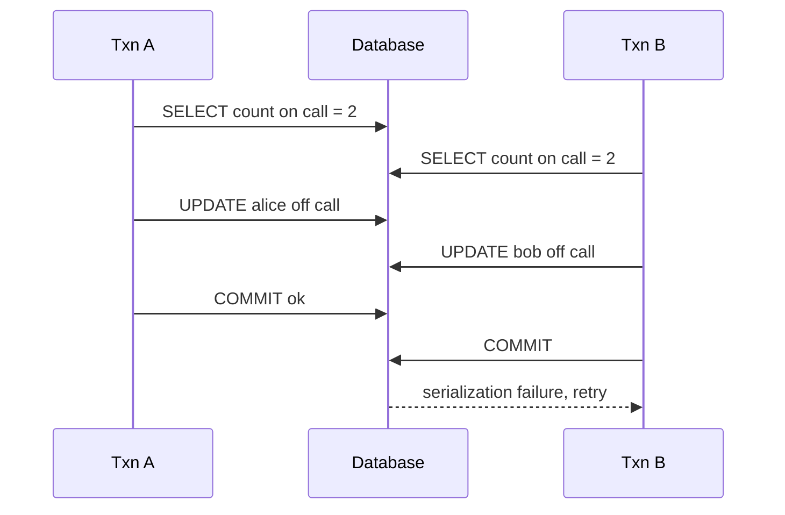

# Transactions and isolation

**In one line:** a transaction groups reads and writes so they commit or fail together, and the isolation level decides which interference from concurrent transactions you are protected from; the rest you must handle with locks, constraints or conditional updates.

## Why it matters in interviews

Double booking a seat, overdrawing a wallet and overselling stock are the same bug: two requests read the same state, both decide the action is allowed, and both write. Interviewers ask about these directly in ticket booking, payment and e-commerce designs. A strong answer names the anomaly, says whether the database's default isolation level prevents it (usually it does not), and picks a concrete fix: a row lock, a conditional update, a unique constraint or serializable isolation.

## How it works

### ACID

| Letter | Meaning | Mechanism |
|---|---|---|
| Atomicity | All writes in the transaction commit or none do | Undo information and the write-ahead log |
| Consistency | Application invariants hold before and after | Constraints, plus correct application logic |
| Isolation | Concurrent transactions do not see each other's partial work, to the degree the level promises | Locks, MVCC snapshots, conflict detection |
| Durability | A committed transaction survives a crash | WAL flushed before commit returns, replicas |

### Anomalies

| Anomaly | What happens |
|---|---|
| Dirty read | T1 reads a value T2 wrote but has not committed; T2 rolls back |
| Non-repeatable read | T1 reads a row twice and gets different values because T2 committed in between |
| Phantom | T1 runs the same range query twice and gets different rows because T2 inserted or deleted matching rows |
| Lost update | T1 and T2 both read a counter, both add to it and write; one increment disappears |
| Write skew | T1 and T2 read the same set, each update a different row based on what they read, and together break an invariant (two doctors both go off call because each saw the other on call) |

### Which level prevents which

| Anomaly | Read uncommitted | Read committed | Repeatable read, Postgres | Repeatable read, MySQL InnoDB | Serializable |
|---|---|---|---|---|---|
| Dirty read | Possible (Postgres treats it as read committed) | Prevented | Prevented | Prevented | Prevented |
| Non-repeatable read | Possible | Possible | Prevented | Prevented | Prevented |
| Phantom | Possible | Possible | Prevented (snapshot) | Prevented for plain reads by the snapshot; locking reads use next-key locks | Prevented |
| Lost update | Possible | Possible | Prevented: the second writer gets a serialization error | Possible with a plain `SELECT` then `UPDATE` | Prevented |
| Write skew | Possible | Possible | Possible | Possible | Prevented |

Defaults: **Postgres is READ COMMITTED; MySQL InnoDB is REPEATABLE READ.** Neither default prevents write skew, and Postgres's default does not prevent lost updates.

### MVCC

Multi-version concurrency control keeps several versions of each row. A transaction reads from a snapshot: the versions committed before its snapshot was taken. Readers do not block writers and writers do not block readers. In Postgres, READ COMMITTED takes a new snapshot per statement and REPEATABLE READ one per transaction. Old versions are cleaned up later (`VACUUM` in Postgres, purge of undo logs in InnoDB).

### Pessimistic locking: SELECT ... FOR UPDATE

`SELECT ... FOR UPDATE` locks the selected rows until the transaction ends; a second transaction trying to lock them waits. This turns read-check-write into a serial section for those rows. `FOR UPDATE SKIP LOCKED` skips rows already locked, which makes a table usable as a work queue. `NOWAIT` fails immediately instead of waiting. Keep these transactions short and lock rows in a consistent order to avoid deadlocks.

### Optimistic locking: version column and compare-and-set

Read the row with its version, do the work, then write only if nobody changed it:

```sql
UPDATE documents
SET body = :new_body, version = version + 1
WHERE id = :id AND version = :read_version;
-- 0 rows updated means a concurrent change: reload and retry, or report a conflict
```

No locks are held while the user or service thinks. It works well when conflicts are rare and across systems that cannot hold database locks (HTTP `If-Match` with ETags is the same idea).

### Serializable snapshot isolation

Postgres SERIALIZABLE (since 9.1) uses SSI: transactions run on snapshots as in repeatable read, while the database tracks read-write dependencies between them. If a pattern that could produce a non-serializable result appears, one transaction fails with a serialization error and must be retried. MySQL SERIALIZABLE instead uses locking: plain reads take shared locks. CockroachDB runs SERIALIZABLE by default. With either approach, the application must **retry on serialization failure**.



Under REPEATABLE READ both commits succeed and nobody is on call. Under SERIALIZABLE one fails and its retry sees the new state.

### Worked examples

**Double booking a seat.** Two users click the same seat.

- Best: a unique constraint on `(event_id, seat_id)` in a `bookings` table. The second insert fails; no race is possible.
- Or a conditional update: `UPDATE seats SET status = 'held', holder = :u, held_until = now() + interval '10 minutes' WHERE id = :s AND status = 'available'`, and check that one row changed.
- Or `SELECT ... FOR UPDATE` on the seat row before deciding.

**Wallet balance.** Two withdrawals of 80 from a balance of 100.

- A read in the application followed by `UPDATE SET balance = :computed` loses an update at READ COMMITTED.
- Fix: `UPDATE wallets SET balance = balance - 80 WHERE id = :w AND balance >= 80` and check the row count. The check and the write are one atomic statement.
- In a real ledger, also insert an immutable entry in the same transaction, with an idempotency key so a retried request does not withdraw twice ([delivery semantics and idempotency](./delivery-semantics-and-idempotency.md)).

**Inventory decrement.** `UPDATE stock SET qty = qty - 1 WHERE sku = :sku AND qty >= 1`. Zero rows updated means sold out. For a flash sale on one SKU, the single row becomes a hot spot: split stock into several bucket rows and decrement any bucket with stock, or reserve through a queue.

## Variants / options

| Option | Pros | Cons | Use when |
|---|---|---|---|
| Atomic conditional update | One statement, no extra locks held | Logic must fit in one `UPDATE` | Counters, balances, stock, status transitions |
| Unique constraint | Impossible to violate | Only expresses uniqueness | Bookings, usernames, idempotency keys |
| `SELECT ... FOR UPDATE` | Simple read-check-write | Waiting, deadlocks, long locks hurt throughput | Short multi-row decisions with real contention |
| Optimistic version column | No locks; works across requests | Retries under contention | Editing documents, low-conflict updates |
| SERIALIZABLE | Database prevents all anomalies | Retries; some throughput cost | Complex invariants hard to express otherwise |

## Where you see it

- Postgres: READ COMMITTED default, REPEATABLE READ as snapshot isolation, SERIALIZABLE as SSI.
- MySQL InnoDB: REPEATABLE READ default with next-key locks for locking reads.
- Ticket and booking systems: holds with expiry implemented as conditional updates.
- Job queues on Postgres using `FOR UPDATE SKIP LOCKED`.

## Common mistakes

- Assuming "it's in a transaction" prevents double booking. At READ COMMITTED it does not.
- Reading a value into the application, computing, and writing it back without a condition or lock.
- Using SERIALIZABLE without retry logic.
- Holding row locks across network calls to other services.
- Forgetting that transactions are per database. Across services you need sagas or an outbox ([distributed transactions](./distributed-transactions.md)).

## Interview questions

**Q: How do you stop two users booking the same seat?**
A unique constraint on `(event_id, seat_id)` for confirmed bookings, plus a conditional update for temporary holds (`WHERE status = 'available'`), checking the affected row count.

**Q: What is write skew and which level prevents it?**
Two transactions read overlapping data and write different rows, together breaking an invariant. Only SERIALIZABLE prevents it in general; otherwise lock the rows that the decision depends on, or materialise the invariant as a row you can lock or constrain.

**Q: Optimistic or pessimistic locking?**
Optimistic when conflicts are rare and you want no waiting, especially across user think time. Pessimistic when contention is high and retries would waste work.

**Q: What are the default isolation levels in Postgres and MySQL?**
Postgres READ COMMITTED; MySQL InnoDB REPEATABLE READ.

**Q: How does MVCC let readers avoid blocking writers?**
Each write creates a new row version; readers see the versions committed before their snapshot, so they never wait for an in-progress writer.

## Related

- Fundamentals: [distributed transactions](./distributed-transactions.md), [consistency models](./consistency-models.md), [storage engines](./storage-engines.md), [delivery semantics and idempotency](./delivery-semantics-and-idempotency.md), [choosing a database](./choosing-a-database.md).
- Problems: [ticket booking](../problems/ticket-booking.md), [payment system](../problems/payment-system.md), [e-commerce platform](../problems/ecommerce-platform.md), [stock exchange](../problems/stock-exchange.md).
- Code: [`src/idempotency-store`](../src/idempotency-store/), [`src/lease-lock`](../src/lease-lock/).
