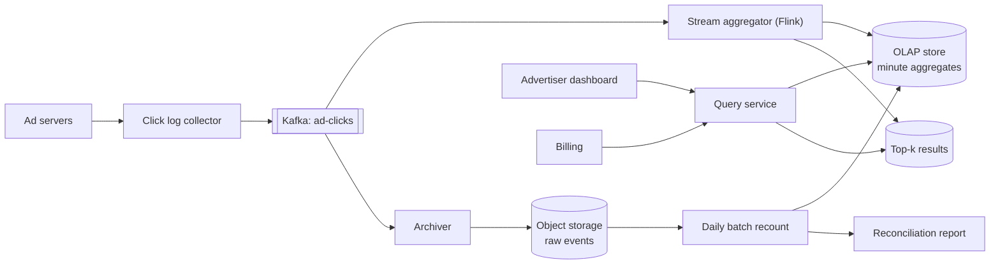
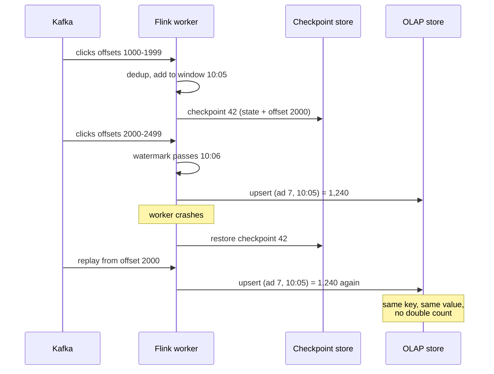

# Design an Ad Click Aggregation System

| | |
|---|---|
| **Asked at** | Common at ad-tech, social and large consumer companies; a standard stream processing problem |
| **Difficulty** | Hard |
| **Core challenges** | exactly-once counts, late events, deduplication, hot keys |
| **Related building blocks** | [`src/count-min-sketch`](../src/count-min-sketch/), [`src/hyperloglog`](../src/hyperloglog/), [`src/bloom-filter`](../src/bloom-filter/), [`src/idempotency-store`](../src/idempotency-store/) |

## 1. Requirements

### Functional
1. Ingest click events (`click_id`, `ad_id`, `user_id`, `ts`, country, device) from the ad servers.
2. Aggregate click counts per ad per minute; roll up to hours and days.
3. Query: clicks for an ad (or campaign) over a time range at minute granularity, filtered by country or device.
4. Query: top 100 most clicked ads in the last M minutes.
5. Counts feed billing (advertisers pay per click), so they must be correct.

### Non-functional
- Scale: 1 B clicks per day, 2 M active ads, peaks of 5× average around big events.
- Freshness: per-minute counts queryable within about 1 minute of the window closing.
- Correctness: no click counted twice, none lost. Late clicks (up to a few minutes, some up to hours from mobile offline buffers) still count. A daily batch recount is the billing source of truth.
- Query latency: under 1 s for dashboard queries over a day of minute data.
- Availability: ingestion must not drop events even if aggregation is down.

### Out of scope
- Click fraud models (we consume their verdicts), ad serving and auctions, impressions and conversions (same design, different topics), advertiser UI.

## 2. Estimation

| Quantity | Estimate | Implication |
|---|---|---|
| Click events | 1 B / 86,400 s ≈ **11.5k/s** average, peak 5× ≈ **60k/s** | A Kafka cluster with tens of partitions absorbs this easily; size consumers for 60k/s |
| Event size | ~200 B | 60k/s × 200 B = **12 MB/s** at peak; network is not the bottleneck |
| Raw storage | 1 B × 200 B = **200 GB/day**, ~70 TB/year | Raw events to object storage (Parquet) for recounts and audits; Kafka retains 7 days |
| Aggregate rows | ~500k ads clicked per minute (assumed) × 1,440 min ≈ **720 M rows/day** before dimensions | Minute rows kept 30 days, then only hourly; OLAP store with columnar compression |
| Aggregate storage | 720 M × ~50 B ≈ **36 GB/day** uncompressed | A few TB per month of minute data; columnar compression cuts this several times |
| Dedup state | clicks in a 24 h window: 1 B ids × ~16 B = **16 GB** | Fits in RocksDB-backed stream state across workers; a Bloom filter would be ~1.2 GB at 1 % FP |
| Hot ad | a viral ad may take 5 % of traffic = **3k/s on one key** | One key, one partition, one worker: needs pre-aggregation (section 6.5) |

## 3. API

```
-- ingestion (internal, from ad servers)
Kafka topic ad-clicks, key = ad_id, value = { clickId, adId, campaignId, userId, ts, country, device }

-- query (advertiser dashboards and billing)
GET /v1/ads/{adId}/clicks?from=2026-11-07T10:00Z&to=2026-11-07T12:00Z&granularity=minute&country=IN
  200: { series: [{ windowStart, clicks }], complete: true|false }

GET /v1/campaigns/{campaignId}/clicks?from=..&to=..&granularity=hour

GET /v1/ads/top?window=5m&limit=100
  200: { asOf, ads: [{ adId, clicks }] }
```

`clickId` is generated by the ad server when it renders the click URL, so retries from the client or ad server carry the same id; that is what makes dedup possible. The query API is read-only and authorised per advertiser account (an advertiser sees only their own ads). Long ranges are served from hourly rollups automatically. `complete: false` marks windows that may still receive late events.

## 4. Data model

```
-- raw events: object storage, partitioned by event date and hour
s3://clicks/raw/dt=2026-11-07/hr=10/part-*.parquet

-- minute aggregates in the OLAP store (Druid, Pinot or ClickHouse)
ad_clicks_minute (
  window_start  TIMESTAMP,    -- event-time minute
  ad_id         BIGINT,
  campaign_id   BIGINT,
  country       CHAR(2),
  device        TEXT,
  clicks        BIGINT,
  unique_users  HLL_SKETCH,   -- optional: approximate distinct users
  PRIMARY KEY (ad_id, window_start, country, device)
)
-- partitioned by day, sorted by (ad_id, window_start)
ad_clicks_hour, ad_clicks_day    -- rollups with the same shape

top_ads (window_end, rank, ad_id, clicks)    -- written every minute

-- stream state (inside the stream processor, checkpointed)
seen_click_ids: keyed by click_id, TTL 24 h
window_counts:  keyed by (ad_id, window_start, country, device)
```

Store choice: queries are "sum clicks over a time range for one ad, grouped by dimension", which is what a column-oriented OLAP store is built for: it scans only the needed columns, compresses timestamps and ids well, and supports upserts or replacing segments. The upsert key `(ad_id, window_start, country, device)` makes the sink idempotent (section 6.3). Raw events stay in object storage because the batch recount and audits read them sequentially.

## 5. High-level design



**Write path**: a click hits the ad server's redirect endpoint, which logs the event and redirects the user to the advertiser. The log collector publishes to Kafka keyed by `ad_id`. Kafka is the durable buffer: if aggregation is down, events wait there for up to 7 days.

**Aggregation**: Flink reads the topic, drops duplicates by `click_id`, assigns each click to a one-minute event-time window, and when the watermark passes the window end, emits `(ad_id, window_start, dims, clicks)` to the OLAP store as an upsert.

**Reconciliation**: an archiver writes every raw event to object storage. Each night a batch job recounts the previous day exactly and replaces the streaming numbers where they differ.

**Read path**: dashboards and billing query the OLAP store through the query service, which picks minute, hour or day tables based on the range.

## 6. Deep dives

### 6.1 Event time, watermarks and late events

Problem: clicks arrive out of order. A phone that was offline sends its clicks 20 minutes late; network delays reorder events by seconds. Counting by arrival time (processing time) puts clicks in the wrong minute and makes reprocessing give different answers.

Options:

1. **Processing-time windows.** Simple, low latency, but wrong for billing and not reproducible.
2. **Event-time windows with a watermark.** The watermark is the processor's estimate that "no more events older than T will arrive", for example max seen event time minus 30 s. A window closes when the watermark passes its end.
3. **Event-time windows with allowed lateness.** Same as 2, but the window state is kept for an extra period (say 10 minutes) after it first fires; each late event updates the count and re-emits the window. Events later than that go to a side output.

**Choice:** option 3. First result fires 30 s after the minute ends (freshness), late events within 10 minutes update it (the sink is an upsert, so re-emitting is safe), and anything later goes to a late-events topic that the daily batch picks up. This bounds state size while still counting every click by end of day. See [batch and stream processing](../fundamentals/batch-and-stream-processing.md).

### 6.2 Click deduplication

Problem: the same click can appear twice: a user double-taps, the ad server retries a publish, or Kafka's producer retries after a timeout. Billing must count it once.

Options:

1. **Exact dedup in stream state.** Key by `click_id`, keep a "seen" flag with a 24 h TTL in the processor's state (RocksDB backed). Exact, about 16 GB of state across workers.
2. **Bloom filter per hour.** ~1.2 GB for a day at 1 % false positive rate, but a false positive drops a real click, which undercounts billing.
3. **Dedup only in the batch job.** Streaming counts slightly high, fixed nightly.

**Choice:** option 1 in the stream, plus a full dedup in the batch recount. The stream job keys by `click_id` first (dedup), then re-keys by `ad_id` (aggregation). Producers also enable idempotent writes in Kafka to remove broker-level duplicates. A Bloom filter is acceptable only for display counts where a 1 % undercount is tolerable. See [delivery semantics and idempotency](../fundamentals/delivery-semantics-and-idempotency.md).

### 6.3 Exactly-once state and idempotent sinks

Problem: if a worker crashes, it restarts from somewhere. Restarting from the latest Kafka offset loses events; restarting from an old one double-counts, unless the state and output are consistent with the input position.

How it works: Flink takes periodic checkpoints (every 30 s). A checkpoint barrier flows through the job; each operator snapshots its state (window counts, seen ids) and the source records its Kafka offsets in the same checkpoint. On failure, the job restores state and offsets from the last completed checkpoint and replays from there. Internal state is then exactly-once. The output still needs care, because windows emitted after the checkpoint will be emitted again on replay.

Sink options:

1. **Transactional sink** (two-phase commit): output is written in a transaction committed only when the checkpoint completes. Exactly-once, but output becomes visible only at checkpoint intervals and needs a transactional target (Kafka supports this).
2. **Idempotent upsert**: write `(ad_id, window_start, dims) → clicks` as an overwrite, not an increment. A replay writes the same value again.

**Choice:** option 2 for the OLAP store, because window results are complete values, not deltas. Never emit "+N" increments to the sink; that turns every replay into a double count.



### 6.4 Reconciliation with a batch recount

Streaming has many moving parts; billing needs a number that can be audited. Each night a batch job (Spark) reads the previous day's raw events from object storage, dedups by `click_id` exactly, applies the fraud verdicts, aggregates per ad per minute, and writes the result into the OLAP store, replacing the streaming segments for that day. It also produces a report of differences per ad; a difference above 0.1 % triggers an alert because it means the stream path has a bug. This is the lambda pattern applied narrowly: the stream gives freshness, the batch gives the final billed numbers.

### 6.5 Hot ads and top-k

Problem: keying by `ad_id` sends all clicks of a viral ad to one worker, which falls behind and holds back the watermark for everyone.

Options:

1. **Salted keys**: key by `(ad_id, salt 0..N-1)` for known hot ads, aggregate per salt, then sum the N partial counts in a second stage keyed by `ad_id`. N partial rows per window are cheap.
2. **Local pre-aggregation**: each worker combines counts per ad in memory for a second before shuffling, so a hot ad sends one record per worker per second instead of 3,000.

**Choice:** option 2 always (it is cheap), plus option 1 for ads a Count-Min Sketch flags as heavy hitters. For the top 100 query, a second stage keeps a min-heap of the top 100 per window from the exact per-ad counts. The sketch in [`src/count-min-sketch`](../src/count-min-sketch/) is useful for spotting candidates cheaply; distinct users per ad use [`src/hyperloglog`](../src/hyperloglog/). See [top-k trending](./top-k-trending.md) for the windowed top-k design in detail.

## 7. Scaling and operations

- **Partitioning**: Kafka topic with 64 partitions keyed by `ad_id` (dedup stage re-keys by `click_id`); Flink parallelism matched to partitions. OLAP store partitioned by day and sharded by `ad_id`.
- **Replication**: Kafka replication factor 3 with `acks=all` so an acknowledged click survives a broker loss; checkpoints in replicated object storage; OLAP replicas for query load.
- **Backfill**: replaying Kafka from an earlier offset into a separate job version reproduces the same results, because windows use event time and the sink is idempotent.
- **Failure modes**: Flink down → Kafka buffers, dashboards show stale data with `complete: false`; OLAP down → Flink back-pressures, Kafka buffers; one slow partition → watermark stalls for all, so use per-partition idle detection and alert on watermark lag.
- **Monitoring**: consumer lag, watermark lag behind wall clock, checkpoint duration and failures, late-event rate, dedup drop rate (sudden rise means a producer bug or an attack), stream-vs-batch difference per day.
- **Abuse and security**: fraud scoring on click patterns (same user, same ad, many clicks), signed click URLs so clicks cannot be forged, advertisers authorised per account for queries.

## 8. Trade-offs summary

| Decision | Chosen | Alternative | Why |
|---|---|---|---|
| Time semantics | Event time with watermark and 10 min lateness | Processing time | Correct minute attribution, reproducible replays |
| Delivery guarantee | Checkpoints + idempotent upsert sink | Two-phase commit sink | Window results are full values, so overwrite is simpler and fresher |
| Dedup | Exact keyed state, 24 h TTL | Bloom filter | Billing cannot drop real clicks on false positives |
| Source of truth | Nightly batch recount | Stream only | Auditable, catches stream bugs, handles very late events |
| Query store | Columnar OLAP | Relational or key-value | Range scans and group-bys over billions of rows |
| Hot keys | Local pre-aggregation + salting | Bigger worker | Splits one key's load; keeps the watermark moving |

## 9. Follow-up questions interviewers ask

- *"Why not just increment a counter in Redis per click?"* No dedup, no event time, no replay: a crash or retry silently changes the count, and you cannot recompute it. It works for display counters, not billing.
- *"What happens to a click that arrives 3 hours late?"* It misses the stream's allowed lateness, goes to the late topic, and the nightly batch counts it in the right minute. Dashboards show it after the batch.
- *"How do you change the aggregation logic safely?"* Run the new job version in parallel from a past offset into a shadow table, compare with production, then switch the query service.
- *"How do you count unique users per ad?"* A HyperLogLog sketch per window (about 1.6 % error at 4 KB), mergeable across minutes into hours.
- *"Why key by ad_id and not campaign_id?"* Ads are the finest level we bill on; campaign totals are rollups. Keying by campaign concentrates more traffic on fewer keys.
- *"How is this different from Lambda vs Kappa architecture?"* We run a Kappa-style stream for freshness and a narrow batch job only for billing reconciliation; reprocessing is done by replaying Kafka, not a separate batch codebase for every metric.
