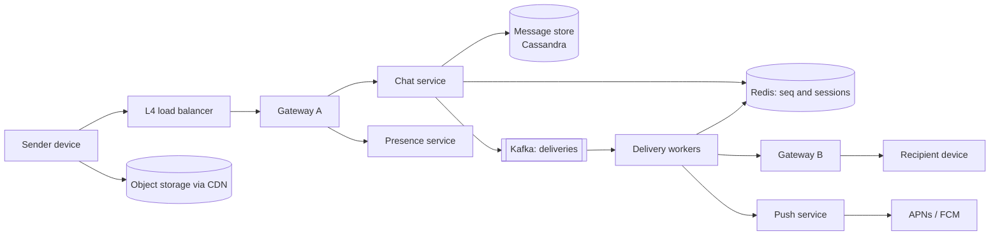
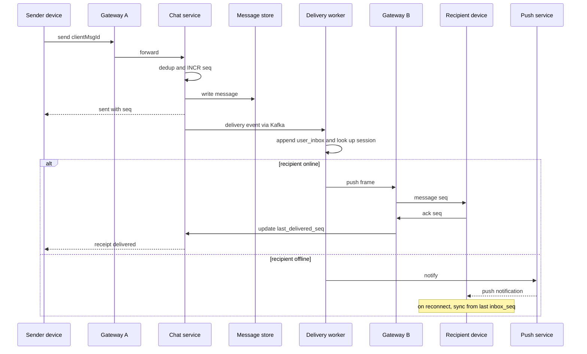

# Design a Chat System (WhatsApp / Slack)

| | |
|---|---|
| **Asked at** | Very common across messaging, social and collaboration-tool companies |
| **Difficulty** | Hard |
| **Core challenges** | persistent connections, per-conversation ordering, offline delivery, multi-device sync |
| **Related building blocks** | [`src/snowflake-id`](../src/snowflake-id/), [`src/consistent-hash-ring`](../src/consistent-hash-ring/), [`src/idempotency-store`](../src/idempotency-store/) |

Related: [real-time communication](../fundamentals/realtime-communication.md), [delivery semantics and idempotency](../fundamentals/delivery-semantics-and-idempotency.md), [notification-system](./notification-system.md), [sharding and partitioning](../fundamentals/sharding-and-partitioning.md).

## 1. Requirements

### Functional
1. 1:1 chat and group chat (groups up to 1,000 members); text plus media attachments.
2. Messages in a conversation appear in the same order for every participant.
3. Sent, delivered and read receipts.
4. Offline users receive messages when they reconnect and get a push notification meanwhile.
5. A user can be logged in on several devices (phone, desktop, web); every device sees the full history and stays in sync.
6. Presence: online indicator and "last seen".

### Non-functional
- Scale: 500 M DAU, 20 B messages/day, ~200 M concurrent connections at peak.
- Latency: p99 under 300 ms from sender to an online recipient in the same region.
- Durability: once the sender sees "sent", the message is never lost.
- Ordering: total order per conversation; no order across conversations is promised.
- Availability: 99.99 % for send and receive; presence may be stale for tens of seconds.

### Out of scope
- Voice and video calls, message search, bots and integrations, the cryptographic protocol in detail (covered at a high level in 6.5).

## 2. Estimation

| Quantity | Estimate | Implication |
|---|---|---|
| Messages | 20 B/day ≈ **230k/s**, peak ~700k/s | Write-heavy; needs a store built for high write throughput (LSM-based) |
| Concurrent connections | ~200 M at peak | At ~100k WebSockets per gateway server → **~2,000 gateways**; they must be stateless apart from the sockets |
| Message size | ~200 B with metadata (text); media stored separately | |
| Storage | 20 B × 200 B = **4 TB/day**, ~1.5 PB/year before replication | Partition by conversation; tier old data to cheaper storage, or keep only undelivered messages (WhatsApp-style) |
| Group fan-out | average group of 20 → each group message is 20 deliveries | Fan-out cost grows with group size; cap group size |
| Heartbeats | 200 M connections / 30 s ≈ **6.7 M/s** | Handle at the gateway in memory; never write each one to a database |
| Media | 10 % of messages × 200 KB = 400 TB/day | Object storage plus CDN, uploaded out of band |

## 3. API

Clients hold one WebSocket per device. Frames are JSON (or protobuf) messages.

```
client → server
  { type: "send", clientMsgId, conversationId, body | ciphertext, attachments? }
  { type: "ack", conversationId, seq }                 delivered receipt
  { type: "read", conversationId, seq }                read receipt (watermark)
  { type: "sync", cursor }                             fetch everything after cursor
  { type: "typing", conversationId }

server → client
  { type: "sent", clientMsgId, conversationId, seq, serverTs }
  { type: "message", conversationId, seq, senderId, body, serverTs, inboxSeq }
  { type: "receipt", conversationId, userId, kind: "delivered" | "read", seq }
  { type: "presence", userId, status, lastSeen }

REST (for history and setup)
  GET  /v1/conversations?cursor=...                   conversation list
  GET  /v1/conversations/{id}/messages?beforeSeq=...&limit=50
  POST /v1/conversations                              create group  { memberIds, name }
  POST /v1/media/uploads                              returns presigned URL
```

`clientMsgId` (a UUID generated on the device) makes send idempotent: a retry after a dropped connection returns the original `seq` instead of storing a duplicate. History pagination uses `beforeSeq`, which is stable because sequence numbers never change. Authentication happens once at WebSocket upgrade with a bearer token; the gateway attaches `userId` and `deviceId` to every frame it forwards.

## 4. Data model

```
messages (
  conversation_id  BIGINT,
  bucket           INT,          -- seq / 10,000, bounds partition size
  seq              BIGINT,       -- per-conversation, gap-free, assigned by server
  message_id       BIGINT,       -- Snowflake, global id
  client_msg_id    UUID,
  sender_id, sender_device, body_or_ciphertext BLOB, attachments, created_at,
  PRIMARY KEY ((conversation_id, bucket), seq)
)
conversations (conversation_id PK, type, name, created_at, member_count)
members       (conversation_id, user_id, role, last_delivered_seq, last_read_seq,
               PRIMARY KEY (conversation_id, user_id))
user_inbox    (user_id, inbox_seq, conversation_id, seq,
               PRIMARY KEY (user_id, inbox_seq))      -- per-user sync log, TTL 30 days
user_convs    (user_id, last_activity, conversation_id)  -- conversation list

Redis:
  session:{user_id}  -> hash device_id -> gateway_id   (TTL refreshed by heartbeat)
  seq:{conversation_id} -> counter
  presence:{user_id} -> status, last_seen              (TTL 60 s)
```

Store choice: a wide-column store (Cassandra or ScyllaDB). The dominant query is "messages of conversation X after or before seq N", which is a single-partition range scan when the partition key is the conversation and the clustering key is `seq`. The write rate (700k/s peak) suits an LSM-tree engine. The `bucket` column stops a busy group from growing one partition without bound. Session and presence data is ephemeral and lives in Redis.

## 5. High-level design



**Send**: the device sends a `send` frame over its WebSocket. Gateway A forwards it to the chat service, which checks membership, dedups on `clientMsgId`, assigns `seq` for the conversation, writes the message to Cassandra and then returns `sent` with the seq. It also publishes one delivery event per recipient (and per other device of the sender) to Kafka.

**Deliver**: a delivery worker appends to the recipient's `user_inbox`, looks up `session:{recipient}` to find which gateways hold the recipient's devices, and pushes the frame to those gateways over an internal RPC. If no device is connected, it calls the push service. The recipient device replies with `ack`, which advances `last_delivered_seq` and produces a "delivered" receipt for the sender.

**Reconnect**: the device sends `sync` with its last `inbox_seq`; the server streams every inbox entry after it, then live delivery resumes.

## 6. Deep dives

### 6.1 Ordering with per-conversation sequence numbers

Problem: two people in a group send at the same moment through different gateways. Every member must see the same order, and a client must be able to tell when it has missed something.

| Option | Ordering | Gap detection | Cost |
|---|---|---|---|
| Client timestamps | Wrong under clock skew | No | Free |
| Snowflake ids from any server | Roughly time-ordered; ties across servers are arbitrary but consistent | No (ids are sparse) | Free |
| **Per-conversation counter** | Total order per conversation | Yes: seq 41 then 43 means 42 is missing | One atomic increment per message |

**Choice: a per-conversation counter.** The chat service runs `INCR seq:{conversation_id}` in Redis (sharded by conversation id), then writes the message with that seq. Because seq values are dense, a client that receives 43 after 41 fetches 42 from history before rendering, so ordering problems are repaired by the client rather than hidden. If a Redis shard loses its counter after failover, the chat service reinitialises it from `max(seq)` in the message store plus a safety margin; a small gap is acceptable, a reused seq is not. A message whose write fails after the increment leaves a gap; clients treat a gap that history cannot fill after a timeout as "nothing there".

An alternative is to route each conversation to one owner process (consistent hashing on conversation id) that assigns seq in memory and persists in batches. This removes the Redis hop but needs ownership handoff on failure; it is worth it only if the counter becomes the bottleneck.

### 6.2 Delivery, receipts and offline users



- **"Sent"** means durably stored. The sender's device keeps the message in an outbox and retries with the same `clientMsgId` until it gets `sent`, which gives at-least-once delivery to the server and exactly-once storage through dedup.
- **"Delivered"** and **"read"** are watermarks, not per-message flags: `last_delivered_seq` and `last_read_seq` per member. Reading message 50 implies 1-49 are read. This turns N receipt writes into one row update and makes group receipts ("read by 12 of 20") a count over the `members` rows.
- Live delivery is best effort; the inbox is the source of truth. If a push to a gateway fails, the device still gets the message on its next sync, so no retry state is needed in the delivery path.

### 6.3 Multi-device sync

Problem: a user has a phone, a laptop and a browser tab, each offline at different times. Each must converge to the same state.

Options:
1. **Per-conversation cursors per device.** On reconnect the device asks every conversation "what is after my seq". With 500 conversations that is 500 queries.
2. **Per-user inbox log.** Every delivery appends `(conversation_id, seq)` to `user_inbox` with an increasing `inbox_seq`. Each device stores one number. Sync is one range scan.

**Choice: the per-user inbox.** The sender's own other devices get inbox entries too, so a message typed on the phone appears on the laptop. Read receipts from one device are also inbox events, which clears unread badges everywhere. The inbox has a 30-day TTL; a device offline longer than that does a full resync of conversation list and recent history.

### 6.4 Group fan-out limits

A message to a group of N members creates N inbox writes and up to N × devices pushes. At an average of 20 members this is fine. A 1,000-member group sending 10 messages per second is 10,000 inbox writes per second for one conversation.

| Option | Fits | Cost |
|---|---|---|
| Fan-out on write to every member's inbox | Small and medium groups | N writes per message |
| Fan-out on read: members subscribe to the conversation log and pull | Very large channels (Slack-style, tens of thousands) | Reads per member, no per-member write |

**Choice: cap groups (1,000 here) and fan out on write.** For a broadcast channel product, switch to fan-out on read: the inbox gets one entry "channel X has new activity", and clients fetch from the channel's message partition, which is hot and well cached.

### 6.5 Presence and end-to-end encryption

**Presence**: the gateway already knows when a socket connects, disconnects or misses heartbeats, so it writes `presence:{user}` with a 60 s TTL and publishes changes. Broadcasting every change to every contact is quadratic in the social graph, so presence updates are sent only to users who currently have a conversation with that person open (they subscribe on open). "Last seen" is read on demand.

**End-to-end encryption** (high level): with a Signal-style protocol, each device has its own key pair; the sender's device encrypts the message separately for every recipient device (groups use a shared sender key per member so the message body is encrypted once). The server stores and forwards ciphertext only. Consequences for the design: server-side search, content moderation and server-rendered previews are not possible; push notification payloads cannot contain the text, so they wake the app to fetch and decrypt; adding a device requires key distribution and, unless history is re-shared from another device, the new device cannot read old messages.

## 7. Scaling and operations

- **Partitioning**: message store by `(conversation_id, bucket)`; inbox by `user_id`; Redis sequence and session keys by consistent hashing on the id; Kafka delivery topic by recipient id so one user's deliveries stay in order.
- **Gateways**: stateful only in their sockets. On deploy, drain by closing sockets gradually; clients reconnect with jittered backoff and sync, which avoids a thundering herd. The L4 load balancer spreads new connections by least connections.
- **Replication**: Cassandra RF 3 with `LOCAL_QUORUM` writes so "sent" survives a node loss; multi-region with each conversation homed in one region to keep seq assignment single-writer.
- **Failure modes**: gateway crash → its devices reconnect elsewhere and sync, sessions expire by TTL; Redis seq shard failover → reinitialise from store (6.1); Kafka lag → messages are stored and "sent" but delivery is delayed; push provider outage → messages wait in the inbox.
- **Monitoring**: send-to-deliver latency p50/p99, connections per gateway, reconnect rate (spikes signal a bad deploy or network event), Kafka lag, seq gap rate seen by clients, push failure rate.
- **Abuse and security**: rate limits on messages per user and on group creation, spam reports (with E2EE, reports include the reported messages sent by the reporting client), TLS on every hop, authorization check of membership on every send.

## 8. Trade-offs summary

| Decision | Chosen | Alternative | Why |
|---|---|---|---|
| Transport | WebSocket per device | Long polling | Lower latency and overhead for bidirectional traffic |
| Ordering | Per-conversation dense seq | Snowflake ids | Total order plus gap detection |
| Receipts | Watermarks per member | Flag per message | One write instead of N; group receipts become counts |
| Sync | Per-user inbox log | Per-conversation cursors | One cursor per device, one scan to catch up |
| Store | Wide-column, partition by conversation | Sharded SQL | Range scans by seq and high write rate |
| Large groups | Cap and fan out on write | Fan out on read for all | Simple and fast at the sizes allowed |

## 9. Follow-up questions interviewers ask

- *"How do you guarantee a message is not delivered twice?"* Delivery is at-least-once; the client dedups by `(conversation_id, seq)`, so a duplicate frame is ignored.
- *"How does a gateway know where to send a message for user B?"* `session:{B}` maps each device to a gateway id; the delivery worker calls those gateways directly. A stale entry fails fast and the inbox covers it.
- *"Why not store messages only until delivered?"* That is a valid privacy and cost choice (WhatsApp historically kept undelivered messages only); it shifts history to the devices and makes new-device history harder. Slack-style products need server history for search and compliance.
- *"How do you handle a user in 2,000 conversations reconnecting after a week?"* Inbox sync returns only conversations with new entries; the client then lazily loads history when a conversation is opened.
- *"How do typing indicators scale?"* They are ephemeral, sent only to members with the conversation open, never stored, and throttled to one per few seconds per user.
- *"What if two regions both accept messages for one conversation?"* Avoid it: home each conversation in one region and forward sends there; otherwise seq assignment needs cross-region consensus.
