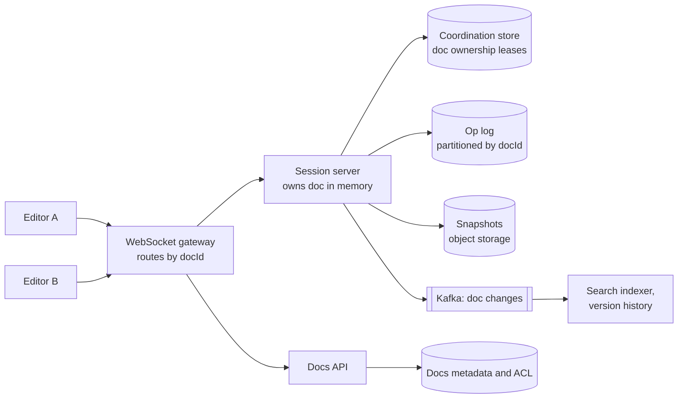
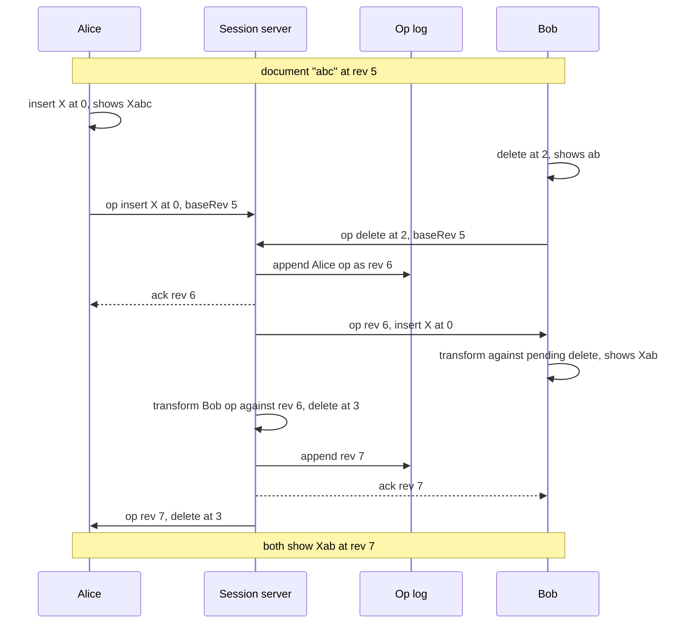

# Design a Collaborative Document Editor (Google Docs)

| | |
|---|---|
| **Asked at** | Common at productivity, collaboration and developer-tool companies |
| **Difficulty** | Hard |
| **Core challenges** | concurrent edits, operation ordering, session routing, offline merge |
| **Related building blocks** | [`src/lease-lock`](../src/lease-lock/), [`src/vector-clock`](../src/vector-clock/), [`src/consistent-hash-ring`](../src/consistent-hash-ring/) |

LLD version (single-user editor internals): [text editor (LLD)](https://github.com/hardyalsinghdeora/low-level-design/blob/main/problems/text-editor.md). Related: [real-time communication](../fundamentals/realtime-communication.md), [consistency models](../fundamentals/consistency-models.md), [file-storage-sync](./file-storage-sync.md), [consensus and coordination](../fundamentals/consensus-and-coordination.md).

## 1. Requirements

### Functional
1. Several users edit the same rich-text document at the same time and see each other's changes live.
2. All copies converge to the same content, and each user's intent is preserved (an insert lands where they typed it).
3. Show collaborators' cursors and selections.
4. Edit offline; changes merge when the device reconnects.
5. Share with viewer, commenter or editor permissions; share by link.
6. Version history: browse and restore earlier versions; name versions.

### Non-functional
- Scale: 50 M DAU, ~5 M documents open at peak, typically 1-5 editors per document, capped at 100 concurrent editors.
- Latency: local edits apply instantly (optimistic); remote edits appear within 200 ms p99 in the same region.
- Durability: an acknowledged edit is never lost.
- Availability: 99.95 %; during a server failover, editing pauses for seconds, not minutes.

### Out of scope
- Spreadsheets and slides (same machinery, different operation types), comments threads in detail, real-time voice.

## 2. Estimation

| Quantity | Estimate | Implication |
|---|---|---|
| Open documents at peak | ~5 M, ~10 M connected sessions | At ~50k WebSockets per server → **~200 session servers** |
| Typing rate | 10 % of sessions typing, keystrokes batched every ~100 ms → ~3 ops/s each | 1 M × 3 ≈ **3 M ops/s** in total, but at most a few per second per document |
| Per-document load | 100 editors × 3 ops/s = 300 ops/s worst case | One server can own a document and order its ops in memory; no distributed ordering needed |
| Op size | ~100 B | 3 M × 100 B = 300 MB/s ≈ **26 TB/day** of op log before compaction |
| Snapshot | average document 50 KB, snapshot every 500 ops | Loading = snapshot + at most 500 ops; ops older than history retention can be compacted |
| Documents stored | 5 B documents × 50 KB = **250 TB** of snapshots | Object storage for snapshots; metadata in a database |

## 3. API

```
REST
  POST /v1/docs                              body: { title }   201: { docId }
  GET  /v1/docs/{id}                         200: { title, rev, snapshot, role }
  POST /v1/docs/{id}/permissions             body: { principal, role }
  GET  /v1/docs/{id}/versions?cursor=...     version list
  POST /v1/docs/{id}/versions/{rev}/restore  creates a new revision equal to rev

WebSocket  wss://edit.example.com/docs/{id}   (routed to the document's owner server)
  client → server
    { type: "join", lastRev }
    { type: "op", clientId, clientSeq, baseRev, ops: [ {retain: 12}, {insert: "X", attrs}, {delete: 3} ] }
    { type: "cursor", anchor, head }
  server → client
    { type: "ack", clientSeq, rev }
    { type: "op", rev, userId, ops }             already transformed to apply on rev - 1
    { type: "cursor", userId, anchor, head }
    { type: "resync", snapshot, rev }            client too far behind
```

`(clientId, clientSeq)` makes op submission idempotent: after a reconnect the client resends unacknowledged ops and the server ignores ones it already applied. `baseRev` tells the server what the client had seen. Auth is checked at `join` (bearer token plus document ACL); viewers can join but their `op` frames are rejected. Version lists are cursor-paginated by revision.

## 4. Data model

```
documents  (doc_id PK, owner_id, title, latest_rev, latest_snapshot_rev, created_at, updated_at)
doc_acl    (doc_id, principal_id, role: owner|editor|commenter|viewer, PRIMARY KEY (doc_id, principal_id))
ops        (doc_id, rev, user_id, client_id, client_seq, payload BLOB, created_at,
            PRIMARY KEY (doc_id, rev))                          -- append-only operation log
snapshots  (doc_id, rev, object_key, created_at, PRIMARY KEY (doc_id, rev))
versions   (doc_id, version_id, rev, name NULL, author_ids[], created_at)
ownership  doc:{doc_id} -> session server id, lease expiry       (coordination store)
```

Store choices:
- **Op log** in a store with fast ordered appends and range reads per document: a wide-column store or sharded SQL partitioned by `doc_id`, clustered by `rev`. The primary key on `(doc_id, rev)` also rejects a second writer that tries to claim the same revision, which protects against split-brain owners.
- **Snapshots** as objects in object storage; only the key is in the database.
- **ACLs and document metadata** in a relational database: modest size and needs consistency (a revoked permission must take effect).
- **Ownership leases** in a coordination service (etcd or ZooKeeper style), see [`src/lease-lock`](../src/lease-lock/).

## 5. High-level design



**Open a document**: the client loads the latest snapshot through the Docs API, then opens a WebSocket. The gateway finds the document's owner session server (from the lease) and forwards the connection. If no server owns the document, the gateway picks one by consistent hashing; that server acquires the lease, loads the snapshot plus newer ops from the log, and serves the session.

**Edit**: the client applies its edit locally at once and sends the op with its `baseRev`. The owner server transforms it against any ops committed since `baseRev`, assigns the next revision, appends it to the op log, acknowledges the sender, and broadcasts the transformed op to the other clients. Ops also go to Kafka for search indexing and version history.

## 6. Deep dives

### 6.1 Operational transformation vs CRDTs

Problem: Alice and Bob edit the same text concurrently. Applying each other's operations naively gives different results, because positions shift.

| | Operational transformation (OT) | CRDT (sequence types such as RGA, YATA as in Yjs) |
|---|---|---|
| Idea | Ops use positions; a transform function rewrites a concurrent op so it applies after another | Every character has a unique id; ops reference ids, and merges commute |
| Ordering | Needs a total order; easiest with a central server | Any order; peers can merge directly |
| Offline | Works, but transforming long divergent histories is expensive and can lose intent | Natural: merge whenever reconnected |
| Overhead | Ops are small; document is plain | Per-character metadata and tombstones (modern libraries compress this well) |
| Rich text | Mature (Google Docs uses OT with a central server) | Supported by libraries; formatting intent is harder |

**Choice: OT with a central server ordering operations per document.** With one authority per document, the server only needs to transform an incoming op against the ops committed since the client's base revision, and clients keep at most one batch of ops in flight. This avoids the hard correctness conditions that peer-to-peer OT needs. The server already exists for permissions, persistence and history, so the CRDT's main advantage (no coordinator) buys little here. A CRDT is the better choice for offline-first or peer-to-peer products, and many newer editors use one with a server acting as a relay and store.



### 6.2 One owner per document: session routing and failover

Problem: ordering is simple only if exactly one process orders a document's ops at a time.

Options:
1. **Any server accepts ops; order via the database** (conditional insert on `rev`). Every op is a contended write; latency suffers with several editors.
2. **One owner per document** chosen by consistent hashing, holding a lease in a coordination store. All sessions for the document connect to the owner.
3. **Consensus group per document.** Strong, but heavy for millions of small documents.

**Choice: option 2.** The owner holds the document in memory and orders ops locally. Safety under split brain comes from two checks: the lease (with a fencing token) and the op log's primary key on `(doc_id, rev)`, so a stale owner's append fails and it steps down. On owner failure the lease expires (a few seconds), another server takes over, rebuilds from snapshot plus log, and clients reconnect and resend unacknowledged ops with the same `clientSeq`.

### 6.3 Persistence: snapshots plus operation log

- **Durability before ack**: the owner appends an op to the log before acknowledging it. Ops are batched per document every ~50 ms, so log writes stay at a few per second per document even under fast typing.
- **Snapshots** every 500 ops, and when the last editor leaves. Loading a document reads one snapshot and at most a few hundred ops.
- **Compaction**: ops older than the retention window are dropped once a snapshot covers them, except those needed for version history checkpoints.
- **Op payloads** are stored compressed; a typing burst of 20 keystrokes batched into one op is roughly the size of a single-keystroke op plus the inserted text, which is why batching every 50-100 ms cuts both log volume and broadcast traffic.

Options considered for the storage shape: storing only the latest document (no history, and every edit rewrites the whole document), storing only the op log (replay from the beginning is slow for old documents), or both. **Both** is the standard event-sourcing shape: the log is the source of truth and snapshots are a cache of it.

### 6.4 Offline editing and cursor presence

**Offline**: the client keeps the document and a queue of local ops in local storage, each tagged with the `baseRev` it was made against. On reconnect it sends `join` with `lastRev`; the server streams ops since then, the client transforms its queued ops against them (the same algorithm as online, just over a longer history), then submits them. If the client is very far behind (op history compacted), the server sends `resync` with a snapshot and the client rebases its local ops onto it. Long offline sessions on the same paragraph can produce surprising merges; the UI highlights text changed while offline.

**Cursor presence**: cursor and selection updates are ephemeral: broadcast by the owner to the other sessions, throttled to about 10 per second, never written to the op log. Cursor positions are transformed by incoming ops exactly like insert positions, so a remote cursor stays on the right character while others type. Each collaborator gets a stable colour and name label.

### 6.5 Permissions and version history

- **Permissions**: checked at `join` and for every `op` (role must be editor). A permission change publishes an event; the owner server re-checks connected sessions and downgrades or disconnects them immediately. Link sharing uses a token that maps to a role.
- **Version history**: the history UI groups ops into versions by author and idle time (for example, a new version after 5 minutes without edits). Each version points at a revision; showing it means loading the nearest snapshot and replaying ops up to that revision. **Restore** does not rewrite history: it computes the difference between the current document and the old revision and commits it as a new op, so collaborators receive it like any other edit.

## 7. Scaling and operations

- **Partitioning**: documents spread across session servers by consistent hashing on `doc_id`; op log partitioned by `doc_id`. A single document is never split, which caps its load at one server's capacity (the 100-editor limit keeps this safe). Very large audiences (thousands of viewers) are served from read-only fan-out replicas that subscribe to the owner.
- **Replication**: op log with synchronous replication (RF 3, quorum writes) so an acked op survives node loss; snapshots in replicated object storage.
- **Caching**: the in-memory document on the owner is the cache; idle documents are evicted after the last session leaves and a snapshot is written.
- **Failure modes**: owner crash → lease expiry, takeover, clients resend; op log unavailable → owner stops acking and clients keep ops locally, so nothing is lost; gateway crash → clients reconnect through another gateway; transform bug causing divergence → clients send periodic checksums of their content and the server forces a resync on mismatch.
- **Monitoring**: op round-trip latency, ops per document distribution, lease takeovers per hour, checksum mismatch rate, reconnect rate, op log write latency.
- **Abuse and security**: per-session op rate limits (a script pasting megabytes per second), document size limits, ACL checks on every op, TLS, audit log of permission changes.

## 8. Trade-offs summary

| Decision | Chosen | Alternative | Why |
|---|---|---|---|
| Concurrency control | OT with a central server | CRDT | Server exists anyway; small ops, plain documents, mature rich-text support |
| Ordering authority | One owner per document via lease | Database conditional writes, consensus per doc | In-memory ordering, fast; fencing keeps it safe |
| Storage | Op log plus periodic snapshots | Latest document only | Durability per op, history, fast loads |
| Presence | Ephemeral broadcast, throttled | Persisted | No value in storing cursors; keeps the log small |
| Restore | New op that reverts content | Truncate history | History stays append-only and collaborators stay in sync |
| Offline | Queue ops with baseRev, transform on reconnect | Lock document while offline | Users can keep working; rare odd merges are visible |

## 9. Follow-up questions interviewers ask

- *"Why does a central server make OT easier?"* With a total order from one server, each client only transforms against ops it has not seen; peer-to-peer OT must satisfy extra transform properties that many published algorithms got wrong.
- *"When would you choose a CRDT?"* Offline-first apps, peer-to-peer sync, or when you want any replica (including edge servers) to accept writes without a coordinator.
- *"How do you handle 1,000 people viewing a document during an all-hands?"* Editors stay on the owner; viewers connect to read-only replicas that receive the op stream, so the owner does not fan out to all of them.
- *"What happens if two servers both think they own a document?"* The lease uses a fencing token and the op log rejects duplicate `(doc_id, rev)`; the stale owner's append fails and it drops its sessions.
- *"How do you detect that clients diverged?"* Periodic content hashes at a known revision; a mismatch triggers a resync from the server's state and an alert, because it means a transform bug.
- *"How would comments anchor to text that keeps changing?"* Store the comment's range as positions at a revision and transform it with every op, exactly like a cursor; if its text is deleted, the comment becomes orphaned and is shown in a side list.
