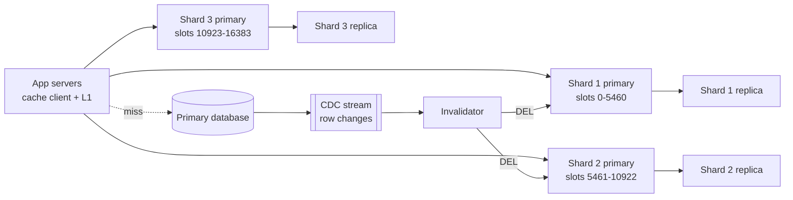
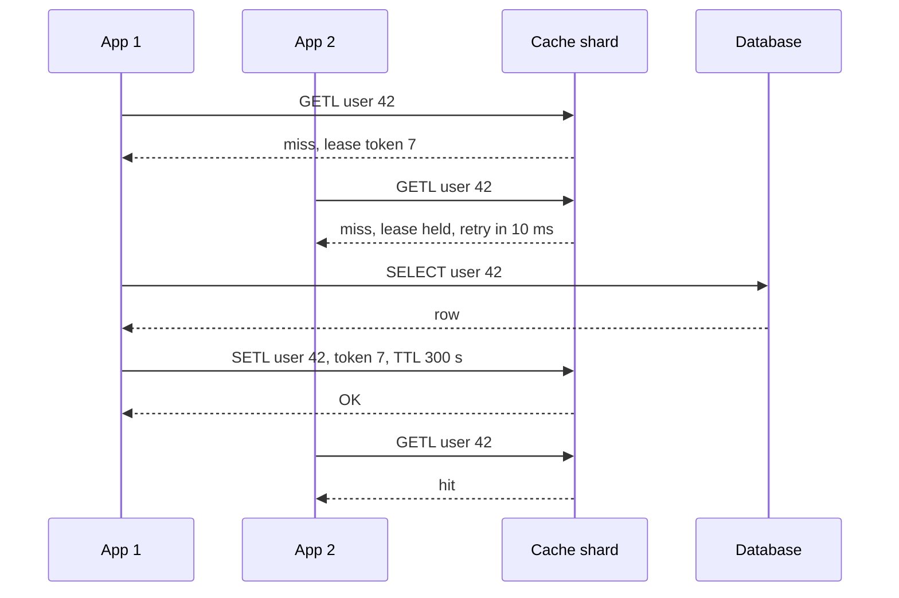

# Design a Distributed Cache (Redis Cluster, Memcached)

| | |
|---|---|
| **Asked at** | Common at companies with read-heavy products; also appears as a deep dive inside feed, catalog and session designs |
| **Difficulty** | Medium |
| **Core challenges** | sharding, hot keys, stampedes, cache-DB consistency |
| **Related building blocks** | [`src/consistent-hash-ring`](../src/consistent-hash-ring/), [`src/bloom-filter`](../src/bloom-filter/) |

LLD version: [lru-cache](https://github.com/hardyalsinghdeora/low-level-design/blob/main/problems/lru-cache.md). Concepts: [caching strategies](../fundamentals/caching-strategies.md), [consistent hashing](../fundamentals/consistent-hashing.md), [replication](../fundamentals/replication.md).

## 1. Requirements

### Functional
1. `GET`, `SET` with TTL, `DELETE`, and multi-key `MGET` for keys up to 250 B and values up to 1 MB (typical ~500 B).
2. Atomic counters (`INCR`) and compare-and-set for small coordination tasks.
3. Configurable eviction when memory is full.
4. Applications use it as a look-aside cache in front of a database; the database stays the source of truth.

### Non-functional
- 5 M reads/s and 500k writes/s at peak; ~1 TB of hot data.
- p99 under 1 ms inside a datacenter (server time), under 2 ms including the network.
- Availability 99.99 %; losing a node must not take the product down or flood the database.
- Staleness: a cached value may lag the database by a few seconds, but must not stay wrong indefinitely.

### Out of scope
- Using the cache as a durable primary store.
- Rich data structures beyond strings, hashes and counters (sorted sets etc. exist in Redis, but are not needed here).

## 2. Estimation

| Quantity | Estimate | Implication |
|---|---|---|
| Ops/s | 5 M reads + 0.5 M writes ≈ **5.5 M ops/s** | A Redis shard does ~100k+ simple ops/s per core, so **~50 primaries** are needed for throughput alone |
| Hot data | **1 TB** | 1 TB / 50 primaries ≈ 20 GB each; a 64 GB node leaves room for fork copy-on-write during snapshots and fragmentation |
| Per-item overhead | ~50-100 B of key and allocator overhead per item; 1 TB / 500 B ≈ 2 B items | 2 B × ~80 B ≈ **160 GB** of overhead: size for ~1.2 TB, not 1 TB |
| Replicas | 1 replica per primary | **~100 nodes**; replicas also serve reads for hot shards |
| Network | 5.5 M × ~600 B ≈ **3.3 GB/s** | ~66 MB/s per primary; fine on 10-25 Gbit NICs, but a 1 MB hot value at 100k reads/s is 100 GB/s and must be handled specially |
| Cache-miss load | 95 % hit rate → 250k reads/s to the DB | The DB is sized for misses; a cold cache (0 % hit) means **20× that** and must never happen all at once |

## 3. API

Clients speak the Redis protocol (RESP) or the Memcached protocol through a client library; shown as commands:

```
GET key                       -> value | nil
MGET k1 k2 k3                 -> [v1, nil, v3]          (client splits by shard and merges)
SET key value EX 300 [NX]     -> OK | nil               (NX: only if absent, used for locks and leases)
DEL key                       -> 1 | 0
INCRBY key n                  -> new value

Lease-aware read used by the look-aside library (Memcached-style leases):
GETL key                      -> value | (miss, lease_token)
SETL key value lease_token    -> OK | REJECTED          (rejected if the key was invalidated after the lease)
```

Idempotency: `SET` and `DEL` are naturally idempotent; `INCR` is not, so retries of counters must tolerate double counting or use a request id. There is no pagination; `SCAN` with a cursor exists for operations but never on the request path. Auth: ACL users per application, TLS in transit, and network isolation so the cache is never reachable from the internet.

## 4. Data model

```
Item (in memory on one shard):
  key        bytes   -- namespaced: "user:v3:{42}:profile"
  value      bytes   -- serialized object, optionally compressed above 1 KB
  expire_at  ms      -- TTL with jitter: base 300 s ± 10 %
  lru/lfu    24 bits -- access clock or frequency counter used by eviction

Cluster metadata:
  slot map: 16384 slots -> (primary, replicas)   -- Redis Cluster
  or ring: [(token, node)]                       -- client-side consistent hashing
```

Keys: include a schema version (`v3`) so a deploy that changes serialization reads new keys instead of failing on old bytes. Use a hash tag `{42}` when several keys for one entity must land on one slot for `MGET` or a multi-key script. Store choice: an in-memory hash table per shard because every access is by exact key and the latency target rules out disk.

## 5. High-level design



**Read**: app → L1 in-process cache (hot keys only, 1-5 s TTL) → client computes the slot `CRC16(key) mod 16384`, looks up the owner in its cached slot map, sends `GET` → hit: return. Miss: the client gets a lease, reads the database, `SETL` with TTL, returns.

**Write**: app writes the database → deletes the cache key (not updates it). The CDC invalidator also deletes the key from the database change stream, which catches writers that forgot to and retries until it succeeds.

**Topology change**: if a slot has moved, the shard replies `MOVED slot host:port`; the client refreshes its slot map and retries. During a migration a key not yet moved gets `ASK`, a one-off redirect.

## 6. Deep dives

### 6.1 Sharding: hash slots vs client-side consistent hashing

| Option | How routing works | Rebalancing | Who uses it |
|---|---|---|---|
| Client-side consistent hashing (ketama) | Each client hashes keys onto a ring of servers | Adding a server remaps ~1/N of keys; those become misses | Memcached deployments |
| Fixed hash slots | `CRC16(key) mod 16384` → slot → node via a slot map | Move whole slots between nodes; keys migrate, no misses | Redis Cluster |
| Proxy layer | Clients talk to a proxy (Twemproxy, Envoy, mcrouter) that routes | Proxy config change | Large Memcached fleets |

**Choice:** Redis Cluster's 16384 fixed slots. The slot is a level of indirection: rebalancing moves slots with their data, so adding capacity does not cause a wave of misses, and every client sees the same mapping through `MOVED` redirects. Consistent hashing is the right answer for Memcached, where nodes do not replicate or migrate data and a remapped key is only a miss. A proxy is worth adding when there are thousands of client processes, because it reduces the connection count on each shard.

### 6.2 Replication and failover

Each primary has one or more replicas fed by asynchronous replication. Cluster nodes exchange heartbeats over the cluster bus; when a majority of primaries consider a primary failed, one of its replicas is promoted. Clients learn the new owner through `MOVED`.

| Failover option | How it decides | Fits |
|---|---|---|
| Redis Cluster built-in | Primaries vote over the cluster bus; a replica of the failed primary is promoted | Sharded clusters, no extra components |
| Redis Sentinel | A separate group of Sentinel processes agrees by quorum and reconfigures clients | A single unsharded primary with replicas |
| Managed service | The provider's control plane detects and promotes | Teams that do not want to run failover themselves |

The cluster bus also needs a majority of primaries reachable: a minority partition stops accepting writes after the node timeout, which bounds how long two primaries for the same slot can coexist.

Trade-off: replication is async, so writes acknowledged by the old primary in the last few milliseconds can be lost on failover. For a cache this is acceptable: the database is the truth and a lost write is a future miss. `WAIT n timeout` makes a write wait for n replica acks when a caller needs it, at the cost of latency, and it still does not make the cache strongly consistent. Memcached has no replication; a node loss is a hit-rate drop, absorbed by a small "gutter" pool of spare servers that take over failed nodes' keys with short TTLs (the approach described in Facebook's memcache paper).

### 6.3 Hot keys and stampedes

Problem 1, hot key: one celebrity profile gets 500k reads/s, all on one shard, above its capacity.

Options: (a) **L1 in-process cache** on app servers with a 1-5 s TTL, which absorbs most reads; (b) **replicate the key** as `key#0..key#9` on different shards and pick one at random on read; (c) **read from replicas** for that shard. **Choice:** L1 first, because it removes network hops entirely and staleness of a few seconds is within the requirement; key splitting for the rare key L1 cannot absorb. Detect hot keys from client-side sampling or Redis `--hotkeys` (needs an LFU policy), not by guessing.

Problem 2, stampede: a popular key expires and 10,000 requests miss at once and all query the database.

Options: (a) **lock / lease**: the first miss gets a lease and fills; others wait briefly or get the stale value; (b) **probabilistic early refresh**: each reader refreshes with a probability that grows as expiry nears, so one request refreshes before expiry; (c) **request coalescing** in the client (singleflight) so one process sends one DB query per key. **Choice:** leases plus TTL jitter, with coalescing in the client library. Leases also fix the stale-set race in 6.4.



### 6.4 Consistency with the database

Problem: cache-aside has a race. Reader R misses, reads the old row from the DB; writer W updates the DB and deletes the key; R then sets the old value. The cache now holds stale data until TTL.

Options:
1. **Update the cache on write** (write-through). Two concurrent writers can apply cache updates in the opposite order to the DB.
2. **Delete on write, TTL as a safety net.** Simple; the race above remains but is bounded by TTL.
3. **Delete on write + leases + CDC invalidation.** A delete invalidates outstanding leases, so R's `SETL` is rejected. Invalidations driven from the DB's change stream ([outbox and CDC](../fundamentals/transactional-outbox-and-cdc.md)) are retried until applied, so a crashed writer cannot leave a stale entry.

**Choice:** option 3 for important data; option 2 is fine where a TTL's worth of staleness is harmless. Never rely on the cache for correctness checks such as balances or inventory; read those from the DB.

### 6.5 Eviction, memory sizing and warm-up

Redis policies: `noeviction` (writes fail when full), `allkeys-lru`, `allkeys-lfu`, `volatile-lru`/`volatile-lfu`/`volatile-ttl` (only keys with a TTL), and random variants. Redis approximates LRU by sampling a few keys and evicting the best candidate, not with an exact linked list. **Choice:** `allkeys-lfu` for a pure cache, since it protects steadily popular keys from being pushed out by a one-time scan; `allkeys-lru` is a fine default too. Set `maxmemory` to ~70-75 % of RAM when snapshots or replication full syncs fork the process.

| Policy | Evicts | Use when |
|---|---|---|
| `allkeys-lru` | Least recently used of all keys (sampled) | General cache, recency predicts reuse |
| `allkeys-lfu` | Least frequently used, with decay | Steady popular set plus occasional scans |
| `volatile-ttl` | Keys with the nearest expiry | Mixed cache and must-keep keys without TTL |
| `noeviction` | Nothing; writes return errors | Redis used as a store, not a cache |

Warm-up: a new or flushed cluster must not see 100 % misses. Bring new shards in by slot migration (data moves with the slot), restore from an RDB snapshot for a full rebuild, or replay recent read keys from logs into a warming job before shifting traffic, and ramp traffic over minutes.

## 7. Scaling and operations

- **Partitioning**: scale out by adding a primary and migrating slots to it; scale reads on a hot shard with more replicas. Keep multi-key operations within one hash tag.
- **Multi-region**: one cache cluster per region, each in front of a local database replica. Invalidate in every region from that region's replication stream, so the cache is not invalidated before the local replica has the new row. Do not replicate cache contents across regions; it costs bandwidth and adds a second path for stale data.
- **Failure modes**: primary down → replica promoted in seconds, brief write errors; whole shard lost → its keys miss, the DB sees that shard's share of traffic; slow shard → client timeouts of a few ms plus a [circuit breaker](https://github.com/hardyalsinghdeora/design-patterns/tree/main/src/modern/circuit-breaker), treat as miss with request coalescing so the DB is not flooded; big value → compress, split, or keep in L1.
- **Monitoring**: hit ratio per key prefix, evictions/s, memory used vs `maxmemory`, p99 latency per shard, ops/s per shard (imbalance means hot keys), replication lag, `MOVED` rate (slot map churn), connection count.
- **Persistence**: off or RDB snapshots only for a pure cache; snapshots exist to speed up a restart, not for durability. AOF with `fsync everysec` is for Redis used as a store.
- **Capacity planning**: track memory per key prefix; one team's new feature caching large blobs is the usual cause of an eviction storm.
- **Security**: ACL users per service with key-prefix permissions, TLS, no public endpoints, and disabled dangerous commands (`FLUSHALL`, `KEYS`, `CONFIG`) for application users.

## 8. Trade-offs summary

| Decision | Chosen | Alternative | Why |
|---|---|---|---|
| Sharding | 16384 hash slots | Client-side consistent hashing | Slots move with their data, so scaling causes no miss wave |
| Replication | Async, 1 replica per shard | Sync replication | Cache data is re-derivable; latency matters more |
| Write path | Delete on write + CDC invalidation | Update cache on write | Avoids ordering races between concurrent writers |
| Stampede | Leases + jitter + coalescing | Plain TTL | Stops thundering herds and stale sets |
| Hot keys | L1 in-process cache | More replicas only | Removes the network hop; staleness bounded to seconds |
| Eviction | `allkeys-lfu` | `allkeys-lru` | Resists scan pollution |

## 9. Follow-up questions interviewers ask

- *"Why 16384 slots?"* It is a fixed, small number that makes the slot bitmap in each heartbeat small (16384 bits = 2 KB) while still allowing far more slots than nodes; Redis Cluster's documentation recommends staying under about 1,000 primaries.
- *"Redis or Memcached?"* Memcached is multi-threaded and simple for plain key-value caching. Redis adds replication, persistence, data structures and Lua; choose it when you need failover or more than strings.
- *"How do you cache a list or a page of results?"* Cache the list of ids and the items separately, so one item update invalidates one key instead of every page containing it.
- *"What if the cache cluster is entirely down?"* Shed load: serve stale L1 data, return degraded responses for non-critical features, and rate-limit DB fallbacks so the database survives.
- *"How do you handle negative lookups (key not in the DB)?"* Cache a short-lived "not found" marker, or keep a Bloom filter of existing ids to reject unknown ids without a DB query.
- *"Can I use the cache as a distributed lock?"* For efficiency locks, `SET key token NX PX 30000` with a token check on release is fine. For correctness, async replication can lose the lock on failover; use a lease with a fencing token from a consensus store instead.
