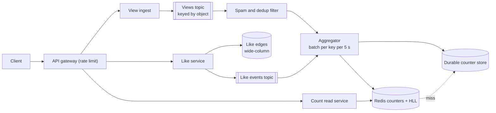
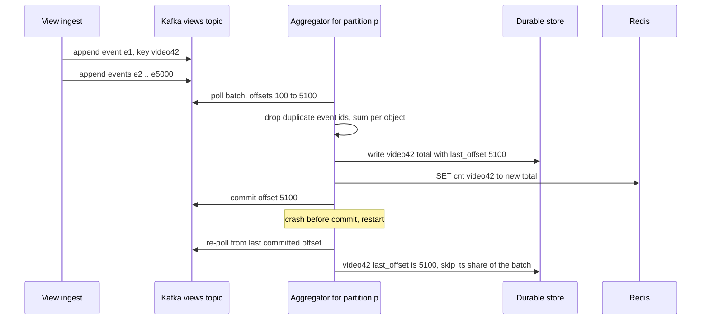

# Design a Distributed Counter (likes, views at scale)

| | |
|---|---|
| **Asked at** | Social, video and content platforms; a common medium problem and a frequent deep dive inside larger designs |
| **Difficulty** | Medium |
| **Core challenges** | hot keys, write amplification, exact vs approximate, unique counts |
| **Related building blocks** | [`src/hyperloglog`](../src/hyperloglog/), [`src/count-min-sketch`](../src/count-min-sketch/) |

## 1. Requirements

### Functional
1. Increment a counter for an object: views of a video, likes of a post, plays of a song.
2. Likes are per user and reversible (like, unlike); a user's like is counted at most once.
3. Read the total for one object, or for a page of objects (a feed shows 20 counts at once).
4. Count unique viewers per object per day.
5. YouTube-style example: public view counts that exclude obvious spam and duplicates.

### Non-functional
- 10 B views per day and 1 B like/unlike actions per day across 1 B objects.
- A viral object can receive 20k+ increments per second.
- Reads: p99 under 10 ms; totals may lag by seconds (views) but a user must see their own like immediately.
- Increments must not be lost under normal failures; small, bounded loss is acceptable only for approximate counters, and must be stated.
- Cost: storing an exact set of viewers per object is not affordable at this scale.

### Out of scope
- Full analytics (breakdowns by country and device; see [ad click aggregation](./ad-click-aggregation.md)), trending ranking (see [top-k trending](./top-k-trending.md)), monetisation rules.

## 2. Estimation

| Quantity | Estimate | Implication |
|---|---|---|
| View increments | 10 B/day ≈ **116k/s**, peak ~500k/s | Cannot be one DB write each; batch through a stream |
| Like actions | 1 B/day ≈ **11.6k/s**, peak ~50k/s | Each must be idempotent per user; a relational or KV write per action is affordable |
| Hottest object | **~20k increments/s** on one key | Beyond what one row lock tolerates; either batch or shard the counter |
| Counter storage | 1 B objects × ~3 counters × 16 B ≈ **50 GB** | Fits in a Redis cluster; durable copy in a KV store |
| Like edges | 1 B/day × 365 × 50 % net likes ≈ 180 B edges × 24 B ≈ **4 TB/year** | Wide-column store keyed by object and by user |
| Unique viewers, exact | a 100 M-viewer video × 8 B ids = **800 MB per object per day** | Exact sets are unaffordable; use HyperLogLog |
| Unique viewers, HLL | **12 KB** per object per day at ~0.81 % standard error | 10 M active objects/day × 12 KB = 120 GB; sparse encoding makes small objects far cheaper |
| Count reads | feed views 20 counts × 2 B feed loads/day ≈ **460k/s** | Batch reads (`MGET`) from cache; never from the durable store |

## 3. API

```
POST /v1/objects/{id}/views              { viewerId?, sessionId, watchedSeconds }   202 Accepted (async)
PUT  /v1/objects/{id}/likes/me           201 / 200 (idempotent: liking twice is a no-op)
DELETE /v1/objects/{id}/likes/me         204 (idempotent)
GET  /v1/objects/{id}/counts             { views: 1203344, likes: 50211, likedByMe: true, asOf }
GET  /v1/counts?ids=a,b,c                batch, up to 100 ids
GET  /v1/objects/{id}/unique-viewers?day=2026-11-07   { estimate: 845000, relativeError: 0.0081 }
```

- **Idempotency**: likes are idempotent by construction (`PUT`/`DELETE` of the `(user, object)` edge). Views carry a client `sessionId` and an event id; deduplication happens in the stream (6.2).
- **Pagination**: "who liked this" lists use cursors on `(liked_at, user_id)`.
- **Auth**: likes require a logged-in user; views accept anonymous sessions but are rate limited per device and IP.

## 4. Data model

```
Durable:
  counters (object_id, counter_name, value BIGINT, last_offset BIGINT, updated_at,   -- Cassandra/DynamoDB
            PRIMARY KEY (object_id, counter_name))      -- last_offset = Kafka offset of the last batch applied
  likes_by_object (object_id, user_id, liked_at, PRIMARY KEY (object_id, user_id))
  likes_by_user   (user_id, object_id, liked_at, PRIMARY KEY (user_id, object_id))
  hll_daily (object_id, day, registers BLOB)                         -- serialized HyperLogLog

Fast path (Redis):
  cnt:{object_id}:views          integer        INCRBY from aggregator
  cnt:{object_id}:likes          integer
  cnt:{object_id}:views:s{0..N}  integer        sharded counter for hot keys (6.3)
  uv:{object_id}:{day}           HyperLogLog    PFADD / PFCOUNT, expires after 3 days

Stream:
  views topic, keyed by object_id: { eventId, objectId, viewerId?, sessionId, ts, watchedSeconds }
```

Store choice: **Redis** for the live counters (in-memory atomic `INCRBY`, ~100k simple ops/s per node). **A wide-column store** (Cassandra, DynamoDB) as the durable record: counters and like edges are pure key lookups at high write volume with no joins. Cassandra has native counter columns, but they are not idempotent on retry, so we store absolute values written by a single aggregator per key instead.

## 5. High-level design



**View**: client → ingest (validate, attach event id) → Kafka partitioned by `object_id` → spam and dedup filter → aggregator, which keeps an in-memory map `object → Δ` and every 5 s (or 10,000 events) flushes one `INCRBY` per object to Redis and one absolute-value write to the durable store, then commits the Kafka offset.

**Like**: client → like service → conditional write of the `(object, user)` edge (insert if absent) → if the edge was created, emit `+1`; if deleted, `-1`. The count change goes through the same aggregator path. The user's own state (`likedByMe`) is read from the edge, so it is correct immediately even though the total lags.

**Read**: count service → `MGET` the counter keys for up to 100 objects from Redis → miss falls back to the durable store and repopulates the cache.

## 6. Deep dives

### 6.1 Exact vs approximate counts

Not every counter needs the same guarantee:

| Counter | Required precision | Approach |
|---|---|---|
| Likes | Exact eventually; each user once | Edge table is the truth; total = number of edges, maintained incrementally and recounted periodically |
| Views | Close enough, never decreasing in public | Batched increments, filtered for spam; displayed rounded ("1.2 M views") |
| Unique viewers | Approximate | HyperLogLog, ~0.81 % standard error |
| Money-relevant counts (ad impressions, creator payouts) | Exact and auditable | Stream with exactly-once processing into a ledger-like store; see [ad click aggregation](./ad-click-aggregation.md) |

The interview point: state which counters can be approximate before choosing the mechanism. Precision you do not need costs memory, writes and coordination.

### 6.2 Write path: buffering and batching

Options:
1. **`UPDATE counters SET value = value + 1` per event.** Exact and simple; at 116k/s with hot rows, row locks serialise on popular objects and the database melts.
2. **Redis `INCR` per event with periodic persistence** (a job copies Redis values to the durable store every minute). Fast; but Redis is the only copy of the last minute of increments, and a failover with async replication loses some. Client retries double count because `INCR` is not idempotent.
3. **Stream and aggregate**: append events to Kafka, aggregate per key in memory for a few seconds, write one increment per key per batch.

**Choice: 3, with Redis as the serving copy.** A video with 20k views/s becomes one Redis write and one durable write every 5 seconds. Correctness on failure comes from the ordering of steps:



Storing the Kafka offset of the last applied batch in each counter row makes the update effectively once: one aggregator owns each key (its partition), so offsets per key only grow, and a restarted aggregator that re-reads a batch skips every row whose `last_offset` already covers it. This needs only a single-row write, which every wide-column store makes atomic. Redis receives absolute values (`SET`), not deltas, so replays are harmless. Duplicate events from client retries are dropped by event id within a short window (a per-partition set of recent ids, or a Bloom filter where a tiny false-drop rate is acceptable for views). See [delivery semantics](../fundamentals/delivery-semantics-and-idempotency.md) and [batch and stream processing](../fundamentals/batch-and-stream-processing.md).

Eventual consistency: totals lag by the batch interval plus consumer lag, typically under 10 s. That is the price for absorbing 500k/s with a handful of writes per hot key.

### 6.3 Hot keys

Problem: even batched, some paths hit one key hard: the like service writing `+1` for a celebrity post, or 460k reads/s concentrated on a few viral objects.

Options:
1. **Sharded counter**: split `cnt:{id}` into N sub-keys `cnt:{id}:s0..s{N-1}`; each increment picks a random shard; reads sum all N (`MGET`). N = 1 for normal objects and grows (8, 64) when an object is detected as hot.
2. **Local pre-aggregation**: each application instance accumulates increments in memory for a second and flushes one combined write.
3. **Read replicas and local caching** for the read side: cache hot counts in the read service's memory for one second.

**Choice: all three, each for its side.** Writes: aggregation in the stream already removes most write heat; sharded counters handle the residual on the like path. Reads: a one-second in-process cache in front of Redis turns 100k reads/s on one key into a few per instance. Hot-key detection uses a count-min sketch over recent keys (see [`src/count-min-sketch`](../src/count-min-sketch/)). Sub-keys use a hash tag only when the read must be atomic; otherwise spreading them across cluster slots is the point.

### 6.4 Unique counts with HyperLogLog

Problem: "how many distinct people watched this today" for millions of objects. Exact sets cost hundreds of MB for one popular object.

Options:
1. **Exact set** (Redis `SADD` or a table of `(object, day, viewer)`). Exact, linear memory in distinct viewers.
2. **HyperLogLog**: hash each viewer id, keep per register the maximum count of leading zeros; estimate cardinality from the registers. Redis `PFADD` / `PFCOUNT` uses 16,384 registers in 12 KB with a standard error of 0.81 %.
3. **Sampling**: count exactly for a sampled fraction of viewers and scale up. Simple, but error is high for small objects.

**Choice: 2.** The aggregator calls `PFADD uv:{id}:{day} viewerId` (batched). HLLs are mergeable: weekly uniques are `PFMERGE` of seven daily HLLs, which an exact count could only do by unioning sets. At day end the registers are persisted to `hll_daily`. Limits to state: an HLL cannot list who viewed, cannot remove a viewer, and its error is relative (±0.81 % typical, larger in the tails). See [`src/hyperloglog`](../src/hyperloglog/) and [probabilistic structures](../fundamentals/bloom-filters-and-probabilistic.md).

### 6.5 Reading totals and the YouTube-style view count

- **Read path**: totals come from Redis; a miss reads the durable store. A feed requests 20 counts in one batch call. Displayed numbers are rounded, which also hides lag.
- **Own action visibility**: after a like, the client shows `likes + 1` locally and `likedByMe` comes from the edge store, so the user sees their own action instantly while the shared total catches up.
- **Validated views**: a public view counter is valuable, so it attracts fraud. The filter step drops views that fail rules (very short watch time, the same session repeatedly, known bot signatures, abnormal rates per IP). Views can be counted immediately into a "raw" counter and moved into the public counter after validation, so the public number may lag the raw one by minutes for a viral video. If later analysis finds fraud, the public count is corrected downward by a batch job; the system must allow that, even though counters normally only increase.
- **Recount**: a nightly batch job recomputes like totals from the edge table and view totals from the event archive, and overwrites drifted values. Incremental counters are a cache of these batch truths.

## 7. Scaling and operations

- **Partitioning**: Kafka partitioned by `object_id`, so one aggregator owns each key and needs no coordination; Redis Cluster by key slot; the durable store by `object_id`. Like edges stored twice (by object and by user) for both queries.
- **Replication**: Kafka RF 3; Redis replicas with failover (losing a few seconds of `SET`s is repaired by the next flush, because values are absolute); durable store RF 3.
- **Caching**: Redis is the cache for counts; one-second in-process caches for hot keys; CDN caching of count JSON for logged-out pages for a few seconds.
- **Failure modes**: aggregator crash → resume from the stored offset; Redis loss → rebuild hot keys from the durable store on miss; Kafka lag → counts are older but nothing is lost; a duplicate storm from a buggy client → dedup by event id and per-device rate limits.
- **Monitoring**: consumer lag per partition (alert above 60 s), Redis vs durable drift on sampled keys, dedup rate, filtered-view rate (spikes mean an attack), hot key count, recount corrections size.
- **Abuse**: rate limit views and likes per device, account and IP; ignore views from accounts flagged as bots; likes require authentication.

## 8. Trade-offs summary

| Decision | Chosen | Alternative | Why |
|---|---|---|---|
| View write path | Kafka + per-key batching | DB increment per event | 500k/s becomes a few writes per key per batch |
| Serving store | Redis with absolute values | Redis `INCR` as the only copy | Replays and failovers cannot double count or lose the total |
| Exactly-once updates | Offset stored with totals | At-least-once with deltas | Restart resumes after the last applied batch |
| Likes | Edge table as truth, incremental total | Counter only | Each user counted once; unlike works; recount possible |
| Hot keys | Sharded counters + local caches | Bigger Redis node | Spreads heat horizontally |
| Unique viewers | HyperLogLog, 12 KB, ~0.81 % error | Exact sets | Constant memory and mergeable across days |
| Freshness | Seconds of lag, rounded display | Synchronous exact count | The requirement allows it, and it removes coordination |

## 9. Follow-up questions interviewers ask

- *"Why not just use Redis `INCR` and persist every minute?"* Fine for low-stakes counters if you accept losing up to a minute on failover and double counting on retries. State that; it is the simpler design. The stream design is for when those losses are not acceptable.
- *"How do you count likes for a post with 50 M likes without reading 50 M rows?"* Maintain the total incrementally from like events; recount from the edge table offline and correct drift.
- *"How accurate is HyperLogLog for a video with 300 views?"* Redis switches to a sparse, more exact representation for small cardinalities, so small counts are close; the 0.81 % figure is the standard error at larger counts.
- *"Can counts go down?"* Likes, yes (unlike). Views only through fraud correction, applied by a batch job, never by the online path.
- *"How do you show a count consistent with the list of likers?"* You do not need to: they are different stores with different freshness. If required, read both from the edge table with the count from an index; at large sizes show an approximate count.
- *"What changes if counts drive payouts?"* Views become billable events: exactly-once stream processing, immutable event archive, reconciliation and audit, like the money flows in [payment system](./payment-system.md).
