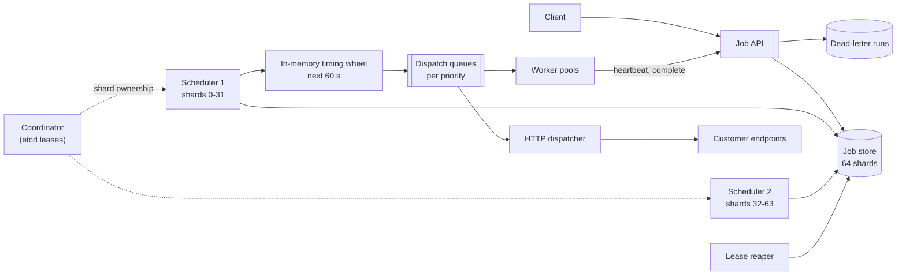
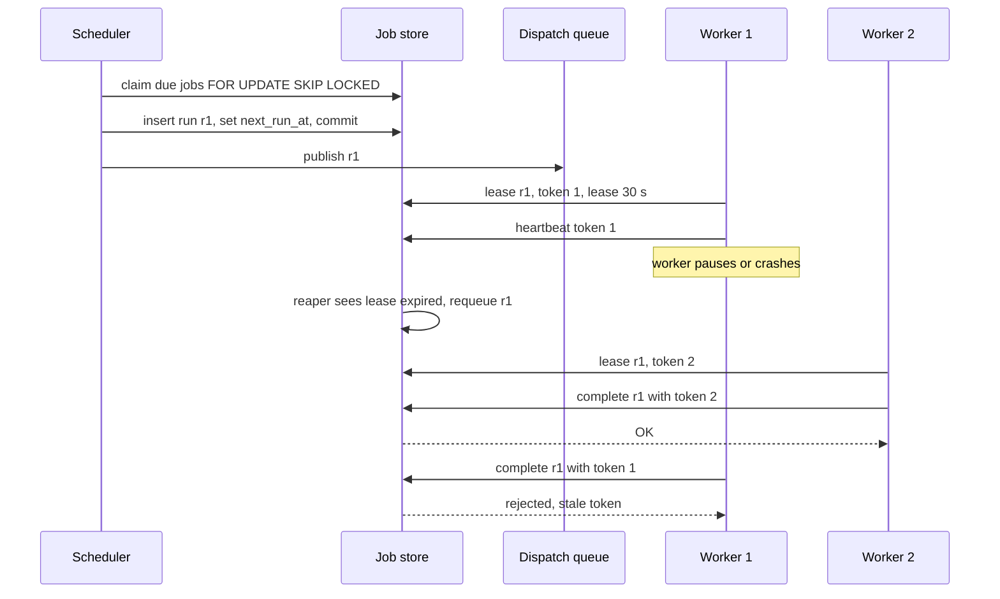

# Design a Distributed Job Scheduler (cron at scale)

| | |
|---|---|
| **Asked at** | Common at infrastructure and backend teams; appears as "design cron", "design a task queue" or "design delayed jobs" |
| **Difficulty** | Medium-Hard |
| **Core challenges** | finding due jobs, exactly one scheduler per job, at-least-once execution, cron time zones |
| **Related building blocks** | [`src/timing-wheel`](../src/timing-wheel/), [`src/lease-lock`](../src/lease-lock/), [`src/idempotency-store`](../src/idempotency-store/) |

Concepts: [delivery semantics and idempotency](../fundamentals/delivery-semantics-and-idempotency.md), [consensus and coordination](../fundamentals/consensus-and-coordination.md), [message queues and streams](../fundamentals/message-queues-and-streams.md), [resilience patterns](../fundamentals/resilience-patterns.md).

## 1. Requirements

### Functional
1. Create a one-off job to run at a given time or after a delay ("send reminder in 24 h").
2. Create a recurring job from a cron expression with a time zone ("0 9 * * MON-FRI, Europe/Berlin").
3. A job is an HTTP callback or a message to a named worker queue, with a payload up to 64 KB.
4. Retries with exponential backoff, a max attempt count, and a dead-letter list for jobs that keep failing.
5. Priorities (high, normal, low) and per-tenant concurrency limits.
6. Pause, resume, cancel and inspect jobs and their run history.

### Non-functional
- 500 M scheduled jobs stored; 10k executions/s on average, 100k/s in bursts at the top of the hour.
- Start delay: a job begins within 2 s of its due time at p99 (within 10 s during top-of-hour bursts).
- At-least-once execution: a due job is never silently skipped; duplicates are possible and jobs must be idempotent.
- Availability 99.95 %; losing a scheduler or worker node must not lose or permanently delay jobs.

### Out of scope
- DAG workflows with dependencies between jobs (Airflow-style); mentioned as a follow-up.
- Running the job code itself (customers run their own workers or endpoints).

## 2. Estimation

| Quantity | Estimate | Implication |
|---|---|---|
| Stored jobs | 500 M × ~1 KB (definition, payload pointer, state) ≈ **500 GB** | Too big and too hot for one DB node; shard by job id |
| Executions | 10k/s avg × 86,400 ≈ **860 M runs/day** | Run history is the biggest table; keep 30 days hot (≈ 26 B rows × 200 B ≈ 5 TB), archive the rest |
| Burst | ~25 % of cron jobs use minute 0 → **100k/s** for a few seconds at :00 | Due-job lookup must be sharded; workers autoscale or the burst spreads over a few seconds |
| Due-job scan | 100k due/s over 64 shards ≈ **1.6k rows/s per shard** | An index on `(next_run_at)` with batched claims of ~500 rows is enough per shard |
| Payload | 64 KB max, avg 2 KB → 500 M × 2 KB ≈ **1 TB** | Store large payloads in object storage, keep a pointer in the row |
| Scheduler nodes | each claims ~5k jobs/s comfortably | ~20 nodes for bursts; partitions spread over them |
| Leases | lease 30 s, heartbeat every 10 s; 100k running jobs → **10k heartbeats/s** | Heartbeats go to the shard owning the run; cheap single-row updates |

## 3. API

```
POST /v1/jobs
  headers: Idempotency-Key
  body: { name, schedule: { type: "once", runAt } | { type: "cron", expr, timeZone },
          target: { type: "http", url, method } | { type: "queue", queue },
          payload, priority, retry: { maxAttempts: 5, backoff: "exponential", baseSec: 10 },
          timeoutSec: 300, misfirePolicy: "fire_once" | "fire_all" | "skip",
          concurrency: "allow" | "forbid" | "replace" }
  201: { jobId, nextRunAt }

GET    /v1/jobs/{jobId}
PATCH  /v1/jobs/{jobId}              { paused: true } | new schedule
DELETE /v1/jobs/{jobId}
GET    /v1/jobs/{jobId}/runs?cursor=...&limit=50       (newest first)
POST   /v1/jobs/{jobId}/runs                           (trigger now)

Worker protocol (for queue targets):
POST /v1/runs/lease     { queue, max: 10 } -> [{ runId, jobId, attempt, payload, leaseUntil, fencingToken }]
POST /v1/runs/{runId}/heartbeat  { fencingToken } -> { leaseUntil }
POST /v1/runs/{runId}/complete   { fencingToken, status: "succeeded" | "failed", error? }
```

Idempotency: `Idempotency-Key` on create prevents duplicate jobs from client retries. Every execution carries a stable `runId` (job id + scheduled time) so workers can deduplicate side effects. HTTP targets receive the `runId` in a header. Pagination by cursor on `(started_at, run_id)`. Auth: tenant API keys; HTTP targets get a signed request (HMAC header) so receivers can verify it came from us.

## 4. Data model

```
jobs (                                  -- sharded by hash(job_id), 64 shards
  job_id         UUID PRIMARY KEY,
  tenant_id      UUID NOT NULL,
  schedule_type  TEXT NOT NULL,         -- once | cron
  cron_expr      TEXT NULL,
  time_zone      TEXT NULL,             -- IANA name, e.g. Europe/Berlin
  next_run_at    TIMESTAMPTZ NULL,      -- UTC; NULL when paused or finished
  priority       SMALLINT NOT NULL,
  target         JSONB NOT NULL,
  payload_ref    TEXT NOT NULL,
  retry_policy   JSONB NOT NULL,
  misfire_policy TEXT NOT NULL,
  state          TEXT NOT NULL,         -- active | paused | completed | cancelled
  version        BIGINT NOT NULL
)
INDEX jobs_due ON jobs (next_run_at, priority) WHERE state = 'active'

runs (                                  -- same shard as its job
  run_id         TEXT PRIMARY KEY,      -- job_id + ':' + scheduled_for
  job_id         UUID NOT NULL,
  scheduled_for  TIMESTAMPTZ NOT NULL,
  attempt        INT NOT NULL,
  state          TEXT NOT NULL,         -- queued | running | succeeded | failed | dead
  lease_owner    TEXT NULL,
  lease_until    TIMESTAMPTZ NULL,
  fencing_token  BIGINT NOT NULL,
  next_attempt_at TIMESTAMPTZ NULL,
  error          TEXT NULL
)
INDEX runs_expired ON runs (lease_until) WHERE state = 'running'
INDEX runs_retry   ON runs (next_attempt_at) WHERE state = 'failed'
```

Keys: `run_id` derived from job and scheduled time makes "create the run for 09:00" idempotent across scheduler failovers. Store choice: a relational database (PostgreSQL) per shard because claiming due work needs row locks and conditional updates (`FOR UPDATE SKIP LOCKED`, compare-and-set on `fencing_token`), and run history needs filtered queries. Old runs move to a columnar or object store after 30 days.

## 5. High-level design



**Create**: client → API → validate cron expression and time zone → compute `next_run_at` in UTC → insert into the job's shard → return. If `next_run_at` is within the next minute, the API also notifies the owning scheduler so it does not wait for its next scan.

**Fire**: each scheduler owns a set of shards (6.2) → every few seconds it claims jobs due in the next 60 s (6.1) → puts them in an in-memory timing wheel → when a slot fires, it inserts the run row (idempotent by `run_id`), computes the job's next `next_run_at`, and publishes the run to the dispatch queue for its priority.

**Execute**: a worker leases a run → heartbeats while working → completes with its fencing token. On failure the run gets `next_attempt_at = now + backoff`; after `maxAttempts` it moves to dead-letter and the tenant is notified.

## 6. Deep dives

### 6.1 Finding due jobs

Problem: out of 500 M jobs, find the few thousand due in the next second, without scanning everything and without two schedulers firing the same job.

| Option | How | Strength | Weakness |
|---|---|---|---|
| DB polling with `SELECT ... FOR UPDATE SKIP LOCKED` | `WHERE next_run_at <= now() + 60 s ORDER BY next_run_at LIMIT 500` on an indexed column | Durable, transactional claim, competing pollers do not block each other | Polling interval adds delay; index hot spot at the head |
| Redis sorted set | `ZADD due <epoch_ms> job_id`, claim with a Lua script doing `ZRANGEBYSCORE` + `ZREM` | Very fast, ms precision | A second source of truth to keep in sync with the DB; async replication can lose claims |
| Hierarchical timing wheel | Buckets per tick (1 s), overflow wheels for minutes and hours, O(1) insert | O(1) insert and expiry for millions of timers in memory | In memory only; must be reloaded from durable storage |

**Choice:** combine them. The database is the source of truth, polled with `SKIP LOCKED` in batches for a 60-second look-ahead window; claimed jobs go into an in-memory [timing wheel](../src/timing-wheel/) that fires them at the right second. If a scheduler dies, its claimed-but-unfired jobs are still in the DB with `next_run_at` unchanged, so the next owner picks them up. Polling every 5 s with a 60 s window keeps start delay sub-second even though the DB is only queried occasionally.

### 6.2 One scheduler per job: partitions with leases and fencing

Problem: if two schedulers process the same shard, every job fires twice. If none does, jobs stop.

Options:
1. **Single leader** elected via etcd/ZooKeeper does all scheduling. Simple; the leader is a throughput limit (fine to ~5k jobs/s) and failover pauses everything.
2. **Partitioned schedulers**: shards are assigned to schedulers; each holds a lease per shard in a coordination service and renews it every few seconds.
3. **Leaderless competition**: every scheduler polls every shard with `SKIP LOCKED`. No coordination service, but every node hits every shard, and DB load grows with node count.

**Choice:** partitioned schedulers with leases. A lease expires if not renewed, so a crashed node's shards move within ~15 s. A paused node (GC, network) might still think it holds the lease after expiry, so every lease grant comes with a monotonically increasing **fencing token**, and writes to the shard include it (`UPDATE ... WHERE shard_epoch <= :token`); a stale owner's writes are rejected. See [`src/lease-lock`](../src/lease-lock/). Rebalancing on scale-out reassigns some shards; a new owner starts by reloading the look-ahead window from the DB.

### 6.3 At-least-once execution with leases and visibility timeouts

Problem: a worker takes a run and crashes. Without a timeout the run is stuck forever; with a naive retry a slow but alive worker and a new worker both run it.

The approach is the visibility timeout pattern (as in SQS): leasing a run sets `lease_until = now + 30 s` and increments `fencing_token`. The worker heartbeats every 10 s to extend the lease. A reaper finds `state = 'running' AND lease_until < now()` and requeues the run with the next attempt. If the old worker later reports completion, its fencing token is stale and the update is rejected. This gives at-least-once, not exactly-once: a worker can finish the side effect and crash before reporting. Jobs therefore must be idempotent, keyed by `run_id` ([idempotency store](../src/idempotency-store/)).



### 6.4 Retries, dead-letter, priorities and missed runs

- **Retries**: exponential backoff with jitter, `delay = min(cap, base × 2^attempt) × random(0.5, 1)`, so failures against one endpoint do not retry in lockstep. Pattern reference: [retry with backoff](https://github.com/hardyalsinghdeora/design-patterns/tree/main/src/modern/retry-with-backoff). Non-retryable errors (HTTP 4xx except 429) go straight to dead-letter.
- **Dead-letter**: runs that exhaust attempts are kept with their last error; tenants can inspect and replay them. Alert the tenant, not just us.
- **Priorities**: separate dispatch queues per priority with weighted consumption (e.g. 70/20/10), so low priority still progresses. Per-tenant concurrency limits are enforced at lease time with a counter per tenant, so one tenant's 1 M jobs cannot starve others ([bulkhead](https://github.com/hardyalsinghdeora/design-patterns/tree/main/src/modern/bulkhead)).
- **Missed runs** (scheduler outage, job paused): the `misfirePolicy` decides. `fire_once` runs one catch-up run and moves on (default), `fire_all` runs every missed occurrence (for billing-style jobs where each period matters), `skip` jumps to the next future time. `concurrency: forbid` skips a run if the previous one is still running, `replace` cancels the old one; these mirror Kubernetes CronJob's `concurrencyPolicy`.

### 6.5 Cron, time zones and DST

Problem: "every day at 02:30 Europe/Berlin" has no 02:30 on the spring-forward day and two 02:30s on the fall-back day.

Options:
1. **Store cron in UTC only.** No ambiguity, but the job shifts by an hour in local time twice a year, which users do not expect.
2. **Store cron with an IANA time zone and compute the next run in that zone.** Matches intent; needs explicit rules for gaps and overlaps.

**Choice:** option 2. Compute `next_run_at` by evaluating the expression in the job's time zone and converting to UTC, one occurrence at a time. Rules: a local time that does not exist (spring gap) runs at the first valid instant after the gap; a local time that occurs twice (autumn overlap) runs once, at the first occurrence. Store the time zone name, not an offset, and keep the tz database updated, because governments change DST rules. Hourly jobs (`0 * * * *`) are evaluated in UTC instants, so they neither skip nor double.

## 7. Scaling and operations

- **Partitioning**: 64 logical shards over fewer physical databases, so shards can move as load grows; schedulers own shards via leases. Spread top-of-hour bursts by encouraging jittered schedules and by letting dispatch queues absorb a few seconds of backlog.
- **Replication**: each shard has a synchronous standby in another zone, because losing a committed `next_run_at` update would re-fire or skip a job.
- **Caching**: the timing wheel is the cache of the next 60 s; job definitions are cached in schedulers for that window.
- **Failure modes**: scheduler crash → leases expire, shards reassigned, look-ahead reloaded; DB shard failover → that shard's jobs delayed by the failover time, then fired under the misfire policy; worker crash → lease expiry and retry; customer endpoint down → backoff, then dead-letter, with a per-endpoint [circuit breaker](https://github.com/hardyalsinghdeora/design-patterns/tree/main/src/modern/circuit-breaker) so retries do not pile up.
- **Monitoring**: schedule lag (start time minus due time) p50/p99, due-but-unclaimed count per shard, lease expirations/s, retry rate, dead-letter rate per tenant, queue depth per priority, shard ownership changes.
- **Security**: tenants can only see and target their own jobs and queues; HTTP targets are validated against an allowlist pattern and private IP ranges are blocked (SSRF); requests are signed.

## 8. Trade-offs summary

| Decision | Chosen | Alternative | Why |
|---|---|---|---|
| Source of truth | Sharded relational DB | Redis sorted set | Durable claims with row locks and fencing |
| Due-job lookup | DB look-ahead polling + in-memory timing wheel | Pure polling every second | Second-level precision without per-second DB scans |
| Coordination | Partitioned schedulers with leases and fencing tokens | Single leader | Scales with nodes; stale owners cannot double-fire |
| Delivery | At-least-once + idempotent jobs | Exactly-once | Exactly-once across external side effects is not achievable |
| Stuck runs | Leases with heartbeats (visibility timeout) | Fixed job timeout only | Long jobs survive; dead workers detected in 30 s |
| Cron time | IANA zone with explicit DST rules | UTC only | Matches what users mean by "9 am" |

## 9. Follow-up questions interviewers ask

- *"Can you guarantee a job runs exactly once?"* Not end to end. We guarantee at-least-once and give each run a stable `run_id`; the job deduplicates with it, which makes the effect happen once.
- *"How do you handle 1 M jobs all due at midnight?"* Claim in batches across shards, let dispatch queues buffer, autoscale workers, and enforce per-tenant concurrency. Offer jittered schedules ("around midnight") and show customers the expected start delay.
- *"Why not just use Kafka with delayed delivery?"* Kafka has no per-message delay or cancellation, and finding "what is due now" is a time index, not a log. Kafka works as the dispatch queue behind the scheduler.
- *"How do you support job dependencies (B after A)?"* Model a workflow as a DAG; completion of A triggers creation of B's run. This becomes a workflow engine with its own state machine (Airflow, Temporal); see the [saga pattern](https://github.com/hardyalsinghdeora/design-patterns/tree/main/src/modern/saga) for compensation.
- *"How do you cancel a job that is already running?"* Mark the run `cancelling`; the next heartbeat response tells the worker to stop. HTTP targets cannot be interrupted, so cancellation is best effort once dispatched.
- *"How precise is the timing?"* Within a second at p99 normally; the look-ahead window and timing wheel tick set the floor. Sub-second precision would need a smaller tick and pushes the cost into every scheduler.
