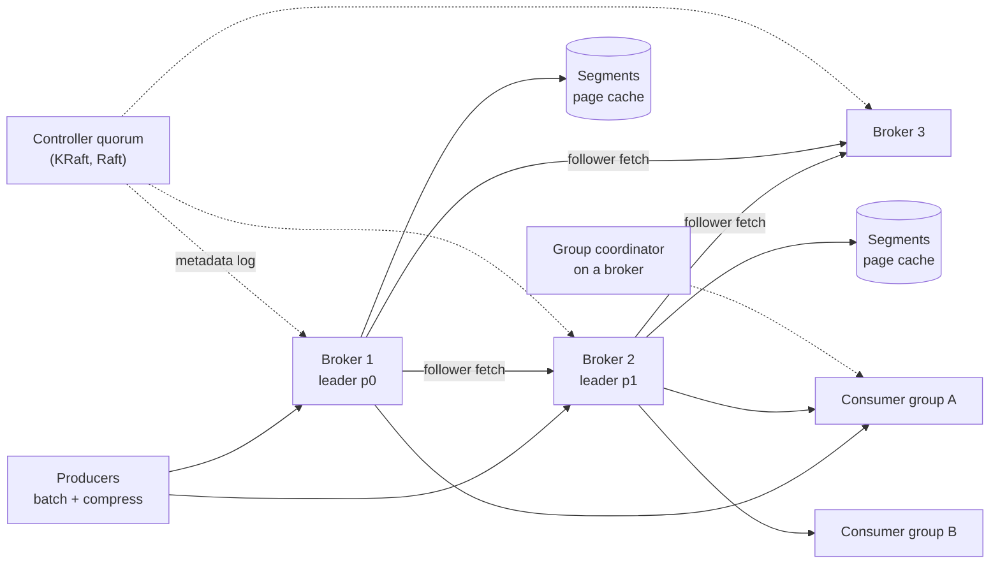
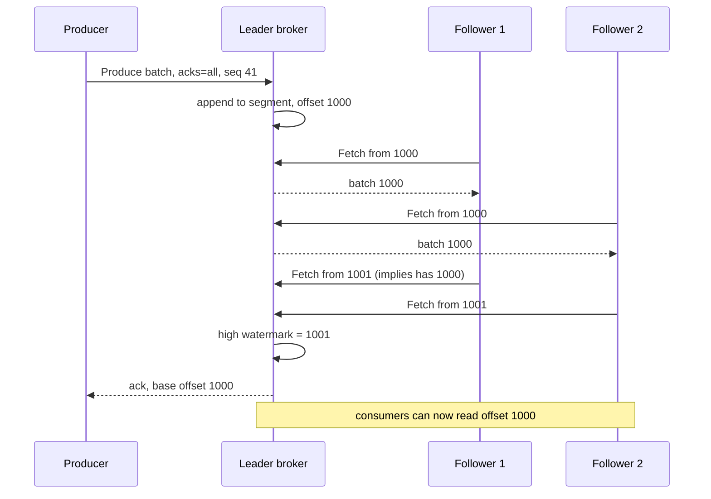

# Design a Distributed Message Queue (Kafka)

| | |
|---|---|
| **Asked at** | Common in infrastructure, data platform and senior backend loops; also asked as "design a pub/sub system" |
| **Difficulty** | Hard |
| **Core challenges** | durable append log, replication, consumer groups, ordering and exactly-once |
| **Related building blocks** | [`src/consistent-hash-ring`](../src/consistent-hash-ring/), [`src/idempotency-store`](../src/idempotency-store/) |

LLD version: [pub-sub-system](https://github.com/hardyalsinghdeora/low-level-design/blob/main/problems/pub-sub-system.md). Concepts: [message queues and streams](../fundamentals/message-queues-and-streams.md), [delivery semantics and idempotency](../fundamentals/delivery-semantics-and-idempotency.md), [replication](../fundamentals/replication.md), [consensus and coordination](../fundamentals/consensus-and-coordination.md).

## 1. Requirements

### Functional
1. Producers publish messages (key, value, headers) to a named topic.
2. Consumers read a topic as part of a consumer group; each message is processed by one member of each group, and many groups read the same topic independently.
3. Consumers can replay from any retained offset or from a timestamp.
4. Retention by time or size, and log compaction (keep the latest value per key) per topic.
5. Ordering is guaranteed for messages with the same key.

### Non-functional
- 500k messages/s in, ~1 KB average (500 MB/s), with 3 consumer groups reading everything (1.5 GB/s out).
- Producer p99 under 20 ms with `acks=all` inside one datacenter; end-to-end p99 under 100 ms.
- Durability: an acknowledged message survives the loss of any one broker (and one more with RF=3 and no unclean election).
- Retention 7 days by default.
- Horizontal scale: add brokers and partitions without downtime.

### Out of scope
- Per-message routing rules and priorities (that is a traditional broker like RabbitMQ).
- Stream processing (joins, windows) on top of the log; see [batch and stream processing](../fundamentals/batch-and-stream-processing.md).

## 2. Estimation

| Quantity | Estimate | Implication |
|---|---|---|
| Ingest | 500k msg/s × 1 KB = **500 MB/s** | Batching and compression are mandatory; per-message disk writes would not keep up |
| Replicated writes | 500 MB/s × RF 3 = **1.5 GB/s** | At ~100 MB/s sustained per broker, **~15-20 brokers** for writes alone |
| Consumer reads | 3 groups × 500 MB/s = **1.5 GB/s** | Mostly served from the OS page cache when consumers are caught up; lagging consumers hit disk |
| Storage | 500 MB/s × 604,800 s (7 days) ≈ **300 TB**, × 3 ≈ **900 TB** | With 12 TB usable per broker, **~75 brokers**; storage, not throughput, sets the count; tiered storage to object storage cuts this |
| Partitions | target ~5-10 MB/s per partition → 500 MB/s / 5 MB/s ≈ **100** for the main topic | Partition count caps consumer parallelism per group; pick it for the peak, since increasing it later changes key-to-partition mapping |
| Segment files | 1 GB segments → 300 TB / 1 GB ≈ **300k segments** per replica set | Retention deletes whole segments, a cheap file delete |
| Offset commits | 100 partitions × 3 groups, commit every 5 s ≈ **60 commits/s** | Trivial; stored in an internal compacted topic |

## 3. API

```
Produce(topic, partition?, records[{key, value, headers, timestamp}], acks = 0 | 1 | all,
        producerId, producerEpoch, baseSequence)
  -> per partition: { baseOffset, logAppendTime } | error (NOT_LEADER, NOT_ENOUGH_REPLICAS, ...)

Fetch(groupMember, [{topic, partition, fetchOffset, maxBytes}], maxWaitMs, minBytes,
      isolation = read_uncommitted | read_committed)
  -> record batches from fetchOffset; long-polls up to maxWaitMs if fewer than minBytes are available

JoinGroup / SyncGroup / Heartbeat / LeaveGroup         (group membership)
OffsetCommit(group, [{topic, partition, offset}])     (next offset to read, not the last processed)
OffsetFetch(group, partitions)
ListOffsets(topic, partition, timestamp)              (seek by time)

Transactions: InitProducerId(transactionalId), AddPartitionsToTxn, EndTxn(commit | abort)
Admin: CreateTopic(name, partitions, replicationFactor, configs), AlterPartitionReassignments, ...
```

Idempotency: the producer id plus a per-partition sequence number lets the leader drop duplicate retries (6.4). Pagination is the offset itself: consumers fetch from an offset and advance. Auth: SASL (SCRAM, OAuth) or mTLS for identity, and ACLs per topic and consumer group (`READ`, `WRITE`, `DESCRIBE`).

## 4. Data model

```
On disk, per partition replica: directory  orders-7/
  00000000000000000000.log        record batches, append-only
  00000000000000000000.index      sparse: relative offset -> byte position in .log
  00000000000000000000.timeindex  sparse: timestamp -> offset
  00000000000052428800.log        next segment, named by its base offset
  ...

Record batch header: baseOffset, length, partitionLeaderEpoch, magic, CRC,
  attributes (compression, transactional, control), lastOffsetDelta, baseTimestamp,
  producerId, producerEpoch, baseSequence, records[]

Metadata (KRaft metadata log, replicated by the controller quorum):
  topics, partitions, replica assignment, leader, leaderEpoch, ISR, configs, ACLs

Internal topics:
  __consumer_offsets    compacted; key (group, topic, partition) -> committed offset
  __transaction_state   compacted; transactionalId -> transaction status and partitions
```

Keys: the partition for a record is `hash(key) mod partitions` (murmur2 in the Java client); records without a key are spread by the producer's partitioner. The sparse index has an entry every ~4 KB of log, so finding an offset is a binary search in the index followed by a short scan. Store choice: plain files on the local filesystem, because the access pattern is sequential append and sequential read, which the OS page cache and disk readahead handle better than any general-purpose database.

## 5. High-level design



**Produce**: producer fetches metadata (which broker leads each partition) → accumulates records per partition for up to `linger.ms` or `batch.size` → compresses the batch → sends it to the partition leader → leader appends the batch to the active segment (page cache write, no fsync per message) → followers fetch it → once every ISR member has it, the high watermark advances and the leader acks (`acks=all`).

**Consume**: consumer joins its group via the group coordinator → gets assigned partitions → fetches from its committed offset → the broker sends bytes from the page cache straight to the socket with `sendfile` → consumer processes and commits offsets periodically. Consumers only see records below the high watermark, so they never read data that could be lost in a leader change.

## 6. Deep dives

### 6.1 Storage: why an append-only log is fast

A partition is a sequence of segment files. Writes only append to the newest segment; old segments are immutable, which makes retention (delete whole files past 7 days) and replication (copy byte ranges) simple.

Three techniques give the throughput:
- **Sequential I/O and the page cache.** The broker writes to the OS page cache and relies on replication, not fsync, for durability. Caught-up consumers read data that is still in memory.
- **Batching end to end.** The producer sends batches, the broker stores the batch as received (it does not re-encode it), and consumers receive the same batch. Compression (lz4, zstd) is applied per batch, which compresses much better than per message.
- **Zero-copy.** Because stored bytes equal wire bytes, the broker uses `sendfile` to move data from page cache to socket without copying into user space. TLS breaks this, since data must be encrypted in user space.

**Retention vs compaction**: delete retention drops segments older than `retention.ms` or beyond `retention.bytes`. Compaction (`cleanup.policy=compact`) rewrites old segments keeping only the latest record per key, and a record with a null value (tombstone) deletes the key after a delay. Compacted topics hold "current state" such as consumer offsets or a table changelog.

### 6.2 Replication: leader, ISR, acks and min.insync.replicas

Problem: an acknowledged message must survive a broker crash, and a new leader must not lose or invent data.

Each partition has one leader and RF-1 followers that fetch from it like consumers. The **in-sync replica set (ISR)** is the leader plus followers that have caught up within `replica.lag.time.max.ms`. The **high watermark** is the highest offset replicated to all ISR members.

| Producer setting | Acknowledged when | Can lose data when |
|---|---|---|
| `acks=0` | Sent | Always possible |
| `acks=1` | Leader wrote it | Leader dies before followers fetch |
| `acks=all` + `min.insync.replicas=1` | All current ISR members have it | ISR shrank to the leader alone, then it died |
| `acks=all` + `min.insync.replicas=2`, RF=3 | At least 2 replicas have it | Two brokers fail at once before a third catches up |

**Choice:** RF=3, `acks=all`, `min.insync.replicas=2`, `unclean.leader.election.enable=false`. With fewer than 2 in-sync replicas the partition rejects writes (`NOT_ENOUGH_REPLICAS`) rather than accepting data it cannot protect. When a leader fails, the controller picks a new leader from the ISR and bumps the **leader epoch**; followers truncate any records beyond the new leader's log for that epoch, so divergent tails are removed consistently.



### 6.3 Consumer groups and rebalancing

Problem: spread partitions over group members, keep each partition on exactly one member, and move them when members join, leave or crash.

Options:
1. **Eager rebalance**: every member gives up all partitions, the leader of the group computes a new assignment, everyone resumes. Simple, but the whole group stops for each change.
2. **Cooperative incremental rebalance** (KIP-429): only partitions that move are revoked; others keep processing.
3. **Static membership** (KIP-345): a member with a fixed `group.instance.id` can restart within the session timeout without triggering a rebalance.

**Choice:** cooperative rebalancing plus static membership for stateful consumers, so rolling deploys do not pause the whole group. Members heartbeat to the group coordinator; a member that misses `session.timeout.ms` or exceeds `max.poll.interval.ms` between polls is removed. Commit offsets only after processing; that gives at-least-once delivery, so handlers must be idempotent. Parallelism per group is capped at the partition count; extra members sit idle.

### 6.4 Idempotent producer and transactions

Problem: a producer retry after a lost ack writes the message twice. A consume-transform-produce job that crashes between producing output and committing its input offset reprocesses input.

**Idempotent producer** (on by default since Kafka 3.0): the broker assigns a producer id; the producer numbers batches per partition. The leader keeps the last few sequence numbers per producer and drops a batch it has already appended, and rejects a gap as out of order. This gives exactly-once writes per partition per producer session.

**Transactions**: a producer with a `transactional.id` writes to several partitions and commits its consumer offsets (`sendOffsetsToTransaction`) as one atomic unit. A transaction coordinator logs the state in `__transaction_state` and writes commit or abort markers into every involved partition. Consumers with `isolation.level=read_committed` read only up to the last stable offset and skip aborted records. A restarted producer with the same `transactional.id` bumps its epoch, which fences the old instance (a zombie) from committing.

**Choice:** idempotence everywhere; transactions only for Kafka-to-Kafka pipelines. Exactly-once does not extend to external side effects such as sending an email or writing to another database; for those, use idempotent consumers keyed by a message id, or the [transactional outbox](https://github.com/hardyalsinghdeora/design-patterns/tree/main/src/modern/transactional-outbox) on the producing side.

### 6.5 Controller and metadata (KRaft)

Brokers need one agreed view of partition leaders and ISRs. Older Kafka stored this in ZooKeeper with a single controller broker; Kafka 4.0 removed ZooKeeper entirely in favour of **KRaft**. A small quorum of controllers (3 or 5) replicates a metadata log with Raft; the active controller appends leader changes, ISR changes and topic configs, and brokers replay the log to stay current. Failover is a Raft election in the controller quorum, and because brokers already hold the metadata log, a new controller does not have to reload state from an external store. This removes a separate system to operate and lets clusters hold far more partitions.

## 7. Scaling and operations

- **Partitioning**: scale throughput by adding partitions and brokers, then reassigning replicas (throttled, since it copies data). Adding partitions remaps keys (`hash mod n` changes), so over-provision partitions for keyed topics up front.
- **Replication**: spread replicas across racks or availability zones (`broker.rack`); for multiple regions, replicate topics asynchronously with MirrorMaker 2 or a similar tool rather than stretching one cluster across a WAN.
- **Tiered storage**: move closed segments to object storage and keep only recent segments on local disks, which cuts broker disk from ~900 TB toward the hot set and makes broker replacement faster.
- **Failure modes**: broker crash → leaders move to ISR followers within seconds; slow follower → drops from ISR, writes continue if `min.insync.replicas` is met; disk full → broker stops, so alert at 70 %; consumer lag → retention may delete unread data, alert well before lag approaches retention; poison message → consumer retries then sends it to a dead-letter topic.
- **Monitoring**: under-replicated partitions (should be 0), offline partitions, ISR shrink/expand rate, request p99 by API, bytes in/out per broker, consumer lag per group and partition, controller elections, disk usage.
- **Security**: TLS, SASL or mTLS, ACLs per topic and group, quotas per client id so one producer cannot saturate a broker.

## 8. Trade-offs summary

| Decision | Chosen | Alternative | Why |
|---|---|---|---|
| Storage | Append-only segments on local disk + page cache | Database or per-message fsync | Sequential I/O and zero-copy reach GB/s |
| Durability | RF=3, `acks=all`, min ISR 2 | `acks=1` | Survives a broker loss with a few ms extra latency |
| Ordering | Per partition only | Global order | Global order allows one writer and one reader; no scale |
| Consumption | Pull with long poll | Broker push | Consumers control pace; batching works naturally |
| Delivery | At-least-once + idempotent handlers; EOS for Kafka-to-Kafka | Exactly-once everywhere | External side effects cannot join a Kafka transaction |
| Metadata | KRaft controller quorum | ZooKeeper | One system to run; faster controller failover |

## 9. Follow-up questions interviewers ask

- *"How do you guarantee ordering for one customer's events?"* Use the customer id as the key so all their events go to one partition, and keep producer retries ordered (idempotence keeps order with up to 5 in-flight requests).
- *"Why pull instead of push?"* A pull consumer fetches as fast as it can process and batches naturally; push needs per-consumer flow control in the broker.
- *"How many partitions should a topic have?"* Enough for peak throughput divided by per-partition throughput and for the largest consumer group's parallelism, with headroom; too many raises metadata and file-handle costs and lengthens failover.
- *"What happens if a consumer is slower than retention?"* Messages are deleted unread and the consumer's offset becomes out of range; `auto.offset.reset` decides whether it jumps to the earliest or latest offset. Alert on lag long before that.
- *"How would you implement delayed messages?"* Kafka has no per-message delay. Use topics per delay bucket (1 min, 10 min) that consumers read and re-check timestamps, or a separate scheduler; see [distributed job scheduler](./distributed-job-scheduler.md).
- *"Kafka vs SQS/RabbitMQ?"* Kafka is a replayable log with per-partition order and many independent readers. SQS and RabbitMQ are queues where a message is deleted once acknowledged, with per-message visibility timeouts, priorities and routing.
