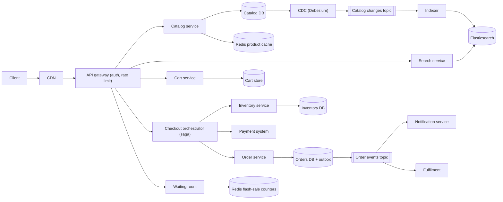
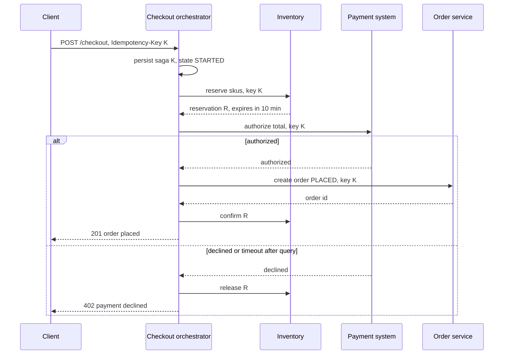

# Design an E-commerce Platform (Amazon, Flipkart)

| | |
|---|---|
| **Asked at** | Commerce, marketplace and retail companies; a broad problem where the interviewer picks the deep dive (search, inventory or flash sales) |
| **Difficulty** | Hard |
| **Core challenges** | inventory contention, checkout saga, search freshness, flash-sale oversell |
| **Related building blocks** | [`src/idempotency-store`](../src/idempotency-store/), [`src/rate-limiter-algorithms`](../src/rate-limiter-algorithms/), [`src/inverted-index`](../src/inverted-index/) |

LLD version of the cart, order and inventory classes: [online-shopping](https://github.com/hardyalsinghdeora/low-level-design/blob/main/problems/online-shopping.md).

## 1. Requirements

### Functional
1. Browse and search a catalog of products and their SKUs (size, colour) with filters and facets.
2. Cart per user, persisted across devices; guest carts merge on login.
3. Checkout: reserve inventory, compute price and tax, take payment, create the order.
4. Order management: status (placed, paid, packed, shipped, delivered, canceled, returned), cancellation and refund.
5. Flash sales: a limited quantity of a product at a fixed start time for a very large audience.
6. Notifications for order events (email, SMS, push).

### Non-functional
- 50 M DAU, 500 M SKUs, 5 M orders per day; flash sales with 1 M+ users arriving within a minute for 10,000 units.
- Product page p99 under 200 ms; search p99 under 300 ms; checkout p99 under 2 s (PSP bound).
- Never oversell a flash-sale item; for regular stock, oversell must be rare and handled (backorder or cancel with apology).
- Browsing and search favour availability: a slightly stale price or stock badge is acceptable. Orders and payments favour consistency.
- 99.99 % availability for browse and checkout.

### Out of scope
- Seller onboarding, warehouse management internals, shipping carrier integration, recommendations, ads.

## 2. Estimation

| Quantity | Estimate | Implication |
|---|---|---|
| Product page views | 50 M × 20 = 1 B/day ≈ **11.5k/s**, peak ~50k/s | CDN for images and static parts, Redis for product documents; the catalog DB serves only misses |
| Searches | 50 M × 4 = 200 M/day ≈ **2,300/s**, peak 10k/s | An Elasticsearch cluster with replicas sized for 10k QPS; never query the primary DB for search |
| Cart writes | 50 M × 2 = 100 M/day ≈ **1,200/s** | Key-value store keyed by user id |
| Orders | 5 M/day ≈ **58/s** avg, ~600/s peak (10× on sale days) | A sharded relational order store; the PSP is the slower dependency |
| Catalog size | 500 M SKUs × 5 KB = **2.5 TB** | Document store or sharded Postgres; search index ~1-2 TB with replicas |
| Order storage | 5 M × 3 KB = **15 GB/day**, ~5.5 TB/year | Partition by month, archive old orders to cheaper storage |
| Flash sale arrival | 1 M users in 60 s ≈ **17k/s** on one SKU | One hot key; must be absorbed by a queue and an atomic in-memory counter, not a DB row lock |

## 3. API

```
GET  /v1/products/{productId}                  product + SKUs + price; stock as a badge ("in stock", "few left")
GET  /v1/search?q=shoes&brand=x&size=9&sort=price&cursor=...&limit=40
PUT  /v1/cart/items/{skuId}                    { quantity }          (idempotent: sets, does not add)
GET  /v1/cart
POST /v1/checkout                               { cartVersion, addressId, paymentMethodToken }
  headers: Idempotency-Key
  201: { orderId, status: "placed" | "payment_pending" }
GET  /v1/orders/{id}
POST /v1/orders/{id}/cancel                     headers: Idempotency-Key
GET  /v1/orders?cursor=...&limit=20

POST /v1/sales/{saleId}/queue                   join the waiting room → { ticket, position }
GET  /v1/sales/{saleId}/queue/{ticket}          poll → { status: "waiting" | "admitted", admissionToken? }
POST /v1/sales/{saleId}/claim                   headers: Admission-Token, Idempotency-Key → { reservationId, expiresAt }
```

- **Idempotency**: checkout and cancel require `Idempotency-Key`; cart updates set absolute quantities so retries are harmless.
- **Pagination**: search uses `search_after` cursors (sort values of the last hit), not deep offsets, which are expensive in Elasticsearch.
- **Auth**: session token or OAuth for users; guest carts keyed by a signed anonymous id.

## 4. Data model

```
products (id, seller_id, title, description, brand, category_id, attributes JSONB, status, updated_at)
skus (id, product_id, attributes JSONB, price_amount BIGINT, currency CHAR(3), updated_at)

inventory (sku_id, warehouse_id, on_hand INT, reserved INT, version INT,
           PRIMARY KEY (sku_id, warehouse_id),
           CHECK (reserved >= 0 AND reserved <= on_hand))
reservations (id UUID PK, sku_id, warehouse_id, quantity INT, checkout_id UUID,
              status TEXT, expires_at TIMESTAMPTZ)          -- HELD | CONFIRMED | RELEASED
INDEX reservations(status, expires_at)                       -- expiry sweeper

carts (user_id PK, version INT, items: [{ sku_id, quantity, added_at }])   -- DynamoDB / Redis + durable store

orders (id UUID PK, user_id, status, currency CHAR(3), subtotal BIGINT, tax BIGINT,
        shipping BIGINT, total BIGINT, payment_id UUID NULL, idempotency_key TEXT,
        created_at, version INT)
UNIQUE (user_id, idempotency_key)
order_items (order_id, sku_id, quantity, unit_price BIGINT, warehouse_id)
order_events (order_id, seq, status, at, payload)            -- history for support and customers
outbox (id, aggregate_id, event_type, payload, created_at, published_at NULL)
```

Store choices: the **catalog** in a sharded relational or document store, with Elasticsearch as a derived read model for search and Redis for product documents. **Carts** in a key-value store (high write rate, single-key access, no joins). **Inventory and orders** in Postgres sharded by `sku_id` and `user_id` respectively, because conditional updates and transactions are the whole point. See [choosing a database](../fundamentals/choosing-a-database.md).

## 5. High-level design



**Browse**: product pages are assembled from the Redis product cache (cache-aside, invalidated by catalog change events) and images from the CDN. Stock shown on pages is a cached badge refreshed every few seconds; the authoritative check happens at checkout.

**Search**: catalog writes go to the catalog DB; Debezium reads its write-ahead log and publishes changes to Kafka; the indexer denormalises product + SKUs + price into one search document and upserts it into Elasticsearch. Freshness is a few seconds. See [search and indexing](../fundamentals/search-and-indexing.md) and [CDC](../fundamentals/transactional-outbox-and-cdc.md).

**Checkout**: client → checkout orchestrator with an idempotency key → reserve inventory → price and tax → authorise payment → create order → confirm reservation. Section 6.2 walks the saga.

**After the order**: the order service writes the order and an outbox row in one transaction; the relay publishes `order.placed`; notifications and fulfilment consume it.

## 6. Deep dives

### 6.1 Inventory reservation

Problem: two shoppers buy the last unit. One must win, and a shopper who abandons checkout must not lock stock forever.

Options:
1. **Decrement at add-to-cart.** Strong guarantee for the shopper, but carts are abandoned at high rates, so stock appears sold out while sitting in idle carts.
2. **Decrement only after payment succeeds.** No locked stock, but two shoppers can both pay for the last unit; one must be refunded. Acceptable for deep stock, poor for scarce items.
3. **Soft reservation with a TTL at checkout start.** `UPDATE inventory SET reserved = reserved + :q WHERE sku_id = :s AND warehouse_id = :w AND on_hand - reserved >= :q` plus a `reservations` row with `expires_at = now() + 10 min`. Payment success confirms it (`on_hand -= q, reserved -= q`); failure, cancel or expiry releases it.

**Choice: 3.** The conditional update is atomic in one row, so oversell is impossible without any explicit lock, and stock is held only for the minutes a buyer is actively paying. A sweeper releases expired `HELD` reservations using the `(status, expires_at)` index; the release is itself conditional on `status = 'HELD'`, so a confirm and a release racing cannot both apply. For deep-stock SKUs with very high write rates, split the row into N sub-rows (stock buckets) and reserve from a random bucket with fallback to the others.

### 6.2 Checkout as a saga

A checkout touches inventory, payment and orders, each owned by a different service with its own database. A distributed two-phase commit across them (and an external PSP) is not available or not worth its blocking behaviour, so the orchestrator runs a [saga](https://github.com/hardyalsinghdeora/design-patterns/tree/main/src/modern/saga): each step has a compensating action, and the saga's own state is persisted so it resumes after a crash. See [distributed transactions](../fundamentals/distributed-transactions.md).

| Step | Action | Compensation |
|---|---|---|
| 1 | Reserve inventory (TTL 10 min) | Release reservation |
| 2 | Price, promotions, tax snapshot | None (read only) |
| 3 | Authorise payment | Void authorisation |
| 4 | Create order `PLACED` | Cancel order |
| 5 | Confirm reservation, capture payment (or capture at shipment) | Refund |

Orchestration versus choreography: with choreography each service reacts to the previous event, which spreads the flow across many consumers and makes "where is checkout 123 stuck" hard to answer. **Choice: orchestration**, with the orchestrator's state in its own table and every call carrying the checkout id as an idempotency key.



If the orchestrator crashes between steps, a recovery worker picks up sagas stuck in a non-terminal state and drives them forward or backward. A payment timeout follows the payment system's rule: query before retry, never re-authorise blindly (see [payment system](./payment-system.md)).

### 6.3 Flash sale

Problem: 1 M users, 10,000 units, a start time everyone knows. The naive design sends 17k requests/s at one inventory row and at the PSP, and bots buy most of the stock.

Layers, from the edge inward:

1. **Waiting room.** Users who arrive before or at the start join a queue (`POST /queue`) and get a ticket. Tickets are ordered randomly among those who arrived before the start (so being first by milliseconds is not an advantage) and by arrival afterwards. An admission service lets users through at a rate the backend can serve, for example 2,000 per second, issuing a short-lived signed admission token. Everyone else polls a static-looking endpoint served from cache.
2. **Atomic claim in Redis.** An admitted user calls `/claim`. A Lua script runs atomically in Redis:

```
-- KEYS[1] = stock key, KEYS[2] = per-user claim key; ARGV[1] = qty, ARGV[2] = per-user limit, ARGV[3] = ttl ms
local stock = tonumber(redis.call('GET', KEYS[1]) or '0')
local mine  = tonumber(redis.call('GET', KEYS[2]) or '0')
if mine + tonumber(ARGV[1]) > tonumber(ARGV[2]) then return -2 end
if stock < tonumber(ARGV[1]) then return -1 end
redis.call('DECRBY', KEYS[1], ARGV[1])
redis.call('INCRBY', KEYS[2], ARGV[1])
redis.call('PEXPIRE', KEYS[2], ARGV[3])
return stock - tonumber(ARGV[1])
```

   Because the script executes as one unit, check and decrement cannot interleave, so the counter never goes below zero. Both keys use the same hash tag (`{sale:42}`) so they live on one Redis Cluster slot.
3. **Asynchronous order creation.** A successful claim writes a reservation message to a queue; workers create the DB reservation and the order at a steady rate. The user gets 10 minutes to pay; on timeout the worker releases the DB reservation and a script increments the Redis stock back.
4. **Reconciliation.** Redis is the gate, the database is the record. Redis is seeded from the DB before the sale; a job compares Redis stock + claims against DB reservations continuously. If Redis fails over and loses recent writes (replication is asynchronous), it can only over-admit; the DB conditional update in 6.1 still refuses the extra units, so the result is a rejected claim, not an oversell.

Options considered: DB row with `SELECT ... FOR UPDATE` (serialises 17k/s on one row, falls over), Redis `DECR` without a script (can go negative; needs compensating `INCR` and a race window), and the script above. **Choice: waiting room + Lua script + DB conditional update as the final guard.**

**Bot protection**: one account per purchase limit (enforced in the script), accounts created recently or without purchase history excluded or challenged, CAPTCHA or proof-of-work at queue entry, device and IP rate limits at the edge (see [rate limiting](../fundamentals/rate-limiting.md)), signed admission tokens bound to the user and expiring in minutes.

### 6.4 Search freshness and correctness

- Options for feeding the index: dual writes from the catalog service (inconsistent on partial failure), periodic batch reindex (hours stale), or **CDC from the catalog database (chosen)**: no change is missed, and the indexer can be replayed from Kafka to rebuild the index.
- Stock in search results is a badge updated from inventory events at most every few seconds per SKU (coalesced) to avoid reindex storms; the product page and checkout show the real state.
- Full reindex: build a new index from a snapshot plus the topic from the snapshot's offset, then swap an alias atomically.

## 7. Scaling and operations

- **Partitioning**: catalog by `product_id`; inventory by `sku_id`; orders by `user_id` (customer queries) with a CDC-fed copy by `seller_id` for seller dashboards; carts by `user_id`. Elasticsearch shards sized at tens of GB each.
- **Replication**: Postgres synchronous standby per shard for orders and inventory; Elasticsearch one or two replicas per shard (also adds read capacity); Redis replicas with automatic failover.
- **Caching**: CDN for images and static assets, Redis for product documents (TTL plus event invalidation), search results for popular queries cached for seconds. See [caching strategies](../fundamentals/caching-strategies.md).
- **Failure modes**: search cluster down → fall back to category browse from the catalog cache; payment system slow → checkout returns `payment_pending` and completes by event; inventory shard down → checkout for affected SKUs fails fast with a clear message while browse continues; notification service down → events wait in Kafka.
- **Monitoring**: checkout conversion and error rate per step, reservation expiry rate (high means payment friction), Redis vs DB stock drift in sales, CDC lag (catalog to index), search p99, oversell incidents (should be zero for flash sales).
- **Abuse**: edge rate limits, bot scoring, purchase limits per account and payment instrument, price-manipulation checks (the server always recomputes the price; never trust the client's total).

## 8. Trade-offs summary

| Decision | Chosen | Alternative | Why |
|---|---|---|---|
| Inventory hold | Soft reservation with TTL at checkout | Decrement at cart / at payment | Holds stock only while paying; atomic conditional update prevents oversell |
| Checkout coordination | Orchestrated saga | 2PC or choreography | No 2PC with a PSP; orchestration is observable and resumable |
| Search feed | CDC to Kafka to Elasticsearch | Dual writes | No missed updates, replayable rebuild |
| Flash-sale gate | Waiting room + Redis Lua | DB row lock | Sheds load before the backend and keeps the hot counter in memory |
| Final oversell guard | DB conditional update | Trust Redis | Redis async replication can lose writes on failover |
| Cart store | Key-value | Relational | Single-key access, high write rate, no joins |

## 9. Follow-up questions interviewers ask

- *"Why not lock the inventory row with `SELECT FOR UPDATE`?"* It works for normal traffic, but it holds a lock across a round trip; the single conditional `UPDATE` does the check and the write in one statement and holds the row lock only for that statement.
- *"What if payment succeeds after the reservation expired?"* Confirm checks the reservation status; if it was released, try to re-reserve. If stock is gone, refund automatically and notify the user. Setting the reservation TTL above the payment timeout makes this rare.
- *"How do you keep prices consistent between the cart and checkout?"* Checkout snapshots prices and promotions server side and shows any change before payment; the order stores unit prices, never references to the live price.
- *"How do you handle a seller updating 1 M SKUs at once?"* Bulk updates go through a batch pipeline with its own Kafka topic and lower priority indexer pool so regular updates stay fresh.
- *"Can the waiting room be bypassed by calling `/claim` directly?"* No: `/claim` requires a signed admission token bound to the user id, sale and expiry, verified without a database call.
- *"How do you show order history fast?"* Orders sharded by `user_id` with an index on `(user_id, created_at)`; recent orders cached; old orders served from the archive store.
