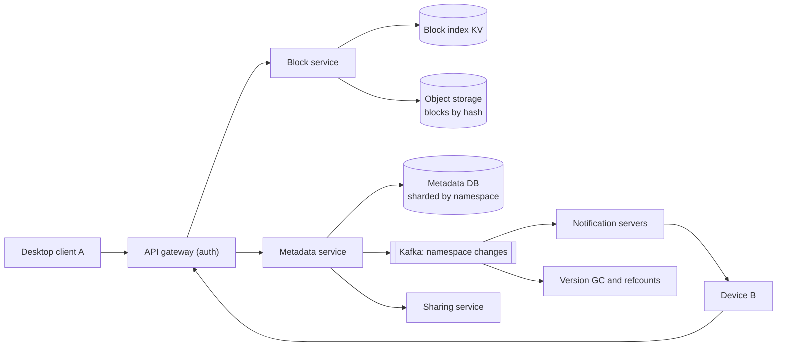
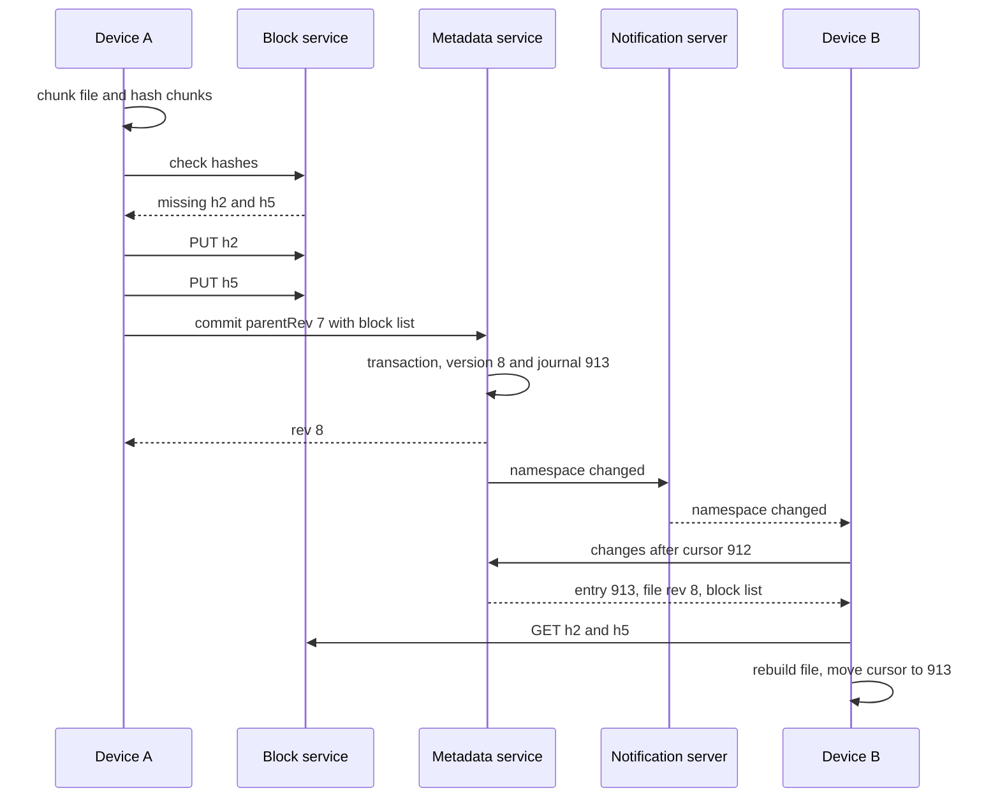

# Design File Storage and Sync (Dropbox / Google Drive)

| | |
|---|---|
| **Asked at** | Common at storage, productivity and cloud companies |
| **Difficulty** | Hard |
| **Core challenges** | chunking and dedup, sync protocol, edit conflicts, metadata consistency |
| **Related building blocks** | [`src/merkle-tree`](../src/merkle-tree/), [`src/idempotency-store`](../src/idempotency-store/), [`src/consistent-hash-ring`](../src/consistent-hash-ring/) |

Related: [object-storage](./object-storage.md), [CDN and blob storage](../fundamentals/cdn-and-blob-storage.md), [transactions and isolation](../fundamentals/transactions-and-isolation.md), [real-time communication](../fundamentals/realtime-communication.md), [collaborative-editor](./collaborative-editor.md).

## 1. Requirements

### Functional
1. Upload, download, rename, move and delete files and folders from desktop, mobile and web clients.
2. Changes on one device appear on the user's other devices automatically.
3. Edit offline; changes sync when the device reconnects.
4. Concurrent edits to the same file never lose data (conflicts are surfaced, not silently overwritten).
5. Share files and folders with other users as viewer or editor; share by link.
6. Version history: restore any version from the last 30 days.

### Non-functional
- Scale: 200 M users, 50 M DAU, average 10 GB stored per user, files up to 50 GB.
- Sync latency: a small change on one device reaches other online devices within ~5 s.
- Durability: 11 nines for file content; metadata must never lose an acknowledged commit.
- Consistency: per-namespace (a user's tree or a shared folder) changes are applied in one order on every device.
- Bandwidth efficiency: editing 1 MB of a 1 GB file uploads about 1 MB, not 1 GB.

### Out of scope
- Real-time co-editing inside documents ([collaborative-editor](./collaborative-editor.md)), full-text search of contents, previews and thumbnails in detail.

## 2. Estimation

| Quantity | Estimate | Implication |
|---|---|---|
| Logical storage | 200 M × 10 GB = **2 EB** | Content lives in object storage or a purpose-built blob store, never in the metadata DB |
| After dedup | assume 20-30 % saved by identical chunks | Worth hundreds of PB; dedup by content hash pays for itself |
| Files | 200 M × 2,000 files = **400 B file entries** × ~500 B ≈ 200 TB | Metadata DB must be sharded; shard by namespace keeps one tree on one shard |
| File changes | 50 M DAU × 10 changes = 500 M/day ≈ **6k/s**, peak ~20k/s | Metadata commits are moderate but need transactions |
| New bytes | 500 M × ~400 KB of new chunks ≈ **200 TB/day** ≈ 2.3 GB/s | Delta sync keeps this far below whole-file uploads |
| Connected devices | ~80 M devices holding a notification connection | At ~100k idle connections per server → **~800 notification servers** |
| Chunk index | 2 EB / 4 MB ≈ **500 B chunks** × ~100 B per entry ≈ 50 TB | Sharded key-value index keyed by hash |

## 3. API

```
POST /v1/blocks/check          body: { hashes: [sha256, ...] }      200: { missing: [...] }
PUT  /v1/blocks/{sha256}       raw bytes (≤ 8 MB); server verifies the hash      201
GET  /v1/blocks/{sha256}       200 bytes (authorised only if caller can read a file using it)

POST /v1/files/commit
  headers: Idempotency-Key
  body: { nsId, path, parentRev, size, blockHashes: [...], clientMtime }
  200: { fileId, rev, journalId }
  409: { conflict: true, currentRev }          parentRev is stale

GET  /v1/namespaces/{nsId}/changes?cursor=<journalId>&limit=1000
  200: { entries: [ { journalId, fileId, path, rev, op, blockHashes } ], cursor, hasMore }

GET  /v1/notify?cursors=ns1:812,ns2:77      long poll / WebSocket; returns { changed: [nsIds] }

POST /v1/shares                body: { nsId or fileId, granteeEmail, role: viewer|editor }
GET  /v1/files/{fileId}/versions
POST /v1/files/{fileId}/restore   body: { rev }
```

Blocks are content-addressed, so `PUT` is naturally idempotent (the same hash is the same bytes). `commit` carries `parentRev` for optimistic concurrency and an `Idempotency-Key` so a retried commit does not create two versions. Change listing is cursor-paginated by journal id. Every block read checks that the caller has read access to at least one file that references the block; otherwise knowing a hash would be enough to fetch someone else's data.

## 4. Data model

```
namespaces   (ns_id PK, type: user_root|shared_folder, owner_id, quota_bytes)
memberships  (ns_id, user_id, role, mount_path, PRIMARY KEY (ns_id, user_id))
files        (ns_id, file_id, parent_id, name, is_dir, latest_rev, deleted_at,
              PRIMARY KEY (ns_id, file_id), UNIQUE (ns_id, parent_id, name))
file_versions(ns_id, file_id, rev, size, block_hashes[], device_id, user_id, created_at,
              PRIMARY KEY (ns_id, file_id, rev))
journal      (ns_id, journal_id, file_id, rev, op: create|modify|move|delete,
              PRIMARY KEY (ns_id, journal_id))        -- monotonic per namespace
blocks       (hash PK, size, storage_key, ref_count, created_at)   -- separate KV store
```

Store choices:
- **Metadata in a sharded relational database, sharded by `ns_id`.** A commit must atomically insert a version, update `files.latest_rev` and append a journal row; that is a single-shard transaction when everything for a namespace lives on one shard. The unique constraint on `(ns_id, parent_id, name)` prevents two files with the same name in a folder.
- **Block index in a key-value store** keyed by hash; it is large, simple and has no relational needs.
- **Block bytes in object storage** (or an in-house blob store), keyed by hash. Small blocks can be packed into larger objects to reduce per-object overhead.

## 5. High-level design



**Upload an edit**: the client chunks the changed file, hashes each chunk, and asks the block service which hashes are missing. It uploads only those, then commits a new version (the ordered list of hashes) to the metadata service with the revision it started from. The metadata service writes the version, updates the file and appends a journal entry in one transaction, then publishes "namespace changed".

**Receive an edit**: notification servers hold one long-lived connection per device and push "namespace X changed". The device calls `changes?cursor=...`, receives the new journal entries, downloads the blocks it does not already have locally, and reassembles the file.

## 6. Deep dives

### 6.1 Chunking: fixed-size vs content-defined

Problem: to upload only what changed and to dedup across files, a file is split into chunks identified by hash. How the boundaries are chosen decides how well this works.

| Option | Boundary rule | Edit in place | Insert in the middle | Cost |
|---|---|---|---|---|
| Whole file | none | Re-upload everything | Re-upload everything | Trivial |
| **Fixed-size blocks** (e.g. 4 MB) | every N bytes | Only touched blocks change | Every later block shifts and changes hash | Cheap hashing |
| **Content-defined chunking** (Rabin or FastCDC) | where a rolling hash of a small window matches a pattern | Only touched chunks change | Boundaries resynchronise after the insert; only nearby chunks change | Rolling hash over all bytes |

**Choice: content-defined chunking with a 1 MB minimum, ~4 MB average and 8 MB maximum chunk size**, hashed with SHA-256. Insertions are common in documents and archives, and fixed blocks turn a one-byte insert at the start into a full re-upload. The rolling-hash cost is small next to network time. Fixed 4 MB blocks are a defensible simpler choice (Dropbox has long used 4 MB blocks) when most large files are append-only or rewritten in place, such as logs and media.

**Dedup** falls out of content addressing: before uploading, the client asks which hashes are missing. Dedup within one user's namespaces is safe. Dedup across users saves more but leaks information (a fast "already have it" reveals that someone stored this exact file), so cross-user dedup is done server-side after upload, invisible to the client.

### 6.2 The sync protocol: notification channel plus delta sync

Options:
1. **Clients poll** `changes` every few seconds. 80 M devices × one poll per 5 s = 16 M requests/s, nearly all empty.
2. **Push full changes** over the persistent connection. Couples the notification tier to metadata and makes reconnect logic complicated.
3. **Push a hint, pull the data.** The notification channel carries only "namespace X changed"; the client then pulls deltas with its cursor.

**Choice: option 3.** The notification tier is stateless apart from connections and can drop messages safely: the cursor guarantees the client eventually sees every journal entry, and a client that reconnects simply pulls from its last cursor. The journal gives a total order of changes per namespace, so every device applies them in the same order.



### 6.3 Conflict handling

Problem: device A and device B both edit `report.docx` (rev 7) while one of them is offline. Both later commit with `parentRev = 7`.

Options:
1. **Last writer wins.** Silently discards one person's work. Unacceptable for files.
2. **Merge contents.** Only possible for formats the server understands (plain text), and wrong for binary formats.
3. **Conflicted copy.** The first commit wins and becomes rev 8. The second gets `409`; its client keeps the user's bytes and commits them as a new file next to the original, for example `report (Device B's conflicted copy 2026-11-07).docx`.

**Choice: conflicted copies.** No data is lost, the rule is simple to explain, and it works for every file type. Directory-level conflicts follow similar rules: an edit to a file whose folder was deleted remotely recreates the folder; two files created with the same name get a suffix. Optimistic concurrency on `parentRev` makes the metadata service the single place where conflicts are detected.

### 6.4 Offline edits and the client state model

The client keeps a local database with three views of every path: the **local** file system as it is now, the **remote** state from the last journal entries it pulled, and the **synced** base (what both sides last agreed on). On reconnect it pulls remote changes, then compares each path three ways:
- Changed locally only → upload and commit with the base rev as `parentRev`.
- Changed remotely only → download and apply.
- Changed on both → conflicted copy as in 6.3.

Local edits are queued in order, and uploads resume chunk by chunk because blocks are idempotent. A [Merkle tree](../src/merkle-tree/) of folder hashes lets the client find which subtrees differ after a long offline period without comparing every file.

### 6.5 Sharing, permissions and version retention

- **Shared folders are their own namespaces.** Sharing a folder moves it into a new namespace; each member's root has a mount entry pointing at it. All members' devices follow the same journal, so changes appear for everyone in one order. Permissions are checked per namespace (`memberships.role`), with per-file link shares stored as signed tokens with optional expiry and password.
- **Versions** are rows in `file_versions` that keep their block lists alive. Blocks carry a reference count updated asynchronously from the change stream; when a version ages past 30 days and no other version references a block, its count drops to zero and a sweeper deletes it after a grace period. A periodic mark-and-sweep reconciles counts, because a missed decrement leaks storage while a wrong decrement loses data, and only the first is acceptable.

## 7. Scaling and operations

- **Partitioning**: metadata by `ns_id` (one namespace per shard keeps commits single-shard); very large shared namespaces may need a dedicated shard. Block index and blob storage by hash, spread by [consistent hashing](../fundamentals/consistent-hashing.md). Notification servers by device id.
- **Replication**: metadata shards with synchronous replica in another zone so an acknowledged commit survives a node loss; blocks erasure-coded across zones by the storage layer.
- **Caching**: hot blocks (recently committed, about to be downloaded by the user's other devices) in a regional cache; namespace journals' recent tail in memory.
- **Failure modes**: metadata shard failover → commits for those namespaces pause, clients retry with the same idempotency key; notification server crash → devices reconnect and pull from their cursors, nothing is lost; block upload succeeds but commit fails → orphan blocks with zero references are garbage-collected.
- **Monitoring**: commit latency and 409 rate, change propagation time (commit to other device applied), notification connection count, block upload throughput, GC backlog and orphan bytes, client error rates by version.
- **Abuse and security**: TLS in transit, encryption at rest with per-namespace keys held in a key management service, quotas per namespace, malware scanning of shared-link downloads, rate limits on share-link access to stop the service being used as a free CDN.

## 8. Trade-offs summary

| Decision | Chosen | Alternative | Why |
|---|---|---|---|
| Chunking | Content-defined, ~4 MB average | Fixed 4 MB blocks | Inserts only change nearby chunks |
| Block identity | SHA-256 content address | Random block id | Dedup and idempotent uploads for free |
| Sync | Push a hint, pull deltas by cursor | Poll, or push full changes | Cheap connections that can drop messages safely |
| Ordering | Per-namespace journal | Global log | Total order where it matters, sharding everywhere else |
| Conflicts | Conflicted copy | Last writer wins | Never loses user data |
| Metadata store | Sharded relational by namespace | NoSQL | Single-shard transactions and unique names per folder |
| Cross-user dedup | Server-side only | Client-visible | Avoids leaking which files exist |

## 9. Follow-up questions interviewers ask

- *"How do you upload a 50 GB file?"* It is just 12,500 chunks; upload them in parallel with resume, and commit once at the end. Until commit, the file does not exist for other devices.
- *"What if a user renames a folder with a million files?"* Rename changes one `files` row (the folder's name), because children reference `parent_id`, not paths; one journal entry tells clients to rename locally.
- *"How do you stop the hash index becoming a hot spot for a popular file?"* Hashes are uniformly distributed, so load spreads across shards; a single viral block is cached at the block service.
- *"How do you move a file between namespaces (into a shared folder)?"* It is a cross-shard operation: copy metadata to the target namespace (blocks are shared by hash, so no bytes move), then delete from the source, coordinated by a saga with journal entries on both sides.
- *"Could you use a Merkle tree for the whole sync?"* It is useful for detecting divergence after long offline periods; the journal remains the primary mechanism because it gives order, not just difference.
- *"How do you handle selective sync on a small laptop?"* The client keeps metadata for the whole tree but downloads blocks only for selected folders, fetching others on demand.
