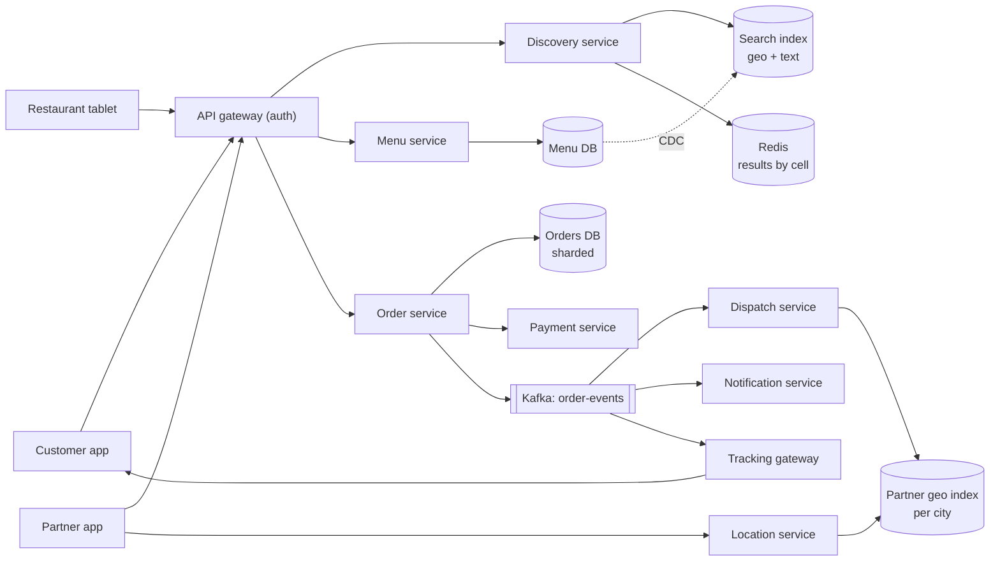
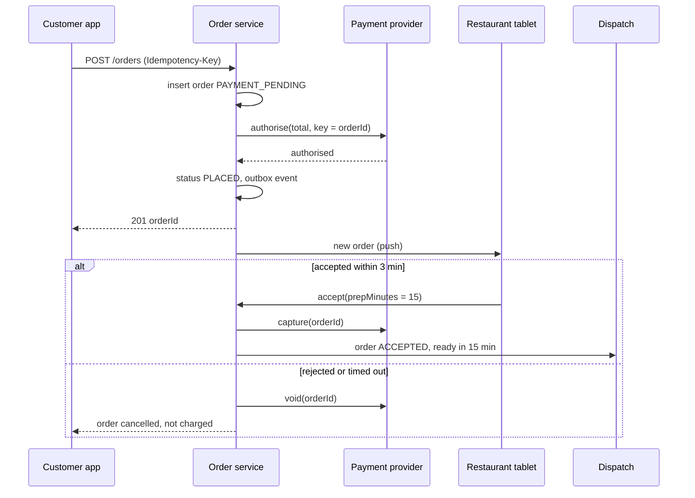

# Design a Food Delivery Platform (Swiggy, Zomato, DoorDash)

| | |
|---|---|
| **Asked at** | Common at consumer marketplace and logistics companies; a three-sided marketplace problem |
| **Difficulty** | Hard |
| **Core challenges** | geo discovery, order state across three parties, partner assignment, dinner peaks |
| **Related building blocks** | [`src/geohash`](../src/geohash/), [`src/inverted-index`](../src/inverted-index/), [`src/idempotency-store`](../src/idempotency-store/) |

The class-level design (order, cart, restaurant, delivery agent objects and their patterns) is in the [LLD food-delivery write-up](https://github.com/hardyalsinghdeora/low-level-design/blob/main/problems/food-delivery.md). This file covers the distributed system.

## 1. Requirements

### Functional
1. Customers discover restaurants that deliver to their location, by cuisine, dish name or restaurant name.
2. Customers see a menu with live item availability and prices, build a cart and place an order with online payment.
3. The restaurant accepts or rejects the order and reports when food is ready.
4. A delivery partner is assigned, picks up the order and delivers it.
5. The customer tracks the order and the partner's position live and gets notifications at each step.

### Non-functional
- Scale: 30 M orders per day, 300k active restaurants, 500k delivery partners online at dinner peak.
- Peaks: lunch and dinner hours carry most of the day's volume; the dinner hour peaks at about 4× the daily average.
- Latency: discovery results under 300 ms p99; order placement under 1 s excluding the payment provider.
- Consistency: an order is charged at most once and is never lost after payment. Menu availability and partner positions may be seconds stale.
- Availability: 99.95 % for ordering during peaks; discovery can degrade to cached results.

### Out of scope
- Restaurant onboarding, payouts and invoicing, the ML models for ETA and ranking (treated as services), grocery delivery, ratings.

## 2. Estimation

| Quantity | Estimate | Implication |
|---|---|---|
| Orders | 30 M / 86,400 s ≈ **350/s** average, dinner peak ~4× = **1,400/s** | Order writes are moderate; plan capacity for 1,400/s, not the average |
| Discovery reads | ~20 browse requests per order ≈ 600 M/day ≈ **7k/s**, peak ~**30k/s** | Read-heavy; cache results per area cell and serve from a search index |
| Menu reads | ~5 menu views per order → **150 M/day**, peak ~7k/s | Cache menus per restaurant; push availability changes instead of polling |
| Partner location writes | 500k partners / 5 s = **100k/s** | Same pattern as ride-hailing: in-memory geo index sharded by city |
| Order storage | 30 M × 3 KB (items, addresses, fees, status history) = **90 GB/day**, ~33 TB/year | Shard orders by order id; move closed orders to cheaper storage after 90 days |
| Menus | 300k restaurants × 150 items × 1 KB ≈ **45 GB** | Fits in a search cluster and a cache; source of truth in a document or relational store |
| Notifications | ~6 per order × 30 M = **180 M/day** | Goes through an async notification service, never on the order path |

## 3. API

```
GET  /v1/restaurants?lat=..&lng=..&q=biryani&cuisine=..&cursor=..
  200: { restaurants: [{ id, name, etaMinutes, deliveryFee, rating, isOpen }], nextCursor }

GET  /v1/restaurants/{id}/menu
  200: { categories: [{ items: [{ itemId, name, priceCents, available, options }] }], version }

POST /v1/carts/{cartId}/items            body: { itemId, qty, options }
POST /v1/orders                          headers: Idempotency-Key
  body: { cartId, addressId, paymentMethodId, tipCents }
  201: { orderId, status: PAYMENT_PENDING, totalCents }
  409: item unavailable or price changed (returns the new cart)

GET  /v1/orders/{orderId}                status, partner, ETA
WS   /v1/orders/{orderId}/track          status changes and partner position

-- restaurant side
POST /v1/merchant/orders/{orderId}/accept   body: { prepMinutes }
POST /v1/merchant/orders/{orderId}/reject   body: { reason }
POST /v1/merchant/orders/{orderId}/ready
PUT  /v1/merchant/items/{itemId}/availability   body: { available }

-- partner side
POST /v1/partner/location                body: { lat, lng, ts } (or over a WebSocket)
POST /v1/partner/tasks/{taskId}/accept | /picked-up | /delivered
```

`POST /v1/orders` requires an `Idempotency-Key`; the server stores `(customer_id, key) → order_id` so a retry after a timeout returns the same order instead of charging twice. The server re-prices the cart at checkout and returns 409 if anything changed. Lists are cursor-paginated. Customers, merchants and partners have separate token scopes, and merchant calls are checked against the restaurant the merchant owns.

## 4. Data model

```
restaurants (restaurant_id PK, name, lat, lng, geohash6, cuisines[], is_open, prep_time_p50, delivery_radius_m)
menu_items  (restaurant_id, item_id, name, price_cents, available, options JSON, PRIMARY KEY (restaurant_id, item_id))

orders (
  order_id       BIGINT PRIMARY KEY,      -- Snowflake id, shard key
  customer_id    BIGINT NOT NULL,
  restaurant_id  BIGINT NOT NULL,
  status         TEXT NOT NULL,           -- PAYMENT_PENDING, PLACED, ACCEPTED, READY, PICKED_UP, DELIVERED, CANCELLED
  items          JSONB NOT NULL,          -- snapshot of names and prices at checkout
  total_cents    BIGINT NOT NULL,
  partner_id     BIGINT NULL,
  version        INT NOT NULL,
  created_at, updated_at TIMESTAMPTZ
)
INDEX orders(customer_id, created_at DESC)
INDEX orders(restaurant_id, status)        -- merchant tablet: open orders

order_events   (order_id, seq, type, payload, ts)     -- audit and outbox source
idempotency    (customer_id, key, order_id, created_at)  -- TTL 24 h

-- search index document per restaurant
{ restaurant_id, name, cuisines, dish_names[], location: geo_point, is_open, rating, avg_prep }

-- live partner state: Redis GEO per city, plus partner:{id} HASH { status, current_tasks, lat, lng }
```

Store choice: orders need transactions with their events, so a relational database sharded by `order_id` (customer and restaurant lookups use secondary indexes on each shard plus a small lookup table, or a read model fed by events). Discovery needs geo filtering, full-text match on dish names and ranking in one query, which is what a search engine (Elasticsearch or OpenSearch) does well. The menu's source of truth is relational; the search index and menu cache are derived from it through change data capture. See [choosing a database](../fundamentals/choosing-a-database.md) and [search and indexing](../fundamentals/search-and-indexing.md).

## 5. High-level design



**Discover**: the app sends its location. Discovery turns it into a geohash cell, checks Redis for a cached result list for that cell and filter, and on a miss queries the search index with a geo filter (restaurants whose delivery radius covers the point), the text query and the ranking signals. ETA per restaurant comes from a prediction service and is added to the cached result.

**Order**: order service re-prices the cart from the menu service, writes the order as `PAYMENT_PENDING`, and calls payment. On payment success it moves the order to `PLACED` and emits an event. The restaurant tablet receives it over a push channel and accepts with a prep time. Dispatch consumes `ACCEPTED`, picks a partner, and the partner app gets a task. Each status change is an event that drives notifications and the tracking stream.

## 6. Deep dives

### 6.1 Restaurant discovery

Problem: the query is "open restaurants that deliver to me, matching 'biryani', ranked". It combines geo, text and ranking, at 30k/s peak.

Options:

1. **SQL with a geo index** plus `LIKE` on names. Cannot do relevance scoring on dish names and degrades under the peak.
2. **Search engine with a `geo_distance` filter**, text matching on restaurant and dish names, and a ranking function using distance, rating, prep time and promotions.
3. **Precomputed lists per cell.** For every geohash-6 cell (about 1.2 km × 0.6 km), a batch job stores the restaurants that deliver there. Very fast for the home feed, but no free-text search.

**Choice:** option 2 for search, option 3 as a cache for the unfiltered home feed. Home feed requests (most traffic) are served from Redis keyed by `cell + filters`, with a TTL of a minute so open/closed changes appear quickly. Search queries go to the index. When a restaurant closes or goes busy, the CDC event updates the index document and invalidates the cell keys it covers. See the [proximity service](./proximity-service.md) for the geo index choices.

### 6.2 Order placement and the restaurant acceptance flow

Problem: the order spans our database, an external payment provider and a restaurant that may not respond. A customer must never be charged for an order the restaurant never saw, and an order must never be lost after payment.

Options:

1. **Synchronous chain**: charge, then call the restaurant, then return. Ties order latency to the restaurant and fails badly when the tablet is offline.
2. **Saga with compensation**: authorise payment, place the order, wait for acceptance with a timeout, capture on accept, void the authorisation on reject or timeout.
3. **Charge first, refund on reject.** Simple, but refunds take days to reach the customer and cost fees.

**Choice:** option 2, as a [saga](https://github.com/hardyalsinghdeora/design-patterns/tree/main/src/modern/saga) driven by order events. Each step is a conditional state transition on the order row plus an outbox event, so retries are safe. The restaurant has 3 minutes to accept; the tablet gets the order over a persistent connection and, as a fallback, an automated phone call. A timeout auto-rejects and voids the hold.



### 6.3 Delivery partner assignment

Problem: assign a partner so they arrive at the restaurant when the food is ready, not 10 minutes early (wasted partner time) or late (cold food). At peak, partners are scarce.

Options:

1. **Nearest free partner at acceptance time.** Simple; partners often wait at the restaurant and the nearest partner is not always the best.
2. **Delayed assignment with ETA matching.** Use the predicted ready time (prep time model) and each candidate's travel ETA. Assign when `now + travel ETA ≈ ready time`, choosing among partners within a radius.
3. **Batched optimisation.** Every 30-60 s per zone, collect unassigned orders and available partners and solve an assignment that minimises total delay; allow one partner to carry two orders from the same or nearby restaurants going in the same direction.

**Choice:** option 3, with option 1 as the fallback when the optimiser is slow or down. Batching (two orders per partner) raises partner utilisation at peak, which is when supply is short. The optimiser only proposes; the assignment itself is a conditional update (`UPDATE tasks SET partner_id = ? WHERE task_id = ? AND partner_id IS NULL`) and a lease on the partner, the same guard as in [ride-hailing](./ride-hailing.md). The partner has 30 s to accept before the task returns to the pool.

### 6.4 Live tracking and notifications

The partner app sends its position every 5 s. The location service updates the geo index and, for partners with an active order, publishes to a per-order channel. The tracking gateway holds the customer's WebSocket (or Server-Sent Events) connection and forwards positions and status changes. When the app is in the background, status changes go as push notifications through the [notification service](./notification-system.md); positions are not sent then. If the WebSocket drops, the app polls `GET /orders/{id}` every 10 s. See [realtime communication](../fundamentals/realtime-communication.md).

### 6.5 Menu availability

Restaurants mark items out of stock during service. The menu service writes the change, invalidates the menu cache key for that restaurant, and CDC updates the search index. The cart is validated against current availability at checkout, so a stale cached menu leads to a 409 with the updated cart, not a wrong order. This keeps the cache simple (short TTL plus explicit invalidation) without needing strong consistency on reads.

## 7. Scaling and operations

- **Peak-hour scaling**: dinner traffic is predictable, so scale stateless services and search replicas on a schedule 30 minutes before the peak, with autoscaling on top. Load-test at 2× the previous record before festivals and sporting events.
- **Partitioning**: orders by `order_id` hash; partner geo and dispatch by city (and zone for large cities), so each dispatch worker owns a zone and its optimiser state. Search index sharded by region.
- **Replication**: orders DB with a synchronous standby per shard; search index with replicas sized for read QPS.
- **Load shedding**: under overload, drop expensive personalisation in discovery first, then serve cell-cached results only, and keep checkout and dispatch at full capacity. Use [bulkheads](https://github.com/hardyalsinghdeora/design-patterns/tree/main/src/modern/bulkhead) so a slow ETA service cannot exhaust order service threads.
- **Failure modes**: payment provider timeout → order stays `PAYMENT_PENDING` and a reconciler queries the provider by `orderId` before retrying or cancelling; restaurant tablet offline → phone fallback and auto-reject; dispatch optimiser down → nearest-partner fallback; Kafka lag → tracking shows the last known status, orders still progress.
- **Monitoring**: orders/min per city against forecast, payment success rate, restaurant acceptance time and rejection rate, time from ready to pickup, delivery ETA error, unassigned orders older than 5 minutes.
- **Abuse and security**: rate limits on order placement and coupon redemption, fraud scoring before payment, address and phone masking between customer and partner, merchant API scoped to their own restaurant.

## 8. Trade-offs summary

| Decision | Chosen | Alternative | Why |
|---|---|---|---|
| Discovery | Search engine plus cell cache | SQL geo query | Geo, text and ranking in one query; cache absorbs the home feed |
| Order flow | Saga: authorise, accept, capture | Charge then refund | Customer never charged for a rejected order |
| Partner assignment | Batched optimiser with nearest fallback | Nearest free partner | Better utilisation at peak; fallback keeps orders moving |
| Menu consistency | Cache with invalidation, validate at checkout | Strongly consistent reads | Stale reads are cheap to correct at checkout |
| Tracking | WebSocket with push and polling fallback | Polling only | Smooth tracking without 10× request volume |
| Sharding key | Orders by order_id, dispatch by city | Orders by city | Even write spread; dispatch needs locality, orders do not |

## 9. Follow-up questions interviewers ask

- *"How do you predict delivery ETA?"* Sum of three models: restaurant prep time (by restaurant, time of day, current queue), partner travel to restaurant, and travel to customer from routing with live traffic. Show a range, and update it as real events arrive.
- *"What if a restaurant gets 200 orders in 10 minutes?"* Throttle it: mark it busy in discovery when its open-order count passes a threshold, and raise its prep time estimate so ETAs stay honest.
- *"How do you avoid charging twice when the app retries?"* The idempotency key maps to one order, and the order id is the idempotency key at the payment provider.
- *"How would you batch two orders onto one partner?"* Only if the restaurants are close, the ready times are within a few minutes and the drop-offs lie in the same direction, so the first customer's delay stays under a fixed bound such as 5 minutes.
- *"Customer and restaurant need their order lists; orders are sharded by order_id. How?"* Maintain read models keyed by customer and by restaurant, fed from order events ([CQRS](https://github.com/hardyalsinghdeora/design-patterns/tree/main/src/modern/cqrs)); the merchant view of open orders is small and can live in Redis.
- *"What breaks first on a big cricket match night?"* Partner supply. Raise delivery fees in short-supply zones, shrink delivery radii so partners do short trips, and show honest ETAs instead of accepting orders that will be late.
