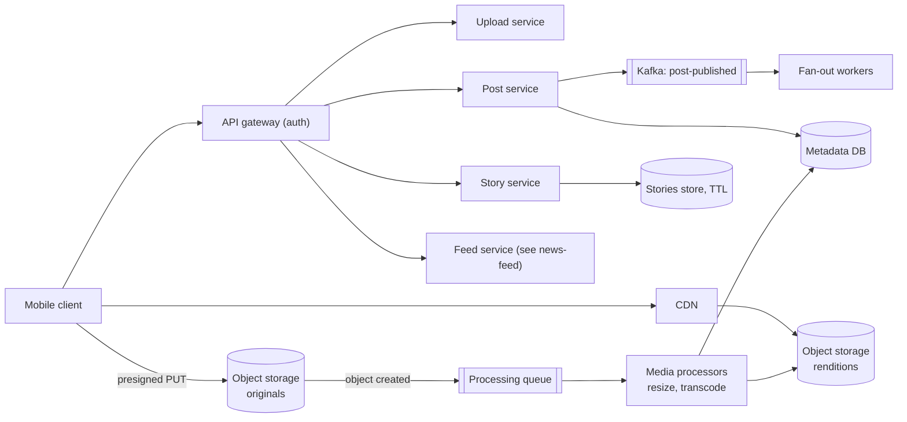
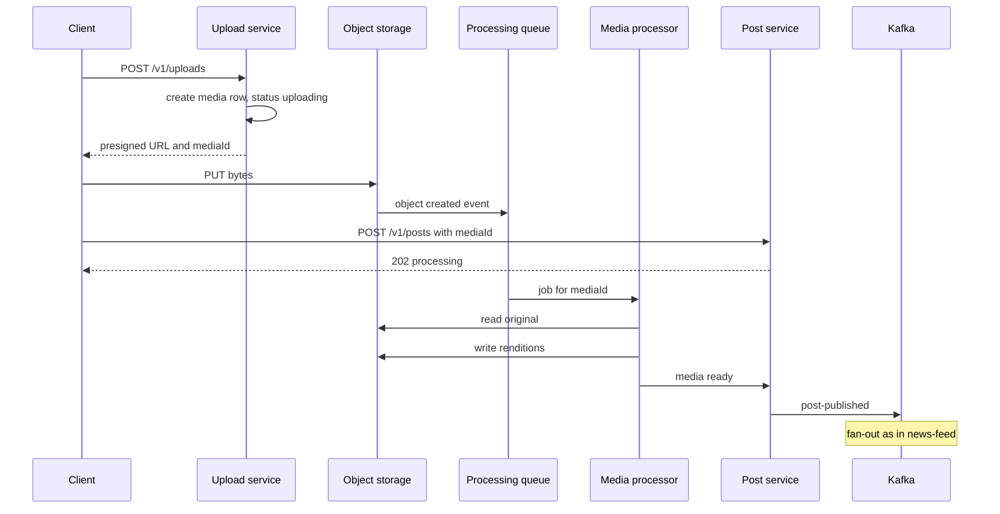

# Design Instagram (photo and video sharing)

| | |
|---|---|
| **Asked at** | Common at social, media and consumer companies; often paired with or substituted for the news feed |
| **Difficulty** | Medium |
| **Core challenges** | media upload and processing, CDN delivery, ephemeral stories, hot counters |
| **Related building blocks** | [`src/snowflake-id`](../src/snowflake-id/), [`src/hyperloglog`](../src/hyperloglog/), [`src/consistent-hash-ring`](../src/consistent-hash-ring/) |

Related: [news-feed](./news-feed.md) (feed generation is designed there and reused here), [video-streaming](./video-streaming.md), [CDN and blob storage](../fundamentals/cdn-and-blob-storage.md), [distributed-counter](./distributed-counter.md), [event-driven architecture](../fundamentals/event-driven-architecture.md).

## 1. Requirements

### Functional
1. Upload a photo or short video with a caption; it is published to the user's profile and followers' feeds.
2. Follow and unfollow users; public and private accounts.
3. Home feed of posts from followed accounts (reusing the [news-feed](./news-feed.md) design).
4. Stories: photos or videos visible to followers for 24 hours, with a viewer list.
5. Like and comment on posts; show counts.
6. Explore page with recommended posts from accounts the user does not follow (brief).

### Non-functional
- Scale: 500 M DAU, 100 M uploads/day (posts plus stories).
- Latency: feed first page p99 under 300 ms; images start rendering in under 200 ms on a good network.
- Upload: the post appears on the author's profile within ~10 s of upload completing; large videos may take longer to be fully processed.
- Durability: uploaded media is never lost (11 nines object storage); counters may lag.
- Availability: 99.95 % for viewing; uploads can degrade briefly.

### Out of scope
- Direct messages ([chat-system](./chat-system.md)), live video, ads, shopping, the ranking models.

## 2. Estimation

| Quantity | Estimate | Implication |
|---|---|---|
| Uploads | 100 M/day ≈ **1,150/s**, peak ~3,500/s | Upload bytes must bypass app servers (presigned URLs) |
| Upload bytes | 90 M photos × 3 MB + 10 M videos × 30 MB ≈ **570 TB/day** in | Ingest bandwidth ~50 Gbps average straight into object storage |
| Stored renditions | photo originals plus ~4 sizes (~1 MB total); video ~3 renditions | Originals plus renditions ≈ **~200 PB/year**; tier originals to cold storage after 30 days |
| Media views | 500 M × 150 images or clips/day = 75 B/day ≈ **870k/s** | Only a CDN can serve this; origin should see a few percent |
| Origin egress | 3 % CDN miss × 870k/s × 200 KB ≈ **5 GB/s** | Origin shield tier in front of object storage |
| Metadata | 100 M posts × 1 KB = 100 GB/day ≈ **36 TB/year** | Sharded metadata store, partitioned by media id |
| Stories | ~50 % of uploads, all expire in 24 h | Live story set is ~50 M stories at any time; fits a TTL store |

## 3. API

```
POST /v1/uploads                       body: { type: "photo"|"video", sizeBytes, contentType }
  201: { uploadId, uploadUrl (presigned PUT, 15 min), mediaId }

POST /v1/posts                         headers: Idempotency-Key
  body: { mediaIds: [..], caption, location? }
  202: { postId, status: "processing" }        becomes "published" when renditions exist

POST /v1/stories                       body: { mediaId }     202: { storyId, expiresAt }
GET  /v1/stories/tray                  accounts with unseen active stories, ordered
GET  /v1/stories/{userId}              active stories of one account
POST /v1/stories/{storyId}/views       204 (idempotent per viewer)

GET  /v1/feed?cursor=...&limit=20      see news-feed
GET  /v1/users/{id}/posts?cursor=...   profile grid
POST /v1/posts/{id}/likes              204 idempotent
GET  /v1/explore?cursor=...
```

`Idempotency-Key` on post creation prevents duplicate posts when the app retries after a timeout. The presigned URL is scoped to one object key, one content type and a maximum size, so a client cannot overwrite another user's media. All lists use opaque cursors. Private accounts are enforced at read time: the feed, profile and story endpoints check the follow edge before returning media URLs.

## 4. Data model

```
media    (media_id PK, owner_id, type, status: uploading|processing|ready|failed,
          original_key, renditions JSON {"1080": key, "640": key, "thumb": key, "hls": key},
          width, height, duration_ms, created_at)
posts    (post_id PK, owner_id, media_ids[], caption, created_at, visibility)
user_posts (owner_id, post_id DESC)                 -- profile grid
follows / followers                                 -- both directions, as in news-feed
stories  (owner_id, story_id, media_id, created_at, expires_at)  TTL 24 h
story_views (story_id, viewer_id, viewed_at)        TTL 48 h
likes    (post_id, user_id) PK; counters (post_id, like_count, comment_count)
comments (post_id, comment_id DESC, author_id, text)
```

Store choices:
- **Media and post metadata** in a sharded relational store or a wide-column store keyed by id. Lookups are by primary key and by owner; both are single-shard queries.
- **Media bytes** in object storage (S3-style). Object keys contain the media id and rendition, and objects are immutable: an edited photo is a new object. Immutability is what lets the CDN cache forever.
- **Stories** in a store with native TTL (Cassandra TTL or Redis with expiry), because every row dies after a day and deleting 50 M rows a day by hand is wasteful.
- Ids are Snowflake-style so profile grids sort by id.

## 5. High-level design



**Upload and publish**: the client asks the upload service for a presigned URL and uploads the bytes directly to object storage. The bucket emits an object-created event; a media processor generates renditions and marks the media `ready`. The client calls `POST /v1/posts` (it can do so before processing finishes); the post service writes the post and, once all its media is `ready`, publishes `post-published`. Fan-out then follows the [news-feed](./news-feed.md) hybrid design.

**View**: the feed service returns post metadata with CDN URLs for the rendition that suits the device (`/m/{mediaId}/640.webp`). The client fetches images from the nearest CDN edge; misses go through an origin shield to the renditions bucket.

## 6. Deep dives

### 6.1 Upload and asynchronous processing

Problem: uploads are large, mobile networks are unreliable, and every photo needs several renditions before it can be shown.

Options:
1. **Upload through the API servers**, process synchronously. Simple, but app servers spend their time on bytes and a 30 MB video holds a request open for a minute.
2. **Presigned direct upload plus a processing queue.** App servers handle only small metadata calls; processing is retried independently.
3. **Client-side processing only** (the phone uploads all renditions). Saves server CPU but trusts the client, multiplies upload bytes on cellular, and still needs server-side validation.

**Choice: option 2, with light client-side compression.** The app resizes a photo to at most ~1080 px wide before upload (it never displays larger), which cuts upload bytes; the server still produces the canonical renditions and strips EXIF location metadata. Videos use multipart or resumable upload so a dropped connection resumes from the last part.



Processing jobs are idempotent: output keys are derived from `mediaId` and rendition name, so a retried job overwrites the same objects. A job that fails three times marks the media `failed` and the client is told to retry. Photos take well under a second to process; videos are chunked and transcoded in parallel as in [video-streaming](./video-streaming.md).

### 6.2 Serving media through the CDN

- **Immutable URLs.** Because objects never change, the CDN uses a cache lifetime of a year, and the hit ratio depends only on popularity. Deleting a post removes the metadata; a CDN purge is issued for the object so it disappears from the edge promptly.
- **Rendition choice.** The API returns the size that fits the device screen; the client never downloads a 1080 px image for a 300 px grid tile. Modern formats (WebP, AVIF) are chosen by `Accept` header at the edge, which needs the format to be part of the cache key.
- **Origin shield.** A regional mid-tier cache between edges and object storage collapses misses from many edges into one origin request.
- **Private accounts.** URLs for private media carry a signed token with a short expiry; the CDN validates the signature at the edge. The object itself is the same; only access is gated.

### 6.3 Stories with a 24-hour expiry

Problem: stories must vanish exactly a day after posting, the story tray must load fast, and every view must be recorded for the author's viewer list.

| Option | Expiry mechanism | Weakness |
|---|---|---|
| Normal table plus a cleanup cron | Nightly delete of `expires_at < now` | Stories visible up to a day too long unless every read also filters |
| **TTL store plus read-time filter** | Row TTL; reads also filter by `expires_at` | Media objects still need their own lifecycle |
| Redis only | Key expiry | Durability; story media metadata would be lost on failover |

**Choice: TTL store with a read-time filter.** Stories rows are written with a 24 h TTL; reads add `expires_at > now` so a row the store has not yet compacted away is still hidden. Media objects for stories are written under a prefix with an object lifecycle rule that moves them to the author's private archive (or deletes them) after a day.

The **story tray** is a feed of accounts rather than posts: when a user posts a story, fan-out writes the author id into followers' `tray:{user}` sorted set scored by time (celebrity authors are pulled, as in news-feed). Reading the tray removes authors whose stories have all expired or been seen. **View tracking** writes `story_views` asynchronously through a queue; the viewer count uses an exact count for small audiences and a [HyperLogLog](../src/hyperloglog/) for very large ones, while the viewer list itself is paged from `story_views`.

### 6.4 Like and comment counters on hot posts

A post from a very popular account can draw tens of thousands of likes per second. The `likes` table (post_id, user_id) gives idempotency and "liked by me". The displayed count is maintained asynchronously: like events are aggregated per post every few seconds and applied as one increment, with the Redis counter for very hot posts split across shards and summed on read. Comments are stored per post with newest-first clustering, and the first page is cached for hot posts. Details: [distributed-counter](./distributed-counter.md).

### 6.5 Explore (brief)

Explore recommends posts from accounts the user does not follow. Candidate generation runs offline and nearline (posts similar to ones the user engaged with, posts popular in their interest clusters), producing a few thousand candidates per user per day; a ranking service scores them online like the feed's ranking stage. The serving infrastructure is the same as the feed's (candidates, features, ranking, hydration); only the candidate source differs. Integrity filters remove borderline content more strictly here because the user did not choose to follow the source.

## 7. Scaling and operations

- **Partitioning**: metadata by media or post id; profile grids by owner id; stories by owner id; feed and tray caches by viewer id with consistent hashing.
- **Replication**: object storage is replicated by the provider across zones; metadata RF 3; feed caches are rebuildable.
- **Storage tiering**: originals move to infrequent-access storage after 30 days; renditions stay hot because they are what the CDN fetches. Popular content is almost all recent, so tiering by age loses little.
- **Failure modes**: processing backlog → posts stay "processing" longer, author is told; CDN region issue → DNS steering to another CDN or region; metadata shard down → affected profiles fail, feeds still serve other posts; Kafka lag → delayed fan-out.
- **Monitoring**: upload success rate by network type, time from upload to ready (p50, p99), processing queue depth, CDN hit ratio and origin egress, feed p99, story expiry correctness (sample check that no story older than 24 h is served).
- **Abuse and security**: content classifiers run in the processing pipeline before `post-published` (nudity, violence, known-bad hashes); rate limits on uploads, follows, likes and comments; EXIF stripping; signed URLs for private media.

## 8. Trade-offs summary

| Decision | Chosen | Alternative | Why |
|---|---|---|---|
| Upload path | Presigned direct to object storage | Through API servers | App servers handle metadata only; uploads scale with storage |
| Processing | Async queue, idempotent jobs | Synchronous in request | Retries are isolated; slow videos do not block publishing |
| Media URLs | Immutable, long CDN TTL | Mutable keys with purges | Maximum cache hit ratio; edits create new objects |
| Story expiry | Row TTL plus read filter | Cron cleanup | Exact visibility window without delete storms |
| Story viewer count | Exact, HyperLogLog for huge audiences | Always exact | Bounded memory for celebrity stories |
| Feed | Reuse hybrid fan-out | Separate design | One feed system for posts; trays use the same machinery |

## 9. Follow-up questions interviewers ask

- *"What if the user posts before processing finishes?"* The post is accepted with status `processing` and shown only to the author with a spinner; fan-out happens when media is ready.
- *"How do you delete a photo everywhere?"* Mark the post deleted in metadata (reads stop immediately), purge the CDN URLs, then delete objects asynchronously; feed lists drop the id at hydration.
- *"How do you avoid storing duplicates of the same viral image?"* Hash uploads; if the content hash already exists, point the new media row at existing renditions. Saves storage but complicates deletion (reference counts).
- *"How do you serve users on slow networks?"* Smaller renditions, progressive formats, a tiny blurred placeholder in the API response so the layout renders before the image arrives.
- *"How do you show 'liked by a friend' on a post?"* At hydration, intersect the post's recent likers with the viewer's followees; cache the result for popular posts.
- *"How would you add Reels (short video)?"* Same upload and transcoding pipeline as video-streaming with adaptive bitrate segments, plus a recommendation-driven feed like Explore.
