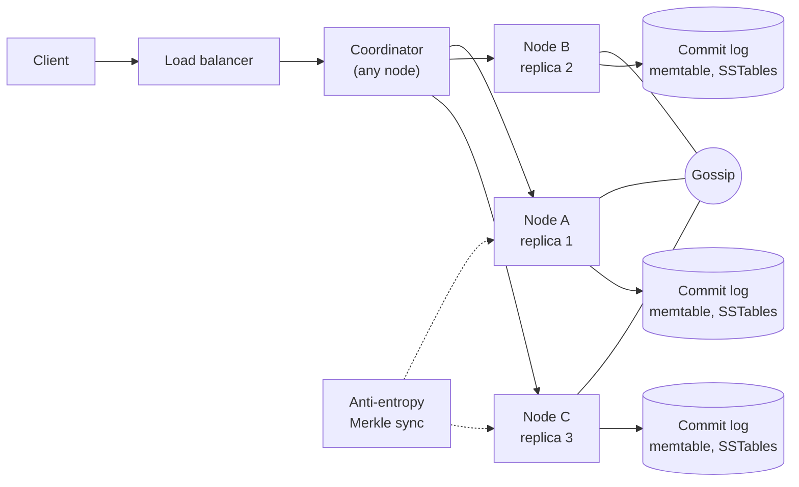
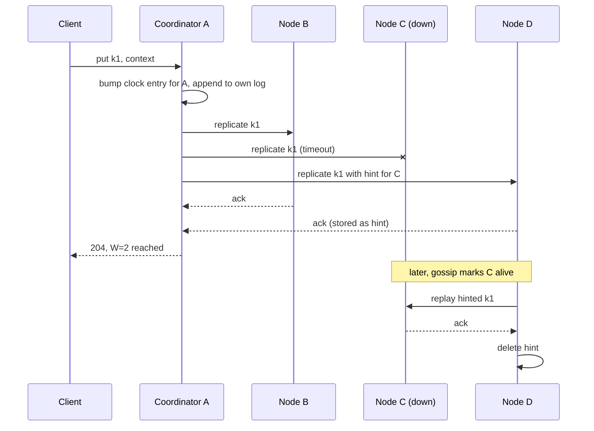

# Design a Distributed Key-Value Store (Dynamo, Cassandra, Riak)

| | |
|---|---|
| **Asked at** | Common in infrastructure and senior backend loops; the classic test of distributed-systems fundamentals |
| **Difficulty** | Hard |
| **Core challenges** | partitioning, tunable consistency, conflict resolution, failure handling |
| **Related building blocks** | [`src/consistent-hash-ring`](../src/consistent-hash-ring/), [`src/quorum-kv`](../src/quorum-kv/), [`src/merkle-tree`](../src/merkle-tree/), [`src/vector-clock`](../src/vector-clock/), [`src/lsm-tree`](../src/lsm-tree/), [`src/bloom-filter`](../src/bloom-filter/) |

Concepts: [consistent hashing](../fundamentals/consistent-hashing.md), [replication](../fundamentals/replication.md), [consistency models](../fundamentals/consistency-models.md), [storage engines](../fundamentals/storage-engines.md).

## 1. Requirements

### Functional
1. `put(key, value)` and `get(key)` for keys up to 256 B and values up to 1 MB (typical value ~1 KB).
2. `delete(key)`.
3. Per-request consistency level: the caller chooses how many replicas must answer (`ONE`, `QUORUM`, `ALL`).
4. Concurrent writes to the same key are detected and either merged or returned to the caller as siblings.

### Non-functional
- 100k writes/s and 300k reads/s at peak; 10 B keys.
- p99 under 10 ms for reads and writes at `QUORUM` within one datacenter.
- "Always writable": a write succeeds as long as any N healthy nodes are reachable, even during node failures and partitions (AP in CAP terms, see [CAP and PACELC](../fundamentals/cap-and-pacelc.md)).
- Durability: an acknowledged write survives the loss of any single node.
- Adding or removing a node moves only about 1/N of the data and needs no downtime.

### Out of scope
- Range scans across keys, secondary indexes, multi-key transactions.
- Cross-datacenter replication details beyond a mention.

## 2. Estimation

| Quantity | Estimate | Implication |
|---|---|---|
| Raw data | 10 B keys × ~1 KB ≈ **10 TB** | Far beyond one machine; must partition |
| Replicated | 10 TB × N=3 = **30 TB**, × ~1.5 LSM space amplification ≈ **45 TB** | At ~2 TB usable SSD per node, ~25 nodes for capacity; plan 40 for headroom and ops load |
| Replica writes | 100k writes/s × 3 replicas = **300k/s** | ~7.5k replica writes/s per node across 40 nodes; LSM sequential writes handle this easily |
| Replica reads | 300k reads/s × R=2 = **600k/s** | ~15k reads/s per node; hot data must sit in the block cache, cold reads hit SSD |
| Network | 300k × 1 KB writes + 600k × 1 KB reads ≈ **0.9 GB/s** cluster-wide | ~25 MB/s per node, well within 10 Gbit NICs |
| Virtual nodes | 40 nodes × 256 vnodes ≈ **10k tokens** | Ring metadata is tiny (fits in every node's memory and gossip state) |
| Merkle tree | depth 15 → 32k leaves per range | One leaf covers ~10k keys per range; a mismatch syncs only those keys |

## 3. API

```
PUT /v1/kv/{key}?w=QUORUM
  headers: X-Context: <opaque vector clock from a previous GET>   (omit for a blind write)
  body: <bytes>
  204, or 503 if fewer than W replicas acknowledged

GET /v1/kv/{key}?r=QUORUM
  200: body + X-Context: <vector clock>
  300 Multiple Choices: [{ value, context }, ...]   (concurrent siblings; client merges and writes back)
  404

DELETE /v1/kv/{key}?w=QUORUM
  headers: X-Context: <vector clock>
  204   (writes a tombstone)
```

Idempotency: a put with the same context and value is a no-op on replicas that already have that version, so client retries are safe. There is no pagination (no range scans). Auth is per-tenant credentials at the coordinator; keys are prefixed by tenant id internally.

## 4. Data model

```
Logical record on every replica:
  key           bytes
  value         bytes | tombstone
  clock         vector clock: [(node_id, counter), ...]   -- truncated to the 10 most recent entries
  written_at    timestamp                                  -- for tombstone GC and LWW fallback

On disk (per node, per vnode range):
  commit log    append-only, fsync batched every few ms
  memtable      sorted in memory (skip list), ~64 MB
  SSTables      immutable sorted files + sparse index + Bloom filter per file

Cluster metadata (gossiped, every node holds a copy):
  ring: [(token, node_id)], node states, schema version
```

Keys: the partition key is `hash(key)` (e.g. MurmurHash3 or MD5 truncated to 64/128 bits) placed on the ring. There are no secondary indexes. Store choice: an LSM tree is the engine because the workload is write-heavy and LSM turns random writes into sequential appends; Bloom filters keep reads from touching every SSTable. A B-tree engine (InnoDB style) would update pages in place and pay random I/O per write.

## 5. High-level design



Every node is identical: it stores data and can act as coordinator. There is no master.

**Write path**: client → any node (or a token-aware client goes straight to a replica) → coordinator hashes the key and walks the ring clockwise to find the first N distinct physical nodes (the preference list) → increments its own entry in the vector clock → sends the write to all N → each replica appends to its commit log, inserts into the memtable, and acks → coordinator returns success after W acks.

**Read path**: coordinator sends the read to all N replicas (or R of them plus a digest request to the rest) → waits for R responses → compares clocks: if one version descends from the others, return it and send it to stale replicas (read repair); if versions are concurrent, return all siblings. On each replica a read checks the memtable, then SSTables from newest to oldest, skipping files whose Bloom filter says "not present".

## 6. Deep dives

### 6.1 Partitioning with consistent hashing and virtual nodes

Problem: `hash(key) mod nodes` remaps almost every key when a node joins.

Options:
1. **Modulo hashing.** Simple, but a membership change moves ~all data.
2. **Consistent hashing, one token per node.** A join moves only the neighbour's range, but load is uneven and a new node takes load from just one neighbour.
3. **Consistent hashing with virtual nodes.** Each physical node owns ~256 tokens spread around the ring.

**Choice:** virtual nodes. Load evens out (standard deviation shrinks as vnodes grow), a joining node takes small slices from every node in parallel, and a stronger machine can get more vnodes. The preference list skips vnodes on the same physical node, and ideally the same rack, so N replicas are on N different machines. See [`src/consistent-hash-ring`](../src/consistent-hash-ring/).

### 6.2 Tunable quorums

With N replicas, a write waits for W acks and a read for R responses. If `R + W > N`, every read set overlaps every write set in at least one replica, so a read sees the latest acknowledged write (absent sloppy quorum, below).

| Setting (N=3) | Behaviour | Use |
|---|---|---|
| W=1, R=1 | Fastest, may read stale | Caches, metrics |
| W=2, R=2 | Overlap guaranteed, tolerates one slow or down replica | Default |
| W=3, R=1 | Fast reads, writes fail if any replica is down | Read-heavy, rarely written |
| W=1, R=3 | Fast writes, slow reads | Write-heavy logs |

**Choice:** `QUORUM` (2 of 3) by default and let callers override. Quorums give overlap, not linearizability: concurrent writes and partial failures can still produce conflicting versions, which is why we need versioning. The [`src/quorum-kv`](../src/quorum-kv/) block demonstrates the overlap property.

### 6.3 Versioning and conflict resolution

Problem: during a partition, two clients write the same key on different replicas. Both writes succeeded. Which one wins?

Options:
1. **Last write wins (LWW) by timestamp.** Simple, used by Cassandra. Silently drops one of two concurrent writes, and clock skew can make an older write win.
2. **Vector clocks.** Each version carries `[(node, counter)]`. Version A descends from B if every counter in A is at least the one in B; otherwise they are concurrent and both are kept as siblings.
3. **CRDTs.** Data types whose merge is defined (counters, sets, maps). No siblings reach the client, but only for those types.

**Choice:** vector clocks with client-side merge, as in the Dynamo paper's shopping cart: the client reads siblings, merges them (e.g. union of cart items), and writes back with the combined context, which supersedes both. Offer LWW as a per-table option for data where losing a concurrent write is fine. Clocks are truncated to a fixed size; truncation can turn a descendant into a false conflict, which costs a merge, never data loss. See [`src/vector-clock`](../src/vector-clock/).

### 6.4 Sloppy quorum and hinted handoff

Problem: replica C for a key is down. With a strict quorum, a write needing W=3 fails, and even W=2 becomes fragile if a second node is slow.

**Approach:** the coordinator sends C's copy to the next healthy node on the ring (D), tagged with a hint "this belongs to C". D stores it in a hints table and counts it toward W. When gossip reports C alive again, D replays the hints to C and deletes them. This keeps writes available during failures. The cost: with sloppy quorum, R and W sets may no longer overlap (if a partition cuts the coordinator off from A, B and C, the write lands on D, E and F, while a reader on the other side still queries A, B and C), so `R + W > N` is no longer a strict guarantee during failures. Hints expire after a few hours; longer outages are repaired by anti-entropy.



### 6.5 Anti-entropy with Merkle trees and gossip membership

Problem: hints expire, read repair only fixes keys that are read. Replicas drift for cold keys.

**Merkle trees**: each node builds a hash tree per token range: leaves hash buckets of keys, parents hash their children. Two replicas compare roots; if equal, the range is in sync with one message. If not, they walk down only the differing subtrees and exchange just the keys in mismatched leaves. Run it as a background repair, throttled. See [`src/merkle-tree`](../src/merkle-tree/).

**Gossip membership**: every second each node sends its membership view (node, heartbeat counter, state) to a few random peers; views merge by taking the higher heartbeat. Information reaches all nodes in O(log nodes) rounds. Failure detection uses a phi accrual detector (as in Cassandra): instead of a fixed timeout, it computes suspicion from the observed heartbeat interval distribution, so a node on a noisy network is not flapped. A suspected node is only routed around; it is removed from the ring only by an operator or after a long timeout, so a temporary failure does not trigger a full data move.

## 7. Scaling and operations

- **Partitioning**: add nodes by assigning them vnodes; they stream ranges from current owners while the old owners keep serving. Throttle streaming so it does not hurt p99.
- **Replication**: N=3 with rack-aware placement. For multi-datacenter, replicate per datacenter (e.g. 3 + 3) and offer `LOCAL_QUORUM` so a read does not wait on a remote region.
- **Caching**: each node has a block cache for SSTable blocks and an optional row cache for hot keys. Bloom filters (~10 bits per key for ~1 % false positives) stay in memory; 10 B keys × 3 replicas × 10 bits ≈ 37 GB cluster-wide, under 1 GB per node.
- **Compaction**: size-tiered for write-heavy tables, leveled for read-heavy ones (fewer SSTables per read, more write amplification). Tombstones are kept for a grace period longer than the repair interval, or a deleted value can be resurrected by a replica that missed the delete.
- **Failure modes**: node down → sloppy quorum and hints; disk corrupt → checksum per block, rebuild from replicas; network partition → both sides accept writes, vector clocks surface conflicts after heal; hot key → one replica set overloaded, mitigate with client-side caching or splitting the value.
- **Monitoring**: p99 per consistency level, pending hints, read-repair rate, sibling rate (high means many concurrent writers), compaction backlog, SSTables per read, gossip convergence time, disk usage per node.
- **Security**: TLS between nodes and from clients, per-tenant auth at the coordinator, encryption at rest for SSTables and commit logs.

## 8. Trade-offs summary

| Decision | Chosen | Alternative | Why |
|---|---|---|---|
| Topology | Leaderless, every node equal | Leader per partition (Raft) | Always writable; no failover pause |
| Partitioning | Consistent hashing, 256 vnodes | Range partitioning | Even load, small moves; range scans not required |
| Consistency | Tunable R/W, default 2/2 of 3 | Strong consistency via consensus | Caller picks latency vs freshness per request |
| Conflicts | Vector clocks + client merge | LWW | No silent loss of concurrent writes |
| Failure handling | Sloppy quorum + hinted handoff | Strict quorum | Writes stay available when replicas are down |
| Repair | Merkle tree anti-entropy | Full data comparison | Sync cost proportional to the difference |
| Engine | LSM tree + Bloom filters | B-tree | Write-heavy workload, sequential I/O |

## 9. Follow-up questions interviewers ask

- *"Does R + W > N give you linearizability?"* No. Sloppy quorum breaks overlap during failures, and even with strict quorums a read concurrent with a write can see the new value on one read and the old on the next. Linearizable operations need consensus (Paxos or Raft), as Cassandra does for its lightweight transactions.
- *"How would you support compare-and-set?"* Run a consensus round among the key's replicas for that operation only. It costs several round trips, so expose it as a separate, slower API.
- *"How do deletes work if replicas can be down?"* A delete writes a tombstone with a clock. Tombstones are dropped only after a grace period longer than the maximum repair interval; dropping earlier lets a stale replica resurrect the value.
- *"How do you add a node without hurting latency?"* Give it vnodes gradually, stream ranges with a bandwidth cap, and only switch reads to it once streaming for a range has finished.
- *"What happens with a very hot key?"* All its traffic lands on N nodes. Cache it in the client or coordinator, or have the application shard the value into sub-keys.
- *"Why not use Raft per partition instead?"* It gives strong consistency and simpler reasoning, but a partition with a lost leader is unwritable until election finishes, and every write goes through one node. Choose it when correctness beats availability, as in etcd or Spanner-style systems.
