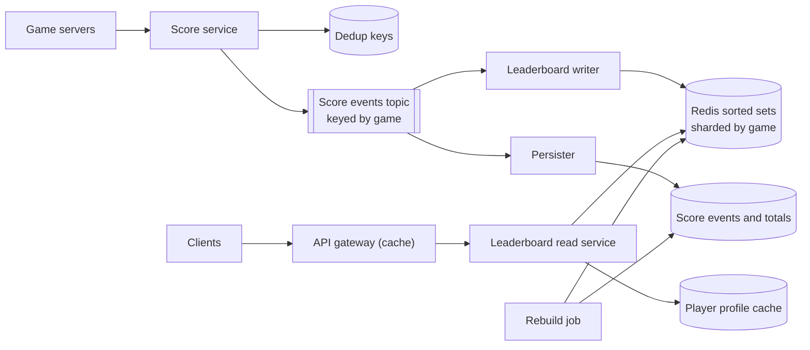
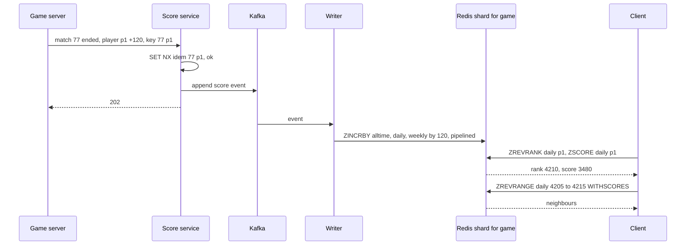

# Design a Real-time Leaderboard

| | |
|---|---|
| **Asked at** | Gaming, fitness, e-learning and contest platforms; a common medium problem and a standard Redis sorted-set question |
| **Difficulty** | Medium |
| **Core challenges** | rank queries at scale, ties, time windows, sharding a global ranking |
| **Related building blocks** | [`src/consistent-hash-ring`](../src/consistent-hash-ring/), [`src/idempotency-store`](../src/idempotency-store/) |

## 1. Requirements

### Functional
1. Players earn points when a match ends; the game server submits the score change.
2. Show the top N players (top 10, top 100) for a game, live.
3. Show a single player's rank and score, and the players just above and below them.
4. Daily, weekly and all-time leaderboards per game; daily and weekly reset on a schedule.
5. Optional: leaderboards scoped to a region or a friends list.

### Non-functional
- 50 M daily active players, 100 M players on the largest all-time board.
- Score updates visible on the leaderboard within 1 s; reads p99 under 50 ms.
- Ranks must be correct for the top of the board; deep ranks ("you are #3,214,876") may be approximate if stated.
- Score submissions must not be lost or applied twice, and cannot be forged by clients.
- 99.9 % availability for reads; writes may queue briefly.

### Out of scope
- Matchmaking, anti-cheat models beyond server-side validation, rewards payout, chat.

## 2. Estimation

| Quantity | Estimate | Implication |
|---|---|---|
| Score updates | 50 M × 10 matches = 500 M/day ≈ **5,800/s**, peak ~50k/s | Each update is an O(log N) sorted-set operation; one Redis node handles on the order of 100k such ops/s |
| Redis writes | 3 boards per update (daily, weekly, all-time) ≈ **17k/s**, peak ~150k/s | Peak exceeds one node; shard by game, and pipeline the three writes |
| Rank reads | one rank + top 10 after each match ≈ **12k/s**, plus browsing ~20k/s | Top-N is cacheable for a second; rank reads go to Redis directly |
| Sorted-set memory | 100 M members × ~100 B (skiplist node, hash entry, member string) ≈ **10 GB** | One large all-time board fits on one node; many games need a cluster |
| Daily boards | ~50 M active players per day across games ≈ **5 GB/day**, kept 7 days | Expire old keys automatically |
| Durable score events | 500 M × 100 B = **50 GB/day** | Event log in Kafka and a wide-column store; the source for rebuilding Redis |
| `ZREVRANK` cost | log2(100 M) ≈ **27** skiplist levels | Microseconds per rank query even on the largest board |

## 3. API

```
POST /v1/games/{gameId}/scores                (game server only, mTLS or signed service token)
  headers: Idempotency-Key: <matchId>:<playerId>
  body: { playerId, delta: 120, matchId, endedAt }
  202 Accepted

GET  /v1/games/{gameId}/leaderboards/{window}/top?limit=10          window = daily | weekly | alltime
  200: { asOf, entries: [{ rank, playerId, name, score }] }
GET  /v1/games/{gameId}/leaderboards/{window}/players/{playerId}?around=5
  200: { rank, score, neighbours: [{ rank, playerId, score }] }
GET  /v1/games/{gameId}/leaderboards/{window}/top?cursor=<rank>&limit=100      paging by rank
GET  /v1/games/{gameId}/leaderboards/friends?playerId=...
```

- **Idempotency**: the key `matchId:playerId` ensures a retried submission does not add points twice (`ZINCRBY` is not idempotent on its own).
- **Pagination**: by rank offset, which is natural for sorted sets (`ZREVRANGE key start stop`); offsets are cheap here because skiplist rank lookups are O(log N).
- **Auth**: only game servers submit scores; clients never send scores directly. Reads are public or per-player authenticated.

## 4. Data model

```
Redis (serving):
  lb:{game}:alltime                    sorted set  member = playerId, score = points
  lb:{game}:daily:2026-11-07           sorted set  EXPIRE 8 days
  lb:{game}:weekly:2026-W45            sorted set  EXPIRE 5 weeks
  player:{playerId}                    hash        name, avatar, region   (for rendering entries)
  idem:{matchId}:{playerId}            string      SET NX EX 86400        (dedup of submissions)

Durable:
  score_events (game_id, player_id, match_id, delta, ended_at,
                PRIMARY KEY ((game_id, player_id), match_id))                -- wide-column; dedup by key
  player_totals (game_id, window, window_id, player_id, score, updated_at)    -- snapshot for rebuilds
```

Store choice: **Redis sorted sets** for serving: `ZINCRBY` and `ZREVRANK` are O(log N), `ZREVRANGE` for top N is O(log N + N), and the whole board lives in memory. A **wide-column store** (Cassandra, DynamoDB) holds score events keyed by `(game, player, match)`, which doubles as deduplication and as the source of truth for rebuilding Redis. A relational database would struggle to answer "rank of player X among 100 M" quickly: it needs a count of rows with a higher score, an index range scan that grows with rank.

## 5. High-level design



**Write**: game server → score service (auth, validate the match result exists and the delta is plausible, dedup on `matchId:playerId`) → Kafka. The leaderboard writer consumes and runs a pipeline of `ZINCRBY lb:{game}:alltime`, `ZINCRBY lb:{game}:daily:{date}`, `ZINCRBY lb:{game}:weekly:{week}` with `EXPIRE` on the windowed keys. The persister writes the same event to the durable store.

**Top N**: client → gateway (cached 1 s for popular boards) → read service → `ZREVRANGE lb:{game}:daily:{date} 0 9 WITHSCORES` → join names from the profile cache.

**My rank**: `ZREVRANK` and `ZSCORE` for the player, then `ZREVRANGE` from rank-5 to rank+5 for neighbours. Three O(log N) calls, under a millisecond in Redis.

## 6. Deep dives

### 6.1 Top N vs a single player's rank

Problem: top N is easy in almost any store; "what is my rank among 100 M" is the hard query.

Options:
1. **SQL** `SELECT COUNT(*) FROM scores WHERE game = :g AND score > :mine`. With an index on `(game, score)` it is a range count, but cost grows with the number of players ahead; for a mid-ranked player that is tens of millions of index entries per query.
2. **Redis sorted set** `ZREVRANK`. A skiplist with span counts gives rank in O(log N) regardless of position.
3. **Precomputed ranks** by a batch job every few minutes. Cheap reads, stale ranks.

**Choice: 2 for the live boards, 3 as a fallback** for very old or huge archival boards. Top N is additionally cached at the gateway for a second, because millions of clients asking for the same top 10 is the hottest read.

### 6.2 Ties

Redis orders members with equal scores lexicographically by member id, which is arbitrary from a player's point of view. Options:

1. **Accept lexicographic order.** Simple; looks random.
2. **Composite score**: encode the tie-breaker into the score. Sorted-set scores are IEEE doubles, which hold integers exactly up to 2^53. Use `score = points × 2^32 + (2^32 - 1 - secondsSinceSeasonStart)`, so higher points win, and among equal points whoever reached it first ranks higher. This works while points stay below 2^21 (about 2 M); choose the split for the game's ranges.
3. **Shared ("dense" or "competition") ranks**: players with equal points share a rank. Rank = `ZCOUNT key (myScore +inf` + 1, the number of players with strictly more points plus one.

**Choice: 2 when the game wants a unique order (earliest wins), 3 when it wants shared ranks.** Both are one Redis call. With option 2, `ZINCRBY` cannot be used directly (the time part must be replaced, not added), so the writer runs a short Lua script: read current score, decode points, add delta, re-encode with the new timestamp, `ZADD`.

### 6.3 Daily and weekly leaderboards

Options:
1. **One sorted set per window**, named by date or ISO week, written alongside the all-time board, with `EXPIRE`. Reset is free: tomorrow's key simply starts empty.
2. **One board with timestamps**, filtered at read time. Sorted sets cannot filter by a second dimension efficiently.
3. **Recompute windows in batch** from the event log. Fine for monthly or seasonal boards, too slow for live daily ones.

**Choice: 1, with 3 for long or custom windows.** The window boundary must be defined in one time zone per game (or one key per region-day); the writer derives the key from the match's `endedAt`, not from arrival time, so a late event lands in the right day. Keys expire a few periods after they close so "yesterday's winners" stays readable. Writes go through one pipeline per event to keep the three boards in step; slight divergence from a partial failure is repaired by replay because writes are idempotent at the event level (6.5).

### 6.4 Sharding beyond one Redis node

Problem: many games together exceed one node's memory or ops, and the largest single board may exceed one node too.

Options:

| Option | How | Top N | One player's rank | Fit |
|---|---|---|---|---|
| Shard by game | Each board lives wholly on one node (hash tag `{game}`) | One call | One call | Almost every case; one board of 100 M is 10 GB |
| Hash-shard players of one board | Each of S shards holds a subset of players | Scatter: top N from every shard, merge | Scatter: `ZCOUNT` of higher scores on every shard, sum | Very large boards; rank costs S calls |
| Score-range buckets | Shard i holds players with scores in range i | Read the top bucket first | Sum of `ZCARD` of higher buckets + `ZREVRANK` in own bucket | Global rank at extreme scale; moves members between shards when scores cross a boundary |

**Choice: shard by game**, with a [consistent hash ring](../fundamentals/consistent-hashing.md) mapping game ids to Redis primaries. Only if one board outgrows a node use score-range buckets: bucket boundaries chosen from the score distribution so buckets are similar in size, a `player → bucket` map so a crossing update is `ZREM` from the old bucket and `ZADD` to the new, and cached `ZCARD`s of the higher buckets (refreshed every second) so a rank query is one call plus a cached sum. Hash-sharding is the simpler large-board option when rank queries are rare.



### 6.5 Persistence and rebuilding

Redis is the serving copy, not the record. Options: (1) rely on Redis persistence (AOF with `appendfsync everysec`, replicas), which can lose about a second on a crash and does not protect against a bad deploy corrupting scores; (2) **persist every score event durably and treat Redis as a rebuildable view**.

**Choice: 2, with AOF and replicas still on** for fast restarts. Events are deduplicated by `(game, player, match)` in the durable store, so replays are safe. Rebuild: load `player_totals` snapshots (written hourly per board) with `ZADD` in batches, then replay events newer than the snapshot from Kafka. Because a replay re-applies deltas, the writer tracks the last applied Kafka offset per board and skips older events, the same pattern as in the [distributed counter](./distributed-counter.md).

## 7. Scaling and operations

- **Partitioning**: Redis Cluster with all keys of a game under one hash tag; Kafka partitioned by `game_id` so one writer owns each board and applies events in order; durable store by `(game, player)`.
- **Replication**: one or two replicas per Redis primary with automatic failover; reads for non-critical views (around-me pages) can go to replicas.
- **Caching**: top-N responses cached for one second at the gateway; player profiles cached separately and joined at read time so a renamed player does not require rewriting sorted sets.
- **Failure modes**: Redis primary lost → replica promoted, a second of updates may be missing and is restored by replaying from the last applied offset; writer lag → leaderboard is stale but consistent; Kafka unavailable → score service buffers briefly, then returns 503 so game servers retry with the same idempotency key.
- **Monitoring**: event-to-visible latency (alert above 5 s), Redis memory per shard, ops/s per shard (hot game), writer lag, mismatch between a sampled player's Redis score and the durable total.
- **Abuse and security**: scores only from authenticated game servers, plausibility checks per match (maximum points per minute of play), anomaly detection on sudden jumps, ability to remove a cheater with `ZREM` from all boards and to recompute from events.

## 8. Trade-offs summary

| Decision | Chosen | Alternative | Why |
|---|---|---|---|
| Serving store | Redis sorted sets | SQL with an index on score | O(log N) rank at any position |
| Source of truth | Durable event log, Redis rebuildable | Redis persistence only | Survives node loss and bad deploys; enables corrections |
| Idempotency | `matchId:playerId` key | Trust the game server | `ZINCRBY` would double count retries |
| Ties | Composite score or shared ranks | Lexicographic default | Predictable for players |
| Time windows | Separate keys with `EXPIRE` | Filter one board by time | Free resets, simple reads |
| Sharding | By game | Split every board | Keeps top N and rank to one call |
| Huge single board | Score-range buckets | Hash shards with scatter-gather | Rank becomes one call plus a cached sum |

## 9. Follow-up questions interviewers ask

- *"How do you build a friends leaderboard?"* Fetch the friend list (hundreds), `ZMSCORE` their scores from the board in one call, sort in the service. Do not maintain a sorted set per user.
- *"How do you show 'top 1 %' instead of an exact rank for deep players?"* `ZREVRANK` / `ZCARD` gives the percentile directly; with bucketed sharding, the bucket index alone gives an approximate percentile.
- *"What happens at midnight when the daily board resets?"* Nothing has to run: writes after midnight go to the new date's key. Yesterday's key stays readable until it expires.
- *"How would you handle 1 M score updates per second for one board?"* Pre-aggregate deltas per player for a few hundred milliseconds in the writer, then one `ZINCRBY` per player per batch; if still too much, score-range buckets spread the writes.
- *"How do you remove a cheater and fix ranks?"* `ZREM` the player from every board of the game, mark their events invalid, and every other player's rank adjusts automatically because ranks are computed, not stored.
- *"Why not compute ranks in a nightly batch?"* Players expect to see their new rank right after a match; batch ranks are fine for archival seasons, not for the live board.
