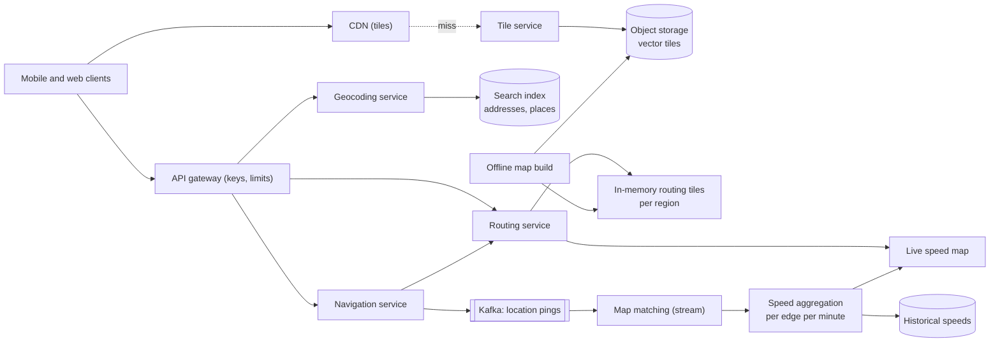
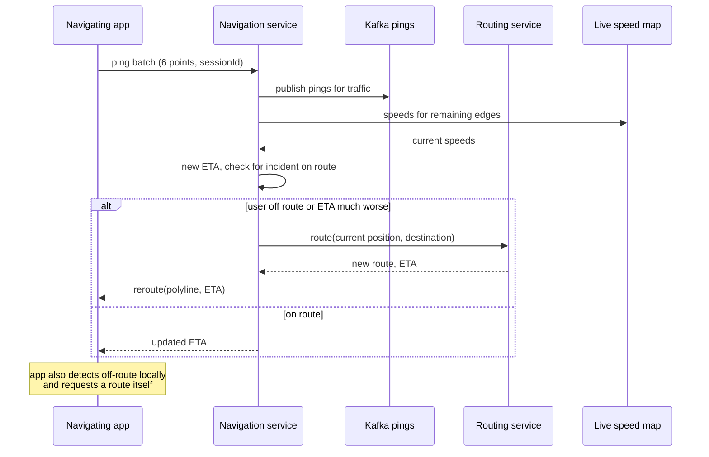

# Design Maps and Navigation (Google Maps)

| | |
|---|---|
| **Asked at** | Common at large tech companies; usually scoped down to tiles, routing and ETA |
| **Difficulty** | Hard |
| **Core challenges** | tile serving at CDN scale, shortest paths on a huge graph, live traffic, rerouting |
| **Related building blocks** | [`src/geohash`](../src/geohash/), [`src/consistent-hash-ring`](../src/consistent-hash-ring/) |

## 1. Requirements

### Functional
1. Show a map the user can pan and zoom, from the whole world down to street level.
2. Geocoding: turn an address or place name into coordinates, and coordinates back into an address.
3. Routing: fastest driving route from A to B with an ETA that reflects current traffic; also walking.
4. Turn-by-turn navigation: the app follows the route, announces turns and reroutes when the user goes off route or traffic changes.

### Non-functional
- Scale: 300 M daily users, 10 M people navigating concurrently at peak.
- Latency: map tiles visible in under 200 ms after a pan (mostly CDN hits); route computation under 1 s p99, most under 200 ms.
- ETA accuracy: within about 10 % for most trips; traffic data no more than a few minutes old.
- Availability: 99.99 % for tiles and routing. Map data may be days old; traffic must be minutes old.

### Out of scope
- Building the map data itself (surveying, imagery, editing tools), public transit timetables, Street View, place reviews, offline maps beyond a note.

## 2. Estimation

| Quantity | Estimate | Implication |
|---|---|---|
| Tile requests | 300 M users × ~100 tiles/day = 30 B/day ≈ **350k/s**, peak ~1M/s | Only a CDN can absorb this; origin must see a small fraction |
| Tiles per zoom | 4^z tiles at zoom z; zoom 14 = 268 M tiles, ~30 % of them on land | Pre-render vector tiles to about zoom 14-16 and let the client overzoom beyond |
| Tile storage | ~80 M land tiles at z14 × ~50 KB, plus lower zooms (~1/3 more) ≈ **5 TB** | Object storage plus CDN; empty ocean tiles stored once and deduplicated |
| Road graph | ~500 M nodes and ~1 B directed edges worldwide (assumed) × ~30 B ≈ **40 GB**, more with shortcuts | Does not fit comfortably in one routing process; partition by region |
| Route requests | 300 M × 3 / 86,400 s ≈ **10k/s**, peak ~**30k/s** | Each query must take milliseconds of CPU, not seconds; needs preprocessing, not plain Dijkstra |
| Location pings | 10 M navigating × 1 ping / 5 s = **2 M pings/s**, sent in batches of 6 every 30 s ≈ 330k req/s | Streaming pipeline to map-match and aggregate speeds per road segment |
| Traffic state | ~1 B edges × 4 B speed = **4 GB** per snapshot every minute | Fits in memory of each routing node; distribute as a compact file |

## 3. API

```
GET /v1/tiles/{style}/{z}/{x}/{y}.pbf          vector tile (Mapbox Vector Tile format), Cache-Control: max-age=86400
GET /v1/geocode?q=1600+Amphitheatre+Pkwy&near=lat,lng
  200: { results: [{ placeId, formattedAddress, lat, lng, confidence }] }
GET /v1/reverse-geocode?lat=..&lng=..
POST /v1/routes
  body: { origin, destination, waypoints?, mode: DRIVE|WALK, departAt?, avoid?: [TOLLS] }
  200: { routes: [{ routeId, polyline, distanceM, etaSeconds, steps[], trafficSpans[] }] }
POST /v1/navigation/{sessionId}/pings          body: [{ lat, lng, speed, heading, ts }]   (batched)
  200: { reroute?: { routeId, polyline, etaSeconds }, etaSeconds }
```

Tiles are immutable per version: the URL includes a data version so the CDN can cache them for a day and a map release changes URLs instead of purging. Routing and geocoding need an API key (for third-party developers) or a user token, and are rate-limited per key. Pings are batched to save battery and radio; the response piggybacks ETA updates and reroute suggestions, so the client needs no separate push channel while navigating.

## 4. Data model

```
-- map data (offline build inputs and outputs)
road_nodes  (node_id, lat, lng)
road_edges  (edge_id, from_node, to_node, length_m, road_class, speed_limit, one_way, turn_restrictions)
routing_tiles/{version}/{region}/{cell}.bin      graph partition with boundary nodes and CH shortcuts
vector_tiles/{version}/{z}/{x}/{y}.pbf          rendered tile per zoom level

-- traffic
segment_speeds (edge_id, minute_bucket, median_speed_kmh, sample_count)   -- streaming output
historical_speeds (edge_id, day_of_week, 15_min_slot, speed_kmh)          -- for future departures

-- geocoding index (search engine)
{ place_id, names[], address_components, street_number_ranges, lat, lng, type, popularity }
```

Store choice: tiles and routing partitions are immutable build artefacts, so they go to object storage and are served through a CDN or loaded into routing servers at start. The raw road graph lives in a versioned store used only by the offline build. Live segment speeds are an in-memory map published every minute; history goes to a columnar store for training. Geocoding is a text search problem with a geo boost, so it lives in a search index. See [CDN and blob storage](../fundamentals/cdn-and-blob-storage.md).

## 5. High-level design



**Map view**: the client computes which tiles cover the viewport at the current zoom and requests them by `z/x/y`. Most are CDN hits; misses go to the tile service, which reads the pre-rendered tile from object storage. The client styles and draws vector tiles itself.

**Route**: the client geocodes the destination, then asks routing for a route. Routing finds the nearest road edges to origin and destination, runs a query on the preprocessed graph using current segment speeds, and returns a polyline, steps and ETA.

**Navigation**: the client follows the route locally and sends ping batches. The navigation service forwards pings to Kafka for traffic, recomputes ETA from current speeds on the remaining edges, and returns a reroute when a faster route appears or the user left the route.

## 6. Deep dives

### 6.1 Map tiles

Problem: draw the world at every zoom level quickly, for a million tile requests per second.

Options:

1. **Render on demand** from the map database. Flexible, but rendering costs tens of milliseconds of CPU per tile; at 1 M/s that is far too much.
2. **Pre-rendered raster tiles** (PNG, 256×256) for every zoom. Simple clients, but every style, language and screen density needs its own set, and labels cannot rotate with the map.
3. **Pre-built vector tiles** (geometry plus attributes, encoded as Protocol Buffers) up to zoom 14-16, styled and rendered on the device. One tile set serves every style and language; the client overzooms from z14 to street level by scaling geometry.

**Choice:** option 3, with raster tiles for imagery and old clients. Tiles are addressed by `z/x/y` in Web Mercator, so zoom z has 2^z × 2^z tiles. Each data release builds a new versioned tile set; the URL carries the version, so CDN entries never need purging and releases roll out as clients pick up the new version. Low zoom tiles are few and requested by everyone, so they stay in every CDN edge; high zoom tiles follow population density, which is also where caching works well.

### 6.2 Routing on a continental graph

Problem: plain Dijkstra on a country-size graph explores millions of nodes for a long trip and takes seconds. A* with a straight-line heuristic helps, but on long routes it still expands a large area, and with travel time as the cost the straight-line bound is weak.

| Option | Query time (country graph) | Preprocessing | Live traffic |
|---|---|---|---|
| Dijkstra / A* | Seconds for long routes | None | Trivial: just read current weights |
| Contraction hierarchies (CH) | About a millisecond | Minutes to hours: order nodes by importance, add shortcut edges | Weights change the shortcuts, so full re-preprocessing is needed; customisable variants exist |
| Partition-based (multi-level cells, as in Customizable Route Planning) | A few milliseconds | Partition once (slow, metric-independent); "customise" cell boundary costs (seconds) | Re-run customisation every minute with new speeds |

**Choice:** a partition-based approach. The graph is split into routing tiles (cells) with precomputed costs between each cell's boundary nodes, at several levels. A query runs bidirectional Dijkstra over the fine cells near origin and destination and the coarse boundary-to-boundary costs in between. When live speeds change, only the customisation step reruns, cell by cell, which fits within a minute. CH remains the answer for static profiles (walking, cycling) where weights rarely change.

Partitioning also gives a deployment unit: each routing server loads the tiles for a region plus the coarse overlay for the world, so a long route crossing regions still runs on one server.

### 6.3 Live traffic and ETA

Problem: turn millions of noisy GPS pings into a speed for each road segment, minutes after the fact.

1. **Map matching**: snap each ping sequence to the most likely sequence of road edges. A hidden Markov model over candidate edges (a standard approach) handles GPS noise and parallel roads.
2. **Aggregation**: a stream job (Flink or similar) keyed by `edge_id` computes median speed per edge in one-minute windows, discarding outliers and requiring a minimum number of samples. Edges with too few samples fall back to the historical speed for that time slot.
3. **Publication**: every minute, the job emits a compact speed snapshot; routing servers load it and rerun customisation.
4. **ETA**: sum over the route's edges of length / speed, using live speeds for the near future and historical speeds for edges the user will reach later (traffic in 40 minutes looks more like history than now). A learned correction on top of this sum improves accuracy, but the sum is the backbone.

Privacy: pings are tied to a rotating session id, not the user, and trimmed at the start and end of each trip before aggregation.

### 6.4 Navigation and rerouting

The hardest flow, because it combines client state, live traffic and a route recomputation under tight time limits.



Off-route detection runs on the device first: if the matched position is more than ~50 m from the route for several consecutive fixes, the app asks for a new route immediately rather than waiting for the next batch. The server suggests a better route only when it saves a meaningful amount of time (for example 2 minutes or 10 %), to avoid flip-flopping between two similar routes.

### 6.5 Geocoding

Geocoding is search: parse the input into components (number, street, city, postcode), match them against an index of places and streets with fuzzy matching and a location bias (results near the user rank higher), and return the best candidates. When the exact house number is missing, interpolate along the street segment's number range. Reverse geocoding is a spatial lookup: find the nearest street segment to the point (via a geohash or S2 cell index) and the address range on it. Popular queries are cached; the index is rebuilt with each data release. See [search and indexing](../fundamentals/search-and-indexing.md).

## 7. Scaling and operations

- **Tiles**: CDN hit ratio above 95 % keeps origin load near 50k/s at peak. Origin tile servers are stateless readers of object storage.
- **Routing partitioning**: by region; each server holds a region's fine tiles plus the global overlay. Replicate each region for QPS and availability; route requests by origin region.
- **Traffic pipeline**: Kafka partitioned by geographic cell so map matching sees a vehicle's consecutive pings in order (key by session id within the cell). If the pipeline lags, routing keeps using the last snapshot and then falls back to historical speeds after 10 minutes.
- **Map releases**: new graph and tile versions are built offline, validated (route regression tests on known trips, tile diff checks) and rolled out region by region; servers can run old and new versions side by side.
- **Failure modes**: CDN edge down → clients go to another edge; routing region down → a replica in another zone serves; navigation service down → the app keeps navigating on the last route, because turn-by-turn runs on the device.
- **Monitoring**: CDN hit ratio, route p99 per region, ETA error (predicted vs actual arrival, by region and trip length), share of edges with live data, ping pipeline lag, reroute rate.

## 8. Trade-offs summary

| Decision | Chosen | Alternative | Why |
|---|---|---|---|
| Tile format | Vector tiles to z14-16, client rendering | Raster for every style | One tile set for all styles and languages; smaller downloads |
| Tile invalidation | Versioned URLs | CDN purges | Immutable caching, atomic releases |
| Routing algorithm | Partition-based with fast customisation | Contraction hierarchies | Live traffic updates in seconds instead of re-preprocessing |
| Traffic | Stream aggregation per edge per minute, historical fallback | Per-request live computation | Routing reads a precomputed snapshot; sparse edges still get a speed |
| Navigation channel | Ping batches with piggybacked updates | Persistent push connection | Fewer radio wake-ups; device can navigate alone if the server is slow |
| Geocoding | Search index with geo bias | Exact match database | Inputs are messy and partial |

## 9. Follow-up questions interviewers ask

- *"Why not A* with a good heuristic?"* With travel time as the cost, the admissible heuristic is distance divided by the highest speed limit, which is weak, so A* still explores a large region on long trips. Preprocessing is what makes millisecond queries possible.
- *"How do you handle an accident that just happened?"* Speeds on the affected edges drop in the next one-minute window when enough pings arrive; user reports can mark an incident faster. Navigation sessions whose remaining route includes those edges get re-evaluated on their next ping.
- *"How would offline maps work?"* Download vector tiles and routing tiles for a region; the device runs routing locally with historical speeds and no live traffic.
- *"How do you keep ETA honest for a trip starting in 2 hours?"* Use historical speeds for the departure time slot, not current traffic.
- *"How do you serve tiles for a brand-new road?"* It appears in the next data release; until then routing can include it if the graph build ran, which is a faster cycle than full tile rendering.
