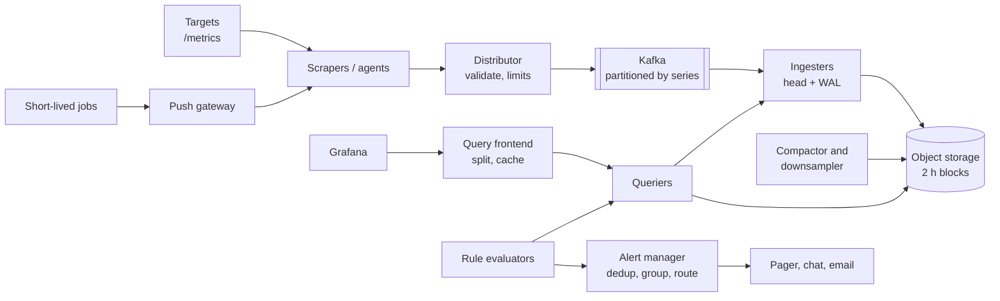
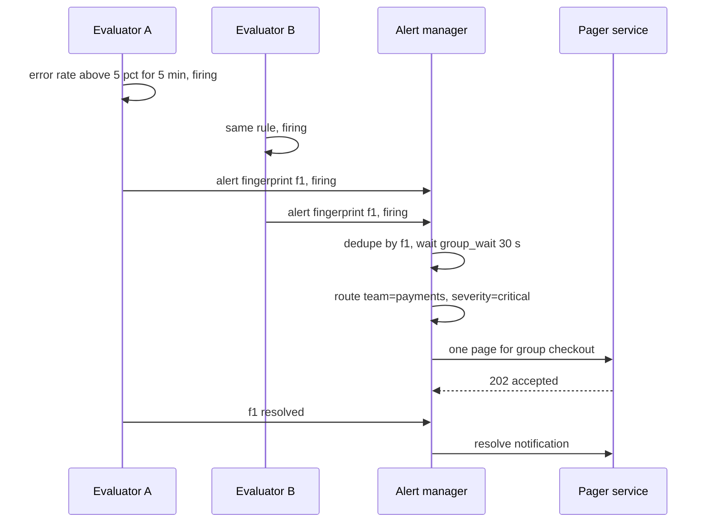

# Design a Metrics Monitoring and Alerting System (Prometheus, Datadog)

| | |
|---|---|
| **Asked at** | Common at infrastructure, SRE and observability teams; a frequent "design a write-heavy time-series system" problem |
| **Difficulty** | Hard |
| **Core challenges** | write-heavy ingestion, cardinality, compression, reliable alerting |
| **Related building blocks** | [`src/consistent-hash-ring`](../src/consistent-hash-ring/), [`src/inverted-index`](../src/inverted-index/), [`src/hyperloglog`](../src/hyperloglog/) |

Concepts: [observability](../fundamentals/observability.md), [storage engines](../fundamentals/storage-engines.md), [message queues and streams](../fundamentals/message-queues-and-streams.md), [batch and stream processing](../fundamentals/batch-and-stream-processing.md). Related: [ad click aggregation](./ad-click-aggregation.md), [notification system](./notification-system.md).

## 1. Requirements

### Functional
1. Collect numeric metrics (counters, gauges, histograms) from hosts, containers and applications.
2. Each data point is `(metric name, labels, timestamp, float value)`, e.g. `http_requests_total{service="checkout", status="500"}`.
3. Query with aggregation over time ranges and label filters (`sum by (service) (rate(http_requests_total[5m]))`) for dashboards.
4. Alert rules evaluated continuously; firing alerts are deduplicated, grouped and routed to on-call (pager, chat, email).
5. Retention: raw data 15 days, downsampled data 1 year.

### Non-functional
- 100k hosts, ~1,000 series each → **100 M active series**; one sample per series every 10 s.
- Ingestion is never blocked by queries; dashboards over the last hour return in under 1 s at p95.
- Alert evaluation delay under 1 minute from the event; the alerting path must work when the dashboards are degraded.
- The monitoring system must be more available than what it monitors, and must alert when it is itself broken.
- Small data loss (a few seconds of samples) during failures is acceptable; losing alerts is not.

### Out of scope
- Logs and traces (separate pipelines, see [observability](../fundamentals/observability.md)).
- Anomaly detection with ML models.

## 2. Estimation

| Quantity | Estimate | Implication |
|---|---|---|
| Ingest rate | 100 M series / 10 s = **10 M samples/s** | Needs horizontally sharded ingesters; no single database takes this |
| Raw sample size | 8 B timestamp + 8 B float = 16 B; Gorilla encoding averages **~1.37 B** | ~12× compression; storage is driven by series count, not bytes per point |
| Compressed ingest | 10 M × 1.37 B ≈ **14 MB/s** ≈ 1.2 TB/day | 15 days raw ≈ 18 TB, × 3 replicas ≈ **54 TB**: fits on tens of nodes or object storage |
| Wire ingest | ~10-20 B/sample after batching and compression ≈ **100-200 MB/s** | Kafka in front of ingestion is modest at this rate |
| In-memory head | 100 M series × ~2-4 KB (labels, index, open chunk) ≈ **200-400 GB** | Spread across ~50-100 ingesters with 8-16 GB each for series state |
| Downsampled | 5-min rollups, 5 aggregates per window: 100 M × 288 windows/day × 5 ≈ 144 B values/day × ~1.5 B ≈ **216 GB/day** | 90 days of 5-min ≈ 19 TB, 1 year of 1-h (12× fewer) ≈ 6.6 TB: cheap in object storage |
| Alert rules | 50k rules evaluated every 30 s ≈ **1.7k rule evaluations/s** | Each touches a small set of series; shard rules across evaluators |
| Query fan-out | A dashboard panel over 10k series × 1 h at 10 s = **3.6 M points** | Push aggregation down to storage nodes; never ship raw points to the browser |

## 3. API

```
Ingestion:
POST /api/v1/write                          (Prometheus remote-write: protobuf + snappy)
  body: [{ labels: {__name__, ...}, samples: [{ ts_ms, value }] }]
  headers: X-Tenant-Id, Authorization: Bearer <agent token>
  204 | 429 (tenant over its series or rate limit) | 400 (sample too old or out of order)

Pull targets expose:  GET /metrics  (text exposition format)

Query:
GET /api/v1/query_range?query=<PromQL>&start=...&end=...&step=30s
  200: { resultType: "matrix", result: [{ metric: {labels}, values: [[ts, "v"], ...] }] }
GET /api/v1/series?match[]=up{job="api"}&start=...&end=...
GET /api/v1/labels/{name}/values

Alerting:
PUT  /api/v1/rules/{namespace}              body: [{ alert, expr, for: "5m", labels: {severity}, annotations }]
POST /api/v1/alerts                         (evaluator -> alert manager) [{ labels, annotations, startsAt, endsAt }]
POST /api/v1/silences                       { matchers, startsAt, endsAt, createdBy, comment }
```

Idempotency: remote write is idempotent per `(series, timestamp)`: a retried batch writes the same samples and duplicates are dropped. Alert notifications are keyed by the alert's label set (its fingerprint) so a resent alert updates the existing one. Query pagination is by time range and `step`, with server-side limits on series and points returned. Auth: per-tenant tokens for agents, SSO for users, tenant id enforced on every read and write.

## 4. Data model

```
Series identity:
  series_id = hash(sorted labels incl. __name__)        -- e.g. 64-bit
  labels    = { __name__: "http_requests_total", service: "checkout", status: "500", pod: "abc" }

Inverted index (per block, per shard):
  label pair -> postings list of series_ids     e.g. ("service","checkout") -> [17, 42, 99, ...]
  query {service="checkout", status="500"} = intersect postings lists

Chunk (per series, ~2 h or 120 samples):
  series_id, min_ts, max_ts, encoding = gorilla, bytes
  timestamps: first ts raw, then delta-of-delta with variable-length bit prefixes
  values:     first value raw, then XOR with previous, encoding only the meaningful bits

Block (immutable, 2 h, later compacted to larger ranges):
  index file + chunk files + tombstones, uploaded to object storage

Rollups: (series_id, window_start, resolution) -> { min, max, sum, count, last }

Alert state (alert manager):
  fingerprint -> { labels, state: pending|firing|resolved, startsAt, lastSentAt, receiver }
```

Store choice: a purpose-built time-series layout (in-memory head + write-ahead log + immutable compressed blocks), because the workload is append-only, keyed by series and time, and queried in time ranges. A general-purpose wide-column store (Cassandra) can hold the data but gives neither Gorilla compression nor a label inverted index; a relational store collapses at 10 M inserts/s.

## 5. High-level design



**Write**: agents scrape targets every 10 s (or receive pushes from batch jobs via the push gateway) → batch samples → remote-write to distributors → distributors check auth, per-tenant rate and series limits, and hash `series_id` to pick a Kafka partition → ingesters consume their partitions, append to the WAL and the in-memory head chunk per series → every 2 h the head is cut into an immutable block, uploaded to object storage, and the WAL is truncated.

**Read**: Grafana → query frontend splits a 7-day query into day-sized subqueries, serves cached results for complete past days → queriers fetch recent data from ingesters and older data from blocks in object storage (via the block index, then only matching chunks) → aggregate (`sum by`, `rate`) close to the data → return a small matrix.

**Alert**: rule evaluators run each rule's expression on its schedule → a result that stays true for the `for` duration becomes a firing alert → sent to the alert manager → deduplicated, grouped, routed, notified.

## 6. Deep dives

### 6.1 Push vs pull ingestion

| Option | How | Strengths | Weaknesses |
|---|---|---|---|
| Pull (Prometheus scrape) | Scraper fetches `/metrics` from each target on a schedule | Target health is a free signal (`up == 0`); scrape rate controlled centrally; easy to debug with curl | Needs service discovery and network reach to every target; short-lived jobs end before a scrape |
| Push (StatsD, Datadog agent, OTLP) | Agents send samples to an endpoint | Works through NAT and firewalls, for serverless and batch jobs | A silent target looks the same as a healthy idle one; clients can flood the backend |

**Choice:** pull inside our own infrastructure via agents that scrape locally, then push batches to the backend with remote write. This keeps the pull model's `up` signal and central scrape config while the backend only sees a controlled push stream. Batch jobs push to a push gateway that is scraped like any target. External or serverless sources push directly with OTLP, behind per-tenant limits.

### 6.2 Time-series storage and Gorilla compression

Problem: 10 M samples/s at 16 B raw would be 14 TB/day before replication, and random per-sample writes would be far too slow.

Approach (from Facebook's Gorilla paper, used in similar form by Prometheus's TSDB):
- **Timestamps, delta-of-delta.** Scrapes are regular, so the delta between timestamps is nearly constant and the delta of deltas is usually 0. A 0 is stored as a single bit; small values use short prefixed bit fields.
- **Values, XOR.** Consecutive values of a gauge or counter are similar, so `v XOR v_prev` has many leading and trailing zero bits. Identical values store one bit; otherwise only the meaningful bits plus their position are stored.
- Together these reach ~1.37 bytes per sample on Facebook's data instead of 16.

Samples append to a per-series head chunk in memory (with a WAL for crash recovery). Every 2 h, chunks are cut into an immutable block with its own inverted index, which compactors later merge into larger blocks. Out-of-order samples beyond a small window are rejected, because the encoding assumes increasing timestamps.

### 6.3 Cardinality: the real scaling limit

Problem: every unique label combination is a new series. One developer adding `user_id` or `request_id` as a label turns 1,000 series into 10 M, each with its own index entries and head memory. Memory and index size grow with series count, not with sample count.

Options:
1. **No limits**, scale ingesters. Cost grows without bound and one tenant can take down a shared cluster.
2. **Hard per-tenant and per-metric series limits** at the distributor, rejecting new series beyond the limit with a clear error.
3. **Limits plus visibility**: track top metrics and labels by series count, and approximate distinct counts per label with [HyperLogLog](../src/hyperloglog/) so offenders are found before they hit the limit.

**Choice:** option 3. Distributors enforce `max_series_per_tenant` and `max_series_per_metric`, ingesters enforce it again locally, and a cardinality dashboard shows the worst offenders. Relabeling rules at the agent drop known-bad labels. High-cardinality data such as per-request detail belongs in logs or traces, not metrics.

### 6.4 Scaling ingestion through Kafka, downsampling and retention

**Kafka in the write path**: distributors write to Kafka partitioned by `series_id`, so all samples of one series go to one partition and one ingester, which keeps chunks append-only. Kafka absorbs bursts and ingester restarts (an ingester replays from its last committed offset and its WAL) and lets a second consumer (rule evaluators for streaming alerts, a long-term archive) read the same stream. Without Kafka, distributors replicate each sample to 3 ingesters chosen on a [hash ring](../src/consistent-hash-ring/), as Cortex and Mimir do; both work, and Kafka trades a little latency for buffering and replay.

**Downsampling**: queries over a year at 10 s resolution would read 3 M points per series. The compactor writes rollups at 5 min and 1 h resolution storing `min, max, sum, count, last` per window, so `avg`, `max` and `rate` remain computable. Retention: raw 15 days, 5-min 90 days, 1-h 1 year. The query frontend picks the coarsest resolution that still gives about one point per pixel.

### 6.5 Alerting pipeline

Problem: alerts must fire reliably, once, to the right person, even during the incident that is breaking everything else.

Pipeline:
1. **Rule evaluation**: evaluators own rule groups (sharded by hash), evaluate every 15-60 s, and keep per-alert state: `pending` while the condition is true for less than `for`, then `firing`. The `for` clause suppresses flapping on a single bad scrape.
2. **Deduplication**: evaluators run in pairs for high availability, so each alert is sent twice. The alert manager identifies an alert by the fingerprint of its labels and keeps one record; alert manager replicas gossip notification state so only one sends.
3. **Grouping and inhibition**: alerts with the same `alertname` and `cluster` are grouped into one notification after a short `group_wait` (e.g. 30 s); a firing "datacenter down" alert inhibits the hundreds of per-service alerts it causes.
4. **Routing and notification**: a routing tree on labels (`team`, `severity`) chooses receivers; critical goes to the pager, warnings to chat. Notifications retry with backoff; repeats are throttled by `repeat_interval`. Silences mute matching alerts during maintenance.



**Meta-monitoring**: a "dead man's switch" alert that always fires is sent to an external service, which pages if it stops arriving. That catches a broken alerting pipeline, which cannot alert about itself.

## 7. Scaling and operations

- **Partitioning**: by `series_id` hash for ingestion (Kafka partitions and ingesters), by time for storage (blocks), and by tenant for limits. Queries fan out to ingesters holding recent data and to block stores for older data.
- **Replication**: Kafka RF=3 for in-flight data; blocks in object storage are durable on their own; compactors deduplicate overlapping blocks from replicated ingesters.
- **Caching**: query frontend caches results for completed time ranges (the past does not change), and a chunk cache keeps recently read chunks near queriers.
- **Failure modes**: ingester crash → replay WAL and Kafka, a gap of seconds; Kafka lag → dashboards show stale recent data, alerts on recent data are delayed, so alert on consumer lag; object storage slow → only long-range queries suffer; query of death (huge cardinality) → per-query series and sample limits, timeouts, and a separate query pool from the ruler so dashboards cannot starve alert evaluation.
- **Monitoring the monitor**: ingestion rate, rejected samples by reason, active series per tenant, head memory, compaction backlog, rule evaluation duration and missed evaluations, notification success rate, dead man's switch.
- **Security and abuse**: per-tenant auth, series and rate limits, label value length limits, and PromQL query cost limits so one user cannot run a query that reads a year of every series.

## 8. Trade-offs summary

| Decision | Chosen | Alternative | Why |
|---|---|---|---|
| Collection | Local scrape + remote-write push | Pure central pull | Keeps `up` signal, works across networks |
| Encoding | Gorilla delta-of-delta + XOR | Generic compression | ~1.4 B/sample with fast appends and decodes |
| Write buffer | Kafka partitioned by series | Direct replication to ingesters | Absorbs bursts, replay on restart, extra consumers |
| Long-term storage | Immutable blocks in object storage | Ingester local disks only | Cheap, durable, decouples storage from compute |
| Cardinality | Hard limits + top-N visibility | Unlimited series | One bad label must not take down a shared cluster |
| Alerting | Separate evaluator and alert manager, HA pairs with dedup | Alerts from the dashboard layer | Alerts survive query overload; one page per incident |
| Retention | 15 d raw, 90 d 5-min, 1 y 1-h | Raw forever | Long-range queries stay fast and cheap |

## 9. Follow-up questions interviewers ask

- *"How do you compute percentiles across many hosts?"* You cannot average per-host p99s. Export histograms (bucket counters) and sum buckets across hosts, then compute the quantile from the merged buckets; sketches such as t-digest or DDSketch work similarly.
- *"Why are counters better than gauges for request rates?"* A counter only increases, so `rate()` recovers the true rate even if scrapes are missed; resets on restart are detected as decreases.
- *"How do you handle a target that disappears?"* With pull, `up == 0` fires an alert; series stop receiving samples and are marked stale so queries do not show the last value forever.
- *"How would you support multi-region?"* Ingest and alert per region so a region's alerts do not depend on a WAN link, and query across regions with a federated query layer for global dashboards.
- *"How do you prevent alert fatigue?"* Alert on symptoms (error rate, latency SLOs) rather than causes, use `for` durations, group and inhibit, and review alerts that page without leading to action.
- *"Why not store metrics in Elasticsearch or Cassandra?"* They can work at small scale, but lack per-series compression and a label index tuned for this access pattern, so they cost several times more disk and memory per sample.
