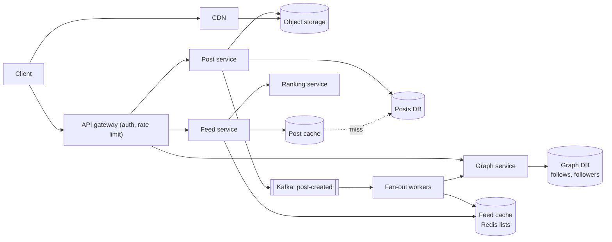
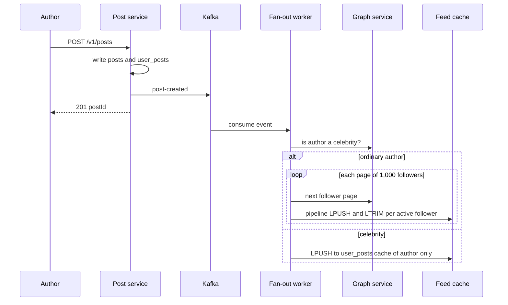

# Design a News Feed (Facebook / Twitter home timeline)

| | |
|---|---|
| **Asked at** | Very common at social and consumer-product companies; the standard fan-out problem |
| **Difficulty** | Medium-Hard |
| **Core challenges** | fan-out cost, celebrity accounts, feed read latency, ranking |
| **Related building blocks** | [`src/snowflake-id`](../src/snowflake-id/), [`src/consistent-hash-ring`](../src/consistent-hash-ring/), [`src/count-min-sketch`](../src/count-min-sketch/) |

LLD version of the domain model: [social network (LLD)](https://github.com/hardyalsinghdeora/low-level-design/blob/main/problems/social-network.md). Related: [instagram](./instagram.md), [distributed-counter](./distributed-counter.md), [caching strategies](../fundamentals/caching-strategies.md), [message queues and streams](../fundamentals/message-queues-and-streams.md).

## 1. Requirements

### Functional
1. A user publishes a post (text, optional images or video).
2. A user follows and unfollows other users.
3. A user opens the home feed and sees recent posts from people they follow, ranked, newest-first as a fallback.
4. The feed scrolls with pagination (infinite scroll) without duplicates or gaps.
5. Posts show like and comment counts; a user can like and comment.

### Non-functional
- Scale: 500 M DAU, 2 B registered users; average 200 followees, some accounts with 100 M+ followers.
- Latency: feed first page p99 under 300 ms; publish returns in under 500 ms (fan-out can finish later).
- Freshness: a new post appears in followers' feeds within ~5 s for ordinary accounts, within a minute for celebrities.
- Availability over consistency: a feed missing a post for a few seconds is acceptable; a feed that fails to load is not. Target 99.95 %.

### Out of scope
- Ads insertion, the ranking model itself (we design the serving path, not the ML), search, direct messages ([chat-system](./chat-system.md)).

## 2. Estimation

| Quantity | Estimate | Implication |
|---|---|---|
| Feed reads | 500 M DAU × 10 opens = 5 B/day ≈ **58k/s**, peak ~150k/s | Reads must be served from memory, not by querying followees' posts each time |
| New posts | 10 % of DAU post once/day = 50 M/day ≈ **600/s**, peak ~2k/s | Post writes are modest; a sharded store handles them easily |
| Fan-out inserts | 50 M posts × 200 followers = 10 B/day ≈ **115k/s** | Fan-out dominates write load; must be async and batched |
| Celebrity post | 1 post × 100 M followers | Pushing it would take 100 M writes; this is why pure push fails |
| Feed cache | 500 M users × 500 ids × 8 B = **2 TB** raw, ~4 TB with Redis overhead | ~70 Redis nodes at 64 GB; keep only active users |
| Post text | 50 M × 1 KB = 50 GB/day ≈ **18 TB/year** | Wide-column or sharded SQL, partitioned by post id |
| Media | 20 % of posts × 500 KB = 5 TB/day ≈ **1.8 PB/year** | Object storage plus CDN; never through app servers |

## 3. API

```
POST /v1/posts
  headers: Authorization, Idempotency-Key
  body: { text, mediaIds?: [..] }          (media uploaded first via presigned URL)
  201: { postId, createdAt }

GET  /v1/feed?cursor=<opaque>&limit=20
  200: { items: [ { post, author, likeCount, commentCount, likedByMe } ], nextCursor }

POST   /v1/users/{id}/follow              204
DELETE /v1/users/{id}/follow              204
POST   /v1/posts/{id}/likes               204 (idempotent: liking twice is a no-op)
POST   /v1/posts/{id}/comments            body: { text }  201
```

The `Idempotency-Key` on post creation stops a retried request on a flaky mobile network from publishing twice. Pagination is cursor-based (section 6.4); offset pagination breaks when new posts arrive at the top. All endpoints require an OAuth bearer token; the user id comes from the token, never from the body.

## 4. Data model

```
posts        (post_id BIGINT PK, author_id, text, media_ids[], created_at, visibility)
             partition key: post_id          -- Snowflake id, time-sortable
user_posts   (author_id, post_id)            -- partition author_id, clustering post_id DESC
follows      (follower_id, followee_id, created_at)   -- partition follower_id
followers    (followee_id, follower_id)      -- reverse edge, partition followee_id
users        (user_id PK, name, avatar_url, follower_count, is_celebrity, last_active_at)
likes        (post_id, user_id, created_at)  -- partition post_id; PK (post_id, user_id)
counters     (post_id PK, like_count, comment_count)  -- updated in batches

feed cache (Redis):  feed:{user_id} -> LIST of post_ids, newest first, trimmed to 500
```

Store choices:
- **Posts and edges** go in a wide-column store (Cassandra-style) or sharded MySQL. Access is by key with no joins: "posts by author newest first" and "followers of X" are single-partition range scans.
- **Both edge directions are stored.** Fan-out needs `followers(followee)`; pull needs `follows(follower)`. Writing two rows per follow is cheap compared with a scatter query.
- **The feed cache holds ids only.** Post bodies are hydrated from a separate post cache, so an edit or delete changes one object rather than millions of feed entries.
- Post ids are Snowflake ids, so sorting by id is sorting by time and merging feeds needs no extra timestamp lookup.

## 5. High-level design



**Publish**: client uploads media to object storage via a presigned URL, then calls `POST /v1/posts` with the media ids. The post service writes the post row and the `user_posts` row, publishes `post-created` to Kafka, and returns. Fan-out workers consume the event, page through the author's followers, and `LPUSH` the post id into each active follower's `feed:{id}` list, then `LTRIM` to 500.

**Read feed**: the feed service reads `feed:{user}` (pushed ids), adds recent posts from celebrities the user follows (pulled, section 6.1), sends ~500 candidates to the ranking service, hydrates the top 20 from the post cache with counts, and returns them with a cursor. Media URLs point at the CDN.

## 6. Deep dives

### 6.1 Fan-out on write vs fan-out on read (the celebrity problem)

| Option | Write cost | Read cost | Weakness |
|---|---|---|---|
| **Fan-out on write (push)** | One insert per follower | One list read | A 100 M-follower post means 100 M writes and minutes of lag; wasted work for followers who never log in |
| **Fan-out on read (pull)** | One insert | Query every followee, merge | 200 followees means 200 partition reads per feed open; at 58k/s that is ~12 M reads/s |
| **Hybrid** | Push for ordinary authors | Merge pushed list with a few celebrity pulls | Two code paths; the threshold needs tuning |

**Choice: hybrid.** Accounts above a follower threshold (for example 100k) are flagged `is_celebrity` and are not fanned out. At read time the feed service fetches the user's followed-celebrity list (usually small, under 50) and reads each celebrity's latest posts from a per-author cache (`user_posts:{author}`, hot in Redis because many readers share it). The merge is a k-way merge on post id. Celebrity posts are read by millions, so their per-author cache has a near-100 % hit ratio, which is why pulling them is cheap while pulling everyone is not.



Fan-out workers process followers in pages of 1,000 with Redis pipelining. The Kafka topic is partitioned by author id so one author's posts are fanned out in order. A post deletion publishes a `post-deleted` event; rather than removing the id from millions of lists, hydration drops ids whose post is gone (a tombstone in the post cache).

### 6.2 Ranking stage

Problem: chronological feeds are simple, but engagement-ranked feeds need a model score per candidate within the 300 ms budget.

Options:
1. **Chronological only.** No ranking cost; poor relevance when a user follows many accounts.
2. **Rank everything at read time with a heavy model.** Best relevance, but scoring 500 candidates with a large model per request is expensive.
3. **Two-stage ranking.** Candidate generation (pushed ids, celebrity pulls, optional recommended posts) yields ~500 ids; a light model scores them using precomputed features (author affinity, post age, engagement so far); optionally a heavier model re-ranks the top 100.

**Choice: two-stage.** Features are kept in a feature store keyed by `(user, author)` and by post, refreshed by a stream job, so scoring is a batch of key lookups plus arithmetic, roughly 20-50 ms. If the ranking service times out, the feed service falls back to chronological order, which keeps the feed available.

### 6.3 Like and comment counters

A popular post can receive tens of thousands of likes per second. Incrementing one database row per like creates a hot key. The `likes` row (post_id, user_id) is the source of truth for "did I like this" and makes likes idempotent. The count is maintained separately: like events go to Kafka, an aggregator sums them per post per few seconds and applies one increment to `counters` and to a Redis counter. For the hottest posts the Redis counter is split into N sub-keys and summed on read. Counts lag by seconds, which users do not notice. See [distributed-counter](./distributed-counter.md) for the full design.

### 6.4 Cursor pagination over a changing feed

Problem: new posts arrive at the top while the user scrolls; offset pagination then shows duplicates.

Options:
1. **Offset and limit.** Breaks as described.
2. **Cursor = last seen post id** ("give me posts older than X"). Works for chronological feeds because ids are time-ordered.
3. **Ranked session snapshot.** On the first page, store the ranked list of ~500 ids under `feedsession:{id}` with a 30-minute TTL; the cursor is `{sessionId, offset}`.

**Choice: option 3 for ranked feeds, option 2 for the chronological fallback.** The cursor is opaque (base64 of a signed JSON) so clients cannot forge it and the server can change its format. When the snapshot is exhausted, the next page falls back to "posts older than the oldest id shown", served by pull. Pull-to-refresh starts a new session.

### 6.5 Cold start and inactive users

- **Inactive users** (no login for 30 days) are skipped by fan-out; this cuts fan-out writes substantially because a large share of followers are dormant. Their feed key expires. On next login the feed service sees a missing key and rebuilds it by pull: read the latest posts of each followee, merge, write the list back.
- **New users** follow nobody, so the feed is empty. Onboarding asks for interests and suggests accounts; until the graph has enough edges, candidate generation adds popular posts from those topics and the user's region.
- **Unfollow** removes the author's ids lazily: hydration filters out posts whose author is no longer followed (one set lookup), and the list self-corrects as it is trimmed.

## 7. Scaling and operations

- **Partitioning**: feed cache sharded by `user_id` with consistent hashing ([consistent hashing](../fundamentals/consistent-hashing.md)); posts by `post_id`; edges by the first id of each edge table. Kafka `post-created` partitioned by author id.
- **Replication**: each Redis shard has a replica; the feed cache is rebuildable from the source tables, so losing it degrades latency, not data. Posts and edges use replication factor 3.
- **Caching**: three caches with different jobs: feed lists (per user), post objects (shared, very high hit ratio), per-author recent posts (celebrity pulls). See [caching strategies](../fundamentals/caching-strategies.md).
- **Media**: served from the CDN with long cache lifetimes because media objects are immutable; see [CDN and blob storage](../fundamentals/cdn-and-blob-storage.md).
- **Failure modes**: fan-out lag (Kafka backlog) → feeds are stale but load; ranking down → chronological fallback; feed shard down → rebuild by pull for affected users at higher latency; hot celebrity author key → replicate that key across read replicas.
- **Monitoring**: feed p99 and error rate, fan-out lag (time from post to last follower insert), Kafka consumer lag, cache hit ratio per cache, ranking timeout rate.
- **Abuse and security**: rate-limit posting and following per account (follow spam inflates fan-out), spam classifiers run on `post-created` before fan-out, visibility checks (blocked users, private accounts) applied at hydration.

## 8. Trade-offs summary

| Decision | Chosen | Alternative | Why |
|---|---|---|---|
| Fan-out model | Hybrid push/pull | Pure push or pure pull | Push makes reads cheap; pull avoids 100 M-write celebrity posts |
| Feed cache contents | Post ids only | Full post objects | Edits and deletes touch one object; memory is ~20× smaller |
| Inactive users | Skipped by fan-out, rebuilt on login | Fan out to everyone | Saves writes for users who may never read them |
| Ranking | Two-stage with chronological fallback | Single heavy model | Fits the latency budget and degrades safely |
| Pagination | Opaque cursor over a session snapshot | Offset | No duplicates while new posts arrive |
| Counters | Async aggregated, sharded hot keys | Synchronous row increment | Avoids hot-row contention on viral posts |

## 9. Follow-up questions interviewers ask

- *"Where exactly is the celebrity threshold?"* It is a tuning knob, not a constant: set it where fan-out time for one post exceeds the freshness target, and allow hysteresis so accounts near the line do not flip back and forth.
- *"A user follows a celebrity and an ordinary friend posts at the same second. What order do they see?"* Both ids are Snowflake ids, so the k-way merge orders them by time before ranking; ranking may then reorder them by score.
- *"How do you handle a post being deleted or made private?"* Tombstone in the post cache; hydration drops it. No attempt to scrub millions of lists.
- *"How would you add 'seen' suppression so the user does not see the same post twice across sessions?"* Keep a per-user Bloom filter of recently seen post ids (a few KB) and filter candidates against it.
- *"What changes if feeds must be strictly chronological?"* The ranking stage disappears, cursor becomes "older than post id", and the hybrid merge is the whole read path.
- *"How do you test the fan-out under a celebrity spike?"* Replay a synthetic post from an account with 100 M fake followers in staging and measure fan-out lag and Redis CPU; the hybrid path should keep both flat.
