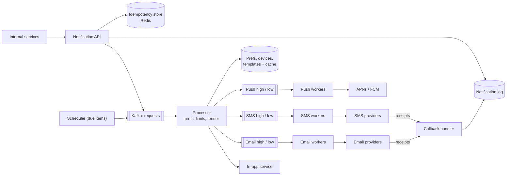
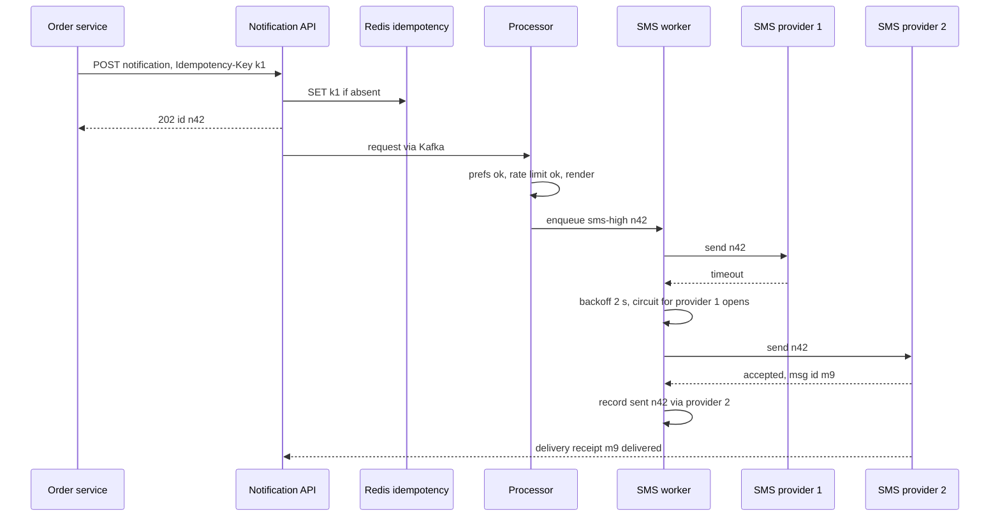

# Design a Notification System (push, SMS, email, in-app)

| | |
|---|---|
| **Asked at** | Very common; almost every product company runs one internally |
| **Difficulty** | Medium |
| **Core challenges** | multi-channel delivery, retries without duplicates, user preferences, broadcast spikes |
| **Related building blocks** | [`src/idempotency-store`](../src/idempotency-store/), [`src/rate-limiter-algorithms`](../src/rate-limiter-algorithms/), [`src/timing-wheel`](../src/timing-wheel/) |

LLD version (classes, channel strategy, template rendering): [notification service (LLD)](https://github.com/hardyalsinghdeora/low-level-design/blob/main/problems/notification-service.md). Related: [message queues and streams](../fundamentals/message-queues-and-streams.md), [delivery semantics and idempotency](../fundamentals/delivery-semantics-and-idempotency.md), [resilience patterns](../fundamentals/resilience-patterns.md), [webhook-delivery-system](./webhook-delivery-system.md), [rate-limiter](./rate-limiter.md).

## 1. Requirements

### Functional
1. Internal services send notifications to a user (or a list of users) on push (iOS, Android), SMS, email and in-app channels.
2. Messages are built from versioned, localised templates with variables.
3. Users set preferences per category and channel (for example: marketing email off, security SMS on) and quiet hours.
4. Notifications can be scheduled for a future time or the user's local time.
5. Broadcast to a segment of millions of users (product announcement).
6. Track each notification's status: accepted, sent, delivered, opened, failed.

### Non-functional
- Scale: 500 M users; ~2 B notifications/day; broadcasts of 100 M users.
- Latency: transactional notifications (OTP, payment alert) handed to the provider within 2 s p99; marketing can take minutes.
- Reliability: no accepted notification is lost; duplicates are rare and never for OTP-like messages beyond what providers themselves cause.
- Availability: 99.99 % for the accept API; a single provider outage must not stop a channel.

### Out of scope
- Building the providers themselves (APNs, FCM, SMS carriers, mail transfer), campaign design tools, the content of marketing segmentation.

## 2. Estimation

| Quantity | Estimate | Implication |
|---|---|---|
| Volume | push 1 B + in-app 800 M + email 200 M + SMS 20 M ≈ **2 B/day ≈ 23k/s** | Moderate on average; queues decouple producers from providers |
| Broadcast spike | 100 M push in 10 min ≈ **170k/s** | 7× average; must not delay transactional traffic, so separate priority queues |
| SMS | 20 M/day, paid per message | Cost control matters: dedup, rate caps and preference checks before sending |
| Notification log | 2 B × 500 B ≈ **1 TB/day**, 90-day retention ≈ 90 TB | Write-heavy store with TTL (wide-column) |
| Device tokens | 500 M users × 2 devices × 200 B ≈ 200 GB | Relational or KV, cached; looked up on every push |
| Preferences | 500 M × ~1 KB ≈ 500 GB | Cache the hot set; preference check on every send |
| Provider limits | each provider account has throughput and connection limits | Workers need per-provider concurrency control and backpressure |

## 3. API

```
POST /v1/notifications
  headers: Authorization (service credentials), Idempotency-Key
  body: {
    userId | userIds[] (≤ 1,000),
    category: "security" | "transactional" | "social" | "marketing",
    channels?: ["push","sms","email","inapp"],     (default from category rules)
    templateId, templateVersion?, variables: { ... },
    priority: "high" | "normal" | "low",
    sendAt?: ISO-8601 | { localTime: "09:00" },
    dedupKey?: "order-123-shipped"                  (collapses repeats for the same event)
  }
  202: { notificationIds: [...] }

POST /v1/broadcasts          body: { segmentId, templateId, category, sendAt?, rateLimitPerSec? }
  202: { broadcastId }
GET  /v1/notifications/{id}  200: { status, channel, events: [...] }
GET  /v1/users/{id}/inbox?cursor=...        in-app inbox, newest first
PUT  /v1/users/{id}/preferences             body: { category -> { channel -> on/off }, quietHours, timezone }
POST /v1/providers/{name}/callbacks         delivery receipts from SMS and email providers
```

The `Idempotency-Key` makes the accept call safe to retry: the same key returns the same ids. `dedupKey` is different: it collapses distinct calls about the same business event (two services both reporting "order shipped") within a window. Callers authenticate with service credentials and each caller is allowed only certain categories, so a marketing service cannot send "security" messages that bypass preferences. Lists use cursors.

## 4. Data model

```
notifications (notification_id PK (Snowflake), user_id, category, channel, template_id, template_version,
               variables JSON, priority, dedup_key, status, send_at, created_at)   TTL 90 days
delivery_events (notification_id, ts, status: queued|sent|delivered|opened|failed|suppressed,
                 provider, provider_message_id, error_code, PRIMARY KEY (notification_id, ts))
inbox         (user_id, notification_id DESC, title, body, read_at)                -- in-app
preferences   (user_id PK, settings JSON, quiet_start, quiet_end, timezone)
devices       (user_id, device_id, platform: ios|android|web, token, app_version, last_seen,
               PRIMARY KEY (user_id, device_id)); INDEX (token)
templates     (template_id, version, channel, locale, subject, body, PRIMARY KEY (template_id, version, channel, locale))
scheduled     (bucket_minute, notification_id)                                     -- due-time index
idempotency   (key PK, notification_ids, expires_at)                               -- 24 h TTL
```

Store choices:
- **Notifications, delivery events and inbox** in a wide-column store (Cassandra-style): write-heavy, append-mostly, read by key, and expire by TTL.
- **Preferences, devices and templates** in a relational database with a read-through cache: small, read on every send, updated rarely, and changes must be consistent (an opt-out must stick).
- **Scheduled index** by minute bucket so the scheduler reads "everything due in this minute" with one partition read.
- **Idempotency and dedup keys** in Redis with TTL, see [`src/idempotency-store`](../src/idempotency-store/).

## 5. High-level design



**Send path**: a service calls `POST /v1/notifications`. The API checks the idempotency key, writes a `notifications` row per channel with status `accepted`, publishes to the `requests` topic and returns 202. A processor consumes it, drops it if the user opted out of this category on this channel (status `suppressed`), applies per-user rate limits and quiet hours, renders the template in the user's locale, looks up device tokens, and enqueues one message per destination on the channel's queue for its priority.

**Delivery path**: channel workers take messages from high-priority queues first, call the provider, and record `sent` with the provider's message id. Provider receipts (SMS delivery reports, email delivered or bounced events) arrive at the callback handler and become `delivered` or `failed`. Push opens are reported by the app.

## 6. Deep dives

### 6.1 Retries with idempotency and dedup

Problem: providers time out, return 5xx, or throttle. Retrying is required to not lose messages, but a retry after a timeout may send a second copy. An OTP arriving twice is confusing; a payment alert arriving five times is a support ticket.

| Layer | Mechanism |
|---|---|
| Caller → API | `Idempotency-Key` returns the original ids on retry |
| Same business event from several callers | `dedupKey` per user within a window, checked in Redis |
| Kafka redelivery to processor or worker | Each message carries `notification_id`; workers record "attempted" before calling the provider and skip ids already `sent` |
| Worker → provider | Retry with exponential backoff and jitter; where the provider supports it, pass our id as its idempotency key or collapse key (APNs `apns-collapse-id`, FCM `collapse_key` replace an undisplayed earlier notification on the device) |

Options for retry mechanics:
1. **Retry inline in the worker** with sleeps. Blocks a worker slot and the partition behind it.
2. **Retry topics with increasing delays** (1 min, 5 min, 30 min) and a dead-letter topic after the last attempt.
3. **Store retries in the scheduler** as future items.

**Choice: retry topics for short delays, the scheduler for long ones, and a dead-letter queue** that is alerted on and replayable. Retries are bounded by the message's usefulness: an OTP older than 5 minutes is dropped rather than retried. True exactly-once delivery is not possible with external providers that do not accept idempotency keys; the design gives at-least-once to the provider with deduplication on our side, which makes duplicates rare. See [retry with backoff](https://github.com/hardyalsinghdeora/design-patterns/tree/main/src/modern/retry-with-backoff) and [delivery semantics](../fundamentals/delivery-semantics-and-idempotency.md).



### 6.2 Priority queues per channel and provider isolation

Problem: a 100 M-user marketing broadcast must not delay a password-reset code.

Options:
1. **One queue per channel**, priority as a field. A broadcast fills the queue and OTPs wait behind it.
2. **Separate queues per channel and priority**, with dedicated worker pools or weighted consumption.
3. **One queue per category** (security, transactional, social, marketing). More isolation, more queues.

**Choice: per channel, high and low priority queues, with worker pools sized separately** (a [bulkhead](https://github.com/hardyalsinghdeora/design-patterns/tree/main/src/modern/bulkhead)). High-priority workers never take low-priority work during a backlog; low-priority workers may take high-priority work when idle. Each provider gets its own concurrency limit and a [circuit breaker](https://github.com/hardyalsinghdeora/design-patterns/tree/main/src/modern/circuit-breaker); SMS and email have a secondary provider so an outage of one fails over instead of stalling. Push cannot fail over (APNs is the only path to iOS devices, FCM the main path to Android), so push backlogs simply wait and expire low-priority items.

### 6.3 Preferences, per-user rate limits and quiet hours

- **Preferences** are checked in the processor, not by callers, so every path respects them. Categories have defaults (security on for every channel and not user-disableable; marketing opt-in per law and region). Unsubscribe links in email update preferences directly.
- **Per-user rate limits** stop notification fatigue: for example at most 3 marketing pushes per day and 1 per hour, implemented as counters per (user, category, channel) with sliding windows in Redis ([`src/rate-limiter-algorithms`](../src/rate-limiter-algorithms/)). Over-limit messages are suppressed or digested ("5 people liked your post"). Security and transactional categories are exempt.
- **Quiet hours** use the user's time zone. Low and normal priority messages arriving in quiet hours are rescheduled to the end of the window; high priority goes through.
- **Scheduling**: future items are written to the `scheduled` index by minute bucket. Scheduler instances own bucket ranges (leases) and each minute read due items and publish them to `requests`. For "9 am local time" broadcasts, the fan-out computes each user's UTC send time, which spreads load across time zones. A [timing wheel](../src/timing-wheel/) in memory handles short delays such as retries.

### 6.4 Broadcast fan-out to millions

Problem: one API call targets 100 M users. Expanding it inside the API request is impossible, and sending it all at once exceeds provider limits.

Options:
1. **Caller sends 100 M individual requests.** Moves the problem to every caller.
2. **Broadcast service expands the segment** into batches of ~1,000 user ids and publishes batch tasks; processors handle each batch with bulk preference and token lookups.

**Choice: option 2, with a configured send rate.** The segment (from the data warehouse or a segment service) is read as a stream of id ranges; each batch task is idempotent by `(broadcastId, batchIndex)`, so a crash resumes from the last completed batch. The broadcast runs on low-priority queues at a rate limit (for example 150k/s), which protects providers and the app's own backend from the stampede of users opening the app at once. Bulk APIs are used where providers offer them (email providers accept batch sends; FCM supports topic messaging for audiences subscribed to a topic).

### 6.5 Delivery tracking and token hygiene

- Status is a sequence of `delivery_events`, not a single mutable field, so late receipts arriving out of order do not overwrite each other; the latest meaningful state is derived on read.
- What "delivered" means differs by channel: an APNs success response means APNs accepted the notification, not that the device displayed it; SMS delivery reports come from carriers and are not available everywhere; email has delivered, bounced and complaint events. Opens and clicks come from the app or tracked links. Dashboards label these precisely.
- **Invalid tokens**: APNs answers 410 for a token that is no longer active and FCM returns an unregistered error; workers delete such tokens so they are not retried forever. Email hard bounces and spam complaints suppress the address; SMS opt-out replies (STOP) suppress the number.

## 7. Scaling and operations

- **Partitioning**: Kafka topics by `user_id` so one user's notifications are processed in order and rate limits are local to a partition; notification log by `notification_id`, inbox by `user_id`; scheduler buckets by time.
- **Replication**: Kafka RF 3 with acks from all in-sync replicas before the API returns 202, so accepted means durable; wide-column RF 3.
- **Caching**: preferences, devices and templates cached in processors with short TTLs and invalidated on change events, because they are read on every message.
- **Failure modes**: provider outage → circuit opens, failover for SMS and email, queued push waits; processor backlog → high-priority partitions are consumed first; Redis down → idempotency falls back to the database unique key on `(caller, Idempotency-Key)`; template render error → message fails fast to the DLQ with the template id, not retried.
- **Monitoring**: accept-to-sent latency per priority, queue lag per channel and priority, provider error and throttle rates, delivery rate per channel, suppression and opt-out rates, DLQ size, cost per channel per day.
- **Abuse and security**: per-caller quotas and category permissions, template variables escaped per channel (HTML for email), SMS pumping protection (rate limits per destination country and per number, since attackers trigger SMS to premium numbers), PII kept out of push payloads shown on lock screens.

## 8. Trade-offs summary

| Decision | Chosen | Alternative | Why |
|---|---|---|---|
| Accept path | Write log, enqueue, 202 | Synchronous provider call | Callers never wait on providers; nothing accepted is lost |
| Queues | Per channel and priority, bulkheaded workers | One shared queue | Broadcasts cannot delay OTPs |
| Delivery semantics | At-least-once plus dedup | Exactly-once | Providers do not support exactly-once; dedup makes duplicates rare |
| Retries | Delay topics, scheduler, DLQ | Inline sleeps | Workers stay free; failures are visible and replayable |
| Preferences | Enforced centrally in the processor | Each caller checks | One place to get opt-outs and legal rules right |
| Status | Append-only event log | Mutable status column | Out-of-order receipts do not clobber state |
| SMS and email | Primary plus secondary provider | Single provider | Survives provider outages |

## 9. Follow-up questions interviewers ask

- *"How do you guarantee an OTP is not sent twice?"* Idempotency key at the API, `sent` check before the provider call, no retry after a provider success, and a short validity window so a late retry is dropped. A provider-side duplicate after a timeout remains possible; the OTP itself is the same code, so it is harmless.
- *"How do you send 'at 9 am local time' to 100 M users?"* Compute each user's UTC send time during fan-out and write them into minute buckets; the load spreads across 24 hours of time zones automatically.
- *"What if a user has five devices?"* One message per active token; the app uses the collapse id so devices replace rather than stack the same notification, and reading it on one device can clear it on others via a silent push.
- *"How would you add a new channel, such as a messaging app?"* A new queue pair, a worker that implements the channel's provider client, a template variant, and a preference column; the processor's routing is configuration.
- *"How do you prevent a buggy service from spamming users?"* Per-caller quotas, per-user rate limits that apply regardless of caller, and an operator kill switch per template or caller.
- *"How do you measure whether notifications work?"* Delivery and open rates per category, opt-out rate after each campaign, and holdout groups for marketing to measure real impact.
