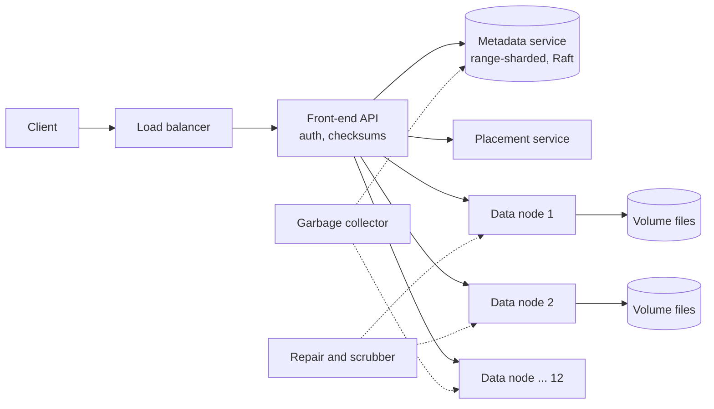
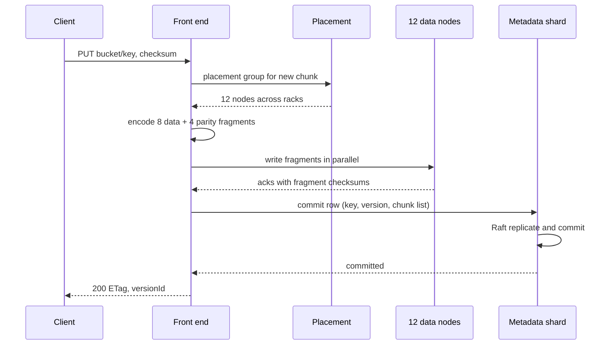

# Design Object Storage (Amazon S3)

| | |
|---|---|
| **Asked at** | Common in infrastructure and storage teams; also asked as "design blob storage" or as a deep dive inside photo and video systems |
| **Difficulty** | Hard |
| **Core challenges** | metadata at scale, durability vs cost, large uploads, listing by prefix |
| **Related building blocks** | [`src/consistent-hash-ring`](../src/consistent-hash-ring/), [`src/merkle-tree`](../src/merkle-tree/), [`src/bloom-filter`](../src/bloom-filter/) |

Concepts: [CDN and blob storage](../fundamentals/cdn-and-blob-storage.md), [replication](../fundamentals/replication.md), [sharding and partitioning](../fundamentals/sharding-and-partitioning.md), [consistency models](../fundamentals/consistency-models.md). Related problem: [file storage and sync](./file-storage-sync.md).

## 1. Requirements

### Functional
1. Buckets: create, delete, list; each bucket has an owner and access policy.
2. Objects: `PUT`, `GET` (with byte ranges), `HEAD`, `DELETE` by bucket and key; objects from 0 B to 5 TB.
3. Multipart upload for large objects: upload parts in parallel, then complete or abort.
4. List objects by prefix with a delimiter (folder-like listing), paginated.
5. Optional versioning per bucket: every overwrite keeps the previous version; delete leaves a delete marker.

### Non-functional
- 100 PB of logical data, ~100 B objects; 100k PUT/s and 1 M GET/s at peak.
- Durability far above availability: design for losing no acknowledged object even with several disks failing at once (S3's stated design target is eleven nines per year).
- Availability 99.99 % for reads; first-byte latency under 100 ms for small objects.
- Strong read-after-write consistency: after a successful `PUT`, a `GET` or `LIST` returns the new object (S3 has offered this since December 2020).
- Storage cost matters: raw disk per logical byte is the main bill.

### Out of scope
- CDN delivery, lifecycle transitions to archival tiers, cross-region replication (mentioned in follow-ups), server-side query (S3 Select style).

## 2. Estimation

| Quantity | Estimate | Implication |
|---|---|---|
| Objects | 100 PB / ~1 MB avg ≈ **100 B objects** | Metadata, not data, is the hard scaling problem |
| Metadata | 100 B × ~1 KB (key, size, ETag, chunk locations, ACL) ≈ **100 TB**, × 3 replicas = 300 TB | Must be a sharded, replicated KV store; cannot be one database |
| Raw disk, 3× replication | 100 PB × 3 = **300 PB** → 15,000 × 20 TB disks | Simple, but triples the bill |
| Raw disk, erasure coding 8+4 | 100 PB × 12/8 = **150 PB** → 7,500 disks | Half the disks of replication; repair reads 8 fragments |
| PUT bandwidth | 100k/s × 1 MB = **100 GB/s** in, × 1.5 EC = 150 GB/s to disk | ~7,500 disks share it: ~20 MB/s each, comfortable |
| GET bandwidth | 1 M/s × 1 MB = **1 TB/s** out | Spread over thousands of nodes; a hot object needs caching or CDN in front |
| Disk failures | ~1-2 % annual failure rate × 7,500 disks ≈ **75-150 failed disks/year**, ~2-3 per week | Repair is continuous background work, not an incident |
| Metadata ops | 1.1 M req/s, each 1-2 metadata lookups | ~100+ metadata shards at ~10-20k ops/s each |

## 3. API

```
PUT    /{bucket}/{key}                  body: bytes, headers: Content-MD5, x-checksum-sha256
  200: ETag: "<md5 or checksum>", x-version-id
GET    /{bucket}/{key}?versionId=...    headers: Range: bytes=0-1048575, If-None-Match
  200 / 206 Partial Content / 304 / 404
HEAD   /{bucket}/{key}
DELETE /{bucket}/{key}?versionId=...    204 (adds a delete marker if versioning is on)

Multipart:
POST   /{bucket}/{key}?uploads                         -> { uploadId }
PUT    /{bucket}/{key}?uploadId=U&partNumber=1..10000  -> ETag of part (parts 5 MB to 5 GB, last may be smaller)
POST   /{bucket}/{key}?uploadId=U                      body: [{ partNumber, ETag }] -> final ETag
DELETE /{bucket}/{key}?uploadId=U                      (abort; parts are garbage-collected)

List:
GET /{bucket}?list-type=2&prefix=photos/2026/&delimiter=/&max-keys=1000&continuation-token=...
  -> { contents: [{ key, size, etag, lastModified }], commonPrefixes: ["photos/2026/01/"], nextContinuationToken }
```

Idempotency: `PUT` of a key is idempotent (the last write wins); part uploads are idempotent per `(uploadId, partNumber)`. The client sends a checksum and the server rejects the object if the received bytes do not match, so a corrupted retry cannot succeed silently. Pagination uses an opaque continuation token that encodes the last key returned. Auth: request signing (HMAC over the canonical request, as in AWS Signature Version 4), bucket policies and ACLs, and pre-signed URLs for time-limited direct access.

## 4. Data model

```
Metadata store (sharded, range-partitioned by (bucket_id, key)):
buckets ( bucket_id, name UNIQUE, owner_id, versioning, policy, region, created_at )

objects (
  bucket_id     BIGINT,
  key           TEXT,             -- up to 1,024 bytes
  version_id    TEXT,             -- time-ordered id; "null" when versioning is off
  is_latest     BOOL,
  is_delete_marker BOOL,
  size          BIGINT,
  etag          TEXT,
  checksum      TEXT,
  storage_class TEXT,
  chunks        LIST<{ chunk_id, offset, length }>,   -- large objects have many chunks
  created_at    TIMESTAMP,
  PRIMARY KEY ((bucket_id, key), version_id DESC)
)

multipart_uploads ( upload_id PK, bucket_id, key, initiated_at, parts: MAP<part_no, {chunk_id, etag, size}> )

Placement map (small, cached everywhere):
chunk_id -> placement group -> [12 data nodes, one per failure domain]

Data node: large append-only volume files (~100 GB) holding many fragments,
           plus an index fragment_id -> (volume, offset, length, crc)
```

Keys: range partitioning on `(bucket_id, key)` keeps keys sorted, which is what makes prefix listing a range scan; hash partitioning would scatter a prefix across every shard. A hot sequential prefix (e.g. keys starting with a date) concentrates writes, so shards split automatically by load. Store choice: metadata in a strongly consistent, range-partitioned KV store (Raft-replicated ranges, as in Spanner, CockroachDB or FoundationDB designs), because read-after-write and listing need ordered, consistent reads. Data lives on plain disks in volume files, because packing small objects into large files avoids one filesystem inode per object (the approach Facebook described for Haystack).

## 5. High-level design



**PUT**: client → front end authenticates the signature → splits the stream into chunks (e.g. 64 MB) → for each chunk, asks placement for a placement group → erasure-codes the chunk into 8 data + 4 parity fragments → writes the 12 fragments to 12 nodes in different failure domains → waits for enough acks (6.2) → commits the metadata row with the chunk list → returns 200. Metadata is committed last, so a crash mid-upload leaves only unreferenced fragments, which the garbage collector removes.

**GET**: front end → metadata lookup for the latest version → for each needed chunk (only those covering the requested range), read the 8 data fragments; if one is slow or missing, read parity fragments and decode → stream bytes to the client, checking checksums.

**LIST**: front end → metadata range scan from `(bucket, prefix)` → if a delimiter is given, collapse keys sharing the next path segment into one `commonPrefix` → return up to 1,000 entries and a token.

## 6. Deep dives

### 6.1 Durability: replication vs erasure coding

Problem: at 7,500+ disks, a few fail every week. Data must survive overlapping failures at the lowest disk cost.

| Scheme | Raw bytes per logical byte | Failures tolerated per chunk | Repair cost for one lost fragment | Read path |
|---|---|---|---|---|
| 3× replication | 3.0× | 2 | Copy 1 replica (1× chunk size) | Read any 1 replica |
| Erasure coding 8+4 (Reed-Solomon) | 1.5× | 4 | Read 8 fragments, recompute (8× fragment size) | Read 8 of 12, CPU to decode on failure |
| 6+3 | 1.5× | 3 | Read 6 fragments | Read 6 of 9 |

**Choice:** erasure coding 8+4 for data at rest, placed so all 12 fragments are in different racks (or spread over availability zones). It halves disk cost versus replication and tolerates more simultaneous losses. Its costs are higher repair bandwidth and CPU, and a small-object penalty: fragmenting a 4 KB object into 12 pieces is wasteful, so objects under ~1 MB are either replicated 3× or packed together with other small objects into one coded chunk. Durability depends as much on repair speed as on the code: the window between a failure and its repair is when further failures hurt, so repair is parallel across many nodes and prioritises chunks that have lost the most fragments.

### 6.2 Write path and consistency

Problem: a PUT must be durable when acknowledged, and a GET right after must see it, even though data and metadata live on different machines.

Approach: write data first, metadata second.
1. Fragments are written to 12 nodes; the front end waits for all 12, or for at least 10 with the remaining ones handed to repair. A chunk is never acknowledged with fewer than the fragments needed to survive a further failure.
2. The metadata row is written through the Raft-replicated metadata shard. The commit of that row is the linearization point: before it, the object does not exist; after it, every read through the metadata service sees it.
3. Overwrites write a new version row; the old chunks become garbage once no version references them.

Because all reads go through the strongly consistent metadata service, there is no eventual-consistency window for `GET` or `LIST`. The cost is that metadata shards must be highly available; this is why they use consensus rather than async replication.



### 6.3 Multipart upload and large objects

Problem: a 2 TB upload over one connection takes hours and must restart from zero on any failure.

Multipart: the client starts an upload, sends parts (5 MB to 5 GB, up to 10,000 parts, so up to 5 TB) in parallel and in any order, retries only failed parts, then calls complete with the ordered list of part ETags. Each part is stored as its own chunks; completion writes one metadata row whose chunk list concatenates the parts', so completion does not copy data. The final ETag is not an MD5 of the whole object (S3 uses a hash of the part hashes with a `-N` suffix), which is why clients should verify with per-part or full-object checksums. Abandoned uploads hold disk until aborted, so a lifecycle rule aborts uploads older than N days.

### 6.4 Prefix listing and metadata partitioning

Options:
1. **Hash partition by `(bucket, key)`.** Even load, but listing a prefix fans out to every shard and merges results.
2. **Range partition by `(bucket, key)`.** Listing is one ordered scan, often on one shard. Sequential keys (timestamps, incrementing ids) create a hot shard at the tail.
3. **Separate listing index** updated asynchronously. Cheap writes, but lists become eventually consistent.

**Choice:** range partitioning with automatic split by size and load, as Bigtable-style systems do. When a range gets hot, split it; when traffic moves on (yesterday's date prefix), merge. Guidance to customers to spread hot prefixes still helps during the seconds before a split. Delimiter handling skips ahead: after returning `commonPrefix photos/2026/01/`, the scan seeks to the first key after that prefix instead of reading every key under it.

### 6.5 Garbage collection, versioning and scrubbing

- **Garbage**: fragments become garbage when an overwrite or delete removes the last metadata reference, or when a PUT crashes before its metadata commit. A GC job compares chunk ids on data nodes against chunk ids referenced by metadata, and deletes unreferenced fragments only if they are older than a grace period (e.g. 24 h), so an in-flight upload's fragments are not removed before its commit. Deleted fragments leave holes in volume files; volumes with much garbage are compacted by copying live fragments to a new volume.
- **Versioning**: a `DELETE` without a version id adds a delete marker as the latest version; `GET` then returns 404 while old versions remain readable by id. Deleting a specific version removes that row. Lifecycle rules expire non-current versions after N days.
- **Scrubbing**: data nodes continuously re-read fragments and verify CRCs, because bit rot is silent; corrupt fragments are rebuilt from the others. Merkle-style hashes per volume make cross-checking a node's inventory against metadata cheap ([`src/merkle-tree`](../src/merkle-tree/)).

## 7. Scaling and operations

- **Partitioning**: metadata ranges split and move by load; data placement uses placement groups (a fixed set of 12 nodes in distinct failure domains) so the map stays small and repair of one node spreads across many groups.
- **Replication**: metadata via Raft across 3 or 5 zones; data via erasure coding across racks or zones. Cross-region replication is an async copy driven by a change log.
- **Caching**: metadata for hot objects is cached in front ends with invalidation on write; hot object bytes are cached in a read cache tier or a CDN. Small objects can be served from replicas.
- **Failure modes**: disk loss → background rebuild of affected fragments; node loss → reads decode from parity, rebuild prioritised; rack or zone loss → still readable if no more than 4 fragments per chunk were in it; metadata shard leader loss → Raft election, writes to that range pause for seconds; GC bug → the most dangerous failure, so GC deletes are delayed, logged and rate-limited.
- **Monitoring**: chunks by number of missing fragments (any chunk at 4 missing is a page), repair queue age, disk failure rate, metadata p99 per shard, hot range splits, 5xx and first-byte latency, scrubber coverage (days since each fragment was verified).
- **Security**: signed requests, bucket policies with deny-by-default, block public access settings, encryption at rest (per-object data keys wrapped by a key management service), TLS in transit, audit logs for every access.

## 8. Trade-offs summary

| Decision | Chosen | Alternative | Why |
|---|---|---|---|
| Redundancy | Erasure coding 8+4, replicate small objects | 3× replication everywhere | 1.5× vs 3× disk with better failure tolerance |
| Metadata store | Range-partitioned, Raft-replicated KV | Hash-partitioned eventually consistent KV | Strong read-after-write and single-range listing |
| Commit order | Data first, metadata commit last | Metadata first | A crash leaves garbage, never a dangling pointer |
| Small objects | Pack into large volume files | One file per object | Avoids filesystem inode and seek overhead |
| Large objects | Multipart with parallel parts | Single stream | Parallel, resumable, bounded retry cost |
| Deletion | Async GC with a grace period | Synchronous delete of fragments | Fast deletes, safe against in-flight uploads |

## 9. Follow-up questions interviewers ask

- *"How do you compute durability for 8+4?"* A chunk is lost only if 5 of its 12 fragments are lost before repair. Model it from the disk failure rate and the repair time: halving repair time cuts the chance of overlapping failures sharply, which is why parallel repair matters as much as the code.
- *"How would you add cross-region replication?"* Emit a change event per committed metadata write; a replicator copies the object to the destination bucket and writes its metadata there. It is async, so the destination lags by seconds to minutes.
- *"How do you serve a single object read 100k times a second?"* Its fragments live on 12 nodes; put a cache tier or CDN in front and serve from cached full copies.
- *"Why not store objects as files in a distributed filesystem?"* Billions of small files overwhelm filesystem metadata; object storage needs only key-based access, so a flat namespace with its own metadata store scales further.
- *"How does conditional write work?"* `If-None-Match: *` or `If-Match: <etag>` is checked inside the metadata commit transaction, so two concurrent writers cannot both succeed.
- *"How do you migrate data off a failing rack?"* Mark its nodes read-only, rebuild or copy their fragments to other placement groups at a throttled rate, update chunk locations, then decommission.
