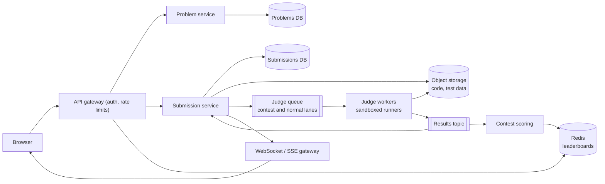
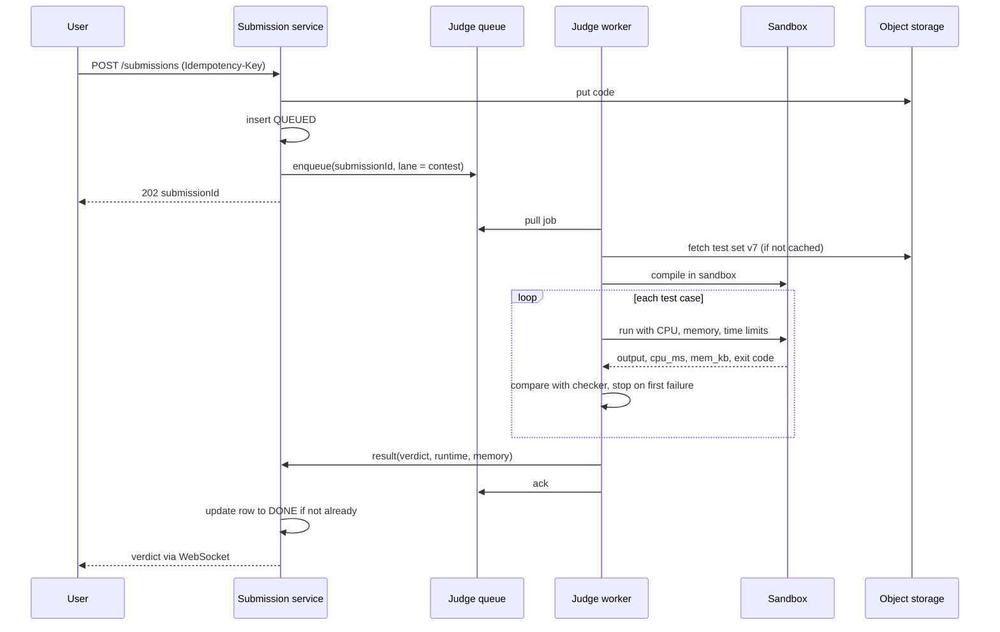

# Design an Online Judge (LeetCode, Codeforces)

| | |
|---|---|
| **Asked at** | Common at developer-tools and education companies, and as a general problem about running untrusted code |
| **Difficulty** | Medium to Hard |
| **Core challenges** | sandboxing untrusted code, queue-based execution, contest spikes, live leaderboard |
| **Related building blocks** | [`src/rate-limiter-algorithms`](../src/rate-limiter-algorithms/), [`src/idempotency-store`](../src/idempotency-store/), [`src/lease-lock`](../src/lease-lock/) |

## 1. Requirements

### Functional
1. Browse a catalog of problems (statement, examples, constraints, tags, difficulty).
2. Submit code in one of ~20 languages; the system compiles it, runs it against hidden test cases and returns a verdict: Accepted, Wrong Answer, Time Limit Exceeded, Memory Limit Exceeded, Runtime Error or Compilation Error, with runtime and memory.
3. "Run" code against the examples or custom input without a full judgement.
4. Contests: a fixed set of problems for a time window, with a live leaderboard ranked by solved count and penalty time.
5. Submission history per user and per problem.

### Non-functional
- Scale: 3 M submissions per day normally; weekly contests with 50k participants.
- Latency: verdict for a typical submission within 5 s; during contest peaks within 30 s.
- Isolation: user code must not reach the network, other submissions, the host or our infrastructure, and must not exceed CPU, memory, time or output limits.
- Fairness: runtime measurements comparable across workers (same hardware class, limits measured as CPU time).
- Availability: 99.9 %; during a contest, submissions must never be lost even if judging is delayed.

### Out of scope
- Writing problems and test data (an admin tool), discussion forums, editorial content, interactive problems beyond a note, payments.

## 2. Estimation

| Quantity | Estimate | Implication |
|---|---|---|
| Normal submissions | 3 M / 86,400 s ≈ **35/s**, plus ~2× that in "Run" requests | Steady load fits a modest worker pool |
| Work per submission | ~50 test cases, ~2 s of CPU total including compile | 35/s × 2 s ≈ **70 cores** busy on average; ~200 cores with Run traffic and headroom |
| Contest peak | 50k contestants; in the first 15 minutes many submit the easy problem: ~20k submissions in 5 min ≈ **70/s**, end-of-contest rush up to **300/s** | 300/s × 2 s = **600 cores** for the peak; scale out workers ahead of the scheduled start |
| Submission records | 3 M × 2 KB metadata = **6 GB/day**; code itself ~5 KB → 15 GB/day | Relational DB for metadata, code in object storage or a large text column; ~8 TB/year total |
| Test data | 3,000 problems × ~50 MB average = **150 GB** | Store in object storage; workers cache the hot problems on local SSD |
| Leaderboard | 50k contestants × ~50 B in a sorted set = **2.5 MB** | One Redis sorted set per contest; reads are cheap |

## 3. API

```
GET  /v1/problems?tag=dp&difficulty=medium&cursor=..
GET  /v1/problems/{slug}                      statement, examples, limits, languages

POST /v1/submissions                          headers: Idempotency-Key
  body: { problemSlug, language, code, contestId? }
  202: { submissionId, status: QUEUED }
GET  /v1/submissions/{id}                     { status: QUEUED|RUNNING|DONE, verdict?, runtimeMs?, memoryKb?, failedTest? }
WS   /v1/submissions/{id}/events              status changes until DONE
GET  /v1/users/me/submissions?problem=..&cursor=..

POST /v1/runs                                 body: { problemSlug, language, code, stdin }   (examples / custom input)

GET  /v1/contests/{id}/leaderboard?page=1     top N, paginated
GET  /v1/contests/{id}/leaderboard/me         my rank and neighbours
```

Submissions are asynchronous: the API returns `202` with an id and the client polls or listens for the verdict. `Idempotency-Key` stops a double-click from creating two submissions (which in a contest could cost penalty time). Code size is capped (64 KB). Rate limits: a few submissions per minute per user per problem, stricter for `/runs`. Hidden test data is never returned; for a failed test the response shows only the test number (and the input only for public examples).

## 4. Data model

```
problems (problem_id PK, slug UNIQUE, title, statement_md, difficulty, tags[],
          time_limit_ms, memory_limit_mb, test_set_version, checker_type)
test_sets (problem_id, version, object_key, sha256, case_count)      -- files in object storage

submissions (
  submission_id  BIGINT PRIMARY KEY,        -- Snowflake id
  user_id        BIGINT NOT NULL,
  problem_id     BIGINT NOT NULL,
  contest_id     BIGINT NULL,
  language       TEXT NOT NULL,
  code_ref       TEXT NOT NULL,             -- object storage key
  status         TEXT NOT NULL,             -- QUEUED, RUNNING, DONE
  verdict        TEXT NULL,
  runtime_ms, memory_kb INT NULL,
  failed_test    INT NULL,
  created_at     TIMESTAMPTZ NOT NULL
)
INDEX submissions(user_id, problem_id, created_at DESC)
INDEX submissions(contest_id, created_at)

contest_scores (contest_id, user_id, solved, penalty_s, per_problem JSON, PRIMARY KEY (contest_id, user_id))
-- Redis: leaderboard:{contestId} sorted set, member = user_id, score = encoded (solved, penalty)
```

Store choice: problems and submissions are relational (filters, history queries, joins for admin tools), and the write rate (35-300/s) is easy for one sharded Postgres cluster partitioned by `submission_id`. Code and test data are blobs, so they go to object storage with references in the database. The live leaderboard is a Redis sorted set because rank queries must be fast during a contest; `contest_scores` in the database is the durable record it can be rebuilt from.

## 5. High-level design



**Submit**: the submission service stores the code in object storage, inserts a `QUEUED` row and publishes a job (`submissionId`, language, problem, test set version) to the judge queue, then returns 202. A judge worker takes the job, fetches the code and the test set (usually from its local cache), compiles and runs it in a sandbox against each test, and publishes the verdict. The submission service updates the row and pushes the result to the user's open connection.

**Contest**: the same path, with jobs going to a separate high-priority queue lane. The scoring service consumes contest verdicts, updates `contest_scores` and the Redis sorted set, and the leaderboard API reads ranks from Redis.

## 6. Deep dives

### 6.1 Sandboxing untrusted code

Problem: users submit arbitrary programs. They can try fork bombs, infinite loops, huge allocations, reading `/etc`, opening sockets, or exploiting the kernel. The judge must contain all of these and still measure time fairly.

| Option | Isolation | Start-up cost | Notes |
|---|---|---|---|
| Containers (namespaces + cgroups) with a seccomp syscall filter | Shares the host kernel; seccomp shrinks the attack surface | Tens of milliseconds | The baseline: cgroups cap memory and CPU, PID limit stops fork bombs, no network namespace |
| gVisor | A user-space kernel intercepts syscalls, so the host kernel sees few of them | Low, container-like | Stronger than seccomp alone; some syscall-heavy programs run slower |
| Firecracker microVMs | Hardware virtualisation, separate guest kernel | Around a hundred milliseconds or less to boot, small memory overhead | Strongest isolation; pool pre-booted VMs and reuse after resetting |

**Choice:** a container per submission run under gVisor (or a microVM per worker slot where stronger isolation is required), always with these limits:

- No network: the sandbox has no network interface besides loopback.
- Read-only root filesystem with the language toolchain; a small tmpfs as the only writable path; output size capped (e.g. 64 MB).
- cgroup memory limit at the problem's limit (plus a margin for the runtime); exceeding it is reported as Memory Limit Exceeded.
- CPU time limit per test measured from the cgroup, plus a wall-clock limit at 2-3× to catch programs that sleep or block; one CPU core pinned per run for fair timing.
- PID limit (e.g. 64) against fork bombs; run as an unprivileged user; drop all capabilities.

Compilation runs in the same kind of sandbox, because compilers can be abused too (huge template expansions, includes of `/dev/random`). Workers are themselves on isolated hosts with no access to internal services other than the queue and object storage.

### 6.2 Submission flow and queueing

Problem: judging takes seconds and load spikes 10× during contests. The API must not block, and no submission may be lost.

Options:

1. **Synchronous**: the API runs the code and responds. Ties request threads up for seconds and fails under spikes.
2. **Queue with competing workers**: the API enqueues; workers pull jobs, ack after publishing the result. A crashed worker's job is redelivered after its visibility timeout.
3. **Queue with priority lanes**: separate lanes (contest, normal submit, run) with workers reserved per lane.

**Choice:** option 3. Contest submissions get a reserved share of workers so free-practice traffic cannot delay them; "Run" requests get the lowest priority and are dropped with a "try again" when the lane is full. Jobs are idempotent: judging the same `submissionId` twice gives the same verdict and the result handler updates the row only if it is not already `DONE`. See [message queues and streams](../fundamentals/message-queues-and-streams.md).



### 6.3 Test case storage and checking

Test sets are versioned files in object storage (`problem_id/v7/{1..50}.in, .out`), referenced by the problem row. Workers keep an LRU cache of test sets on local SSD keyed by `(problem_id, version)` and verify the SHA-256 on download; contest problems are pre-loaded onto workers before the start. Output comparison uses a checker per problem: exact match, token match ignoring whitespace, floating-point tolerance, or a custom checker program (itself sandboxed) for problems with many correct answers. Updating a test set creates a new version, so in-flight judgements keep using the version they started with.

### 6.4 Result delivery

Options: client polling every 1-2 s, Server-Sent Events, or WebSocket. **Choice:** WebSocket or SSE from a push gateway, with polling as the fallback. Polling 50k contestants every 2 s is 25k requests/s of mostly "still queued" answers; push sends one message per state change. Status responses for polling are cheap reads from a cache, so the fallback is still safe. See [realtime communication](../fundamentals/realtime-communication.md).

### 6.5 Contest mode and the live leaderboard

Ranking is by problems solved (descending), then penalty time (ascending): time from contest start to each accepted solution plus a fixed penalty per wrong attempt before it. Encode it as one sorted-set score, for example `score = solved × 10^9 - penalty_seconds`, so `ZREVRANGE` gives the ranking and `ZREVRANK` gives a user's position in O(log n). The scoring service applies each contest verdict to `contest_scores` in a transaction (only the first Accepted per problem counts), then updates Redis. Leaderboard pages are cached for 5-10 s, since 50k viewers refreshing would otherwise hit Redis directly. Many contests freeze the public board in the last hour and reveal it at the end. See the [leaderboard design](./leaderboard.md) for ranking at larger scale.

## 7. Scaling and operations

- **Contest spikes**: contests are scheduled, so pre-scale the worker pool (and pre-warm microVM pools and test caches) 15 minutes before the start; autoscale on queue depth and age of the oldest job after that.
- **Partitioning**: submissions DB sharded by `submission_id`, with the `(user_id, problem_id)` index on each shard plus a per-user read model for history; leaderboards one sorted set per contest, which at 2.5 MB never needs splitting.
- **Replication**: DB primary with synchronous standby; Redis leaderboard with a replica and rebuildable from `contest_scores`; the queue replicated so an acknowledged submission is never lost.
- **Failure modes**: worker crash → job redelivered after the visibility timeout; sandbox escape attempt or kernel error → worker host is drained and replaced; queue backlog during a contest → users see `QUEUED` with position, and contest timing uses submission time, not judge time, so delays do not cost penalty; Redis down → rebuild from the database at the end, leaderboard temporarily stale.
- **Monitoring**: queue depth and oldest job age per lane, verdict latency p50 and p99, worker utilisation, sandbox kills by reason, timing variance of a reference solution run every few minutes on each worker (detects noisy hardware).
- **Plagiarism detection**: after a contest, compare accepted solutions per problem with a token-based similarity method (normalise identifiers, then fingerprint with winnowing as MOSS does) and flag pairs above a threshold for human review. It runs offline, never on the judging path.

## 8. Trade-offs summary

| Decision | Chosen | Alternative | Why |
|---|---|---|---|
| Execution model | Async queue with priority lanes | Synchronous run in the API | Absorbs spikes, contest traffic isolated from practice |
| Sandbox | gVisor containers, microVMs where needed | Plain containers | Untrusted code; shrink the shared-kernel attack surface |
| Time limit | CPU time per test plus wall-clock cap | Wall-clock only | Fair across noisy hosts; still catches sleeping programs |
| Test data | Versioned blobs, cached on worker SSD | Read from DB per run | Large files, read-heavy, immutable per version |
| Result delivery | WebSocket/SSE with polling fallback | Polling only | One message per change instead of thousands of empty polls |
| Leaderboard | Redis sorted set, DB as record | SQL `ORDER BY` per request | O(log n) rank lookups under contest load |

## 9. Follow-up questions interviewers ask

- *"How do you make runtime measurements fair?"* Same instance type for all workers, one pinned core per run, CPU time from cgroups rather than wall-clock, and run each test more than once only if close to the limit.
- *"What if a worker dies halfway through a submission?"* The job was not acked, so it is redelivered to another worker after the visibility timeout; the result handler ignores a second result for a `DONE` submission.
- *"How do you support interactive problems?"* Run the user's program and a judge-provided interactor in the same sandbox group connected by pipes, each with its own limits.
- *"How do you handle a contest with 200k participants?"* The leaderboard set is still small (10 MB); the challenge is judging capacity, so pre-scale more workers, cache test data everywhere, and shed "Run" traffic first.
- *"Why not run all tests in parallel to speed up the verdict?"* You can, across cores within one submission, but it uses more workers per submission during peaks and complicates "stop at first failure". Parallelise only when the queue is short.
